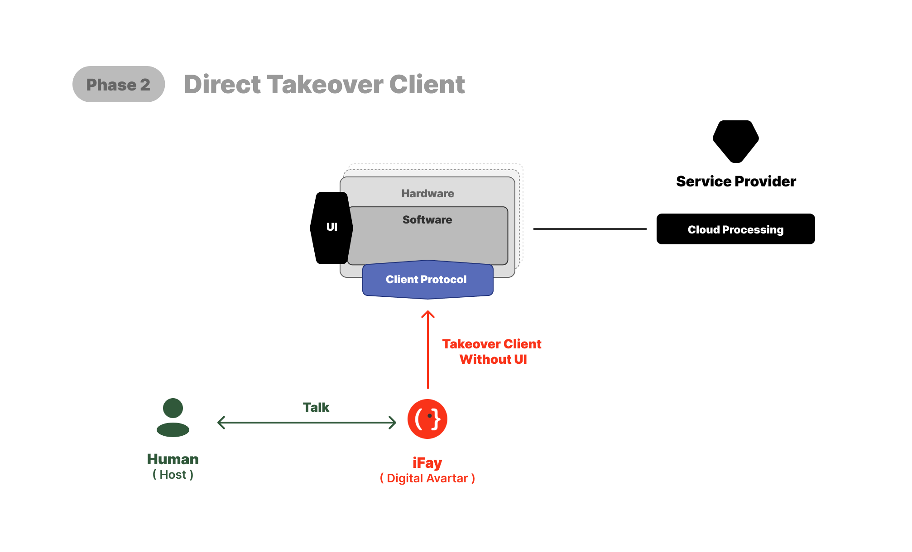
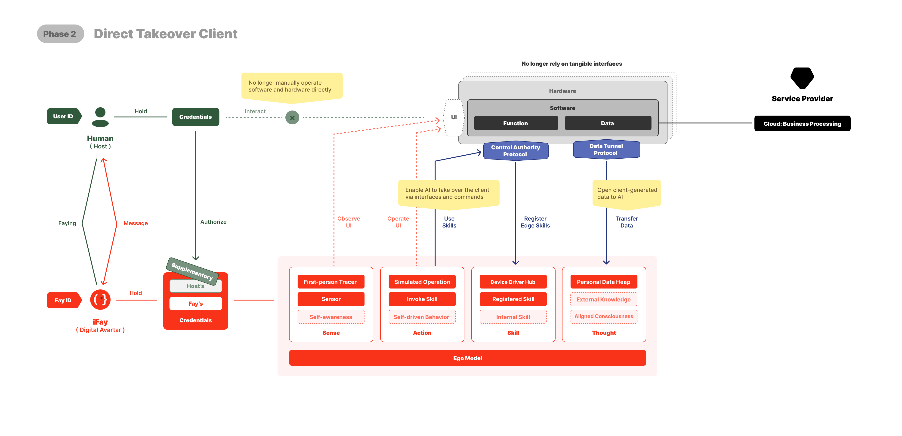

# Phase 2: Abgeleitete Übernahme von Endgeräten durch iFay

Nachdem Phase 1 die minimale Vertragsform „Human Prime ↔ iFay" stabilisiert hat, wendet sich Phase 2 der Beziehung zwischen iFay und Endgeräten zu.

Endgerät ist hier in einem verallgemeinerten Sinn gemeint — eine Drohne, ein Roboter, ein intelligentes Fahrzeug, ein IoT-Gateway, ein Personal Computer, ein Telefon gehören alle zu dieser Klasse. Ihr gemeinsames Merkmal: Hardware, die angetrieben werden kann, physische Handlungen, die initiiert werden können, und physische Folgen, die daraus resultieren können.

Der Schlüssel in Phase 2 ist nicht, einen iFay mehr Dinge kontrollieren zu lassen; er besteht darin, jedes übernommene Endgerät klar in die Faying-Verantwortungskette einzuschreiben.

## Abgeleitet, nicht direkt

Phase 2 führt „Human Prime ↔ Endgerät" nicht als direkte Beziehung ein. Ihre Erweiterungsweise ist mittelbar:

> **Das Endgerät tritt durch den iFay des entsprechenden Human Prime in den Faying State ein.**

Das verantwortliche Ende ist nach wie vor der Human Prime; daran ändert sich nichts. Der iFay ist nach wie vor die Entität, die den Faying State trägt, übernimmt aber zusätzlich eine Pflicht — als Verwahrer für die von ihm übernommenen Endgeräte zu fungieren. Das Endgerät steht nicht eigenständig im Faying State; sein „Sich-im-kontrollierten-Zustand-Befinden" leitet sich vom Faying State des iFay ab, dem es derzeit zugehört.

Um die in Kapitel 12 eingeführte Analogie fortzuführen — Jack übergibt das Lenkrad an einen KI-Fahrer — kümmert sich Phase 2 darum: Wenn dieser KI-Fahrer anschließend das Auto fährt, abbiegt, bremst und die Spur wechselt, wie jeder „Kontrollzustand" von Lenkrad, Gas und Blinker stets konsistent damit bleibt, ob Jack noch unter Aufsicht steht.

## Drei Kernthemen

**Sichtbarkeit der Übernahme**: Wenn ein iFay ein Endgerät übernimmt, muss dies vom Human Prime und von außen in Echtzeit beobachtbar sein — welches Endgerät, in welchem Zeitfenster, von welchem iFay übernommen. Dies ist die Erweiterung von Human View auf Endgeräte-Ebene.

**Verkettete Beendigung**: Wenn ein iFay in Rogue Fay übergeht, müssen alle von ihm übernommenen Endgeräte gleichzeitig den abgeleiteten Effekt von Faying verlieren. Es darf nicht erlaubt sein, dass ein Endgerät zuvor nicht abgeschlossene physische Handlungen weiter ausführt, während der iFay die Aufsicht bereits verlassen hat — dies entspricht genau dem Verbot unter D3 in Kapitel 13.

**Irreversibilität physischer Handlung**: Handlungen in der physischen Welt sind stark irreversibel. Eine Drohne hat bereits geliefert, ein Roboterarm hat sich bereits bewegt, ein Fahrzeug ist bereits abgebogen — ein nachträgliches Audit kann das nicht rückgängig machen. Phase 2 muss „lieber nicht handeln als falsch handeln" als Standardvorgabe auf Protokollebene setzen, nicht als nachträgliches Audit-Pflaster.

Der dritte Punkt ist besonders kritisch. In dem Moment, in dem irgendeine Unsicherheit über den Faying State entsteht, fällt das Endgerät standardmäßig auf „passives Warten" zurück, nicht auf „optimistische Ausführung".

## Verhältnis zum Geltungsbereich des aktuellen Zeitraums

**Phase 2 liegt außerhalb des Geltungsbereichs des aktuellen Faying-Protokoll-Designs.** Das Faying Protocol dieses Zeitraums deckt nur Phase 1 ab. Die konkrete Protokollform, mit der „ein iFay durch Faying ein Endgerät abgeleitet übernimmt", in Phase 2 wird in einer separaten Spezifikation definiert, nachdem Phase 1 stabilisiert ist. Dieses Kapitel skizziert die Existenz und Richtung von Phase 2, damit der Missionspfad ein vollständiges Evolutionsbild hat.

Phase 2 ist der erste Schritt, mit dem Faying „zwischen Software" hinaus an die „Software-Physik"-Grenze tritt. Von hier an betreffen Faying-Beziehungen nicht mehr nur Bits, sondern beginnen, die durch Bits angestoßenen physischen Folgen zu betreffen. Diese Tatsache ist die „Schwerkraft", auf die Phasen 3 bis 5 von Zeit zu Zeit zurückblicken müssen.

