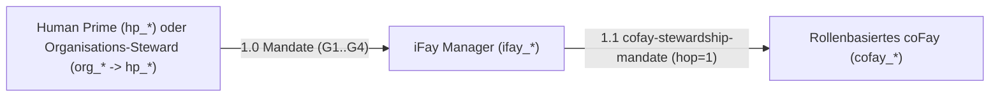

## §1 Überblick und Geltungsbereich

Diese Spezifikation definiert **Faying Protocol/1.1 (`coFay` Delegated Stewardship Profile)**. Sie folgt strikt den Regeln für abwärtskompatible `MINOR`-Erweiterungen in `Faying Protocol/1.0` §1.7.2: Alle Nachrichten, Zustandsautomaten und Fehlercodes von `Faying Protocol/1.0` (`2025-10-25` Final und `schemas/fap-1.0.cddl`) bleiben unverändert. Gegenstellen, die nur `1.0` unterstützen, handeln gemäß §1.7.3 `Faying Protocol/1.0` aus oder ignorieren unbekannte optionale Felder sicher.

Im iFay-Ökosystem (`Fay = iFay + coFay`) ist ein `iFay` fest an einen einzelnen Human Prime gebunden, während ein `coFay` eine rollenbasierte digitale Silizium-Entität auf Basis einer Role Charter ohne persönliche Ego-Replikation ist. Damit **jede externe Aktion einer Silizium-Entität eindeutig einem verantwortlichen Human Prime zugeordnet wird**, ergänzt dieses Profil die Kette `Human Prime ↔ iFay` um ein kryptografisch geprüftes Stewardship-Mandat `iFay Manager → coFay` sowie eine atomare, doppelt signierte Übertragungsautorisierung.

### §1.1 Normative Schlüsselwörter (RFC 2119 & RFC 8174)

Die Schlüsselwörter `MUST`, `MUST NOT`, `REQUIRED`, `SHALL`, `SHALL NOT`, `SHOULD`, `SHOULD NOT`, `RECOMMENDED`, `NOT RECOMMENDED`, `MAY` und `OPTIONAL` in diesem Dokument sind gemäß [BCP 14](https://www.rfc-editor.org/info/bcp14) ([RFC 2119](https://www.rfc-editor.org/rfc/rfc2119) und [RFC 8174](https://www.rfc-editor.org/rfc/rfc8174)) zu interpretieren, sofern sie in Großbuchstaben erscheinen. Bei Abweichungen zwischen Sprachfassungen sind die vereinfachte chinesische Fassung (`zh-CN`) und `schemas/fap-1.1-cofay.cddl` maßgeblich.

---

## §2 Dreistufige Verantwortungszuordnung

Ein `coFay` darf kein Wurzelmandat selbst ausstellen (`MUST NOT`) und keiner anonymen Entität ohne Human-Prime-Verankerung zugeordnet sein (`MUST NOT`). Jedes gültige `cofay-stewardship-mandate` bildet zwingend (`MUST`) eine dreistufige Verantwortungskette:

1. **Verantwortungsanker (`steward_entity` + `accountable_human_prime`)**: Bei persönlicher Verwaltung (`hp_*`) identisch mit `accountable_human_prime`; bei Organisationsverwaltung (`org_*`) `MUST` ein verantwortlicher `accountable_human_prime` (`hp_*`) angegeben sein (sonst Ablehnung mit `1010 E_HUMAN_WITNESS_REQUIRED`).
2. **Verwaltender Agent (`manager_fay_id`)**: `MUST` ein `ifay_*` mit aktivem `Faying Protocol/1.0`-Mandat sein; ein `cofay_*` `MUST NOT` als Aussteller auftreten.
3. **Ausführendes Subjekt (`subject_cofay_id`)**: `MUST` ein durch `charter_id` gebundenes `cofay_*` sein, dessen Konformität über `coFACTS` (getrennt von `iFACTS` für `iFay`) geprüft wird.

---

## §3 Vier Sicherheitsinvarianten gegen Rechteausweitung (Normative)

Prüfer eines `cofay-stewardship-mandate` `MUST` folgende vier Invarianten in dieser Reihenfolge durchsetzen:

1. **Kaskadierender Nothalt bei `G0` oder Widerruf (`safe-state-halt`)**: Befindet sich der vorgelagerte Human Prime oder `iFay`-Manager in `G0` (`EmergencyOverride`) oder `Revoked`, `MUST` das `coFay` sofort in `safe-state-halt` wechseln und `1024 E_UPSTREAM_EMERGENCY_HALT` liefern; zwischengespeicherte Aufrufe an Host-Geräte oder externe Skills sind untersagt (`MUST NOT`).
2. **Ein-Hop-Obergrenze**: `hop_count == 1` und `max_stewardship_hops == 1` sind zwingend (`MUST`); Weiterdelegation durch `coFay` wird mit `1023 E_STEWARDSHIP_HOP_LIMIT` abgewiesen.
3. **Monotone Stufenbegrenzung**: `grade <= manager_grade` (`0..4`) ist zwingend (`MUST`); Überschreitungen scheitern mit `1021 E_GRADE_AMPLIFICATION`.
4. **Doppelte Bereichs- und Zeitfensterkonvergenz**: `scope` (`domains`, `actions`, optionale `terminals` und Budgets) `MUST` Teilmenge von `charter_scope` und `manager_scope` sein; `[not_before, not_after]` `MUST` innerhalb von `[manager_not_before, manager_not_after]` liegen (sonst `1022 E_SCOPE_ESCAPE`).

---

## §4 Atomare, doppelt signierte Übertragung (`cofay-transfer`)

Bei Rollenwechseln oder Organisationsübergängen `MUST` ein Stewardship-Wechsel atomar über `cofay-transfer-authorization` erfolgen:

- **Domänengetrennte JCS-Signatur**: Sowohl `from_steward` als auch `to_steward` `MUST` die UTF-8-Präfixkette `"ifay.faying.cofay-transfer.v1:"` gefolgt von der RFC-8785-JCS-Serialisierung des unsignierten Objekts kryptografisch signieren.
- **Atomare Annahmekriterien**: Selbstübertragungen (`from_steward == to_steward`), abgelaufene Zeitfenster oder ungültige Kennungen scheitern mit `1026 E_TRANSFER_WINDOW_OR_PARTY_INVALID`; fehlt oder scheitert eine der beiden Signaturen, wird die Übertragung mit `1025 E_TRANSFER_DUAL_SIG_REQUIRED` verworfen. Die Historie auf der GMChain bleibt durchgängig prüfbar; MeriToken (`μ`) bleibt strikt nicht-monetär.

---

## §5 Normative Schemata, Fehlercodes und Testvektoren

| Code | Fehlername | Auslöser | Laufzeitaktion |
| --- | --- | --- | --- |
| `1010` | `E_HUMAN_WITNESS_REQUIRED` | Fehlender gültiger `accountable_human_prime`-Anker | Mandat ablehnen |
| `1021` | `E_GRADE_AMPLIFICATION` | `grade > manager_grade` oder ungültige Stufe | Mandat ablehnen |
| `1022` | `E_SCOPE_ESCAPE` | `scope` oder Zeitfenster außerhalb `charter_scope ∩ manager_scope` | Mandat ablehnen |
| `1023` | `E_STEWARDSHIP_HOP_LIMIT` | `hop_count != 1` oder Weiterdelegation ohne `ifay_*` | Mandat ablehnen |
| `1024` | `E_UPSTREAM_EMERGENCY_HALT` | Vorgelagerter Status ist `G0` oder `Revoked` | `safe-state-halt` |
| `1025` | `E_TRANSFER_DUAL_SIG_REQUIRED` | Fehlende oder ungültige Signatur einer Partei | Übertragung abbrechen |
| `1026` | `E_TRANSFER_WINDOW_OR_PARTY_INVALID` | Selbstübertragung, abgelaufenes Zeitfenster oder ungültige ID | Übertragung ablehnen |

- **Maßgebliches CDDL-Schema**: `schemas/fap-1.1-cofay.cddl`
- **JSON-Schema-Sicht**: `schemas/fap-1.1-cofay.json`
- **Sprachübergreifende Testvektoren**: `vectors/cofay-stewardship-v1.1.json` (`V01`–`V10`, verifiziert in TypeScript und Rust).
