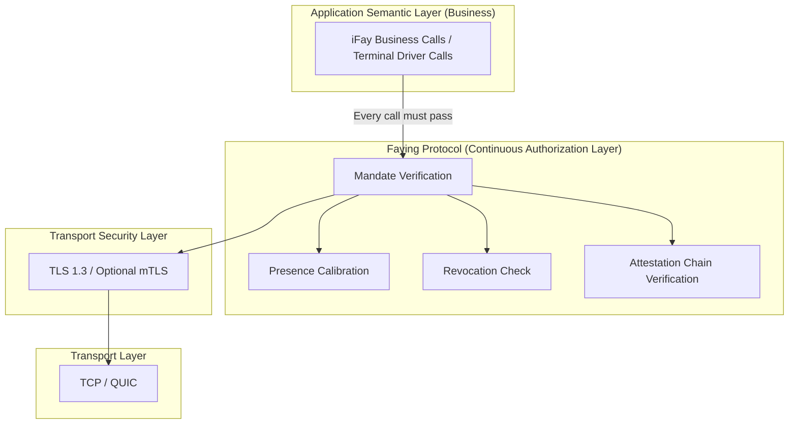
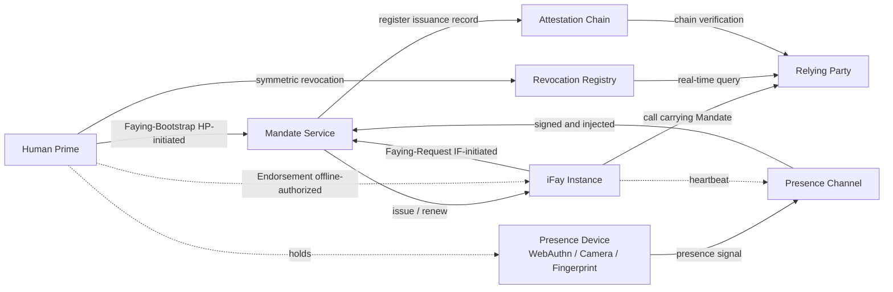
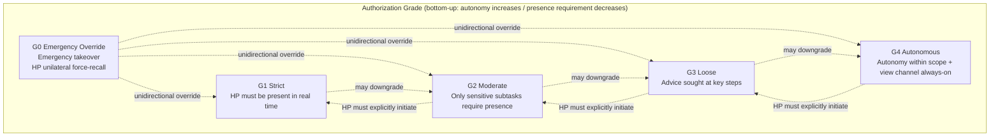
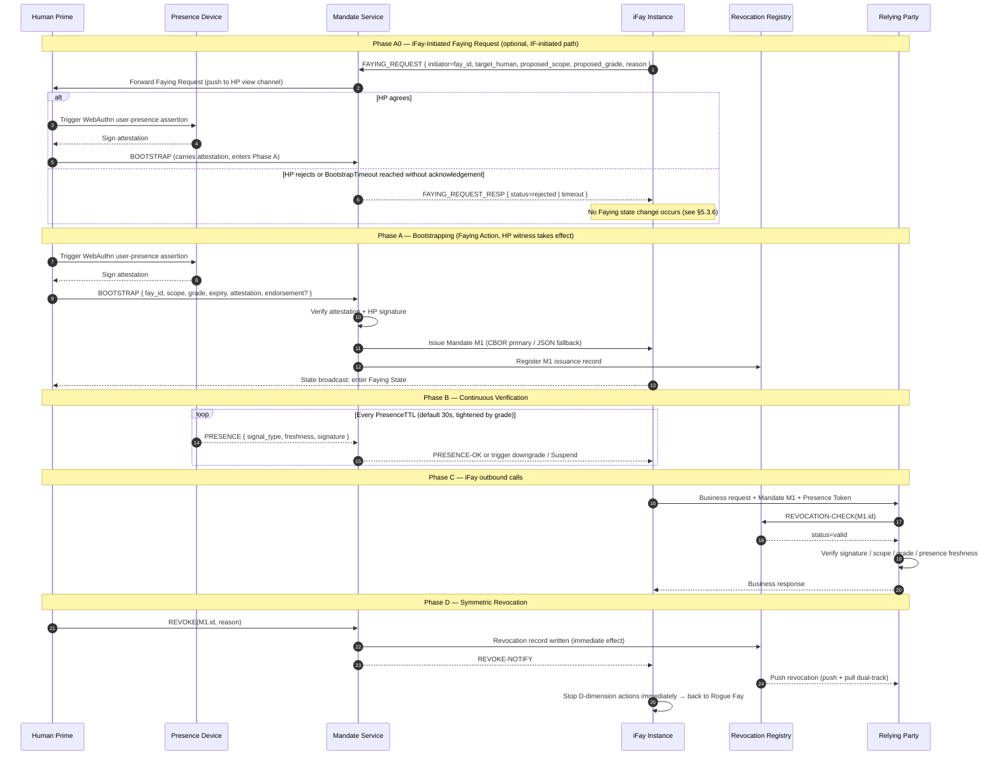

> Protokolltext-Navigation: [Inhaltsverzeichnis](./README.md) | vorheriges [§1 Überblick](./01-Ueberblick.md) | nächstes [§3 Komponenten und Schnittstellen](./03-Komponenten-und-Schnittstellen.md)

## §2 Architektur

Dieses Kapitel gibt die architektonische Gesamtsicht des Faying Protocol auf der Protokollebene wieder:

- **§2.1 Position im Protokoll-Stack**: charakterisiert die Schichtposition des Faying Protocol oberhalb von TLS 1.3 und unterhalb der Geschäftssemantik und macht die harte Bedingung „jede ausgehende Aktion einer iFay muss das Mandate-Verifikationstor passieren“ ausdrücklich;
- **§2.2 Entitätsbeziehungen**: zählt die 7 Entitätsklassen, die das Protokoll umfasst, und ihre Verantwortungsgrenzen auf und gibt die bidirektionalen Faying-Kanten (HP-initiiert / IF-initiiert) sowie die Offline-Endorsement-Kante (Endorsed Mandate) an;
- **§2.3 Hierarchie der Autorisierungsstufen**: stellt das Stufenspektrum und die Wechselrichtungen für die fünf Stufen G0–G4 entlang der beiden Dimensionen Autonomie / Präsenzanforderung dar;
- **§2.4 Kern-Interaktionssequenz**: fügt BOOTSTRAP (einschließlich des IF-initiierten Pfads Phase A0) + kontinuierliche Verifikation + Aktion + symmetrischen Widerruf zu einer einzigen End-to-End-Sequenz zusammen und dient als visueller Anker für spätere Kapitel (§5 Nachrichten / §7 Stufen / §8 Lebenszyklus / §10 Fehlerbehandlung);
- **§2.5 Entwurfsprinzipien**: nennt die 6 Entwurfsprinzipien, die die Protokollebene stets befolgen muss (Default-Deny / Least-Privilege / Continuous-Verification / Auditable-by-Construction / Human-Override / Graceful-Degradation).

> **Hinweis zur EARS-Rückverfolgbarkeit**: Jeder harten Bedingung auf Architekturebene in diesem Kapitel folgt eine `Trace:`-Zeile, die die zugehörigen EARS-Teilklausel-IDs (aus der Anforderungsbasis) in der Form `R<requirement>.<criterion>.<clause>` auflistet.
>
> **Terminologie-Abgleich**: Die in diesem Kapitel auftauchenden Entitätsnamen (Human Prime / iFay Instance / Presence Device / Mandate Service / Presence Channel / Attestation Chain / Revocation Registry / Relying Party usw.) stimmen vollständig mit der Terminologie-Abgleich-Kurzreferenz in Anhang A überein; wann immer dieses Kapitel und Anhang A in der Terminologie mehrdeutig erscheinen, ist **Anhang A maßgeblich**.

### §2.1 Position im Protokoll-Stack

**Entwurfshaltung**: Das Faying Protocol ersetzt weder TLS noch erfindet es OAuth neu; es sitzt oberhalb von TLS und unterhalb der Geschäftssemantik und erzwingt, dass **jede ausgehende Aktion einer iFay** das Mandate-Verifikationstor passiert. Jeder ausgehende Aufruf, der das Faying-Protocol-Tor umgeht, gilt als Rogue Action und muss von einer Middleware abgewiesen werden, die oberhalb der Transportschicht und unterhalb der Geschäftsschicht angesiedelt ist.

**Harte Bedingungen auf Protokollebene**:

- **A-Stack-1 (jeder Aufruf muss die Vier-Element-Verifikation passieren)**: Bevor eine Relying Party einen einzelnen ausgehenden Aufruf einer iFay Instance akzeptiert, muss sie der Reihe nach Mandate-Verifikation / Präsenzkalibrierung / Widerrufsprüfung / Attestation-Chain-Verifikation vollständig durchführen — alle vier; fehlt auch nur eine, gilt der Aufruf als torumgehende Rogue Action und wird per Default-Deny abgewiesen.
  - **Trace**: `R2.1.1` (kein Mandate → Default-Deny), `R2.1.2` (Umfangsprüfung), `R2.1.3` (fehlendes Feld → Ablehnung), `R2.1.4` (RR unerreichbar → Default-Deny-Ablehnung).
- **A-Stack-2 (Aufgabentrennung zwischen Kanal- und Autorisierungsschicht)**: Vertraulichkeit des Kanals und Identität der Gegenstelle werden von TLS 1.3 / optionalem mTLS getragen, und das Faying Protocol wiederholt dies nicht; das Faying Protocol ist allein für die „kontinuierliche Autorisierungs“-Semantik zuständig und führt keine protokollseitigen Handshake- oder Schlüsselvereinbarungsaufgaben ein, die sich mit TLS überschneiden.

### §2.2 Entitätsbeziehungen

**Hinweise zur bidirektionalen Faying-Kante**:

- `HP --> MS (Faying-Bootstrap, HP-initiated)`: Der Human Prime initiiert Faying (Etablierung oder Anpassung) proaktiv über den BOOTSTRAP-Kanal (siehe §5.3.1).
- `IF --> MS (Faying-Request, IF-initiated)`: Die iFay Instance strebt beim Human Prime proaktiv Faying an; die Anfrage geht zuerst durch den Mandate Service, danach bestätigt der Human Prime über BOOTSTRAP, damit sie wirksam wird (siehe §2.4 Phase A0, §5.3.6 FAYING_REQUEST).
- `HP -. Endorsement (offline-authorized) .-> IF`: Die Endorsement-Erklärung eines Endorsed Mandate trägt eine Offline-Vorabautorisierungs-Semantik — zum BOOTSTRAP-Zeitpunkt packt der HP `endorsed_scope` / `endorsed_grade` / `endorsed_lifetime` in einem Zug in das Mandate, sodass die iFay während einer physischen Trennung innerhalb eines eingeschränkten Rahmens autonom arbeiten kann; diese Kante ist keine „Laufzeitkommunikation“, sondern eine „in Mandate-Feldern getragene vorab übernommene Semantik“ (siehe §4.1 Feld `endorsement`, §7.5 Endorsement Grades).

**Entitätsverantwortlichkeiten**:

| Entität | Aufgaben auf Protokollebene | Verantwortungs-/Befugnisgrenze |
| --- | --- | --- |
| **Human Prime (HP)** | Die einzige Entität, die eine Faying Action initiieren darf; die einzige Entität, die die Widerrufsbefugnis besitzt; der einzige letztgültige Verantwortungsendpunkt | Zu jedem Zeitpunkt lässt sich die ausgehende Aktion einer iFay eindeutig einem einzigen HP zuordnen; jede Faying-Zustandsänderung muss eine ausdrückliche, ungetäuschte, überprüfbare Bestätigung des HP erhalten |
| **iFay Instance (IF)** | Die beauftragte Agenten-Entität, eindeutig identifiziert durch FayID; muss bei jedem ausgehenden Aufruf ein gültiges Mandate vorlegen; darf beim HP proaktiv Faying anstreben (FAYING_REQUEST) oder die Trennung von Faying anfragen | Besitzt nicht die Befugnis, ihr eigenes Mandate zu widerrufen; es existiert kein legitimer Pfad für selbst initiierte Höherstufungen; FAYING_REQUEST wird erst durch die ausdrückliche HP-Bestätigung wirksam |
| **Presence Device (PD)** | Hardware, die WebAuthn-/FIDO2-Berechtigungen und biometrische Fähigkeiten trägt; die physische Quelle von Präsenzsignalen | Jedes Presence Signal muss von der PD signiert werden und `nonce + produced_at + device_attestation` tragen; das Frischefenster wird nicht vom Signal getragen, sondern durch `presence_req.max_staleness_ms` des zugehörigen Mandate vorgegeben |
| **Mandate Service (MS)** | Der logische Dienst, der Mandates im Namen des HP ausstellt / erneuert / herabstuft / widerruft | Es existiert kein legitimer Pfad für „MS-Selbstentscheidung über Bootstrap“ oder „MS ersetzt HP beim Abschluss der Faying-Bestätigung“; ist MS unerreichbar, konvergiere zu Default-Deny |
| **Presence Channel (PC)** | Der latenzarme, replay-resistente Präsenzstrom von PD zu MS; trägt zudem die zugrunde liegende Signalquelle für den Liveness Channel aus §3.5 | nonce ist einmalig nutzbar; ein Signal jenseits von `presence_req.max_staleness_ms` des zugehörigen Mandate gilt als veraltet; dieselbe nonce darf innerhalb von `2 × max_message_lifetime` höchstens einmal akzeptiert werden |
| **Attestation Chain (AC)** | Die rückwärts verfolgbare Signaturkette, die aus allen Ausstellungsaktionen HP → MS → IF → abgeleitete IF gebildet wird | Jeder Knoten der Kette muss von seinem Elternknoten signiert und innerhalb dessen Gültigkeitsfensters mit einem Zeitstempel versehen sein; jeder fehlende oder signaturungültige Knoten macht die gesamte Kette nicht vertrauenswürdig |
| **Revocation Registry (RR)** | Echtzeit-Widerrufsstatusdienst (OCSP-ähnliches Kurz-Polling + aktives Push + konservatives Fallback) | Die Latenz der Widerrufssichtbarkeit ≤ `RevocationVisibilityBudget`; ist RR unerreichbar und ≥ `StaleBudget`, muss die RP ablehnen (kein „optimistisches Durchwinken“ erlaubt) |
| **Relying Party (RP)** | Das von der iFay aufgerufene Endgerät, die Anwendung oder der Dienst | Verifiziert bei jedem Aufruf zwingend das Vier-Element-Tupel (Mandate / Presence / Attestation / Revocation); schlägt eines fehl → Ablehnung |

**Harte Bedingungen auf Protokollebene**:

- **A-Ent-1 (alleiniger Verantwortungsendpunkt)**: Für jeden von der RP akzeptierten ausgehenden Aufruf entspricht der Wurzelknoten der Attestation Chain seines Mandate genau einem Human Prime; existieren mehrere Aussteller gleichzeitig, ablehnen mit `E_PROTOCOL`.
  - **Trace**: `R1.1.1` (AC-Wurzel entspricht genau einem HP), `R1.1.2` (wenn mehrere Mandates gleichzeitig Active sind, müssen das ausgewählte Mandate und die koexistierenden Mandates denselben HP-Aussteller teilen), `R1.1.3` (Ausstellermismatch → Ablehnung mit `E_PROTOCOL` sowie Schreiben in die AC + Push an den HP-Sichtkanal).
- **A-Ent-2 (kein Faying = Rogue Fay)**: Der Verhaltenszustand einer iFay Instance gehört zu jedem Zeitpunkt der binären Menge `{Faying State, Rogue Fay}` an; es gibt keinen dritten Zustand und keine Grauzone „weder Faying noch Rogue“.
  - **Trace**: `R1.1.4` (das Fünf-Tupel des Audit-Logs rekonstruiert den Verantwortungsendpunkt, was die Beobachtbarkeit des binären Zustands impliziert — diese Teilklausel fällt in die von dieser Aufgabe deklarierte Anforderungsmenge).

### §2.3 Hierarchie der Autorisierungsstufen

**Kernregeln**:

- **Herabstufungen** (G_ST → G_MO → G_LO → G_AU) dürfen vom Protokoll unter den im Mandate eingebetteten Regeln automatisch ausgelöst werden (z. B. Präsenzsignal verloren → automatische Herabstufung auf eine striktere Stufe; Hinweis: Präsenz verloren → „strikter“ bedeutet G_AU → G_LO und ähnliche „umgekehrte Richtung“; siehe §7).
- **Höherstufungen** (in Richtung höherer Autonomie) müssen vom HP über eine frische Faying Action ausdrücklich initiiert werden; keine autonome Höherstufung durch iFay oder MS ist erlaubt.
- **G0 Emergency Override** darf jederzeit einseitig vom HP initiiert werden, überschreibt jede aktuelle Stufe und drängt die iFay sofort in Suspended bis zur menschlichen Überprüfung.

**Harte Bedingungen auf Protokollebene**:

- **A-Grade-1 (Höherstufungen müssen eine HP-Bezeugung tragen)**: Wenn bei GRADE_SWITCH `target_grade.autonomy > current_grade.autonomy` gilt, muss die Anfrage eine überprüfbare `human_witness` tragen (Standardform: WebAuthn-Benutzerpräsenz-Aussage); fehlende oder ungültige Signatur → Ablehnung mit `E_HUMAN_WITNESS_REQUIRED`.
  - **Trace**: `R6.1.1` (Höherstufungen müssen eine HP-Bezeugung tragen), `R6.1.2` (fehlende oder ungültige Signatur → `E_HUMAN_WITNESS_REQUIRED`).
- **A-Grade-2 (die Präsenzverlust-Richtung ist monoton verschärfend)**: Bei Verlust der Präsenzsignale wandert der nächste Zustandsübergang nach `Degraded(grade')` oder `Suspended`, mit `grade'.autonomy < current.autonomy`; das Verbleiben auf der ursprünglichen Stufe ist verboten, das Umschalten zu höherer Autonomie ist verboten.
  - **Trace**: `R5.2.1` (Wanderung zu einer strikteren grade'), `R5.2.2` (kein Verbleiben / kein umgekehrter Optimismus).
- **A-Grade-3 (G0 hat höchste Priorität und ist HP-exklusiv)**: G0 Emergency Override wird mit höchster Priorität über jeder aktuellen Stufe und jeder aktuellen Ereigniswarteschlange verarbeitet; nur der HP darf G0 ausdrücklich initiieren; ein von IF / MS / SA selbst initiiertes G0 wird einheitlich mit `E_PROTOCOL` abgelehnt.
  - **Trace**: `R6.2.1` (G0 höchste Priorität), `R6.2.4` (nur der HP darf G0 initiieren).

### §2.4 Kern-Interaktionssequenz (Bootstrap + Heartbeat + Action)

**Schlüsselbedingungen der Phase A0**:

- Ein IF-initiierter FAYING_REQUEST erzeugt kein Mandate direkt; MS agiert nur als Weiterleiter und sendet die Anfrage an den HP-Sichtkanal.
- Die Bestätigung des HP muss die Form einer BOOTSTRAP-Nachricht + einer überprüfbaren Attestation annehmen; es existiert kein legitimer Pfad für „MS stimmt standardmäßig im Namen des HP zu“.
- Erteilt der HP innerhalb von `BootstrapTimeout` (Standard 60 s, siehe Anhang B) keine ausdrückliche Bestätigung, muss MS `FAYING_REQUEST_RESP { status=timeout }` zurückgeben und das Ereignis in die Attestation Chain schreiben; zugleich muss der FAYING_REQUEST mit `E_FAYING_REQUEST_NOT_CONFIRMED` (Fehlercode 1014) erfasst werden.
- Siehe §5.3.6 für die Nachrichtendefinitionen FAYING_REQUEST / FAYING_REQUEST_RESP und §5.4 für den Fehlercode 1014.

**Harte Bedingungen auf Protokollebene**:

- **A-Seq-1 (die HP-Bezeugung ist unersetzbar)**: Der BOOTSTRAP in Phase A0 / Phase A muss eine überprüfbare `human_witness` tragen; es existiert kein legitimer Pfad für IF / MS / SA, um HP beim Abschluss der Faying-Bestätigung zu ersetzen.
  - **Trace**: `R1.3.1` (HP-initiiert muss eine überprüfbare ausdrückliche Bestätigung vorlegen), `R1.3.2` (IF-initiierter Pfad wird erst nach ausdrücklicher HP-Bestätigung wirksam), `R1.3.5` (kein legitimer Pfad für IF / MS / SA, um HP beim Abschluss der Bestätigung zu ersetzen).
- **A-Seq-2 (IF-initiierter Timeout erzeugt keine Zustandsänderung)**: Ein IF-initiierter FAYING_REQUEST, der innerhalb von `BootstrapTimeout` keine ausdrückliche HP-Bestätigung erhält, verfällt oder wird abgelehnt und erzeugt keine Faying-Zustandsänderung; das Ereignis wird unabhängig von der Wirksamkeit in die Attestation Chain geschrieben.
  - **Trace**: `R1.3.3` (Ablehnung ohne Zustandsänderung, wenn `BootstrapTimeout` ohne Bestätigung abläuft), `R1.3.4` (Ereignis wird unabhängig von der Wirksamkeit in die AC geschrieben).
- **A-Seq-3 (symmetrischer Widerruf in Phase D)**: Sobald ein HP-initiierter REVOKE über MS veröffentlicht wird, müssen alle nachfolgenden RP-Abfragen innerhalb von `RevocationVisibilityBudget` (Standard 1 s) `revoked` zurückgeben; MS sendet zugleich REVOKE-Benachrichtigungen an abonnierte RPs.
  - **Trace**: `R4.1.1` (jeder BOOTSTRAP-Eintrag entspricht mindestens einem gleich gut erreichbaren REVOKE-Eintrag), `R4.1.2` (REVOKE-Pfadtiefe ≤ BOOTSTRAP-Pfadtiefe), `R4.1.3` (Authentifizierungsstärke des REVOKE-Eintrags ist nicht strikter als die von BOOTSTRAP).
- **A-Seq-4 (HP-Sichtkanal muss erreichen)**: Die Weiterleitung in Phase A0, der Zustands-Broadcast in Phase A und die REVOKE-Benachrichtigungen in Phase D müssen über den HP-Sichtkanal veröffentlicht werden; jeder Zustandsübergang muss nach Abschluss für den HP sichtbar werden.
  - **Trace**: `R3.3.1` (Mandate-Zustandsübergänge werden nach Abschluss am HP-Sichtkanal veröffentlicht).

### §2.5 Entwurfsprinzipien

Die folgende Tabelle gibt die 6 Entwurfsprinzipien wieder, die das Faying Protocol auf der Protokollebene stets befolgen muss. Jedes Prinzip hat zwei Spalten: **Landung auf Protokollebene** und **zugehörige EARS-Teilklauseln**, womit sichergestellt wird, dass die Prinzipien nicht auf der Slogan-Ebene verbleiben.

| Prinzip | Landung auf Protokollebene | Zugehörige EARS-Teilklauseln |
| --- | --- | --- |
| **Default-Deny** | Kein Mandate → Ablehnung; fehlt eines von Mandate-scope / grade / Zeitfenster → Ablehnung; ist RR unerreichbar und ≥ `StaleBudget` → Ablehnung per Default-Deny | `R2.1.1`, `R2.1.2`, `R2.1.3`, `R2.1.4` |
| **Least-Privilege** | Das Mandate muss `scope` ausdrücklich deklarieren; „Allmacht-Delegation“ ist verboten; Wildcards / Präfix-Matching in `scope.actions` sind auf Protokollebene verboten; bei Ableitung konvergiert `child.scope ⊆ parent.scope` strikt | `R2.1.2`, `R2.1.3` |
| **Continuous-Verification** | Jeder Aufruf durchläuft sowohl die Präsenz- als auch die Widerrufsprüfung; kein Zwischenspeichern von Vertrauen; `PresenceState.last_freshness ≥ now − max_staleness_ms` ist die Vorbedingung für das Akzeptieren eines Aufrufs; die Frische — nicht die Heartbeat-Polling-Periode — ist die Grundlage, um einen Aufruf durchzulassen | `R5.1.1`, `R5.1.2`, `R5.1.3`, `R5.1.4` |
| **Auditable-by-Construction** | Alle Faying Action / Revoke / Grade-Switch / Delegate müssen in die Attestation Chain gelangen; jedes nicht in der Kette befindliche Audit-Ereignis gilt als nicht vertrauenswürdig; der HP-Sichtkanal muss erreichen | `R3.3.1` (HP-Sichtkanal muss erreichen) |
| **Human-Override** | G0 Emergency Override hat stets höchste Priorität; nur der HP darf G0 ausdrücklich initiieren; ein von IF / MS / SA selbst initiiertes G0 ist einheitlich `E_PROTOCOL`; nach der G0-Verarbeitung muss das Ziel-Mandate Suspended sein | `R6.2.1`, `R6.2.2`, `R6.2.3`, `R6.2.4` |
| **Graceful-Degradation** | Präsenzsignal verloren → automatische Herabstufung auf eine striktere Stufe; „umgekehrter Optimismus“ verboten; G4-Heartbeat verloren → direkt Suspended; `Degraded` jenseits von `MaxDegradedDuration` muss → Suspended | `R5.2.1`, `R5.2.2`, `R5.2.3`, `R5.2.4` |

**Beziehungen zwischen den Prinzipien**:

- **Default-Deny ∧ Least-Privilege** konvergieren gemeinsam die „Durchlassmenge“: Default-Deny konvergiert den Standardzustand zu „ablehnen“, und Least-Privilege konvergiert die Erlaubnismenge zum minimalen Tripel „expliziter scope ∩ explizite grade ∩ explizite presence_req“; zusammen bilden sie die „Sicherheitsbasislinie“ des Faying Protocol.
- **Continuous-Verification ∧ Graceful-Degradation** erhalten gemeinsam die „Monotonie des Stufenspektrums zur Laufzeit“: Ersteres lässt jeden Aufruf auf der Tatsache „jetzt noch frisch“ ruhen, Letzteres stellt sicher, dass sich die Stufe in der Präsenzverlust-Richtung stets strikter verschärft, nie umgekehrt.
- **Auditable-by-Construction ∧ Human-Override** gewährleisten gemeinsam „nachträgliche Rekonstruierbarkeit + Echtzeit-Rückruf“: Ersteres lässt jede einzelne Faying Action / Revoke / Grade-Switch durch einen unabhängigen Dritten rekonstruieren, Letzteres lässt den HP jederzeit in G0-Form die Kontrolle zurückgewinnen.

> **Prinzipien dürfen nicht abgeschwächt werden**: Die 6 obigen Entwurfsprinzipien sind **Zusagen auf Normebene** des Protokolltexts; keine Referenzimplementierung / kein SDK / keine Interoperabilitätskonformitäts-Testsuite darf eines davon unter dem Vorwand der „Engineering-Bequemlichkeit“ abschwächen; ist in einer künftigen Version eine Anpassung erforderlich, muss sie über den in §11 Offene Fragen beschriebenen Beschlussprozess vom Protocol Committee genehmigt und unter einer neuen Versionsnummer (nicht mehr Faying Protocol/1.0) veröffentlicht werden.
