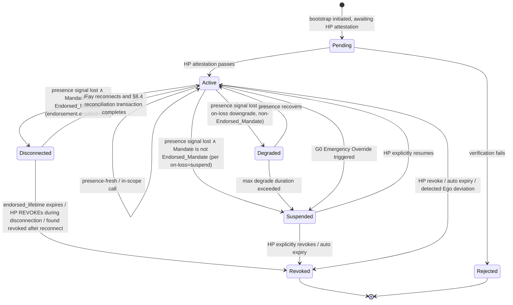

> Protokolltext-Navigation: [Inhaltsverzeichnis](./README.md) | vorheriges [§3 Komponenten und Schnittstellen](./03-Komponenten-und-Schnittstellen.md) | nächstes [§5 Protokollnachrichten](./05-Protokollnachrichten.md)

## §4 Datenmodelle

Dieses Kapitel beschreibt die Kern-Datenmodelle des Faying Protocol in drei Abschnitten:

- **§4.1 Menschenlesbare TypeScript-Ansicht (Non-normative)** — ein menschenlesbares Gerüst für das Protocol Committee, SDK-Implementierende und Reviewer;
- **§4.2 Maßgebliche CDDL-Definition (Normative)** — das maßgebliche Schema für das CBOR-Primärformat; alle Bytes auf der Leitung unterliegen diesem Abschnitt;
- **§4.3 Mandate-Zustandsmaschine** — einschließlich des Zustands `Disconnected`, der Matrix der Übergangs-Auslösebedingungen und der Zuordnungstabelle „Mandate-Zustand ↔ Fay-Verhaltenszustand“.

> **Maßgebliche Erklärung**: Wenn die TypeScript-Ansicht aus §4.1 und die CDDL aus §4.2 in irgendeiner Weise inkonsistent sind, ist **§4.2 CDDL maßgeblich**. §4.1 dient nur dem menschlichen Lesen und geht nicht in die Signatureingabe auf der Leitung ein; die Deterministic-CBOR-Kodierung aus §4.2 ist die alleinige Quelle der Signatureingabe (siehe §6 Kryptografie).
>
> **Nicht-Manipulierbarkeit des endorsement-Felds**: Die `endorsement`-Teilstruktur geht als Feld von `mandate` in die Signatureingabe ein; jede nachträgliche Manipulation eines ihrer Teilfelder (`enabled` / `endorsed-scope` / `endorsed-grade` / `endorsed-lifetime-ms` / `offline-revocation-policy`) bricht die Signaturverifikation des Mandate (im Einklang mit Requirement 11.1 Klausel 3 und §6.3).

### §4.1 Kerntypen (TypeScript-Ansicht, Non-normative)

Der nachstehende TypeScript-Block gibt in menschenlesbarer Form die Kerntypen FayID / Grade / Scope / Mandate / Endorsement / PresenceRequirement / PresenceSignal / Attestation wieder; die maßgeblichen Definitionen liegen in §4.2.

```typescript
type FayID = string          // ULID-ähnlich, z. B. "fay:01HX...Z"
type HumanPrimeID = string   // z. B. "hp:..." (an eine WebAuthn-credentialId verankerbar)
type MandateID = string      // ULID
type Nonce = Uint8Array      // 16 Bytes zufällig

/** Autorisierungsstufe */
enum Grade {
  EmergencyOverride = 0,  // G0
  Strict            = 1,  // G1
  Moderate          = 2,  // G2
  Loose             = 3,  // G3
  Autonomous        = 4   // G4
}

/** Autorisierungsumfang (Least-Privilege) */
interface Scope {
  domains:    string[]    // erlaubte Ressourcendomänen (URL-Muster / SPIFFE-ID-ähnlich)
  actions:    string[]    // erlaubte Aktionen (read / write / control:drone:takeoff …)
  terminals?: string[]    // erlaubte Endgeräte (in der Phase-2-Ableitung verwendet)
  budget?:   ResourceBudget
}

interface ResourceBudget {
  time_window:    [IsoTime, IsoTime]
  max_invocations?: number
  max_cost_units?:  number  // abstrakte Ressourceneinheiten (Geld / Inferenzkontingent / Traffic usw.)
}

/** Mandate (ersetzt das Token) */
interface Mandate {
  version:       "Faying Protocol/1.0"
  id:            MandateID
  issued_at:     IsoTime
  not_before:    IsoTime
  not_after:     IsoTime          // muss endlich sein: unbefristetes Faying ist ein Antipattern
  issuer:        HumanPrimeID     // HP (oder ein vom HP autorisierter MS)
  ms_id:         string           // der MS, der tatsächlich ausgestellt hat
  subject:       FayID            // die autorisierte iFay
  scope:         Scope
  grade:         Grade
  presence_req:  PresenceRequirement
  parent?:       MandateID        // verweist bei der Ableitung auf das Eltern-Mandate
  endorsement?:  Endorsement      // optional: bezeugte Autorisierung (Endorsed Mandate)
  attestation:   Attestation
  signature:     SignatureBundle  // siehe §6
}

/** Endorsed Mandate — vorab übernommene Semantik für Offline-Autonomie
 *
 * Genau dann, wenn `enabled = true`, darf die iFay während einer physischen
 * Trennung des Faying-Zustands autonom arbeiten, innerhalb von
 * endorsed_scope ⊆ scope und endorsed_grade.autonomy ≤ grade.autonomy;
 * endorsed_lifetime muss endlich sein. Der Verantwortungsendpunkt bleibt stets der Aussteller (Human Prime).
 */
interface Endorsement {
  enabled:                    boolean
  endorsed_scope:             Scope        // ⊆ Mandate.scope
  endorsed_grade:             Grade        // .autonomy ≤ Mandate.grade.autonomy
  endorsed_lifetime_ms:       number       // ≤ (not_after - not_before)
  offline_revocation_policy:  "stop-and-audit" | "stop-only" | "graceful-stop"
}

/** Hinweis zu Scope.actions: Wildcards / Präfix-Matching sind auf Protokollebene verboten (siehe §9 T2 Atomic_Action-Hartbedingung). */

/** Präsenzanforderung (an die Stufe gebunden) */
interface PresenceRequirement {
  signal_types:   PresenceSignalType[]
  max_staleness_ms: number     // ein Überschreiten löst eine Herabstufung aus
  on_loss:        OnLossPolicy // "downgrade-to:G2" | "suspend" | "emergency-override"
}

/** Präsenzsignal */
interface PresenceSignal {
  mandate_id:     MandateID
  signal_type:    PresenceSignalType
  produced_at:    IsoTime
  nonce:          Nonce
  device_id:      string
  device_attestation: Attestation
  signature:      SignatureBundle
}

/** Attestation (einheitlicher Träger überprüfbarer Aussagen) */
interface Attestation {
  format:        "webauthn" | "tpm-quote" | "platform-keystore" | "self-signed"
  payload:       Uint8Array       // selbstbeschreibend je nach Format
  signer:        string           // Public-Key-ID
  signature:     SignatureBundle
}
```

### §4.2 CDDL (CBOR-Primärformat, maßgebliche Definition)

Der nachstehende CDDL-Block ist das **maßgebliche Schema** für das Wire-Format von Faying Protocol/1.0. Sowohl die offiziellen Testvektoren dieser Spezifikation (`vectors/`) als auch die Interoperabilitätskonformitäts-Testsuite (`conformance/`) unterliegen diesem Abschnitt; das CBOR-Byte-Dekodierungsergebnis jeder Implementierung muss exakt mit diesem Abschnitt übereinstimmen.

```cddl
; Faying Protocol/1.0 — CBOR Data Definition Language
; Normative; this is the authoritative schema for Faying Protocol/1.0 wire format.
faying-grade = 0..4    ; 0=EmergencyOverride, 1=Strict, 2=Moderate, 3=Loose, 4=Autonomous

scope = {
  domains:    [* tstr],
  actions:    [* tstr],
  ? terminals: [* tstr],
  ? budget:   resource-budget
}

resource-budget = {
  time-window:        [iso-time, iso-time],
  ? max-invocations:  uint,
  ? max-cost-units:   uint
}

iso-time = #6.0(tstr)   ; CBOR tag 0 (RFC 3339 string)

presence-signal-type =
  "webauthn-uv-fresh" /
  "face-continuous"   /
  "fingerprint-tap"   /
  "presence-heartbeat-only" /
  "intent-ticket"

presence-requirement = {
  signal-types:        [+ presence-signal-type],
  max-staleness-ms:    uint,
  on-loss:             tstr            ; "downgrade-to:Gx" | "suspend" | "emergency-override"
}

attestation = {
  format:    "webauthn" / "tpm-quote" / "platform-keystore" / "self-signed",
  payload:   bstr,
  signer:    tstr,
  signature: signature-bundle
}

signature-bundle = {
  alg:       "Ed25519" / "ES256" / "ML-DSA-65",   ; PQC negotiation slot
  pubkey:    bstr,
  sig:       bstr,
  ? chain:   [* bstr]                              ; optional certificate chain
}

mandate = {
  version:        "Faying Protocol/1.0",
  id:             tstr,
  issued-at:      iso-time,
  not-before:     iso-time,
  not-after:      iso-time,
  issuer:         tstr,        ; Human Prime ID
  ms-id:          tstr,
  subject:        tstr,        ; FayID
  scope:          scope,
  grade:          faying-grade,
  presence-req:   presence-requirement,
  ? parent:       tstr,
  ? endorsement:  endorsement,
  attestation:    attestation,
  signature:      signature-bundle
}

endorsement = {
  enabled:                       bool,
  endorsed-scope:                scope,         ; must ⊆ main Mandate.scope
  endorsed-grade:                faying-grade,  ; must ≤ main Mandate.grade (autonomy weaker or equal, security higher)
  endorsed-lifetime-ms:          uint,          ; must ≤ (mandate.not-after - mandate.not-before)
  offline-revocation-policy:     "stop-and-audit" / "stop-only" / "graceful-stop"
}

presence-signal = {
  mandate-id:           tstr,
  signal-type:          presence-signal-type,
  produced-at:          iso-time,
  nonce:                bstr .size 16,
  device-id:            tstr,
  device-attestation:   attestation,
  signature:            signature-bundle
}
```

> **Zuordnung der Feldbenennung**: Die CDDL verwendet `kebab-case` (Wire-Format-Konvention); die TypeScript-Ansicht verwendet `snake_case` (Konvention des menschlichen Lesens). Die Felder entsprechen einander eins zu eins: `presence-req` ↔ `presence_req`, `endorsed-scope` ↔ `endorsed_scope`, `endorsed-lifetime-ms` ↔ `endorsed_lifetime_ms` usw.

### §4.3 Mandate-Zustandsmaschine



**Semantik des Zustands `Disconnected`**: gilt ausschließlich für Endorsed_Mandate (d. h. `endorsement.enabled = true`). Während dieses Zustands:

- darf die iFay_Instance D-Dimension-Aktionen nur innerhalb von `endorsement.endorsed_scope` ausführen, beschränkt durch `endorsement.endorsed_grade`;
- führt ein Überschreiten von `endorsement.endorsed_lifetime` sofort zu einem Soft-Timeout → Wanderung nach Revoked, selbst während die iFay physisch noch getrennt ist;
- wird ein während der Trennung vom HP ausgestellter REVOKE unmittelbar bei der Wiederverbindung der iFay gemäß `endorsement.offline_revocation_policy` verarbeitet (Standard `stop-and-audit`);
- muss die Wiederverbindung die Abgleichstransaktion aus §8.4 durchlaufen; eine „stille Wiederaufnahme“ ist verboten.

**Matrix der Übergangs-Auslösebedingungen** (verzahnt mit §3.5 Liveness Channel und Requirement 11 / 12):

| Übergang | Auslösebedingung |
| --- | --- |
| Active → Degraded | `PresenceState.stale=true` ∧ Mandate ist kein Endorsed_Mandate ∧ `on-loss = "downgrade-to:Gx"` |
| Active → Disconnected | `PresenceState.stale=true` ∧ Mandate ist ein Endorsed_Mandate (`endorsement.enabled=true`) |
| Active → Suspended | `PresenceState.stale=true` ∧ Mandate ist kein Endorsed_Mandate ∧ `on-loss = "suspend"` |
| Disconnected → Active | iFay verbindet sich wieder und die Abgleichstransaktion aus §8.4 schließt ab (einschließlich Presence-Wiederherstellung / ausstehendem REVOKE / GRADE_SWITCH, alle abgeglichen) |
| Disconnected → Revoked | `endorsed_lifetime` läuft ab ∨ HP widerruft während der Trennung ∨ nach der Wiederverbindung als widerrufen vorgefunden |

**Zuordnung Mandate-Zustand ↔ Fay-Verhaltenszustand** (auf die A/B/C/D-Dimensionen aus Kapitel 13 abgestimmt):

| Mandate-Zustand | Äquivalenter Fay-Verhaltenszustand | D-Dimension (ausgehende Aktion) |
| --- | --- | --- |
| Pending | Rogue Fay | Verboten |
| Active | Faying State | Erlaubt (innerhalb des scope) |
| Degraded | Faying State (eingeschränkt) | Nur innerhalb des scope der aktuellen Herabstufungsstufe erlaubt |
| Disconnected | Faying State (nur endorsed) | Nur innerhalb von `endorsement.endorsed_scope` erlaubt, beschränkt durch `endorsement.endorsed_grade` (siehe §7.5 / §8.4) |
| Suspended | Faying State pausiert | Verboten, doch das Mandate bleibt wiederherstellbar |
| Revoked | Rogue Fay | Verboten |
| Rejected | Rogue Fay | Verboten |

---
