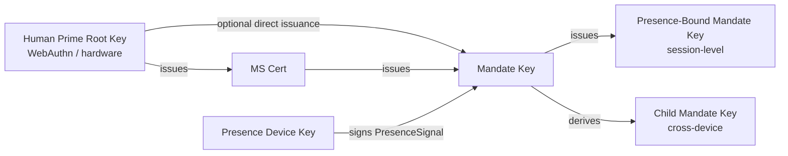

> Protokolltext-Navigation: [Inhaltsverzeichnis](./README.md) | vorheriges [§5 Protokollnachrichten](./05-Protokollnachrichten.md) | nächstes [§7 Autorisierungsstufen](./07-Autorisierungsstufen.md)

## §6 Kryptografie

Dieses Kapitel beschreibt die kryptografische Spezifikation auf der Faying-Protocol-Ebene in drei Abschnitten:

- **§6.1 Algorithmen-Suiten**: die Aushandlungstabelle und die Regeln für die drei Ebenen Default / Alternative / PQC;
- **§6.2 Schlüsselableitung und Rollen**: die Ableitungshierarchie und die harten Bedingungen vom Human Prime Root Key hinab bis zum Presence-Bound Mandate Key;
- **§6.3 Signaturformat**: losgelöste Signaturen, Deterministic-CBOR-Signatureingabe, Mehrfachsignaturketten und der Signatureingabe-Anker für das Endorsed_Mandate.

> **Hinweis zur EARS-Rückverfolgbarkeit**: Jeder Regel in diesem Kapitel folgt eine `Trace:`-Zeile, die die zugehörigen EARS-Teilklausel-IDs (aus der Anforderungsbasis) in der Form `R<requirement>.<criterion>.<clause>` auflistet.

### §6.1 Algorithmen-Suiten

| Verwendung | Default | Alternative | PQC-Verhandlungs-Slot |
| --- | --- | --- | --- |
| Signieren (Mandate / Presence / Attestation) | **Ed25519** | ECDSA-P256 | ML-DSA-65 (FIPS 204) |
| Hashing | **SHA-256** | BLAKE3 | SHA3-256 |
| Ableitung (KDF) | HKDF-SHA-256 | — | HKDF-SHA3-256 |
| Symmetrisch (z. B. bei aktivierter Mandate-Stapling-Verschlüsselung) | ChaCha20-Poly1305 | AES-256-GCM | — |
| Kanalschicht | TLS 1.3 zwingend | mTLS optional | TLS-1.3-PQ (hybrid X25519 + ML-KEM-768) |

**Aushandlungsregeln**:

- **N1 (jede Seite deklariert)**: Client und Server müssen zum BOOTSTRAP-Zeitpunkt jeweils die von ihnen unterstützten Signatur-, Hash-, KDF-, Symmetrisch- und Kanalschicht-Suiten deklarieren; die endgültigen Werte für `SignatureBundle.alg`, `hash`, `kdf`, `channel-suite` müssen die stärksten gemeinsam unterstützten Algorithmen sein.
  - **Trace**: `R8.1.1` (jede Seite deklariert beim BOOTSTRAP die unterstützten Suiten), `R8.1.2` (der stärkste gemeinsam unterstützte Algorithmus wird als endgültiger Wert gewählt).

- **N2 (Mindest-Implementierungssatz)**: Jede kompatible Implementierung muss mindestens den Signaturalgorithmus-Satz `{Ed25519, ECDSA-P256}` gleichzeitig unterstützen; PQC-Suiten sind OPTIONAL, doch jede Implementierung muss Verhandlungs-Slots für künftige rollende Upgrades reservieren.
  - **Trace**: `R8.1.3` (muss `{Ed25519, ECDSA-P256}` gleichzeitig unterstützen), `R8.2.3` (PQC-Suiten sind `OPTIONAL`, bis sie als `MUST` markiert sind, und der BOOTSTRAP darf nicht abgelehnt werden, nur weil die Gegenstelle PQC nicht unterstützt).

- **N3 (keine gemeinsame Suite → `E_PROTOCOL`)**: Existiert zum BOOTSTRAP-Zeitpunkt kein gemeinsam unterstützter Signatur- oder Hash-Algorithmus, muss Mandate_Service den BOOTSTRAP mit `E_PROTOCOL` ablehnen.
  - **Trace**: `R8.1.4` (BOOTSTRAP mit `E_PROTOCOL` ablehnen, wenn kein gemeinsamer Algorithmus existiert).

- **N4 (PQC-Verhandlungs-Slot reserviert + rollbares Upgrade)**: `Mandate.signature_bundle` muss den Algorithmen-Slot bereitstellen, um `ML-DSA-65` (FIPS 204) als optionalen Signaturalgorithmus zu unterstützen; der BOOTSTRAP-Verhandlungs-Slot muss optionale Unterstützung für `TLS-1.3-PQ` (hybrid X25519 + ML-KEM-768) reservieren; das Protokoll muss erlauben, dass die Default-Suite innerhalb eines Lebenszyklus über die Versionsaushandlung vorwärtsgerollt wird, ohne die Überprüfbarkeit bestehender Mandates zu brechen.
  - **Trace**: `R8.2.1` (`Mandate.signature_bundle` stellt den `ML-DSA-65`-Algorithmen-Slot bereit), `R8.2.2` (BOOTSTRAP-Verhandlungs-Slot reserviert `TLS-1.3-PQ`), `R8.2.4` (versionsausgehandeltes rollendes Upgrade bewahrt die Überprüfbarkeit bestehender Mandates).

### §6.2 Schlüsselableitung und Rollen

Das nachstehende Diagramm zeigt die Schlüsselableitungshierarchie und die Rollenbeziehungen des Faying Protocol: Der HP Root Key verlässt niemals die vom Menschen gehaltene Hardware und autorisiert nur den MS Key und (unter eingeschränkten Pfaden) den Mandate Key; der Mandate Key etabliert beim Ausstellen von Presence-Bound- und Child-Mandate-Keys kurzlebige Sitzungsschlüssel; der Presence_Device Key dient ausschließlich dem Signieren des PresenceSignal.



**Schlüsselbedingungen**:

- **K1 (Hardware-Verankerung des HP Root Key)**: Der HP Root Key verlässt niemals die vom Menschen gehaltene Hardware (WebAuthn-Authentifikator / Platform Keystore / Hardware-Wallet); es existiert auf der Protokollebene kein kryptografischer Pfad, der erfordern würde, dass der HP Root Key die Hardware verlässt.
  - **Trace**: `R9.2.4` (jedes Mandate verwendet einen unabhängigen, kurzlebigen Sitzungs-Signaturschlüssel — impliziert die Schlüsselhierarchie-Bedingung der Trennung von Root Key und Sitzungsschlüssel), `R8.1.3` (hardwaretragbare Eigenschaft des Mindest-Implementierungssatzes).

- **K2 (Richtung der Widerrufskette)**: Der Widerruf des MS Key wird direkt durch den HP Root Key ausgeführt; MS kann sich nicht selbst widerrufen. Diese Bedingung garantiert, dass die Widerrufserreichbarkeit im HP wurzelt, nicht in MS selbst.
  - **Trace**: `R9.2.4` (der Presence-Bound Mandate Key wird bei jedem GRADE_SWITCH zur Rotation gezwungen — impliziert die umgekehrte Bedingung, dass MS den Root Key nicht selbst widerrufen kann).

- **K3 (unabhängiger Sitzungsschlüssel je Mandate)**: Jedes Mandate hat einen unabhängigen Sitzungs-Signaturschlüssel (zur Vermeidung des Missbrauchs langlebiger Schlüssel); der Presence-Bound Mandate Key wird bei jedem GRADE_SWITCH zur Rotation gezwungen.
  - **Trace**: `R9.2.4` (jedes Mandate verwendet einen unabhängigen, kurzlebigen Sitzungs-Signaturschlüssel; jeder GRADE_SWITCH erzwingt die Rotation des Presence-Bound Mandate Key).

- **K4 (gerätegebundener Ableitungspfad)**: Der Child Mandate Key muss an `device_id` und `device_attestation` des Zielgeräts gebunden sein; jeder Pfad „ein Mandate auf ein anderes Endgerät kopieren und direkt verwenden“ muss abgelehnt und über DELEGATE geführt werden.
  - **Trace**: `R9.2.1` (bindet zum Ausstellungszeitpunkt `device_id` und `device_attestation`), `R9.2.2` (die Verwendung desselben Mandate auf einem anderen Endgerät muss über DELEGATE erfolgen).

- **K5 (Channel Binding)**: Bei aktiviertem mTLS muss ein Mandate den von [RFC 9266](https://www.rfc-editor.org/rfc/rfc9266) definierten TLS-Exporter-Channel-Binding-Wert tragen, und Relying_Party muss diesen Wert zum Verifikationszeitpunkt vergleichen.
  - **Trace**: `R9.2.3` (bei aktiviertem mTLS das RFC-9266-TLS-Exporter-Channel-Binding mitführen, und die RP muss vergleichen).

### §6.3 Signaturformat

**S1 (Losgelöste Signatur)**: Alle Signaturen sind losgelöst — das CBOR-`signature_bundle` ist von der Nutzlast getrennt, was Audit und Neusignierung erleichtert. `signature_bundle` darf die Nutzlast selbst oder eine Kopie davon nicht einbetten.
- **Trace**: `R10.2.2` (losgelöste Signatur, `signature_bundle` von der Nutzlast getrennt).

**S2 (kanonische Definition der Signatureingabe)**: Jedes signierte Objekt muss vor dem Signieren gemäß [RFC 8949 §4.2.1 Deterministic Encoding](https://www.rfc-editor.org/rfc/rfc8949#section-4.2.1) sortiert werden; die Signatureingabe muss berechnet werden als:

> `signature_input = H( Deterministic-CBOR( Envelope_without_signature ) )`

wobei `H` der ausgehandelte endgültige Hash-Algorithmus ist (Default SHA-256, Alternative BLAKE3, PQC-Verhandlungs-Slot SHA3-256) und `Envelope_without_signature` die Reststruktur des `Faying Protocol Envelope` nach Entfernen des Felds `signature_bundle` bezeichnet. **Diese Formel gilt für jedes Objekt in diesem Protokoll, das signiert werden muss** (einschließlich Mandate, PresenceSignal und des Faying Protocol Envelope selbst) und macht die Signatureingabe unabhängig von Mehrdeutigkeiten der JSON-Serialisierung — der Signatureingabe-Hash muss unter CBOR- und JSON-Kodierung identisch sein.

- **Trace**: `R10.2.1` (vor dem Signieren gemäß RFC 8949 §4.2.1 Deterministic Encoding sortiert), `R10.2.4` (Signatureingabe ist `H( Deterministic-CBOR(Envelope_without_signature) )`), `R10.1.4` (die Deterministic-CBOR-Serialisierung vor dem Signieren macht die Signatureingabe unabhängig von Mehrdeutigkeiten der JSON-Serialisierung).

**S3 (Mehrfachsignaturkette)**: In Mehrfachsignaturszenarien (z. B. erfordert DELEGATE die Gegensignatur des Eltern-Mandate) werden Elternketten-Signaturen über das Array `signature_bundle.chain` mitgeführt; die Reihenfolge der Kettenelemente ist „Kind → Eltern → Großeltern → … → Wurzel“, und jedes Kettenelement folgt selbst der Kanonisierung aus S2.
- **Trace**: `R10.2.3` (Elternketten-Signaturen in Mehrfachsignaturszenarien über das Array `signature_bundle.chain` mitgeführt).

**S4 (Signatureingabe-Anker des Endorsed_Mandate)**: Trägt ein Mandate das `endorsement`-Feld (unabhängig vom Wahrheitswert von `enabled`), müssen alle Teilfelder von `endorsement` —

```
(enabled, endorsed_scope, endorsed_grade, endorsed_lifetime_ms,
 offline_revocation_policy)
```

— in die Signatureingabe eingehen. Das heißt, bei der Berechnung von `H( Deterministic-CBOR(Mandate_without_signature) )` **darf** der `endorsement`-Teilbaum **nicht ausgeschlossen werden**. Diese Regel steht im Einklang mit P16.1 (Endorsement_Signature_Inclusion).

Jede nachträgliche Manipulation des `endorsement`-Felds (einschließlich des Umschlagens von `enabled` von `false` auf `true`, der Erweiterung von `endorsed_scope`, der Lockerung von `endorsed_grade`, der Verlängerung von `endorsed_lifetime_ms`, der Änderung von `offline_revocation_policy`) führt zum Fehlschlagen der Signaturverifikation: Relying_Party lehnt den zugehörigen Aufruf mit `E_ATTESTATION_INVALID` ab, und Mandate_Service lehnt mit `E_ENDORSEMENT_INVALID` ab und löst den Widerruf dieses Mandate aus (siehe §5.4 Fehlercode 1013, §9.7, P16.1).

- **Trace**: `R11.1.3` (das `endorsement`-Feld jedes Endorsed_Mandate geht in die Signatureingabe ein, sodass jede nachträgliche Manipulation die Signaturverifikation bricht), `R11.1.4` (wird eine Manipulation des `endorsement`-Felds erkannt, lehnt die RP mit `E_ATTESTATION_INVALID` ab und MS löst den Widerruf aus).

**S5 (Ableitung der Nicht-Manipulierbarkeit des endorsement-Felds)**: gemeinsam aus S2 und S4 abgeleitet —

1. Nach S4 muss der `endorsement`-Teilbaum in `Deterministic-CBOR(Mandate_without_signature)` eingehen;
2. Nach S2 ist die Signatureingabe `H(Deterministic-CBOR(Mandate_without_signature))`;
3. Daher wird jede Änderung an einem beliebigen Teilfeld von `endorsement` das Deterministic-CBOR-Serialisierungsergebnis ändern und damit den Signatureingabe-Hash ändern;
4. Nach der kryptografischen Eigenschaft der Signaturverifikation muss die ursprüngliche Signatur an der neuen Signatureingabe scheitern.

Somit wird die Nicht-Manipulierbarkeit des `endorsement`-Felds direkt aus §6.3 abgeleitet und erfordert keinen zusätzlichen Mechanismus auf Protokollebene. **Diese Nicht-Manipulierbarkeit ist der kryptografische Grundstein der Endorsed_Mandate-Verantwortungskette** (siehe §11.4 und P16.5): Jede nachträgliche Manipulation des endorsement wird unmittelbar in der Signaturverifikationsstufe erkannt und kappt jeden möglichen Pfad, „der Verantwortungszuordnung durch Manipulation von Endorsement-Erklärungen zu entgehen“.

- **Trace**: `R11.1.3` (nachträgliche Manipulation bricht die Signaturverifikation), `R10.2.4` (Definition der Signatureingabe), `R11.1.4` (Disposition auf Protokollebene bei erkannter Manipulation).

---
