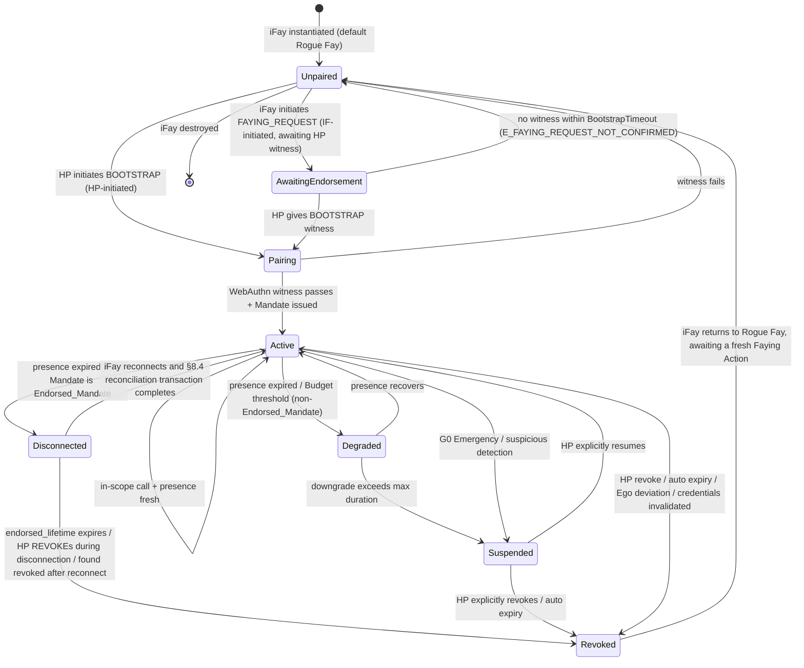
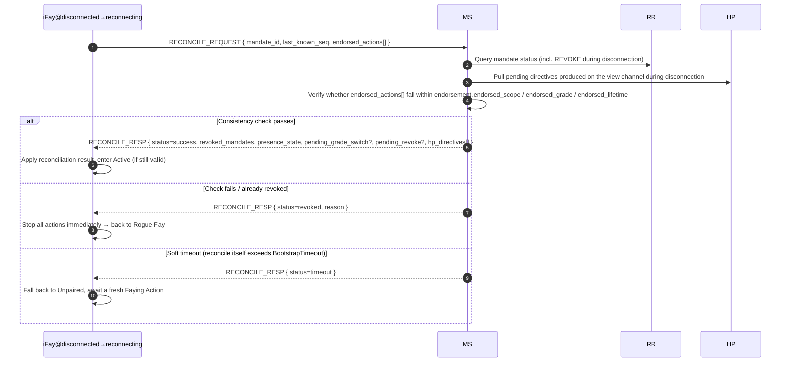

> Protokolltext-Navigation: [Inhaltsverzeichnis](./README.md) | vorheriges [§7 Autorisierungsstufen](./07-Autorisierungsstufen.md) | nächstes [§9 Sicherheitsbetrachtungen](./09-Sicherheitsbetrachtungen.md)

## §8 Lebenszyklus

Dieses Kapitel beschreibt den End-to-End-Lebenszyklus des Faying Protocol: von der Instanziierung der iFay über die Initiierung der Faying Action, die Aufrechterhaltung des Faying State, durch Herabstufung / Trennung / Suspendierung / Widerruf bis zurück zur Rogue Fay — die vollständige Zustandsschließung. Die in diesem Kapitel spezifizierte Zustandsmaschine ist der Träger der Invarianten auf Protokollebene — die Legitimität aller D-Dimension-Aktionen (ausgehend), die Eindeutigkeit des Verantwortungsendpunkts und die Grenze der „bezeugten Autonomie“ während der Trennung sind sämtlich in diesem Kapitel definiert.

### §8.1 Zustandsmaschine des vollständigen Lebenszyklus

Das nachstehende Diagramm deckt die 7 Zustandsschließungen der Protokollebene (**Unpaired / Pairing / Active / Degraded / Disconnected / Suspended / Revoked**) und alle legitimen Übergänge zwischen ihnen ab. `AwaitingEndorsement` ist ein transienter Zwischenzustand auf dem IF-initiierten bidirektionalen Faying-Pfad (siehe §2.4 / §5.3.6); es bildet keine stabile Schließung, in der „Aktionen ausführbar“ sind, wird aber dennoch im Zustandsdiagramm gezeigt, um den Übergangsgraphen vollständig zu halten.

> Beziehung zur Mandate-Zustandsmaschine aus §4.3: §4.3 beschreibt den Zustand *des Mandate-Objekts* (Pending / Active / Degraded / Disconnected / Suspended / Revoked / Rejected); dieser Abschnitt beschreibt den Lebenszyklus-Zustand *der iFay-Entität*. Die beiden werden über die Zuordnung „Active/Degraded/Disconnected Mandate ⇔ Faying State / nur-bezeugter Faying State“ verbrückt; siehe die Tabelle „Zuordnung Mandate-Zustand ↔ Fay-Verhaltenszustand“ am Ende von §4.3.

### §8.2 Phasensemantik

Die nachstehende Tabelle gibt die Semantik der 7 Zustandsschließungen wieder. Der Wert jedes Zustands in der Spalte „ausgehende Aktion (D-Dimension)“ ist die Zulassungsentscheidung der D-Dimension auf Protokollebene.

- **Unpaired**: entspricht der Rogue Fay im Blueprint. Nur Aktionen A1–A4 (Selbstwahrnehmung), B1–B3 (interner Ausdruck), C1–C2 (einseitige Mensch-Kommunikation, einschließlich der Initiierung von FAYING_REQUEST) sind erlaubt. D-Dimension-Aktionen sind einheitlich verboten.

> **Präzise Bestimmung der Rogue Fay (wichtig)**: Eine getrennte Verbindung allein bedeutet **nicht** Rogue Fay. Eine iFay wird genau dann als Rogue Fay bestimmt, wenn einer der folgenden beiden Fälle gilt: (1) **getrennt UND keine ausdrückliche Autorisierung existiert** — d. h. kein Mandate in `Active / Degraded / Disconnected` deckt ihr aktuelles Verhalten ab (einschließlich des Falls, dass nie Faying etabliert wurde, oder das Mandate widerrufen / abgelaufen / suspendiert wurde); (2) **erwiesenermaßen getrennt** — gemäß §9.9 als Perceived-Disconnected beurteilt UND das aktuelle Mandate ist kein gültiges Endorsed_Mandate (oder `endorsement` ist abgelaufen / `enabled=false`).
>
> Umgekehrt: Eine iFay, deren physische Verbindung getrennt ist, die aber ein **gültiges Endorsed_Mandate** hält und sich noch innerhalb von `endorsed_scope / endorsed_grade / endorsed_lifetime` befindet, ist im Zustand `Disconnected` und im **Faying State (nur bezeugt), nicht Rogue Fay** — ihre D-Dimension-Aktionen während der Trennung werden von `Mandate.issuer` (HP) über die zum BOOTSTRAP-Zeitpunkt etablierte Offline-Vorabautorisierung getragen (siehe §4.3 / §7.5 / §8.3 / §8.4). Erst wenn das endorsement-lifetime abläuft, es widerrufen wird oder der Abgleich fehlschlägt, wandert diese iFay nach Revoked → Unpaired und kehrt zur Rogue Fay zurück.
- **AwaitingEndorsement**: Eine von der iFay initiierte FAYING_REQUEST wurde an den HP-Sichtkanal weitergeleitet und wartet auf die Bestätigung des HP über BOOTSTRAP innerhalb von `BootstrapTimeout` (Standard 60 s); dieser Zustand erzeugt kein Mandate; ausgehende Aktionen sind einheitlich verboten; bei Timeout fällt er nach Unpaired zurück und wird in die Attestation Chain geschrieben (Fehlercode 1014 `E_FAYING_REQUEST_NOT_CONFIRMED`).
- **Pairing**: eine laufende Faying Action, transient. Muss WebAuthn-Bezeugung + Mandate-Ausstellung innerhalb von `BootstrapTimeout` abschließen; Fehlschlag → Rückfall nach Unpaired ohne Reststand.
- **Active**: normal laufender Faying State. Es existiert genau ein zugehöriges Mandate im Active-Zustand; alle D-Dimension-Aufrufe werden gemäß `Mandate.scope` und `Mandate.grade` zugelassen.
- **Degraded**: Faying State besteht weiterhin, doch die Stufe ist verschärft (ausgelöst durch das Ablaufen des Präsenzsignals). Gilt ausschließlich für **Nicht-Endorsed_Mandate**. Die Dauer darf `MaxDegradedDuration` nicht überschreiten (je nach Stufe standardkonfiguriert, siehe Anhang B); Überschreiten → Wanderung nach Suspended.
- **Disconnected**: Der Faying State ist nur innerhalb von `endorsement.endorsed_scope` und `endorsement.endorsed_lifetime` gültig; gilt für das „nur-bezeugte“ Aktionsfenster eines Endorsed_Mandate während physischer Trennung. Für die konkrete Zulassungs- und Trennungssemantik siehe §4.3 / §7.5 / §8.4.
- **Suspended**: Faying State vorübergehend ausgesetzt. Ausgehende Aktionen sind einheitlich verboten, doch die Mandate-Metadaten werden für die ausdrückliche HP-Wiederherstellung oder das Audit bewahrt; Überschreiten des Auto-Ablaufpunkts → Wanderung nach Revoked.
- **Revoked**: Mandate beendet. Die iFay kehrt zur Rogue Fay zurück; jeder nachfolgende D-Dimension-Aufruf muss eine frische vollständige Faying Action durchlaufen (neue `mandate_id`). Revoked ist der absorbierende Zustand eines Mandate (siehe P10).

### §8.3 Sequenz der Verantwortungszuordnung

> **Zu jedem Zeitpunkt gilt: ausgehende Aktion der IF → es muss genau ein Active-, Degraded- oder Disconnected-Mandate existieren → der `issuer` dieses Mandate ist der Verantwortungsendpunkt.**

Diese Klausel ist die formalisierte temporale Klausel für die „Eindeutigkeit des Verantwortungsendpunkts“ auf Protokollebene; es existiert kein dritter Fall:

1. **Kein konformes Mandate**: Es existiert kein Active- / Degraded- / Disconnected-Mandate ⟹ die ausgehende Aktion ist nicht erlaubt (D-Dimension verboten); die RP muss `E_NO_MANDATE` (1001) oder `E_PRESENCE_STALE` (1005) zurückgeben.
2. **Mehrere konforme Mandates koexistieren**: Die Protokollebene wählt zwingend dasjenige mit dem „spezifischsten scope“, und sie müssen denselben `issuer` (HP) teilen; existieren mehrere konforme Mandates mit unterschiedlichen Ausstellern, wird dies als Protokollfehler behandelt und muss `E_PROTOCOL` (1099) zurückgeben.
3. **Ausgehende Aktion während Disconnected**: weiterhin `Mandate.issuer` (HP) zugeordnet. `endorsement` beschränkt nur den ausführbaren `endorsed_scope` / `endorsed_grade` / `endorsed_lifetime` der Aktion und ändert den Verantwortungsendpunkt nicht; es existiert kein legitimer Pfad dafür, dass „endorsement die Verantwortung auf die iFay selbst / MS / Supervisory Agent überträgt“ (siehe P16.5).

Aus dieser Klausel sind unmittelbar ableitbar:

- Für jeden akzeptierten Aufruf `c` hat das Audit-Fünftupel `(mandate_id, endorsement_id?, action, ts, signature_chain)` als Wurzelknoten seines `signature_chain` notwendig und ausschließlich `Mandate.issuer`;
- Die iFay hat keinen legitimen Pfad der „Selbstzuordnung“; MS / Supervisory Agent dürfen ihre eigene Agenten-Bezeugung nicht durch die `issuer`-Identität des HP ersetzen;
- Der Verantwortungsendpunkt kann sich innerhalb des Lebenszyklus eines Mandate nicht ändern; jede Änderung muss Widerruf + neuen BOOTSTRAP durchlaufen (neue `mandate_id`, neuer `issuer`).

### §8.4 Wiederverbindungs-Abgleich

> **Zweck**: die „bezeugte Autonomie“ der iFay während Disconnected mit den Zustandsänderungen der protokollzentralen Sicht (MS / RR / HP-Sichtkanal) zu einem konsistenten Zustand konvergieren und „Wiederverbindung = Aktion wieder aufnehmen“ ausdrücklich als Antipattern verbieten.

#### §8.4.1 Ablauf

#### §8.4.2 Rückgabeinhalt der Abgleichstransaktion

Bei Transaktionserfolg (`status = success`) muss `RECONCILE_RESP` die folgenden Felder zurückgeben (in Eins-zu-eins-Entsprechung mit Requirement 12.4):

1. **`revoked_mandates`**: Liste der während der Trennung widerrufenen Mandates (einschließlich kaskadierter Kind-Mandates);
2. **`presence_state`**: der aktuelle PresenceState (genutzt, um zu entscheiden, ob die D-Dimension fortgesetzt werden darf);
3. **`pending_grade_switch`**: unabgeschlossene GRADE_SWITCH-Ereignisse (falls vorhanden);
4. **`pending_revoke`**: unabgeschlossene REVOKE-Ereignisse (falls vorhanden);
5. **`hp_directives`**: ausstehende Direktiven, die während der Trennung auf dem HP-Sichtkanal erzeugt wurden (z. B. G0 Emergency Override, ausdrücklicher REVOKE, erzwungene Herabstufung usw.).

#### §8.4.3 Aufzählung der Transaktionsausgänge

Der Ausgang der Abgleichstransaktion ist genau einer der folgenden drei, im Einklang mit der Formalisierung P17.4 `reconcile_result(M) ∈ {success, revoked, timeout}`:

| Ausgang | Auslösebedingung | Folgezustand | Audit-Anforderung |
| --- | --- | --- | --- |
| `success` | Konsistenzprüfung besteht ∧ Mandate noch gültig ∧ innerhalb von BootstrapTimeout abgeschlossen | Disconnected → Active | In die Attestation Chain geschrieben, einschließlich vollständigem Audit der endorsed_actions |
| `revoked` | endorsed_lifetime abgelaufen ∨ HP hat während der Trennung REVOKE ausgestellt ∨ nach der Wiederverbindung als widerrufen vorgefunden ∨ endorsed_actions außerhalb der Grenzen | Disconnected → Revoked → Unpaired | In die Attestation Chain geschrieben; Trennungsperioden-Audit gemäß `endorsement.offline_revocation_policy` behandeln |
| `timeout` | Die Abgleichstransaktion selbst überschreitet `BootstrapTimeout`, ohne success / revoked zu erreichen | Disconnected → Unpaired | In die Attestation Chain geschrieben, markiert mit `reason=reconcile-timeout` |

#### §8.4.4 Harte Bedingungen auf Protokollebene

- **D-Dimension-Verbot**: Bevor die Abgleichstransaktion abschließt, darf die iFay keine D-Dimension-Aktionen ausführen; jeder Aufruf, der innerhalb dieses Fensters bei der RP eintrifft, muss mit `E_PRESENCE_STALE` (1005) oder `E_REVOKED` (1006) abgelehnt werden. Dieses Verbot gilt innerhalb von `[t_reconnect, t_reconnect + reconcile_complete_ms]` (im Einklang mit P17.4).
- **Timeout = Rückfall zur Rogue Fay**: Die Abgleichstransaktion muss innerhalb von `BootstrapTimeout` abschließen; bei Timeout fällt die iFay nach Unpaired zurück und wartet auf eine frische Faying Action (ein Auto-Retry des BOOTSTRAP ist verboten).
- **Alle drei Ausgänge müssen in die AC**: Die drei Ausgänge `success` / `revoked` / `timeout` der Abgleichstransaktion selbst müssen sämtlich in die Attestation Chain geschrieben werden; das Audit der Aktionen während der Trennungsperiode wird gemäß `endorsement.offline_revocation_policy` behandelt:
  - `stop-and-audit` (Standard): sofort stoppen + vollständiges endorsed_actions-Audit einreichen + zur Rogue Fay zurückfallen;
  - `stop-only`: sofort stoppen + Audit nicht erzwungen (gilt nur für irreversible / Notfall-Szenarien; erfordert einen Beschluss des Protocol Committee);
  - `graceful-stop`: begrenztes Abschließen (Write-Close / Zustandsspeicherung) vor dem Stoppen erlauben; Abschlussaktionen bleiben durch das endorsement beschränkt.
- **Kein Selbst-Retry nach Rückfall**: Ist der Ausgang der Abgleichstransaktion `revoked` oder `timeout` und fällt die iFay zur Rogue Fay zurück, darf die iFay BOOTSTRAP nicht eigenständig erneut versuchen; sie muss darauf warten, dass der HP erneut initiiert (HP-initiiert) oder dass eine neue, vom HP ausdrücklich bestätigte FAYING_REQUEST erfolgt (IF-initiiert).
- **Stille Wiederaufnahme verboten**: Kein Implementierungspfad „Wiederverbindung = Wiederaufnahme“ ist erlaubt. Jede Implementierung, die die Abgleichstransaktion aus §8.4 umgeht und Disconnected direkt nach Active wandert, wird als nicht-konform behandelt; die Interoperabilitätskonformitäts-Testsuite muss sie als fail markieren.

---
