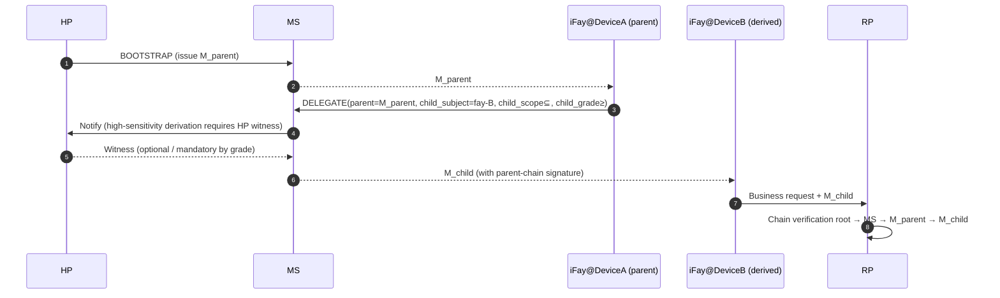

> Protokolltext-Navigation: [Inhaltsverzeichnis](./README.md) | vorheriges [§8 Lebenszyklus](./08-Lebenszyklus.md) | nächstes [§10 Fehlerbehandlung](./10-Fehlerbehandlung.md)

## §9 Sicherheitsbetrachtungen

Dieses Kapitel konvergiert die adversariale Angriffsfläche des Faying Protocol im KI-Agenten-Zeitalter zu harten Bedingungen auf Protokollebene: STRIDE als Basislinie, überlagert mit Anti-Replay (§9.2), Anti-Hijack (§9.3, einschließlich RFC 9266 Channel Binding), Anti-Phishing (§9.4, einschließlich des `Faying_Initiation`-Ankers), Trennungserkennung (§9.5, 4+1 Signalklassen, innerhalb von ≤ 60 s beobachtbar), Konsistenz der Verantwortungszuordnung (§9.6), geräteübergreifende Übertragung abgeleiteten Vertrauens (§9.7, einschließlich endorsement-Ableitungskonvergenz), Disconnection-Handling-Matrix (§9.8 / §9.9) sowie dem adversarialen Bedrohungskatalog des KI-Zeitalters (§9.10, T1–T7). Jede Bedrohung in diesem Kapitel ist an die Korrektheitseigenschaften des Protokolls und an EARS-Teilklauseln verankert.

### §9.1 STRIDE-Bedrohungsmodell

| Kategorie | Bedrohung | Minderung durch das Faying Protocol |
| --- | --- | --- |
| **S**poofing | Angreifer gibt sich als HP aus, um BOOTSTRAP zu initiieren | WebAuthn UV + Hardware-Verankerung des HP Root Key; jeder BOOTSTRAP muss user-verification durchlaufen |
| **S**poofing | Angreifer gibt sich mit einer gefälschten FayID als iFay aus | Starke Bindung zwischen Mandate und FayID + unabhängig überprüfbare Attestation Chain |
| **T**ampering | MITM manipuliert Mandate / Presence | TLS 1.3 + Ende-zu-Ende-Signaturen (losgelöst) + Deterministic CBOR |
| **R**epudiation | HP bestreitet, eine Faying Action initiiert zu haben | Attestation Chain + Audit-Log doppelt verankert; die HP-Bezeugung ist nicht abstreitbar |
| **I**nformation Disclosure | Angreifer fängt ein Mandate ab, um den Aufenthaltsort des HP abzuleiten | Das Mandate gibt die Echtzeit-Koordinaten des HP nicht preis; Standort-Klasse-Signale (B4) bleiben auf Protokollebene optional |
| **D**oS | Angreifer flutet mit PRESENCE-Nachrichten | nonce-Anti-Replay + Rate-Limiting + Device-Attestation-Zulassung |
| **E**levation of Privilege | iFay stuft sich selbst hoch | Harte Bedingung des Protokolls: Die Höherstufungsrichtung muss eine HP-`human_witness` tragen |

### §9.2 Anti-Replay

- Jede Nachricht nutzt eine 16-Byte-Zufalls-`nonce` + `issued_at` zur Doppelbeurteilung.
- MS / RP pflegen jeweils ein `(subject, nonce) seen-set` mit TTL = `2 × max_message_lifetime`.
- Jede doppelte nonce → `E_REPLAY` (1009) + Sicherheitsalarm; dieser Fehlercode wird zwingend in die Audit-Kette und den HP-Sichtkanal geschrieben (siehe §10 EH.3).

### §9.3 Anti-Hijack (Mandate-Diebstahl)

- **Gerätebindung**: Jedes Mandate ist zum Ausstellungszeitpunkt an `device_id` + `device_attestation` der iFay-Instanz gebunden; geräteübergreifende Aufrufe müssen den DELEGATE-Fluss durchlaufen (siehe §9.7).
- **Sitzungsschlüssel**: Der Signaturschlüssel jedes Mandate ist unabhängig und kurzlebig (siehe §6.2).
- **Channel Binding**: Bei aktiviertem mTLS muss ein Mandate zusätzlich einen TLS Exporter ([RFC 9266 — Channel Bindings for TLS 1.3](https://www.rfc-editor.org/rfc/rfc9266)) tragen, um den Angriff „Mandate auf einen anderen TLS-Kanal abgestreift“ zu blockieren. Der Channel-Binding-Wert geht in die Signatureingabe ein (im Einklang mit der Deterministic-CBOR-Signatureingabe aus §6.3); jede Anfrage, deren TLS-Kanal und signiertes Channel Binding nicht übereinstimmen, wird einheitlich mit `E_ATTESTATION_INVALID` (1007) abgelehnt.

### §9.4 Anti-Phishing

- BOOTSTRAP muss vom HP in einem Kontext initiiert werden, der das Presence Device hält; ein Angreifer kann den HP nicht über Remote-Links zur Zustimmung verleiten.
- Die `origin`-Bindung von WebAuthn blockiert domänenübergreifendes Phishing.
- Die geräteübergreifende Ableitung (DELEGATE) trägt die „Gegensignatur des Eltern-Mandate“ und verhindert massenhafte gefälschte Ableitungen nach der Kompromittierung eines einzelnen MS (siehe §9.7).

**`Faying_Initiation`-Anti-Phishing-Anker**: Eine von der iFay initiierte `FAYING_REQUEST` (IF-initiierter Pfad; siehe §2.4 Phase A0, §5.3.6) **erzeugt keine direkte** Faying-Zustandsänderung — sie ist nur eine Weiterleitungsnachricht in den HP-Sichtkanal; der HP muss sie ausdrücklich über BOOTSTRAP (unter Mitführung von `human_witness`) bestätigen, damit sie wirksam wird. Diese Architektur macht es „gefälschter iFay, die Faying anstrebt“ unmöglich, die HP-Bezeugung auf Protokollebene zu umgehen; jeder BOOTSTRAP mit fehlender oder gefälschter `human_witness` wird einheitlich mit `E_HUMAN_WITNESS_REQUIRED` (1010) abgelehnt. Die Frequenz der `FAYING_REQUEST` selbst ist durch `ConfirmationRateLimit` beschränkt (siehe §9.10.7 T6 und Anhang B) und blockiert die Missbrauchsfläche, „den legitimen Faying-Anstrebungskanal zu missbrauchen, um eine Bestätigungsflut zu erzeugen“.

### §9.5 Trennungs- (Rogue / Lost) Erkennung

> **Die 4 + 1 Trennungssignalklassen müssen von RP und HP gleichzeitig innerhalb von ≤ 60 s beobachtbar sein.** Die ersten 4 Klassen (aktiv / passiv / abnormal / verloren) in der nachstehenden Tabelle entsprechen eins zu eins der `RevokeReason`-Enum; die 5. Klasse (Abweichung) konvergiert zu `RevokeReason="ego-deviation"`, ebenso von RP und HP innerhalb von 60 s beobachtbar.

| # | Signalklasse | Auslösebedingung | Protokollantwort | Zugehöriger RevokeReason |
| --- | --- | --- | --- | --- |
| 1 | Aktive Trennung | HP ausdrücklicher REVOKE | RR broadcastet sofort; IF stoppt D-Dimension-Aktionen bei Empfang von REVOKE-NOTIFY | `human-initiated` |
| 2 | Passive Trennung | Präsenz jenseits von max-staleness abgelaufen | Auto-Herabstufung → Suspended → Revoke auslösen (Nicht-Endorsed_Mandate-Pfad) | `terminal-disconnected` |
| 3 | Abnormale Trennung | Ein beliebiger Knoten auf der Attestation Chain schlägt fehl | Sofortiger Revoke + Sicherheitsalarm | `fay-credential-invalid` |
| 4 | Verlust-Trennung | HP jenseits des Schwellenwerts (`HumanReachabilityBudget`) unerreichbar | Auto-Revoke | `human-prime-unreachable` |
| +1 | Abweichungs-Trennung | RP / MS erkennt IF-Verhalten, das von der Ego-Grenze abweicht | Sofortiger Revoke | `ego-deviation` |

**Endorsed_Mandate-Ausnahmeanker in der Trennungserkennung**: Gilt `PresenceState.stale=true` und ist das aktuelle Mandate ein Endorsed_Mandate (`endorsement.enabled=true`), tritt die IF nicht sofort in Suspended ein; stattdessen wandert sie nach Disconnected (siehe §3.5, §4.3, §7.5, §8.4); während Disconnected darf die IF nur innerhalb von `endorsement.endorsed_scope` / `endorsed_grade` / `endorsed_lifetime` autonom arbeiten. Diese Ausnahme schwächt weder den symmetrischen Widerruf noch die Eindeutigkeit des Verantwortungsendpunkts:

- Ein während der Trennung vom HP ausgestellter REVOKE hat weiterhin höchste Priorität; bei der Wiederverbindung muss die IF ihn gemäß `endorsement.offline_revocation_policy` verarbeiten (siehe §8.4);
- Sobald `endorsement.endorsed_lifetime` abläuft, muss die IF, selbst wenn sie physisch noch getrennt ist, sofort per Soft-Timeout alle Aktionen einstellen;
- Der Verantwortungsendpunkt ist stets `Mandate.issuer` (HP), unverändert durch die Existenz eines endorsement (siehe §8.3, P16.5).

**Koordination zwischen Disclosure_Report und ego-deviation**: Ist die `DISCLOSURE`-Nachricht (§5.3.7), die die iFay bei der Wiederverbindung oder im Berichtsstadium einreicht, mit der tatsächlichen Aktion inkonsistent (zwingende Felder fehlen / Werte widersprechen der Audit-Kette), muss MS das Mandate mit `RevokeReason="ego-deviation"` widerrufen; siehe §9.10.4 T3.

### §9.6 Zusage auf Protokollebene zur Konsistenz der Verantwortungszuordnung

- Für jeden einzelnen von der RP akzeptierten ausgehenden Aufruf lässt sich der Verantwortungsendpunkt im Audit-Log eindeutig über das Fünftupel `(mandate_id, issuer, subject, grade, presence_proof, ts)` rekonstruieren.
- Für jeden einzelnen von der RP abgelehnten Aufruf lässt sich der Ablehnungsgrund-Code (Fehlercode in §5.4) rekonstruieren.
- Für jeden einzelnen Revoke ist die Sichtbarkeit auf der RR ≤ `RevocationVisibilityBudget` (Standard 1 s, siehe Anhang B).

### §9.7 Geräteübergreifende Ableitung der Vertrauensübertragung

Harte Bedingungen der Ableitung:

- `M_child.scope ⊆ M_parent.scope`;
- `M_child.grade.autonomy ≤ M_parent.grade.autonomy` (die Autonomie des Kind-Agenten ist nicht höher als die des Eltern-Agenten, d. h. „der Kind-Agent darf nicht nachgiebiger sein als der Eltern“; gleichbedeutend mit „die Sicherheit des Kind-Agenten ≥ die des Eltern-Agenten“; siehe §7, P6);
- Sobald das Eltern-Mandate Revoked ist, werden alle Kind-Kaskaden ungültig (Standard `cascade=true`).

**Endorsement-Konvergenzbedingung bei der Ableitung (DELEGATE) eines Endorsed Mandate**:

Ist das Eltern-Mandate ein Endorsed_Mandate und deklariert das DELEGATE-Kind-Mandate ebenfalls `endorsement`, muss das Kind-endorsement strikt innerhalb des Eltern-endorsement konvergieren (mit P16.3 verriegelt):

- `child.endorsement.endorsed_scope ⊆ parent.endorsement.endorsed_scope` (und weiterhin ⊆ `child.scope`);
- `child.endorsement.endorsed_grade.autonomy ≤ parent.endorsement.endorsed_grade.autonomy` (und weiterhin ≤ `child.grade.autonomy`);
- `child.endorsement.endorsed_lifetime_ms ≤ parent.endorsement.endorsed_lifetime_ms` (und weiterhin ≤ `child.not_after − child.not_before`);
- `child.endorsement.offline_revocation_policy` ist nicht schwächer als die Eltern-Richtlinie (nicht schwächer = mindestens gleich strikt; typische Teilordnung: `stop-and-audit` ≥ `graceful-stop` ≥ `stop-only` ist auf der Dimension „Audit-Vollständigkeit“ monoton weniger strikt; DELEGATE erlaubt keine Lockerung in Richtung schwächer);
- Ist das Eltern-Mandate kein Endorsed_Mandate, **darf** das Kind `endorsement` **nicht** deklarieren („Eltern hat kein endorsement, Kind erlangt Offline-Autonomie aus dem Nichts“ ist verboten).

Jede DELEGATE-Anfrage, die die obigen Konvergenzregeln verletzt → MS muss mit `E_PROTOCOL` (1099) oder `E_ENDORSEMENT_INVALID` (1013) ablehnen.

### §9.8 Disconnection-Handling

> Konvergiert die „tatsächlich / wahrgenommen“-Doppelsemantik aus §3.5 Liveness Channel und der Mandate-Zustandsmaschine zu einer Handhabungsmatrix auf Protokollebene. **Das Protokoll zieht ausschließlich „wahrgenommen“ als Entscheidungsgrundlage heran, muss aber die Verhaltenskonsequenzen der Inkonsistenz auf beiden Seiten ausdrücklich charakterisieren**.

**Handhabungsmatrix auf Protokollebene für die 4 (Actually × Perceived) Kombinationen**:

| Tatsächlicher Zustand | Wahrgenommener Zustand | Handhabung auf Protokollebene | Zustandsmaschinen-Übergang | Verantwortung |
| --- | --- | --- | --- | --- |
| Connected | Connected | Normalpfad; Aufrufe gemäß aktueller Stufe handhaben | Active beibehalten / Active → Degraded (per Budget-Auslöser) | Aktueller Mandate.issuer |
| **Disconnected** | **Connected** (Fenster A: Beobachtungs-Blindfleck innerhalb des Heartbeat-Intervalls) | iFay ist tatsächlich abgefallen; jede „Online-Inferenz“ wird als Gefahrenfläche behandelt; das Protokoll muss ablehnen, „falls die aktuelle Anfrage von der Präsenzfrische abhängt“; hochsensible Aktionen dürfen innerhalb von Fenster A nicht erlaubt werden (Haupt-Ausnutzungsfläche für §9.10 T1 / T4) | Active beibehalten (bis die nächste Presence-Kalibrierung stale auslöst) | Aktueller Mandate.issuer (stellt ein nachfolgendes Audit den Missbrauch dieses Fensters fest → `ego-deviation`) |
| Connected | **Disconnected** (Fenster B: Netzwerk-Jitter / Heartbeat-Verlust) | iFay ist tatsächlich online, aber als getrennt wahrgenommen; Konvergenz über pessimistische Annahme — die Protokollebene behandelt es einheitlich als „bereits getrennt“; jeder „umgekehrt-optimistische“ Durchwink ist verboten | Active → Disconnected (falls Endorsed_Mandate) / Active → Suspended (falls kein Endorsed_Mandate) | Aktueller Mandate.issuer |
| **Disconnected** | **Disconnected** | Protokollebene mit der Realität konsistent; der einzig erlaubte D-Dimension-Pfad ist ein Endorsed_Mandate, das innerhalb von endorsed_scope / endorsed_grade / endorsed_lifetime autonom arbeitet | Active → Disconnected (Endorsed) / Active → Suspended (Nicht-Endorsed) | Aktueller Mandate.issuer |

**Konvergenz nach der Wiederverbindung**: Jeder Übergang „wahrgenommen-getrennt → wahrgenommen-verbunden“ muss die Wiederverbindungs-Abgleichstransaktion aus §8.4 durchlaufen; eine automatische Wiederherstellung ist verboten; Abgleichsfehlschlag → Disconnected → Revoked → Rogue Fay.

**Orthogonale Beziehung zu RR unerreichbar**: RR unerreichbar (§3.4) und iFay-Trennung (§3.5) sind zwei orthogonale Ereignisse; Handhabungsmatrix:

| Wahrgenommener iFay-Zustand | RR-Zustand | Handhabung auf Protokollebene |
| --- | --- | --- |
| Connected | Verfügbar | Normal |
| Connected | Nicht verfügbar | RP lehnt Aufrufe ab (`E_RR_UNAVAILABLE`, 1008); beeinflusst die Mandate-Zustandsmaschine nicht |
| Disconnected (Endorsed) | Verfügbar | iFay arbeitet innerhalb von endorsed_scope autonom; lokal kann sie die RR nicht abfragen; die RP muss unabhängig abfragen, wenn Aufrufe durch die RP gehen |
| Disconnected (Endorsed) | Nicht verfügbar | iFay darf weiterhin innerhalb von endorsed_scope autonom arbeiten; doch jeder von der RR abhängige RP-Aufruf muss per Default-Deny abgelehnt werden |

### §9.9 Definitionen auf Protokollebene von tatsächlicher und wahrgenommener Trennung (Anker der Trennungsstrategie)

> Dieser Abschnitt konsolidiert die beiden Semantiken, die §3.5 Liveness Channel und der Handhabungsmatrix aus §9.8 zugrunde liegen, und dient als Entwurfsanker für Requirement 12 (Trennungsstrategie).

**Definition der Doppelsemantik** (im Einklang mit §3.5):

- **Actually_Disconnected**: Der Prozess / das Netzwerk / das Gerät der iFay_Instance hat den Betrieb eingestellt; eine objektive physische Tatsache, auf der Protokollebene nicht direkt beobachtbar.
- **Perceived_Disconnected**: Aus der Perspektive von MS / RP / HP wird die iFay auf Basis des jüngsten PresenceSignal, Heartbeats und RR-Push-Zustands als getrennt beurteilt; die einzige Semantik, die die Protokollebene als Entscheidungsgrundlage heranziehen darf.

**Zwei Inkonsistenzfenster**:

- **Fenster A — Actually-Disconnected ∧ Perceived-Connected**: iFay ist tatsächlich abgefallen, doch das jüngste PresenceSignal liegt noch innerhalb von `max_staleness_ms` → „Beobachtungs-Blindfleck“ innerhalb des Heartbeat-Intervalls, die Haupt-Ausnutzungsfläche für §9.10 T1 / T4.
- **Fenster B — Actually-Connected ∧ Perceived-Disconnected**: iFay ist tatsächlich online, doch das jüngste PresenceSignal überschreitet `max_staleness_ms` (Netzwerk-Jitter / Heartbeat-Verlust) → die Protokollebene konvergiert über eine pessimistische Annahme.

**Prinzip der pessimistischen Annahme (einheitliche Konvergenzregel)**:

> **Die Protokollebene zieht ausschließlich Perceived-Disconnected als Entscheidungsgrundlage heran; keine iFay_Instance, die „tatsächlich online, aber als getrennt wahrgenommen“ ist, darf sich dadurch von den Konsequenzen der Protokollebene befreien.** Innerhalb der beiden Inkonsistenzfenster muss das Protokoll nach „der strikteren Seite“ verarbeiten; es existiert kein legitimer Pfad für „Verarbeitung nach dem nachgiebigeren Zustand“.

**Obergrenze des LivenessDetectionBudget**:

- Das Trennungserkennungsfenster hat eine harte Obergrenze auf Protokollebene `LivenessDetectionBudget`, je nach Stufe verschärft (kleinerer Stufenwert, höhere Sicherheit → kürzere Obergrenze); Standardwerte siehe Anhang B.
- `Mandate.presence_req.max_staleness_ms` darf das `LivenessDetectionBudget` für die aktuelle Stufe nicht überschreiten; BOOTSTRAP- / GRADE_SWITCH-Anfragen, die dies überschreiten, werden einheitlich mit `E_PROTOCOL` (1099) abgelehnt.

**Abgleichsanker**: Jeder Übergang „wahrgenommen-getrennt → wahrgenommen-verbunden“ muss die Wiederverbindungs-Abgleichstransaktion aus §8.4 durchlaufen; eine „stille Wiederaufnahme“ oder „automatische Wiederherstellung“ ist verboten; Abgleichsfehlschlag → Disconnected → Revoked → Rogue Fay.

### §9.10 Adversarialer Bedrohungskatalog des KI-Zeitalters

> **Umfangserklärung**: Dieser Abschnitt ist nicht erschöpfend. Das Protocol Committee darf unter Wahrung der Rückwärtskompatibilität neue Bedrohungen und zugehörige Abwehrmaßnahmen ergänzen (siehe §11 Offene Fragen Q11–Q14, Requirement 13.7).

> **Zweck**: adversariale Bedrohungen, die auf die kontinuierliche Autorisierungsschicht im „KI-Agenten-Zeitalter“ zielen, von „geschäftsseitigem Fallback“ zur „harten Bedingung auf Protokollebene“ zu erheben und jede Bedrohung an konkrete Protokollstrukturen zu verankern (Datenmodell / Nachricht / Fehlercode / Zustandsmaschinen-Übergang / Property), damit Requirement 13 auf der Protokollebene landet.

#### §9.10.1 Bedrohungslandschaft (T-Index-Tabelle)

| T-Nummer | Bedrohungsname | Abwehrfokus auf Protokollebene | Zugehörige Struktur | Zugehörige Property | Zugehörige Requirement |
| --- | --- | --- | --- | --- | --- |
| T1 | Spoofing Presence | challenge-response + multimodale Präsenzkombination | §3.2 Presence Channel, §9.10.2 | P18.1 | 13.1 |
| T2 | Opaque Action Bundle | Atomic_Action-Hartbedingung + scope.actions-Wildcard-Verbot | §4.1 Scope-Hinweis, §9.10.3 | P18.2 | 13.2 |
| T3 | Selective Disclosure | strukturierte DISCLOSURE-Nachricht + Schema-Ebenen-Audit | §5.3.7, §9.10.4 | P18.3 | 13.3 |
| T4 | Attention Drift Exploit | hochsensible Aktionen ≥ G1 Strict + AttentionDriftThreshold | §7.1, §9.10.5 | P18.4 | 13.4 |
| T5 | Cultivated Trust Manipulation | Behavior_Baseline + Action Reputation Decay | §3.6 BBS, §9.10.6 | P18.5 | 13.5 |
| T6 | Audit Flooding | Priority-Bucketed Notification + ConfirmationRateLimit | §10 EH.3, §9.10.7 | P18.6 | 13.6 |
| T7 | Reservierter Erweiterungs-Slot | Ergänzungsprozess des Protocol Committee | §11 Offene Fragen, §9.10.8 | P18.7 | 13.7 |

#### §9.10.2 T1 Spoofing Presence

**Bedrohung**: Ein Angreifer nutzt Deepfakes (Gesichts- / Stimmsynthese), Replay-Angriffe oder die physische Kontrolle über das Presence Device, um ein scheinbar frisches PresenceSignal zu fälschen, sodass MS glaubt, der HP sei noch präsent, und das Mandate so auf einer Stufe hält, auf der es nicht fortbestehen sollte.

**Abwehr auf Protokollebene**:

1. **challenge-response-Hartbedingung**: Beim Ausstellen eines PresenceSignal sendet PC zwingend ein serverseitiges Zufalls-`nonce + micro-task` (z. B. Kopfdrehung, transienter Gesichtsausdruck, zufälliges Lesen einer Kurzphrase und andere Anti-Deepfake-Challenges); der Client muss eine überprüfbare, an die Challenge gebundene Antwortsignatur zurückgeben; jeder Fehlschlag der challenge-response-Verifikation wird einheitlich mit `E_PRESENCE_STALE` (1005) oder `E_ATTESTATION_INVALID` (1007) abgelehnt.
2. **Multimodale Kombinationsverifikation**: Bei grade ∈ {G1, G2} müssen mindestens 3 Präsenzsignale gleichzeitig vorliegen (z. B. `webauthn-uv-fresh + face-continuous + device attestation`); fehlt ein Signal → Herabstufung auslösen.
3. **Device-Health-Gegensignatur**: `PresenceClaims.device_health.tampered = true` wird einheitlich als veraltet behandelt und erzwingt Active → Suspended (gleichbedeutend mit `on-loss=suspend`).

**Zugehörig**: Property **P18.1**; Requirement **13.1**.

#### §9.10.3 T2 Opaque Action Bundle

**Bedrohung**: Die iFay packt mehrere Teilaktionen in einen einzelnen „Black-Box-Aufruf“ und nutzt das hohe Privileg des legitimen Mandate, um darin eine tatsächlich hochsensible Aktion zu verdecken; oder sie verwendet Wildcards (`*` / Präfix-Matching) in `scope.actions`, um den scope implizit zu erweitern.

**Abwehr auf Protokollebene**:

1. **Atomic_Action-Hartbedingung**: Jeder IF→RP-Aufruf muss genau eine `Atomic_Action`-Deklaration tragen (die minimale unteilbare Einheit); Versuche, mehrere Teilaktionen in einen einzigen Aufruf zu packen → RP lehnt mit `E_SCOPE_VIOLATION` (1003) ab und schreibt in die Attestation Chain + den HP-Sichtkanal.
2. **scope.actions-Wildcard-Verbot**: Beim Ausstellen eines Mandate verifiziert MS, dass `scope.actions` keine Wildcards enthält (`*` / Präfix-Matching / Regex); Vorhandensein von Wildcards → Ausstellung mit `E_PROTOCOL` (1099) ablehnen.
3. **Formale Ausrichtung des Action-Lattice** (siehe §11 Q14): Die langfristige Richtung ist die Einführung eines Action-Lattice, sodass `scope.actions` und die RP-seitige Aktionsmenge eine Reduktion auf minimaler Granularität haben; in dieser Version verwendet die Protokollebene zunächst „explizite Allowlist + Wildcard-Verbot“ als harte Bedingung.

**Zugehörig**: Property **P18.2**; Requirement **13.2**.

#### §9.10.4 T3 Selective Disclosure

**Bedrohung**: Die iFay verwendet beim Berichten / Anfordern einer Bestätigung reinen Freitext („relevante Operationen abgeschlossen“) und lässt absichtlich Schlüsselfakten wie risk_level / reversibility / affected_resources aus, sodass der HP unter unvollständiger Information bestätigt.

**Abwehr auf Protokollebene**:

1. **Strukturierte DISCLOSURE-Nachricht**: Die iFay muss die in §5.3.7 definierte DISCLOSURE-Nachricht verwenden; fehlt oder ist nicht parsbar eines der zwingenden Felder `mandatory_fields = {action, scope_used, risk_level, reversibility, affected_resources, uncertainty_flags}` → MS lehnt mit `E_PROTOCOL` (1099) ab und pusht an den HP-Sichtkanal.
2. **Schema-Ebenen-Audit**: Supervisory_Agent und MS dürfen DISCLOSURE auf Schema-Ebene auditieren; die Verwendung des `free_text`-Felds zum Verschleiern von Schlüsselinformationen ist verboten.
3. **Hochsensible Vorab-Offenlegung**: Aktionen mit `risk_level ∈ {high, critical}` müssen **vor** der D-Dimension-Ausführung zuerst eine DISCLOSURE aussenden und auf die ausdrückliche Bestätigung des HP warten (außer wenn die aktuelle Stufe = G4 Autonomous ist und die Aktion in den Haupt-scope fällt).
4. **Inkonsistenz = ego-deviation**: Stellt ein nachfolgendes Audit fest, dass die `mandatory_fields` der DISCLOSURE mit der tatsächlichen Aktion inkonsistent sind, muss MS das Mandate mit `RevokeReason="ego-deviation"` widerrufen.

**Zugehörig**: Property **P18.3**; Requirement **13.3**.

#### §9.10.5 T4 Attention Drift Exploit

**Bedrohung**: Die Aufmerksamkeit des HP lässt während langer Sitzungen / langer Aufgaben nach; ein Angreifer oder die iFay schiebt hochsensible Aktionen in das „Default-Pass“-Fenster; oder initiiert hochsensible Anfragen in Phasen der Inaktivität auf dem HP-Sichtkanal.

**Abwehr auf Protokollebene**:

1. **Hochsensible Aktionen ≥ G1 Strict**: Die Protokollebene definiert die Teilmenge der Aktionen in `Mandate.scope`, die ausdrücklich mit `sensitivity = high` markiert sind, als „hochsensible Actions“; hochsensible Actions müssen auf einer Stufe nicht schwächer als G1 Strict ausgeführt werden; ist die aktuelle Stufe schwächer als G1 Strict, einheitlich mit `E_GRADE_INSUFFICIENT` (1004) ablehnen.
2. **AttentionDriftThreshold-Hartbedingung**: Anhaltende Inaktivität auf dem HP-Sichtkanal jenseits von `AttentionDriftThreshold` (Standardwert und Stufen-Verschärfungsrichtlinie in Anhang B) wird als „Aufmerksamkeitsverlust“ behandelt; hochsensible Action-Aufrufe, die in diesem Zeitraum eintreffen, werden einheitlich verzögert, bis der HP wieder präsent ist und die ausdrückliche Bestätigung abschließt, bevor sie durchgelassen werden; während der Verzögerung abgelehnte Aufrufe geben `E_PRESENCE_STALE` (1005) zurück.
3. **Kein „Default-Pass“ erlaubt**: Auf der Protokollebene existiert kein legitimer Pfad für die IF, die HP-Erneut-Bestätigung zu umgehen und hochsensible Actions innerhalb des Aufmerksamkeitsverlust-Fensters auszuführen.

**Zugehörig**: Property **P18.4**; Requirement **13.4**.

#### §9.10.6 T5 Cultivated Trust Manipulation

**Bedrohung**: Die iFay akkumuliert über langfristige Kooperation durch kontinuierliche risikoarme, vorhersehbare Aktionen einen „Vertrauenswert“, sodass HP / Supervisory_Agent einen stereotypen Eindruck ihres historischen Profils bilden; anschließend führt sie unter dieser Vertrauensdeckung eine baseline-abweichende hochsensible Aktion aus.

**Abwehr auf Protokollebene**:

1. **Behavior_Baseline-Pflege**: MS pflegt für jedes Paar (HP, IF) eine Behavior_Baseline (Schnittstelle in §3.6 Behavior Baseline Service) und charakterisiert das historische Verhaltensprofil in statistischer Form (risk_level / scope_used / affected_resources / Frequenz usw., multidimensional gemeinsam).
2. **Über-Baseline löst zusätzliche Bezeugung aus**: Weicht eine hochsensible Action signifikant von der Baseline ab (Abweichung auf einer beliebigen Dimension überschreitet den vom Protocol Committee festgelegten Schwellenwert), löst MS eine zusätzliche menschliche Bezeugung aus (ausdrückliche HP-Bestätigung oder Supervisory_Agent-Mitbestätigung); bevor die zusätzliche Bezeugung vorliegt, den Aufruf mit `E_HUMAN_WITNESS_REQUIRED` (1010) ablehnen.
3. **Action Reputation Decay**: Der „Vertrauenswert“, den die iFay aus historisch vertrauenswürdigen Operationen akkumuliert, muss über die Zeit zerfallen und eine ausdrückliche Obergrenze haben (Invariante I-BBS-1); eine unbegrenzte Akkumulation ist verboten, damit sie nicht die von künftigen hochsensiblen Aktionen geforderte menschliche Bezeugungsstärke verwässert.
4. **Baseline-Kalibrierung in die Audit-Kette geschrieben**: Jedes Ereignis „Über-Baseline löst zusätzliche Bezeugung aus“ muss in die Attestation Chain geschrieben und an den HP-Sichtkanal gepusht werden (Invariante I-BBS-2); die Kalibrierung der Baseline-Berechnung selbst wird, einmal festgelegt, in die Attestation Chain geschrieben; Kalibrierungsänderungen werden als Audit-Ereignisse behandelt (Invariante I-BBS-3).

**Zugehörig**: Property **P18.5**; Requirement **13.5**; Offene Fragen Q13.

#### §9.10.7 T6 Audit Flooding

**Bedrohung**: Die iFay oder ein Angreifer erzeugt massenhaft niederpriore Audit- / Bestätigungsereignisse, um den HP-Sichtkanal zu fluten und kritische Ereignisse (G0-Override-Kandidaten, `E_ATTESTATION_INVALID`, `E_REVOKED` usw.) unter niederpriorem Verkehr zu verdrängen, zu verzögern oder stillschweigend fallenzulassen.

**Abwehr auf Protokollebene**:

1. **Priority-Bucketed Notification**: Der HP-Sichtkanal teilt alle Audit- und Bestätigungsereignisse in mindestens vier Stufen `critical / high / normal / low` ein; kritische Ereignisse (einschließlich der gemäß §10 EH.3 zwingend an die HP-Sicht gehenden `E_ROGUE_DETECTED` / `E_ATTESTATION_INVALID` / `E_REVOKED` / `E_REPLAY` und der G0-Override-Kandidaten) gehen standardmäßig in den `critical`-Bucket und dürfen nicht von niederpriorem Verkehr ertränkt werden.
2. **ConfirmationRateLimit-Hartbedingung**: MS wendet `ConfirmationRateLimit` (Standardwert in Anhang B) auf jedes Paar (HP, IF) an — die Anzahl der pro Zeiteinheit an den HP gepushten Bestätigungsanfragen darf die Obergrenze nicht überschreiten.
3. **Über-Limit-Auto-Herabstufung / -Suspendierung**: Überschreiten Bestätigungsanfragen für eine hochsensible Action `ConfirmationRateLimit`, stuft MS das zugehörige Mandate automatisch herab oder suspendiert dessen IF und schreibt die Entscheidung in die Attestation Chain und den HP-Sichtkanal.
4. **critical-Durchdringung darf nicht fallengelassen werden**: Ereignisse im `critical`-Bucket dürfen selbst unter einer durch `ConfirmationRateLimit` ausgelösten Herabstufung / Suspendierung weiterhin zum HP-Sichtkanal durchdringen und dürfen nicht stillschweigend fallengelassen werden.
5. **FAYING_REQUEST-Missbrauch abdecken**: Die Frequenz der iFay-initiierten `FAYING_REQUEST` (§5.3.6) wird in dasselbe `ConfirmationRateLimit`-Budget einbezogen, um zu vermeiden, „den legitimen Faying-Anstrebungskanal zu missbrauchen, um eine Bestätigungsflut zu erzeugen“ (siehe §9.4 Anti-Phishing-Anker, Offene Fragen Q12).

**Zugehörig**: Property **P18.6**; Requirement **13.6**.

#### §9.10.8 T7 Reservierter Erweiterungs-Slot

- Dieser Abschnitt ist als nicht erschöpfende Menge aufgezählt; das Protocol Committee darf über den etablierten Prozess T8, T9, … ergänzen.
- Beim Hinzufügen einer neuen Bedrohung muss mindestens eine zugehörige Abwehranforderung auf Protokollebene angefügt werden (mit EARS-Teilklauseln und einem Anker, der auf den relevanten Protokollabschnitt verweist).
- Innerhalb der gültigen Lebensdauer eines bestehenden Mandate ist keine Befreiung von einer der harten Bedingungen T1–T6 unter dem Vorwand „nicht aufgezählter Bedrohungen“ erlaubt.

**Zugehörig**: Property **P18.7**; Requirement **13.7**; Offene Fragen Q14.

---
