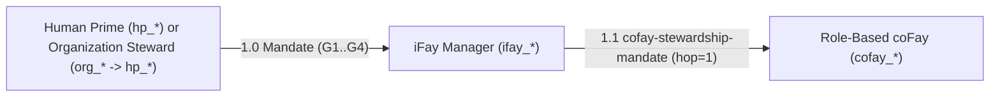

## §1 Overview & Scope

This specification defines **Faying Protocol/1.1 (`coFay` Delegated Stewardship Profile)**. It strictly follows the `MINOR` backward-compatibility rules in `Faying Protocol/1.0` §1.7.2: every message, state machine transition, and error code in `Faying Protocol/1.0` (`2025-10-25` Final and `schemas/fap-1.0.cddl`) remains completely unchanged. Peers supporting only `1.0` negotiate down to `Faying Protocol/1.0` per §1.7.3 or safely ignore unrecognized optional extensions.

Within the iFay ecosystem (`Fay = iFay + coFay`), an `iFay` is bound to a single Human Prime, whereas a `coFay` is a role-based silicon digital life governed by a Role Charter without a personal Ego persona replica. To uphold the foundational accountability axiom—**every external action taken by any silicon entity MUST resolve unambiguously to an accountable Human Prime**—this profile extends the `Human Prime ↔ iFay` trust chain with a cryptographically enforced `iFay Manager → coFay` delegated stewardship mandate and atomic dual-signed stewardship transfer authorization.

### §1.1 Requirements Language (RFC 2119 & RFC 8174)

The key words `MUST`, `MUST NOT`, `REQUIRED`, `SHALL`, `SHALL NOT`, `SHOULD`, `SHOULD NOT`, `RECOMMENDED`, `NOT RECOMMENDED`, `MAY`, and `OPTIONAL` in this document are to be interpreted as described in [BCP 14](https://www.rfc-editor.org/info/bcp14) ([RFC 2119](https://www.rfc-editor.org/rfc/rfc2119) and [RFC 8174](https://www.rfc-editor.org/rfc/rfc8174)) when, and only when, they appear in all capitals, as shown here. In case of divergence across translations, the Simplified Chinese (`zh-CN`) specification and `schemas/fap-1.1-cofay.cddl` are authoritative.

---

## §2 Three-Tier Responsibility Attribution Chain

A `coFay` `MUST NOT` self-issue a root mandate and `MUST NOT` operate under an unanchored anonymous entity. Every valid `cofay-stewardship-mandate` `MUST` establish a verifiable three-tier responsibility chain:

1. **Ultimate Accountability Anchor (`steward_entity` + `accountable_human_prime`)**:
   - For personal stewardship, `steward_entity` is `hp_*` and `MUST` equal `accountable_human_prime`;
   - For organizational stewardship, `steward_entity` is `org_*` and `MUST` explicitly bind the accountable `accountable_human_prime` (`hp_*`). Any missing or malformed Human Prime anchor `MUST` be rejected with `1010 E_HUMAN_WITNESS_REQUIRED`.
2. **Managing Agent Tier (`manager_fay_id`)**:
   - `MUST` be an `ifay_*` entity holding an active `Faying Protocol/1.0` Mandate; a `cofay_*` entity `MUST NOT` act as an upstream stewardship issuer.
3. **Subject Execution Tier (`subject_cofay_id`)**:
   - `MUST` be a `cofay_*` entity governed by `charter_id`, whose conformance is verified under `coFACTS` (strictly distinct from `iFACTS` for `iFay`).

---

## §3 Four Non-Amplifying Security Invariants (Normative)

Verifiers evaluating a `cofay-stewardship-mandate` `MUST` enforce four invariants in strict order:

1. **Upstream `G0` & Revocation Cascading Halt (`safe-state-halt`)**:
   - Whenever the upstream Human Prime or `iFay` Manager is in `G0` (`EmergencyOverride`) or `Revoked`, the `coFay` `MUST` immediately enter `safe-state-halt` and return `1024 E_UPSTREAM_EMERGENCY_HALT`. It `MUST NOT` continue invoking Host terminals or external skills from cached state.
2. **Single-Hop Stewardship Ceiling**:
   - `hop_count` `MUST` equal `1` and `max_stewardship_hops` `MUST` equal `1`. If `hop_count != 1` or the issuer is not an `ifay_*` manager, verification `MUST` fail with `1023 E_STEWARDSHIP_HOP_LIMIT`. A `coFay` `MUST NOT` sub-delegate stewardship downstream.
3. **Monotonic Grade Non-Amplification**:
   - The stewardship `grade` (`0..4`) `MUST` satisfy `grade <= manager_grade`. Any attempt to grant higher autonomy than `manager_grade` `MUST` be rejected with `1021 E_GRADE_AMPLIFICATION`.
4. **Dual Scope & Time-Window Convergence**:
   - `scope` (`domains`, `actions`, optional `terminals`, and `budget` limits `max_invocations` / `max_cost_units`) `MUST` simultaneously be a subset of both `charter_scope` and `manager_scope`;
   - `[not_before, not_after]` `MUST` lie within `[manager_not_before, manager_not_after]` and cover the evaluation timestamp. Any violation `MUST` be rejected with `1022 E_SCOPE_ESCAPE`.

---

## §4 Atomic Dual-Signed Stewardship Transfer (`cofay-transfer`)

Because a `coFay` outlives individual role rotations or organizational handoffs, transferring stewardship `MUST` execute atomically via `cofay-transfer-authorization` to prevent unilateral seizure or accountability gaps:

- **Domain-Separated Canonical Signing Input**: Both `from_steward` and `to_steward` `MUST` sign the UTF-8 byte sequence `"ifay.faying.cofay-transfer.v1:"` concatenated with the RFC 8785 JCS canonicalization of the unsigned transfer object (`Ed25519`, `ES256`, or negotiated `ML-DSA-65`).
- **Atomic Acceptance Criteria**:
  1. `from_steward` and `to_steward` `MUST NOT` be identical (self-transfer is forbidden);
  2. Both stewards `MUST` declare valid `from_human_prime` and `to_human_prime` (`hp_*`) anchors and designate `next_manager_fay_id` (`ifay_*`);
  3. The evaluation time `MUST` fall within `[issued_at, expires_at]` and `nonce` `MUST` be at least 8 characters; violations return `1026 E_TRANSFER_WINDOW_OR_PARTY_INVALID`;
  4. Missing or invalid signature from either party rolls back the transfer and returns `1025 E_TRANSFER_DUAL_SIG_REQUIRED`. Across valid transfers, historical reputation on GMChain remains continuously auditable, and MeriToken (`μ`) remains strictly non-monetary reputation accounting.

---

## §5 Normative Schemas, Error Codes & Conformance Vectors

### §5.1 1.1 Error Codes (`1021`–`1026`)

| Code | Name | Trigger Condition | Runtime Action |
| --- | --- | --- | --- |
| `1010` | `E_HUMAN_WITNESS_REQUIRED` | Reused from 1.0: missing valid `accountable_human_prime` | Reject mandate |
| `1021` | `E_GRADE_AMPLIFICATION` | `grade > manager_grade` or out-of-range grade | Reject mandate |
| `1022` | `E_SCOPE_ESCAPE` | `scope` or validity window escapes `charter_scope ∩ manager_scope` | Reject mandate |
| `1023` | `E_STEWARDSHIP_HOP_LIMIT` | `hop_count != 1` or non-`ifay_*` issuer sub-delegation | Reject mandate |
| `1024` | `E_UPSTREAM_EMERGENCY_HALT` | Upstream state is `G0` or `Revoked` | Enter `safe-state-halt` |
| `1025` | `E_TRANSFER_DUAL_SIG_REQUIRED` | Missing or invalid signature from `from_steward` or `to_steward` | Abort transfer |
| `1026` | `E_TRANSFER_WINDOW_OR_PARTY_INVALID` | Self-transfer, expired transfer window, or invalid party IDs | Reject transfer |

### §5.2 Interoperability Artifacts

- **Authoritative CDDL Schema**: `schemas/fap-1.1-cofay.cddl`
- **JSON Schema View**: `schemas/fap-1.1-cofay.json`
- **Cross-Language Test Vectors**: `vectors/cofay-stewardship-v1.1.json` (`V01`–`V10`, verified identically by both TypeScript and Rust reference implementations).
