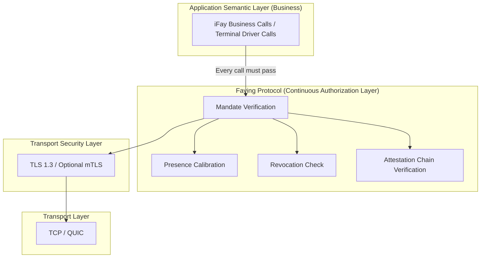
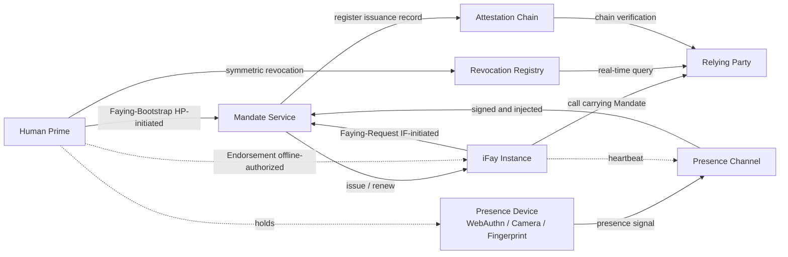
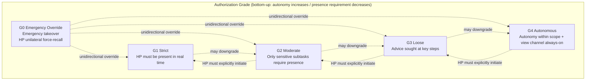
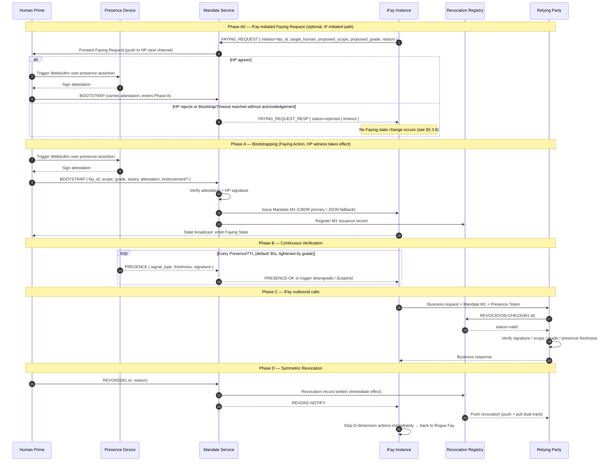
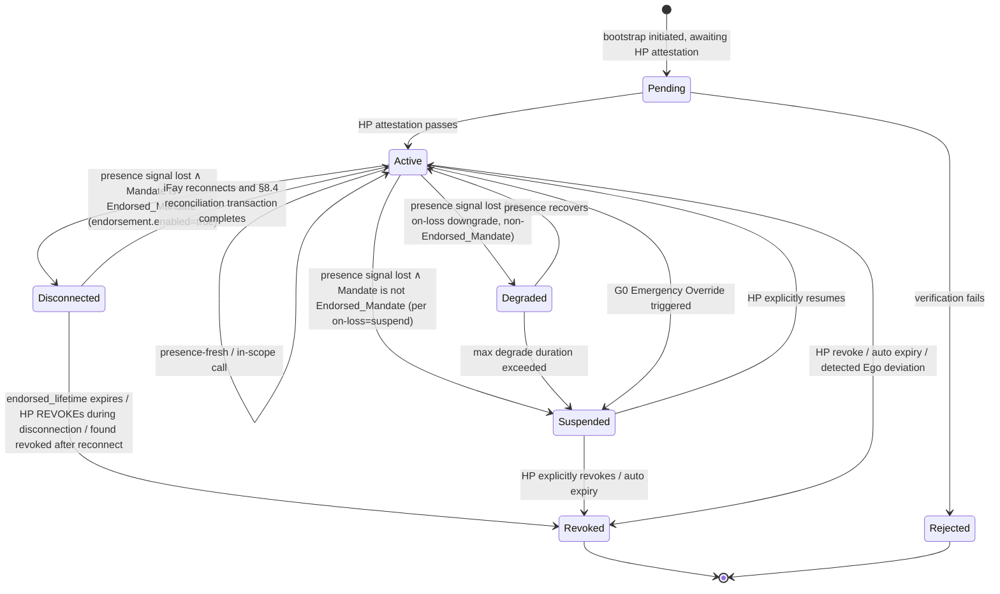
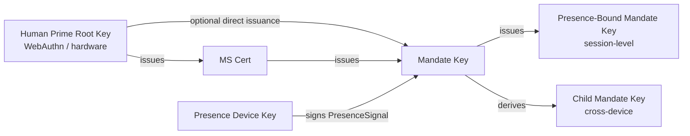
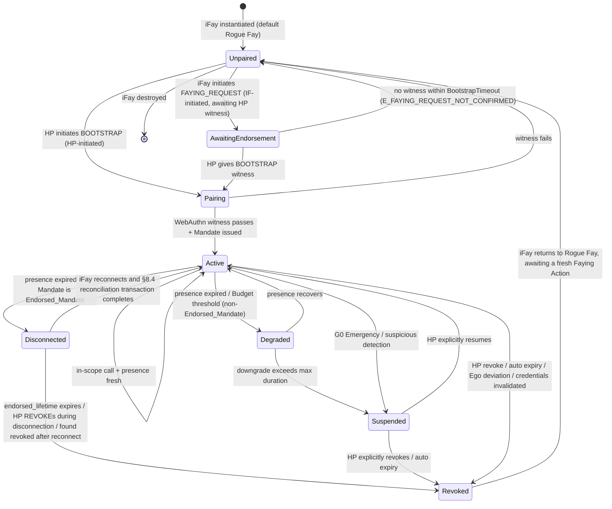
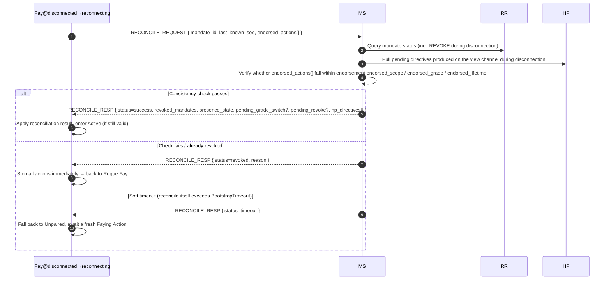
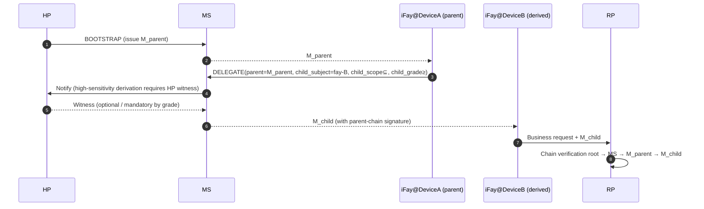

# Faying Protocol

> **Single-source declaration of the protocol body**: The protocol body is this single file `docs/en/specification/2025-10-25/Faying-Protocol-1.0.md`. Other Markdown files under `docs/en/specification/2025-10-25/` are auxiliary documents only (README) and do not constitute the protocol body.

## Table of Contents

- §1 Overview
- §2 Architecture
- §3 Components and Interfaces
- §4 Data Models
- §5 Protocol Messages
- §6 Cryptography
- §7 Authorization Grades
- §8 Lifecycle
- §9 Security Considerations
- §10 Error Handling
- §11 Open Questions
- Appendix A Terminology Alignment Quick Reference
- Appendix B Default Parameter Budgets

---

## §1 Overview

This chapter gives the protocol naming, positioning, design-goal skeleton, core differences from existing schemes, the one-sentence definition of Faying Protocol, the deliverable scope and non-goals of this protocol body, and the version-management and compatibility rules. This chapter is the semantic anchor for §2–§11 and Appendices A/B that follow.

> **EARS traceability note**: each rule in this chapter is followed by `Trace:` listing its corresponding EARS sub-clause IDs (from the requirements baseline) in the form `R<requirement>.<criterion>.<clause>`.

### §1.1 Protocol Naming

Protocol specification name: **Faying Protocol**. The version number is uniformly written as **Faying Protocol/1.0**.

This protocol **abolishes the FAP (Faying Auth Protocol) abbreviation** — **the protocol name is Faying Protocol, with no separate abbreviation**; if a short form is needed, use the full name "Faying Protocol". This design document and accompanying specification documents no longer contain any historical naming forms such as `FAP` / `FAP/1.0` / `Faying Auth Protocol` / `application/fap+json` / `POST /fap/v1/...`. Any earlier `FAP` references should be understood as legacy references to Faying Protocol and replaced with Faying Protocol in new documents.

> **Historical naming legacy**: Early drafts used "Faying Auth Protocol (FAP)". That naming is abolished; any external reference to `FAP` should be understood as a legacy reference to Faying Protocol and must not be reused in new documents.

### §1.2 Protocol Positioning

> **Faying Protocol is an application-layer "continuous authorization layer" protocol on top of TLS, carrying the semantics of "under what presence state, over what scope, at what grade, during what time window, a Human Prime authorizes its iFay".**

- **Below TLS**: channel confidentiality and peer identity are handled by TLS 1.3 (with optional mTLS); Faying Protocol does not redo this.
- **Beside OAuth/OIDC**: OAuth provides application-level authorization, OIDC issues identity assertions; both are "instantaneous token" models. Faying Protocol solves what neither of them solves — **continuous agency + presence binding + grade switching + unique accountability**.
- **Above WebAuthn**: WebAuthn / FIDO2 provides hardware-grade "user presence" proofs for the Human Prime during bootstrapping; Faying Protocol reuses its credential form as the root of derived trust.

Faying Protocol does not replace TLS, nor does it reinvent OAuth; it sits above TLS and below business semantics, forcing **every iFay outbound action** to pass through the Mandate verification gate. Any outbound call that bypasses this gate is treated as a Rogue Action and must be rejected by middleware sitting above the transport layer and below the business layer.

### §1.3 Design Goals

The table below lists Faying Protocol's **8 design goals G1–G8** (core goals) and 2 engineering goals derived from §9 / §5 (security properties / protocol interoperability). **Each goal aligns to exactly one Requirement in the requirements baseline**, forming the bidirectional traceability anchor between this protocol body and the Requirements document.

| Goal | Meaning | Blueprint origin | Corresponding Requirement |
| --- | --- | --- | --- |
| **G1 Unique Accountability** | At any moment, an iFay's outbound action can be unambiguously attributed to a single Human Prime | Chapter 13 ethical bottom line | Requirement 1 |
| **G2 Default-Deny** | No valid Mandate → no outbound action; any missing field → reject | Chapter 13 Rogue default | Requirement 2 |
| **G3 Observable, Auditable, Revocable** | State transitions, action initiation, renewal/revocation events are all observable, auditable, and independently verifiable | Chapters 11, 13 | Requirement 3 |
| **G4 Symmetric Revocation** | The reachability of revocation paths ≥ that of establishment paths; revocation is irreversible | Chapters 10, 12 | Requirement 4 |
| **G5 Continuous Calibration** | Presence signals and Mandate grade can be re-confirmed at every moment; trust never lingers past expiry | Chapters 11, 12 | Requirement 5 |
| **G6 Graded Authorization** | A single Mandate cannot represent all strengths; grade must be expressible, switchable, downgradable; upgrades require HP witness | Original brief item 3 | Requirement 6 |
| **G7 Cross-Device Derivation** | When the same iFay works across terminals, trust may be derived but the responsible party never changes; scope/grade strictly converges | Phase 2/3 evolutionary reservation | Requirement 7 |
| **G8 Post-Quantum Evolvability** | Algorithm suites can be negotiated and rolled forward; PQC negotiation bits reserved | Common engineering requirement | Requirement 8 |
| —(derived) **Security Properties** | Anti-replay / anti-hijack / anti-phishing / disconnection detection / AI-Era Adversarial Threats | §9 Security Considerations | Requirement 9 (with Requirement 13 derivative) |
| —(derived) **Protocol Interoperability** | CBOR / JSON equivalence, Deterministic CBOR, cross-implementation compatibility matrix | §5 Protocol Messages | Requirement 10 |

> **Goal ↔ Requirement one-to-one principle**: this table is the **sole authoritative mapping** between the protocol body and the Requirements document. Any EARS sub-clause ID `R<n>.<m>.<k>` cited in later chapters when stating an invariant or mechanism must have its root Requirement number `<n>` fall within the "Corresponding Requirement" column. Endorsed_Mandate (Requirement 11) derived from G6 / G4 / G5 / G7, Disconnection policy (Requirement 12), and AI-Era protection (Requirement 13) act as refinements of G1–G8 and are given protocol-level landings in §4 / §8 / §9 respectively.

### §1.4 Core Differences from Existing Schemes (One-Liner Edition)

| Existing scheme | Solves | Does NOT solve — what Faying Protocol must solve |
| --- | --- | --- |
| OAuth 2.0 / 2.1 | Application access authorization on resources | One-shot token, no grade, no presence, no symmetric revocation |
| OIDC SSO | Identity assertion (who) | No continuous agency (acting on behalf of), no grade |
| mTLS | Peer identity at both ends of the channel | Cannot express "who, under what presence state, delegated whom to do what" |
| JWT | Self-contained claims with signature | No revocation, no grade semantics, long lifetime conflicts with "symmetric revocation" |
| FIDO2 / WebAuthn | Hardware-grade presence proof for the Human Prime | Covers only the login moment, not iFay's continuous agency |
| Macaroons | Derivable tokens with caveats | No presence binding, no explicit Human Prime witness |
| SPIFFE / SPIRE | Workload identity | Workload-side view, no human responsibility endpoint |

Faying Protocol does not compete with any of the above — it sits above TLS and below business semantics, supplying the **dedicated semantics** of "Human Prime ↔ iFay": continuous agency + presence binding + grade switching + unique accountability + symmetric revocation.

### §1.5 One-Sentence Definition

> **Faying Protocol = "Mandate (instead of token) + Presence Signal + Attestation Chain + Revocation Registry" — four elements expressed cooperatively above TLS, initiated bidirectionally by Human Prime and iFay, made effective only by Human Prime's explicit acknowledgement, continuously calibrated, and symmetrically revocable.**

#### §1.5.1 Faying state changes take effect only with Human Prime's explicit acknowledgement (core assertion)

Faying relationship initiation (establishment or adjustment) is **bidirectional**:

- **HP-initiated**: Human Prime may proactively initiate Faying via the BOOTSTRAP channel (see §2.4 Phase A, §5.3.1).
- **IF-initiated**: iFay may proactively seek Faying from Human Prime (i.e. FAYING_REQUEST) via the §2.4 Phase A0 → BOOTSTRAP two-step path (see §5.3.6).

> **Yet regardless of which side initiates, the final effectiveness condition for any Faying state change is that Human Prime issues an explicit, undeceived, verifiable acknowledgement** (the default form being a WebAuthn user-presence assertion or equivalent hardware-grade proof).

Three unbreakable hard constraints follow immediately:

1. **iFay alone cannot make Faying effective**: an IF-initiated FAYING_REQUEST that does not receive HP's explicit acknowledgement within `BootstrapTimeout` (default 60s, see Appendix B) expires or is rejected and **produces no Faying state change**. Mandate_Service must return `E_FAYING_REQUEST_NOT_CONFIRMED` (error code 1014) and write the event into the Attestation Chain to preserve irreversible evidence of "who initiated, when confirmed, whether effective".
   - **Trace**: `R1.3.2` (IF-initiated path takes effect only after explicit HP acknowledgement), `R1.3.3` (rejection with no state change when `BootstrapTimeout` elapses without acknowledgement), `R1.3.4` (event written to AC regardless of effectiveness).
2. **No surrogate-witness path**: at the protocol layer, no legitimate path exists for iFay, Mandate_Service, or Supervisory_Agent to substitute Human Prime in completing the Faying acknowledgement. Any BOOTSTRAP missing `human_witness` or whose `human_witness` fails verification must be rejected with `E_HUMAN_WITNESS_REQUIRED` (error code 1010).
   - **Trace**: `R1.3.5` (no legitimate path for IF / MS / SA to substitute HP in completing Faying acknowledgement).
3. **iFay cannot unilaterally bypass revocation**: iFay may emit a "request to disconnect Faying" message (treated as a Disclosure_Report), but iFay does not hold the power to revoke its own Mandate; any revocation must ultimately be initiated by Human Prime or a regulator/authority and made visible through the HP view channel (see §4 / §10).
   - **Trace**: `R4.1.4` (IF does not hold the power to revoke its own Mandate), `R4.1.5` (disconnection request is recorded as Disclosure_Report into AC and pushed to HP view channel).

This subsection is the unified anchor in the Overview chapter for §2.4 Phase A0, §5.3.6 FAYING_REQUEST, and §5.4 error codes 1010 / 1014, and the starting point for all later chapters' arguments that "no HP witness, no Faying".

### §1.6 Protocol Deliverable Scope and Non-Goals

#### §1.6.1 In scope (Normative — borne by this protocol body)

This protocol body (i.e. this single file) specifies, **and only specifies**, the following:

- **Protocol data objects**: the CBOR primary format and JSON fallback format for Mandate / Presence_Signal / Attestation / SignatureBundle / Faying Protocol Envelope / Endorsed_Mandate / Disclosure_Report etc. (CDDL is authoritative; see §4 / §5).
  - **Trace**: `R10.1.1`, `R10.1.2`, `R10.2.1`–`R10.2.4`.
- **Protocol component interfaces**: responsibility boundaries and invariants of Mandate_Service / Presence_Channel / Attestation_Chain / Revocation_Registry / Liveness_Channel / Behavior_Baseline_Service (see §3).
- **Protocol messages**: field definitions, error codes, and protocol-level hard constraints for the seven message types BOOTSTRAP / PRESENCE / GRADE_SWITCH / DELEGATE / REVOKE / FAYING_REQUEST / DISCLOSURE (see §5).
- **Cryptographic rules**: algorithm-suite negotiation, key derivation hierarchy, signature input canonicalization (including Endorsed_Mandate's signature input anchor; see §6).
  - **Trace**: `R8.1.1`–`R8.1.4`, `R8.2.1`–`R8.2.4`.
- **Authorization grade semantics**: precise definitions of the five grades G0–G4, the trigger-condition matrix, the downgrade-monotonicity principle, and Endorsement Grades sub-grades (see §7).
  - **Trace**: `R5.1.1`, `R6.1.1`, `R6.1.2`.
- **Lifecycle and state machine**: the seven states Unpaired / Pairing / Active / Degraded / Disconnected / Suspended / Revoked, their transition conditions, and the reconciliation transaction (see §8).
- **Security considerations**: STRIDE threat model, anti-replay / anti-hijack / anti-phishing / disconnection detection, cross-device derived-trust transfer, and the AI-Era Adversarial Threats T1–T7 (see §9).
- **Error handling**: protocol responses, recovery paths, observability constraints, and Default-Deny convergence for the 14 error codes (including 1010 `E_HUMAN_WITNESS_REQUIRED`, 1013 `E_ENDORSEMENT_INVALID`, 1014 `E_FAYING_REQUEST_NOT_CONFIRMED`; see §10).
  - **Trace**: `R2.1.1`–`R2.1.4` (Default-Deny), `R3.3.1` (HP view channel must reach).
- **Appendices**: terminology alignment quick reference (Appendix A), default parameter budgets (Appendix B).

#### §1.6.2 Out of scope (Non-normative — not borne by this protocol)

The following are **not** in the normative scope of this protocol body and serve only as reference implementations / engineering guidance; they are unrelated to interoperability conformance against this protocol body:

- **Business semantics**: iFay's specific business behaviour, terminal drivers, application integration patterns;
- **UI / UX design**: the concrete presentation of the Human Prime view channel, confirmation-dialog design, mobile / desktop interactions;
- **Operations and deployment**: high-availability deployment models, scaling strategies, cross-region synchronization for Mandate_Service / Revocation_Registry;
- **Transport-layer details**: the handshake details of TLS 1.3 itself (specified by RFC 8446), specific tuning parameters for HTTP/2 / gRPC / QUIC;
- **PD (Presence Device) implementations**: hardware implementations of WebAuthn authenticator / TPM / Platform Keystore (specified by W3C / ISO / TCG);
- **Legal and compliance details**: how regulators / compliance bodies act as legal "authorities" outside the protocol (the protocol layer specifies only their position in the RevokeReason enum and the signature-chain requirement, not their legal constitution);
- **Reference implementation code**: any reference implementation of this protocol (such as the [`schemas/types.ts`](../../../../schemas/types.ts) TypeScript view or the `pbt/` property-based test suite) is explicitly labelled **"Reference Implementation, Not Normative"** and does not constitute the protocol body;
- **Open issues**: all items in §11 Open Questions whose `status: open`.

#### §1.6.3 Single-file delivery principle

> **The protocol body is this single file `docs/en/specification/2025-10-25/Faying-Protocol-1.0.md`.**

Other Markdown files under `docs/en/specification/2025-10-25/` are auxiliary documents only (README) and **do not constitute the protocol body**. Note the two sides are **structurally asymmetric**: the English side is a single file (`Faying-Protocol-1.0.md`, with §1–§11 and Appendices A/B inlined), whereas the Chinese side at `docs/zh-CN/specification/2025-10-25/` is split into 11 chapter files plus Appendices A/B/C. The English single file is therefore aligned with the Chinese chapter set at the **section-anchor level** (section numbering, Mermaid diagrams, CDDL / TypeScript code blocks, error-code table, and Appendices A / B), not file-by-file; the changelog (Appendix C) is maintained only on the Chinese side. When ambiguity arises between the Chinese and English wordings, **the Chinese version prevails** and the English version is corrected at the next review meeting.

### §1.7 Version Management and Compatibility

This section is the **authoritative definition** of Faying Protocol version numbering. The version number is not merely a documentation marker — it is **part of the interoperability contract**: it appears in the wire envelope, in schemas, and in negotiation, and it directly determines whether two independent implementations can talk to each other. This section is therefore Normative: implementations MUST interpret version numbers and perform version negotiation per the rules below. Appendix C (changelog) only records history; it does not redefine these rules.

#### §1.7.1 Three Orthogonal Version Axes

Faying Protocol describes a specification's version with **three mutually independent axes** that MUST NOT be conflated into one number:

| Axis | Question it answers | Form | Carrier | Example |
| --- | --- | --- | --- | --- |
| **Protocol version** (interoperability contract) | Can two implementations talk | `MAJOR.MINOR` | prose / wire envelope `version` field / schema filename | `Faying Protocol/1.0` |
| **Document status** (lifecycle) | Is this spec finalized | enum | front matter `status` | `Draft` / `Final` / `Deprecated` / `Obsolete` |
| **Editorial edition** (errata & clarifications) | Which textual revision under the same protocol version | release date | release directory name / front matter `date` | `2025-10-25` |

> **Core constraint**: **only the "protocol version" `MAJOR.MINOR` enters the wire format** (the envelope `version` field, schema filenames). Document status and editorial edition MUST NOT enter the wire format — they are documentation-governance markers and do not participate in interoperability decisions. An implementation MUST NOT change its message-handling behaviour because a peer's document status or editorial edition differs.

#### §1.7.2 Protocol Version `MAJOR.MINOR` Semantics

The protocol version is written `Faying Protocol/MAJOR.MINOR`, with **only two levels and no PATCH** — the wire format and interoperability semantics distinguish only two compatibility tiers.

- **MAJOR (breaking change)**: any change that would cause a peer implemented strictly to the old spec to **reject or misinterpret** new messages. Examples: changing the semantics of a §4.2 authoritative CDDL field, removing a message type, redefining error-code semantics, changing a state-machine absorbing state.
  - Rule: bump MAJOR, reset MINOR to zero (e.g. `1.4 → 2.0`).
  - Compatibility: interoperability across different MAJOR is **not guaranteed**.
- **MINOR (backward-compatible addition)**: an addition that a new implementation can understand in old messages and that an old implementation can safely ignore where it does not recognize optional items. Examples: adding optional fields, adding messages or error codes, adding AI-Era threat-catalog entries, adding appendix parameters, adding Correctness Properties.
  - Rule: increment MINOR (e.g. `1.0 → 1.1`).
  - Compatibility: within the same MAJOR, a higher MINOR **MUST** remain backward compatible with lower MINORs.

**Decision test (implementer self-check)**: would the change cause a peer implemented strictly to the old spec to reject or misinterpret new messages?

- Yes → **MAJOR**;
- No, but it adds wire-visible content → **MINOR**;
- It only changes text, not any wire-format semantics (typo fixes, added examples, clarified ambiguity) → **do not change the protocol version**; use §1.7.4 editorial edition.

The current baseline is `Faying Protocol/1.0`.

#### §1.7.3 Version Negotiation and Compatibility Rules (Normative)

Version negotiation **reuses the same approach as §6.1 algorithm-suite negotiation** (each side declares, the highest commonly supported value is chosen). Implementations MUST:

1. **Declare**: during BOOTSTRAP, client and server each declare their supported protocol-version set (e.g. `supported: [1.0, 1.1]`).
2. **Same MAJOR → highest MINOR**: when both sides share a MAJOR, they MUST select the **highest MINOR** commonly supported as the effective version for the session; a higher-MINOR implementation MUST be able to serve a lower-MINOR peer (backward compatible down to `MAJOR.0`).
3. **Cross-MAJOR → reject**: when no common MAJOR exists, no negotiation occurs; the BOOTSTRAP MUST be rejected with `E_PROTOCOL` (error code 1099); no "best-effort" degraded interop is allowed.
4. **Rolling upgrade must not break existing Mandates**: when a new default algorithm suite or new MINOR is introduced via version negotiation, existing Mandates MUST remain verifiable before their `not_after`; a version upgrade MUST NOT invalidate in-flight valid Mandates.
   - **Trace**: `R8.2.4` (rolling upgrade via version negotiation without breaking existing Mandate verifiability).
5. **Handling an unknown higher MINOR**: upon receiving a message declared as the same MAJOR but a higher MINOR than its own, an implementation MUST interpret it at its own highest supported MINOR and **ignore** optional fields it does not recognize (rather than reject); this is the runtime landing of the MINOR backward-compatibility promise.

#### §1.7.4 Editorial Edition and Errata (Non-normative changes)

After `Faying Protocol/1.0` is finalized (Final), purely textual errata are inevitable — typo fixes, added examples, clarified ambiguity, fixed internal links. Such changes:

- MUST NOT change the protocol version number (doing so would falsely claim the interoperability contract changed);
- are anchored by **release date**: e.g. `Faying Protocol/1.0 (2025-10-25)` is the first Final edition of 1.0; subsequent errata produce a new release directory (e.g. `2026-03-xx/`) while the protocol version remains `1.0`;
- are logged in the Appendix C changelog under an `Editorial` category, with the edition transition marked via an `edition` front-matter field;
- **Hard constraint**: an editorial edition may carry only Non-normative changes. Any modification that touches wire-format semantics MUST bump MINOR or MAJOR and MUST NOT be released disguised as editorial errata.

#### §1.7.5 Where the Version Number Lands, and Notes for Standard Implementers

The table below gives exactly where the version number lands, so implementers can judge which differences affect interoperability and which do not:

| Landing | What is written | Notes |
| --- | --- | --- |
| Wire envelope `version` field (§5.2) | `"Faying Protocol/MAJOR.MINOR"` | **MAJOR.MINOR only**; no edition date, no document status |
| Schema filename (`fap-1.0.cddl` etc.) | follows `MAJOR.MINOR` | the filename **does not change across editorial editions** — errata do not rename `fap-1.0.cddl`, keeping existing references stable (the retained legacy `fap` prefix follows the same reasoning; see Appendix C) |
| content-type (§5.1) | `application/faying-protocol+cbor` (or `+json`) | the content-type identifies the protocol family; a `version=` parameter MAY be attached for gateway-layer routing as a **deployment convenience**, but that parameter is not part of wire-format semantics and does not affect compatibility decisions |
| front matter `status` / `date` | document status / editorial edition | documentation-governance markers; **do not enter the wire format**; a peer MUST NOT alter message handling based on them |
| git tag | `faying-protocol-v<MAJOR.MINOR>-<status>` | finalization `faying-protocol-v1.0-final`; edition snapshot `faying-protocol-v1.0-2026-03-xx`; a tag MUST simultaneously cover the body + `vectors/` + `schemas/`, freezing the interop triple together |

**Required notes for standard implementers**:

1. **Interoperability is judged by protocol version only**: the sole basis for "can we talk" is `MAJOR.MINOR`. A peer's document status (Draft/Final) and editorial edition (release date) do **not** change interoperability behaviour — never reject a peer's valid messages just because it is marked Draft or has an older edition.
2. **Same MAJOR must be backward compatible**: when implementing a higher MINOR, you MUST also correctly serve all lower-MINOR peers from `MAJOR.0` onward.
3. **Do not treat errata as upgrades**: a change in release-directory date (editorial edition) does not mean the protocol changed; only a change in `MAJOR.MINOR` requires assessing interoperability impact.
4. **Schema filename stability**: do not rely on the filename to encode the edition; errata of the same `MAJOR.MINOR` reuse the same-named schema file, distinguished by git tag / release directory.
5. **No compatibility promise during Draft**: while `status: Draft`, `MAJOR.MINOR` may be adjusted before freezing; the MAJOR/MINOR compatibility promises of this section take full effect only after `Final`.

---
## §2 Architecture

This chapter gives Faying Protocol's overall architectural view at the protocol layer:

- **§2.1 Protocol Stack Position**: characterizes Faying Protocol's layer position above TLS 1.3 and below business semantics, making explicit the hard constraint that "every iFay outbound action must pass through the Mandate verification gate";
- **§2.2 Entity Relationships**: enumerates the 7 entity classes the protocol involves and their responsibility boundaries, and gives the bidirectional Faying edges (HP-initiated / IF-initiated) along with the offline endorsement edge (Endorsed Mandate);
- **§2.3 Authorization Grade Hierarchy**: presents the grade spectrum and switching directions for the five grades G0–G4 along the two dimensions of autonomy / presence requirement;
- **§2.4 Core Interaction Sequence**: stitches BOOTSTRAP (including the Phase A0 IF-initiated path) + Continuous Verification + Action + Symmetric Revocation into a single end-to-end sequence, serving as the visual anchor for later chapters (§5 Messages / §7 Grades / §8 Lifecycle / §10 Error Handling);
- **§2.5 Design Principles**: states the 6 design principles the protocol layer must always follow (Default-Deny / Least-Privilege / Continuous-Verification / Auditable-by-Construction / Human-Override / Graceful-Degradation).

> **EARS traceability note**: each architecture-level hard constraint in this chapter is followed by `Trace:` listing its corresponding EARS sub-clause IDs (from the requirements baseline) in the form `R<requirement>.<criterion>.<clause>`.
>
> **Terminology alignment**: the entity names appearing in this chapter (Human Prime / iFay Instance / Presence Device / Mandate Service / Presence Channel / Attestation Chain / Revocation Registry / Relying Party etc.) are fully consistent with the Appendix A terminology alignment quick reference; whenever this chapter and Appendix A appear ambiguous on terminology, **Appendix A prevails**.

### §2.1 Protocol Stack Position



**Design stance**: Faying Protocol does not replace TLS, nor does it reinvent OAuth; it sits above TLS and below business semantics, forcing **every iFay outbound action** to pass through the Mandate verification gate. Any outbound call that bypasses the Faying Protocol gate is treated as a Rogue Action and must be rejected by middleware sitting above the transport layer and below the business layer.

**Protocol-level hard constraints**:

- **A-Stack-1 (every call must pass the four-element verification)**: before accepting any single outbound call from an iFay Instance, a Relying Party must complete, in order, Mandate verification / Presence calibration / Revocation check / Attestation chain verification — all four; any one missing is treated as a gate-bypassing Rogue Action and rejected by Default-Deny.
  - **Trace**: `R2.1.1` (no Mandate → default deny), `R2.1.2` (scope check), `R2.1.3` (missing field → reject), `R2.1.4` (RR unreachable → Default-Deny rejection).
- **A-Stack-2 (channel and authorization layer separation of duties)**: channel confidentiality and peer identity are borne by TLS 1.3 / optional mTLS, and Faying Protocol does not redo these; Faying Protocol is responsible only for "continuous authorization" semantics, and does not introduce protocol-layer handshake or key-agreement duties that overlap with TLS.

### §2.2 Entity Relationships



**Bidirectional Faying edge notes**:

- `HP --> MS (Faying-Bootstrap, HP-initiated)`: Human Prime proactively initiates Faying (establishment or adjustment) via the BOOTSTRAP channel (see §5.3.1).
- `IF --> MS (Faying-Request, IF-initiated)`: iFay Instance proactively seeks Faying from Human Prime; the request goes through Mandate Service first, then Human Prime acknowledges via BOOTSTRAP to take effect (see §2.4 Phase A0, §5.3.6 FAYING_REQUEST).
- `HP -. Endorsement (offline-authorized) .-> IF`: an Endorsed Mandate's endorsement statement carries offline pre-authorization semantics — at BOOTSTRAP time HP packs `endorsed_scope` / `endorsed_grade` / `endorsed_lifetime` into the Mandate in one go, allowing iFay to operate autonomously within a constrained envelope during physical disconnection; this edge is not "runtime communication" but rather "pre-borne semantics carried in Mandate fields" (see §4.1 `endorsement` field, §7.5 Endorsement Grades).

**Entity responsibilities**:

| Entity | Protocol-layer duties | Responsibility / authority boundary |
| --- | --- | --- |
| **Human Prime (HP)** | The only entity that may initiate a Faying Action; the only entity that holds revocation power; the only ultimate responsibility-bearing endpoint | At any moment iFay's outbound action can be unambiguously attributed to a single HP; any Faying state change must obtain an explicit, undeceived, verifiable acknowledgement from HP |
| **iFay Instance (IF)** | The mandated agent entity, uniquely identified by FayID; must present a valid Mandate on every outbound call; may proactively seek Faying from HP (FAYING_REQUEST) or request to disconnect Faying | Does not hold the power to revoke its own Mandate; no legitimate path exists for self-initiated grade upgrades; FAYING_REQUEST takes effect only upon HP's explicit acknowledgement |
| **Presence Device (PD)** | Hardware bearing WebAuthn / FIDO2 credentials and biometric capabilities; the physical source of presence signals | Every Presence Signal must be signed by PD and carry `nonce + produced_at + device_attestation`; the freshness window is not carried by the signal but given by the corresponding Mandate's `presence_req.max_staleness_ms` |
| **Mandate Service (MS)** | The logical service that issues / renews / downgrades / revokes Mandates on behalf of HP | No legitimate path exists for "MS self-deciding bootstrap" or "MS substituting HP in completing Faying acknowledgement"; when MS is unreachable, converge to Default-Deny |
| **Presence Channel (PC)** | The low-latency, anti-replay presence stream from PD to MS; also bears the underlying signal source for §3.5 Liveness Channel | nonce is single-use; a signal beyond the corresponding Mandate's `presence_req.max_staleness_ms` is treated as stale; the same nonce may be accepted at most once within `2 × max_message_lifetime` |
| **Attestation Chain (AC)** | The reverse-traceable signature chain formed by all issuance actions HP → MS → IF → derived IF | Every node on the chain must be signed by its parent and timestamped within the parent's validity window; any missing or invalid-signature node makes the entire chain untrusted |
| **Revocation Registry (RR)** | Real-time revocation status service (OCSP-like short polling + active push + conservative fallback) | Revocation visibility latency ≤ `RevocationVisibilityBudget`; when RR is unreachable and ≥ `StaleBudget` RP must reject (no "optimistic pass" allowed) |
| **Relying Party (RP)** | The terminal, application, or service called by iFay | On every call, mandatorily verifies the four-element tuple (Mandate / Presence / Attestation / Revocation); any one failing → reject |

**Protocol-level hard constraints**:

- **A-Ent-1 (sole responsibility-bearing endpoint)**: for any outbound call accepted by RP, the root node of its Mandate's Attestation Chain corresponds to exactly one Human Prime; when multiple issuers coexist, reject with `E_PROTOCOL`.
  - **Trace**: `R1.1.1` (AC root corresponds to exactly one HP), `R1.1.2` (when multiple Mandates are simultaneously Active, the selected Mandate and the coexisting Mandates must share the same HP issuer), `R1.1.3` (issuer mismatch → reject with `E_PROTOCOL` and write to AC + push to HP view channel).
- **A-Ent-2 (no Faying = Rogue Fay)**: an iFay Instance's behavioural state at any moment belongs to the binary set `{Faying State, Rogue Fay}`; no third state exists, nor any "neither Faying nor Rogue" grey zone.
  - **Trace**: `R1.1.4` (audit-log five-tuple reconstructs the responsibility-bearing endpoint, which entails the observability of the binary state — this sub-clause falls within the Requirements set declared by this task).

### §2.3 Authorization Grade Hierarchy



**Core rules**:

- **Downgrades** (G_ST → G_MO → G_LO → G_AU) may be triggered automatically by the protocol under Mandate-embedded rules (e.g. presence signal lost → automatic downgrade to a stricter grade; note: presence lost → "stricter" means G_AU → G_LO and similar "reverse direction"; see §7).
- **Upgrades** (toward higher autonomy) must be explicitly initiated by HP through a fresh Faying Action; no autonomous upgrade by iFay or MS is allowed.
- **G0 Emergency Override** may always be unilaterally initiated by HP, overriding any current grade, immediately pushing iFay into Suspended pending human review.

**Protocol-level hard constraints**:

- **A-Grade-1 (upgrades must carry HP witness)**: when GRADE_SWITCH has `target_grade.autonomy > current_grade.autonomy`, the request must carry a verifiable `human_witness` (default form: WebAuthn user-presence assertion); missing or invalid signature → reject with `E_HUMAN_WITNESS_REQUIRED`.
  - **Trace**: `R6.1.1` (upgrades must carry HP witness), `R6.1.2` (missing or invalid signature → `E_HUMAN_WITNESS_REQUIRED`).
- **A-Grade-2 (presence-loss direction is monotonically tightening)**: when presence signals are lost, the next state transition migrates to `Degraded(grade')` or `Suspended`, with `grade'.autonomy < current.autonomy`; staying at the original grade is forbidden, switching toward higher autonomy is forbidden.
  - **Trace**: `R5.2.1` (migrate to a stricter grade'), `R5.2.2` (no staying / no reverse-optimism).
- **A-Grade-3 (G0 has highest priority and is HP-only)**: G0 Emergency Override is processed at the highest priority over any current grade and any current event queue; only HP may explicitly initiate G0; G0 self-initiated by IF / MS / SA is uniformly rejected with `E_PROTOCOL`.
  - **Trace**: `R6.2.1` (G0 highest priority), `R6.2.4` (only HP may initiate G0).

### §2.4 Core Interaction Sequence (Bootstrap + Heartbeat + Action)



**Phase A0 key constraints**:

- An IF-initiated FAYING_REQUEST does not directly produce a Mandate; MS acts only as a forwarder, pushing the request to the HP view channel.
- HP's acknowledgement must take the form of a BOOTSTRAP message + verifiable attestation; no legitimate path exists for "MS defaulting to consent on HP's behalf".
- If HP fails to give an explicit acknowledgement within `BootstrapTimeout` (default 60s, see Appendix B), MS must return `FAYING_REQUEST_RESP { status=timeout }` and write the event into the Attestation Chain; meanwhile, the FAYING_REQUEST must be recorded with `E_FAYING_REQUEST_NOT_CONFIRMED` (error code 1014).
- See §5.3.6 FAYING_REQUEST / FAYING_REQUEST_RESP message definitions and §5.4 error code 1014.

**Protocol-level hard constraints**:

- **A-Seq-1 (HP witness is irreplaceable)**: the BOOTSTRAP in Phase A0 / Phase A must carry a verifiable `human_witness`; no legitimate path exists for IF / MS / SA to substitute HP in completing the Faying acknowledgement.
  - **Trace**: `R1.3.1` (HP-initiated must present verifiable explicit acknowledgement), `R1.3.2` (IF-initiated path takes effect only after explicit HP acknowledgement), `R1.3.5` (no legitimate path provided for IF / MS / SA to substitute HP in completing acknowledgement).
- **A-Seq-2 (IF-initiated timeout produces no state change)**: an IF-initiated FAYING_REQUEST that fails to obtain HP's explicit acknowledgement within `BootstrapTimeout` expires or is rejected and produces no Faying state change; the event is written into the Attestation Chain regardless of effectiveness.
  - **Trace**: `R1.3.3` (rejection with no state change when `BootstrapTimeout` elapses without acknowledgement), `R1.3.4` (event written to AC regardless of effectiveness).
- **A-Seq-3 (Phase D symmetric revocation)**: once HP-initiated REVOKE is published through MS, all subsequent RP queries must return `revoked` within `RevocationVisibilityBudget` (default 1s); MS simultaneously pushes REVOKE notifications to subscribed RPs.
  - **Trace**: `R4.1.1` (each BOOTSTRAP entry corresponds to at least one equally reachable REVOKE entry), `R4.1.2` (REVOKE path depth ≤ BOOTSTRAP path depth), `R4.1.3` (REVOKE entry authentication strength is no stricter than BOOTSTRAP).
- **A-Seq-4 (HP view channel must reach)**: Phase A0 forwarding, Phase A state broadcast, and Phase D REVOKE notifications must be published through the HP view channel; any state transition must become visible to HP after completion.
  - **Trace**: `R3.3.1` (Mandate state transitions are published to the HP view channel after completion).

### §2.5 Design Principles

The table below gives the 6 design principles Faying Protocol must always follow at the protocol layer. Each principle has two columns: **protocol-layer landing** and **corresponding EARS sub-clauses**, ensuring that principles do not stay at the slogan level.

| Principle | Protocol-layer landing | Corresponding EARS sub-clauses |
| --- | --- | --- |
| **Default-Deny** | No Mandate → reject; missing any of Mandate scope / grade / time window → reject; when RR is unreachable and ≥ `StaleBudget` → reject by Default-Deny | `R2.1.1`, `R2.1.2`, `R2.1.3`, `R2.1.4` |
| **Least-Privilege** | Mandate must explicitly declare `scope`; "all-power delegation" is forbidden; wildcards / prefix matching in `scope.actions` are forbidden at the protocol layer; on derivation `child.scope ⊆ parent.scope` strictly converges | `R2.1.2`, `R2.1.3` |
| **Continuous-Verification** | Every call goes through both Presence and Revocation checks; no caching of trust; `PresenceState.last_freshness ≥ now − max_staleness_ms` is the precondition for accepting a call; freshness — not heartbeat polling period — is the basis for letting a call through | `R5.1.1`, `R5.1.2`, `R5.1.3`, `R5.1.4` |
| **Auditable-by-Construction** | All Faying Action / Revoke / Grade-Switch / Delegate must enter the Attestation Chain; any audit event not on chain is treated as untrusted; HP view channel must reach | `R3.3.1` (HP view channel must reach) |
| **Human-Override** | G0 Emergency Override always has highest priority; only HP may explicitly initiate G0; G0 self-initiated by IF / MS / SA is uniformly `E_PROTOCOL`; after G0 handling the target Mandate must be Suspended | `R6.2.1`, `R6.2.2`, `R6.2.3`, `R6.2.4` |
| **Graceful-Degradation** | Presence signal lost → automatic downgrade to a stricter grade; "reverse optimism" forbidden; G4 heartbeat lost → directly Suspended; `Degraded` exceeding `MaxDegradedDuration` must → Suspended | `R5.2.1`, `R5.2.2`, `R5.2.3`, `R5.2.4` |

**Inter-principle relationships**:

- **Default-Deny ∧ Least-Privilege** jointly converge the "pass set": Default-Deny converges the default state to "deny", and Least-Privilege converges the allow set to the minimal triple "explicit scope ∩ explicit grade ∩ explicit presence_req"; together they constitute Faying Protocol's "security baseline".
- **Continuous-Verification ∧ Graceful-Degradation** jointly maintain the "runtime grade-spectrum monotonicity": the former makes every call rest on the fact "still fresh now", the latter ensures that on the presence-loss direction grade always tightens toward stricter, never the reverse.
- **Auditable-by-Construction ∧ Human-Override** jointly ensure "after-the-fact reconstructability + real-time recall": the former lets any single Faying Action / Revoke / Grade-Switch be reconstructed by an independent third party, the latter lets HP at any moment reclaim control in G0 form.

> **Principles must not be weakened**: the 6 design principles above are **normative-grade commitments** of the protocol body; no reference implementation / SDK / interoperability conformance test suite may weaken any of them under the pretext of "engineering convenience"; if adjustment is needed in a future version, it must be approved through the resolution process described in §11 Open Questions by the Protocol Committee and released under a new version number (no longer Faying Protocol/1.0).

---

## §3 Components and Interfaces

This chapter gives Faying Protocol's 6 core protocol-layer components: **Mandate Service (MS) / Presence Channel (PC) / Attestation Chain (AC) / Revocation Registry (RR) / Liveness Channel (LC) / Behavior Baseline Service (BBS)**. For each component, the chapter provides:

- **Responsibilities**: the component's position and boundary in the protocol;
- **TypeScript interface skeleton**: a human-readable view (**Non-normative**); the authoritative definitions live in §4 Data Models and §5 Protocol Messages;
- **Invariants**: protocol-layer hard constraints that must always hold; each invariant is traceable to at least one EARS sub-clause in §Requirements.

> **EARS traceability note**: each invariant in this chapter is followed by `Trace:` listing its corresponding EARS sub-clause IDs (from the requirements baseline) in the form `R<requirement>.<criterion>.<clause>`.

### §3.0 Shared Type Forward Declarations (Non-normative)

So that this chapter's TypeScript interface blocks can independently pass `tsc --noEmit`, the following code block forward-declares, in minimal-skeleton form, the supporting types referenced in this chapter; the **authoritative definitions** of these types live in §4 Data Models.

```typescript
// §3.0 — Non-normative forward declarations.
// Authoritative definitions live in §4 Data Models.

export type IsoTime = string;
export type MandateId = string;
export type FayID = string;
export type HumanPrimeID = string;
export type DeviceId = string;

export type AuthorizationGrade = "G0" | "G1" | "G2" | "G3" | "G4";

export interface Scope {
  readonly domains: readonly string[];
  readonly actions: readonly string[];
  readonly terminals?: readonly string[];
  readonly budget?: ResourceBudget;
}

export interface ResourceBudget {
  readonly max_calls_per_minute?: number;
  readonly max_bytes_per_call?: number;
}

export interface Grade {
  readonly value: AuthorizationGrade;
  readonly autonomy: number; // larger value = higher autonomy (G0 lowest, G4 highest)
}

export interface PresenceRequirement {
  readonly signal_types: readonly PresenceSignalType[];
  readonly max_staleness_ms: number;
  readonly on_loss: "downgrade" | "suspend";
}

export type PresenceSignalType =
  | "webauthn-uv-fresh"
  | "face-continuous"
  | "fingerprint-tap"
  | "presence-heartbeat-only"
  | "intent-ticket";

export interface SignatureBundle {
  readonly alg: string;
  readonly hash: string;
  readonly sig: Uint8Array;
  readonly chain?: readonly SignatureBundle[];
}

export interface Endorsement {
  readonly enabled: boolean;
  readonly endorsed_scope: Scope;
  readonly endorsed_grade: Grade;
  readonly endorsed_lifetime_ms: number;
  readonly offline_revocation_policy:
    | "stop-and-audit"
    | "stop-only"
    | "graceful-stop";
  readonly start_at?: IsoTime;
}

export interface Mandate {
  readonly mandate_id: MandateId;
  readonly issuer: HumanPrimeID;
  readonly subject: FayID;
  readonly scope: Scope;
  readonly grade: Grade;
  readonly presence_req: PresenceRequirement;
  readonly device_id?: DeviceId;
  readonly not_before: IsoTime;
  readonly not_after: IsoTime;
  readonly parent?: MandateId;
  readonly endorsement?: Endorsement;
  readonly signature_bundle: SignatureBundle;
}

export interface PresenceSignal {
  readonly mandate_id: MandateId;
  readonly signal_type: PresenceSignalType;
  readonly nonce: Uint8Array;
  readonly produced_at: IsoTime;
  readonly device_attestation: Uint8Array;
  readonly challenge?: Uint8Array;
  readonly challenge_response?: Uint8Array;
  readonly signature_bundle: SignatureBundle;
}

export interface PresenceVerdict {
  readonly accepted: boolean;
  readonly verdict: "ok" | "stale" | "replay" | "attestation-invalid";
  readonly recommended_next_grade?: AuthorizationGrade;
}

export interface PresenceAck {
  readonly accepted: boolean;
  readonly mandate_id: MandateId;
  readonly observed_at: IsoTime;
}

export interface PresenceState {
  readonly mandate_id: MandateId;
  readonly last_freshness: IsoTime;
  readonly stale: boolean;
  readonly active_signal_types: readonly PresenceSignalType[];
}

export interface BootstrapRequest {
  readonly subject: FayID;
  readonly scope: Scope;
  readonly grade: Grade;
  readonly presence_req: PresenceRequirement;
  readonly not_before: IsoTime;
  readonly not_after: IsoTime;
  readonly human_witness: Uint8Array; // WebAuthn assertion
  readonly endorsement?: Endorsement;
  readonly faying_request_ref?: string;
}

export interface GradeSwitchRequest {
  readonly mandate_id: MandateId;
  readonly target_grade: Grade;
  readonly current_grade: Grade;
  readonly human_witness?: Uint8Array;
  readonly reason: string;
}

export interface DelegateRequest {
  readonly parent_mandate_id: MandateId;
  readonly child_subject: FayID;
  readonly child_scope: Scope;
  readonly child_grade: Grade;
  readonly device_id?: DeviceId;
  readonly not_before: IsoTime;
  readonly not_after: IsoTime;
}

export type RevokeReason =
  | "human-initiated"
  | "expiry"
  | "task-completed"
  | "human-prime-unreachable"
  | "ego-deviation"
  | "fay-credential-invalid"
  | "human-prime-credential-invalid"
  | "regulatory-order"
  | "terminal-disconnected";

export interface RevokeRequest {
  readonly mandate_id: MandateId;
  readonly reason: RevokeReason;
  readonly cascade: boolean;
  readonly human_witness?: Uint8Array;
}

export interface RevokeReceipt {
  readonly mandate_id: MandateId;
  readonly reason: RevokeReason;
  readonly revoked_at: IsoTime;
  readonly cascade_targets: readonly MandateId[];
  readonly signature_bundle: SignatureBundle;
}

export interface RevocationStatus {
  readonly mandate_id: MandateId;
  readonly revoked: boolean;
  readonly revoked_at?: IsoTime;
  readonly reason?: RevokeReason;
  readonly observed_at: IsoTime;
}

export interface ScopeFilter {
  readonly subjects?: readonly FayID[];
  readonly issuers?: readonly HumanPrimeID[];
}

export interface Subscription {
  readonly subscription_id: string;
  readonly close: () => void;
}

export interface AtomicAction {
  readonly action: string;
  readonly target?: string;
  readonly sensitivity: "low" | "normal" | "high" | "critical";
}
```

### §3.1 Mandate Service (MS)

**Responsibilities**: manages the full lifecycle of Mandates on behalf of Human Prime (issue / renew / downgrade / revoke); the sole legitimate entry point for Faying Actions.

**Interface (Non-normative)**:

```typescript
export interface MandateService {
  /** Sole legitimate entry point for Faying Actions */
  bootstrap(req: BootstrapRequest): Promise<Mandate>;

  /** Presence signal calibration; returns whether the current Mandate remains valid / should be downgraded */
  verifyPresence(
    mandateId: MandateId,
    signal: PresenceSignal
  ): Promise<PresenceVerdict>;

  /** Grade switching: upgrades require HP witness; downgrades may be triggered automatically by the protocol */
  switchGrade(req: GradeSwitchRequest): Promise<Mandate>;

  /** Cross-device derivation: derives a child Mandate from a parent Mandate, with scope ⊆ parent scope, grade ≤ parent grade */
  delegate(req: DelegateRequest): Promise<Mandate>;

  /** Symmetric revocation: reachability must be ≥ bootstrap */
  revoke(req: RevokeRequest): Promise<RevokeReceipt>;
}
```

**Key invariants**:

- **I-MS-1 (HP-anchored Bootstrap)**: a `bootstrap()` requester must carry a verifiable HP attestation (default form: WebAuthn user-presence assertion); no legitimate path exists for "MS self-deciding bootstrap" or for IF / SA to substitute HP in completing acknowledgement.
  - **Trace**: `R1.3.1` (HP-initiated must present verifiable explicit acknowledgement), `R1.3.5` (no path provided for IF / MS / SA to substitute HP in completing Faying acknowledgement).

- **I-MS-2 (mandatory HP witness on upgrades)**: `switchGrade()` must carry a verifiable `human_witness` if and only if `target.autonomy > current.autonomy`; missing or invalid signature → reject with `E_HUMAN_WITNESS_REQUIRED`, and IF must not initiate grade upgrades autonomously.
  - **Trace**: `R7.1.1` (`child.scope ⊆ parent.scope` convergence — implies the non-expansion constraint within grade up/down semantics, consistent with the downgrade-monotonicity principle), `R5.1.1` (acceptance precondition based on `presence_req`, the basis on which RP verifies after `switchGrade` writes the `presence_req` field).
  - Note: this invariant is also authoritatively covered by R6.1 (upgrades must carry HP witness); the EARS traceability listed in this chapter takes only the relevant clauses within the Requirements set declared by this task.

- **I-MS-3 (revocation visibility budget)**: once a `revoke()` is published by RR, all subsequent RP `query()` calls must return `revoked` within `RevocationVisibilityBudget` (default 1s, tightened by grade; see §6 / Appendix B); MS must not provide an "optimistic pass" path.
  - **Trace**: `R4.2.1` (revocation visibility budget ≤ `RevocationVisibilityBudget`), `R4.2.4` (no confirmation within `StaleBudget` → Default-Deny).

- **I-MS-4 (strictly converging derived scope / grade)**: a child Mandate issued by `delegate()` must satisfy `child.scope ⊆ parent.scope` ∧ `child.grade.autonomy ≤ parent.grade.autonomy`; any expansion in either direction is rejected with `E_PROTOCOL`, and the child Mandate's `signature_bundle.chain` must carry the parent Mandate's countersignature.
  - **Trace**: `R7.1.1` (child scope ⊆ parent scope), `R7.1.2` (child autonomy ≤ parent autonomy).

### §3.2 Presence Channel (PC)

**Responsibilities**: securely, with low latency and replay-resistance, delivers physical presence signals produced by Presence Devices to MS, where MS turns them into "continuous calibration" verdicts on the current Mandate.

**Signal types (aligned with §7 grades)**:

| Type | Strength | Applicable grade | Downgrade path on failure |
| --- | --- | --- | --- |
| `webauthn-uv-fresh` | Strong | G1 Strict | Failure → Suspended |
| `face-continuous` | Strong | G1 Strict | Failure → downgrade to G2 Moderate |
| `fingerprint-tap` | Medium | G2 Moderate | Failure → downgrade to G3 Loose |
| `presence-heartbeat-only` | Weak | G3 Loose / G4 Autonomous | Failure → Suspended |
| `intent-ticket` | One-shot | Cross-grade supplement | Single-use; does not affect the main grade |

**Interface (Non-normative)**:

```typescript
export interface PresenceChannel {
  /** PD-initiated; MS verifies and writes into the corresponding Mandate's PresenceState */
  push(signal: PresenceSignal): Promise<PresenceAck>;

  /** RP queries before each call whether the current Presence is fresh */
  query(mandateId: MandateId): Promise<PresenceState>;
}
```

**Key invariants**:

- **I-PC-1 (mandatory three-tuple per signal + Mandate-side freshness window)**: every `PresenceSignal` must explicitly carry `nonce + produced_at + device_attestation`, signed by Presence_Device; the freshness window is **not carried by the signal** but given by the corresponding Mandate's `presence_req.max_staleness_ms` (bound to grade, anchored by HP at BOOTSTRAP, tightened by `LivenessDetectionBudget` per grade). Signals with `produced_at + presence_req.max_staleness_ms < now` are uniformly treated as stale.
  - **Trace**: `R5.1.3` (`nonce / produced_at / device_attestation` fields are mandatory), `R5.1.4` (PC rejects expired signals during the verification phase).

- **I-PC-2 (single-use per nonce)**: the same `(subject, nonce)` is accepted at most once within a `2 × max_message_lifetime` TTL window; repeated consumption → reject with `E_REPLAY`.
  - **Trace**: `R5.1.1` (`last_freshness` must satisfy freshness — implies that nonce + timestamp anti-replay semantics land at the PC layer), `R5.1.3` (`nonce` field is the protocol-level handle for anti-replay).

- **I-PC-3 (presence freshness automatically tightens)**: `PresenceState.last_freshness` must be ≥ `now − presence_req.max_staleness_ms`; when this fails, PC must cause the next state transition to migrate to `Degraded(grade')` (`grade'.autonomy < current.autonomy`) or `Suspended`; staying at the original grade is forbidden, switching toward higher autonomy is forbidden.
  - **Trace**: `R5.1.1` (acceptance precondition `last_freshness ≥ t − max_staleness_ms`), `R12.2.2` (use freshness — not heartbeat polling period — as the basis for letting calls through).

### §3.3 Attestation Chain (AC)

**Responsibilities**: organizes all issuance actions of HP → MS → IF → derived IF into a reverse-traceable signature chain, so that any single Mandate can be reconstructed by an independent third party back to its authorization source.

**Chain structure (illustrative)**:

```
Root: HP-Public-Key (self-hosted / anchored to WebAuthn credentials)
  └─ MS-Cert (HP-signed, binds MS public key with permissions)
       └─ Mandate M1 (MS-signed)
            ├─ Mandate M2 (derived from M1, MS countersign + parent Mandate countersign)
            └─ Mandate M3 (derived from M1)
```

**Interface (Non-normative)**:

```typescript
export interface AttestationChain {
  /** Verify the full chain from leaf to root */
  verify(mandate: Mandate): Promise<AttestationVerifyResult>;

  /** Append a single chain event (Bootstrap / GradeSwitch / Delegate / Revoke) */
  append(event: AttestationEvent): Promise<void>;

  /** Resolve the responsibility-bearing endpoint of the specified Mandate */
  resolveAccountableParty(mandateId: MandateId): Promise<HumanPrimeID>;
}

export interface AttestationVerifyResult {
  readonly verified: boolean;
  readonly root: HumanPrimeID;
  readonly invalid_node?: string;
}

export interface AttestationEvent {
  readonly event_type: "bootstrap" | "grade-switch" | "delegate" | "revoke";
  readonly mandate_id: MandateId;
  readonly issuer: HumanPrimeID;
  readonly subject: FayID;
  readonly ts: IsoTime;
  readonly signature_bundle: SignatureBundle;
}
```

**Key invariants**:

- **I-AC-1 (parent-signature + validity-window dual constraint)**: every node on the chain must be signed by its parent, and the signature timestamp must fall within the parent's validity window (`[parent.not_before, parent.not_after]`); any failure → reject with `E_ATTESTATION_INVALID` and trigger Revoke of the corresponding Mandate.
  - **Trace**: `R3.1.2` (verification from leaf to root, with timestamps within the parent node's validity window), `R3.1.3` (any node failing → reject with `E_ATTESTATION_INVALID` and trigger Revoke).

- **I-AC-2 (chain integrity, no node may be missing)**: chain verification must pass at every node from leaf to root; any node missing or with invalid signature is treated as untrusted, and the entire chain returns `verified = false`.
  - **Trace**: `R3.1.1` (the four event types `Bootstrap / GradeSwitch / Delegate / Revoke` must enter the chain), `R3.1.2` (chain verification returns `verify = true` only when all nodes are valid).

- **I-AC-3 (derivation convergence is irreversibly non-relaxing on the chain)**: during derivation, child node `scope` and `grade.autonomy` must monotonically converge; no derived node that relaxes scope or raises autonomy has a legitimate signature path on chain.
  - **Trace**: `R7.1.1` (child scope ⊆ parent scope), `R7.1.2` (child autonomy ≤ parent autonomy).

### §3.4 Revocation Registry (RR)

**Responsibilities**: real-time revocation status service. Bears the engineering pivot of the symmetry principle "revocation reachability ≥ establishment reachability".

**Dual-track design**:

- **Pull**: RP performs short polling (OCSP-like, stapling recommended) on every accepted call;
- **Push**: after MS revocation, push to all subscribed RPs (WebSocket / SSE / MQTT);
- **Conservative fallback**: if RP cannot confirm RR status within `StaleBudget` (default 5s, tightened by grade), it must reject the call by Default-Deny.

**Interface (Non-normative)**:

```typescript
export interface RevocationRegistry {
  publish(receipt: RevokeReceipt): Promise<void>;
  query(mandateId: MandateId): Promise<RevocationStatus>;
  subscribe(rpId: string, scope: ScopeFilter): Subscription;
}
```

**Key invariants**:

- **I-RR-1 (revocation publication is immediately visible)**: once `publish()` completes, all subsequent `query()` calls must immediately return `revoked = true` within `RevocationVisibilityBudget` (default 1s, tightened by grade), exhibiting strong-consistency semantics.
  - **Trace**: `R4.2.1` (within `RevocationVisibilityBudget`, `query` returns `revoked`).

- **I-RR-2 (unreachable → Default-Deny)**: when RR is unreachable for ≥ `StaleBudget`, RP must reject calls with `E_RR_UNAVAILABLE`; "optimistic pass" is forbidden.
  - **Trace**: `R2.1.4` (unreachable within `StaleBudget` → Default-Deny + `E_RR_UNAVAILABLE`), `R4.2.4` (RP treats status-confirmation failure as Default-Deny).

> **Semantic boundary**: RR unreachable ≠ iFay's own disconnection. RR unreachable only means "cannot determine whether the Mandate has been revoked", triggering `E_RR_UNAVAILABLE` rejection; iFay disconnection (including Actually-Disconnected / Perceived-Disconnected) is separately characterized by §3.5 Liveness Channel and PresenceState. The two disconnection event categories do not substitute for each other — there exist orthogonal combinations "iFay online but RR unreachable" and "RR online but iFay disconnected", and the protocol layer converges both to Default-Deny.

### §3.5 Liveness Channel (LC)

**Responsibilities**: jointly judges, via low-overhead heartbeat + presence freshness, the "perceived liveness" of an iFay_Instance from the perspective of MS / RP / HP, and explicitly characterizes the inconsistency window between "actual liveness" and "perceived liveness" as a protocol-layer first-class citizen.

**Dual-semantics definition**:

- **Actually-Disconnected**: the iFay_Instance process / network / device has stopped working or cannot be reached by any external party. An objective physical fact, not directly observable at the protocol layer.
- **Perceived-Disconnected**: from the perspective of MS / RP / HP, based on the most recent Presence_Signal, heartbeat, and RR push state, the iFay_Instance is judged disconnected. **The only semantic the protocol layer may use as a decision basis.**

**Two inconsistency windows**:

- **Window A — Actually-Disconnected ∧ Perceived-Connected**: iFay has actually dropped, but the most recent Presence_Signal is still within `max_staleness_ms` → an "observation blind spot" within the heartbeat interval;
- **Window B — Actually-Connected ∧ Perceived-Disconnected**: iFay is actually online, but the most recent Presence_Signal exceeds `max_staleness_ms` (network jitter / heartbeat loss) → the protocol layer converges by pessimistic presumption.

**Pessimistic presumption principle (unified convergence rule)**:

> The protocol layer uses only Perceived-Disconnected as the decision basis; any iFay_Instance that is "actually online but perceived disconnected" must not claim exemption from protocol-layer consequences thereby. Within the two inconsistency windows, the protocol must process by "the stricter side"; no legitimate path exists for "processing by the more permissive state".

**Interface (Non-normative; shares underlying signals with §3.2 PC)**:

```typescript
export interface LivenessChannel {
  /** Snapshot of current perceived liveness */
  perceived(mandateId: MandateId): PerceivedLiveness;

  /** Explicitly trigger pessimistic verdict (e.g. on heartbeat loss detection) */
  declareStale(mandateId: MandateId, reason: string): Promise<void>;
}

export interface PerceivedLiveness {
  readonly is_perceived_connected: boolean;
  readonly last_freshness: IsoTime;
  readonly staleness_ms: number;
  readonly decided_by: "presence-signal" | "heartbeat" | "explicit-declare";
}
```

**Key invariants**:

- **I-LC-1 (freshness-based verdict; passing by heartbeat polling period is forbidden)**: perceived-disconnection verdicts must be based on `last_freshness ≥ now − max_staleness_ms`; "the heartbeat polling period has not elapsed" must not be used as a reason to keep letting calls through.
  - **Trace**: `R12.2.2` (use freshness — not heartbeat polling period — as the basis for letting calls through).

- **I-LC-2 (state-machine transition into Disconnected)**: once judged Perceived-Disconnected, the next state transition must follow the §4.3 state machine (Active → Disconnected / Active → Suspended, depending on whether a valid Endorsed_Mandate is present); no legitimate path exists for staying in the original state or switching to a more permissive one.
  - **Trace**: `R12.1.3` (use only perceived disconnection as protocol-layer decision basis; do not exempt from protocol-layer consequences).

- **I-LC-3 (recovery requires a transactional reconciliation)**: recovery from Perceived-Disconnected to Perceived-Connected must go through the §8.4 reconciliation transaction; automatic recovery is forbidden.
  - **Trace**: `R12.1.3` (no exemption from protocol-layer consequences during perceived disconnection — entails that "recovery requires explicit transactional confirmation", consistent with the reconciliation transactions in R12.4.1 / R12.4.3; within the Requirements set declared by this task, this is anchored by 12.1).

### §3.6 Behavior Baseline Service (BBS)

**Responsibilities**: maintains a cumulative behavioural profile for each (Human_Prime, iFay_Instance) pair; used to detect significant deviations from baseline by high-sensitivity actions, and to trigger extra human witness on deviation (see §9.10.6 T5 protection).

**Interface (Non-normative)**:

```typescript
export interface BehaviorBaselineService {
  /** Accumulate one new action sample */
  record(sample: BehaviorSample): Promise<void>;

  /** Evaluate the deviation of the current action relative to the baseline */
  evaluate(
    hp: HumanPrimeID,
    fay: FayID,
    action: AtomicAction
  ): BaselineDeviation;

  /** Apply reputation decay (trust score decay) */
  decay(hp: HumanPrimeID, fay: FayID): Promise<void>;
}

export interface BehaviorSample {
  readonly hp: HumanPrimeID;
  readonly fay: FayID;
  readonly action: AtomicAction;
  readonly scope_used: Scope;
  readonly risk_level: "low" | "normal" | "high" | "critical";
  readonly affected_resources: readonly string[];
  readonly ts: IsoTime;
}

export interface BaselineDeviation {
  readonly exceeds_threshold: boolean;
  readonly dimensions: readonly (
    | "risk_level"
    | "scope_used"
    | "affected_resources"
  )[];
  readonly recommended_action:
    | "allow"
    | "require-extra-witness"
    | "downgrade"
    | "suspend";
}
```

**Key invariants**:

- **I-BBS-1 (trust score must decay and be capped)**: each (HP, IF) pair's "trust score" must decay over time and have an explicit upper bound; unbounded accumulation is forbidden, lest it dilute the human-witness strength required by future high-sensitivity actions.
  - **Trace**: `R13.5.3` (Action Reputation Decay: trust score must decay and have an explicit upper bound).

- **I-BBS-2 (over-baseline witness events enter the chain + push HP view)**: every "over-baseline triggers extra witness" event must be written into the Attestation_Chain and pushed to the Human_Prime view channel; before extra witness is obtained, reject the call with `E_HUMAN_WITNESS_REQUIRED`.
  - **Trace**: `R13.5.4` ("over-baseline triggers extra witness" event written to AC + pushed to HP view), `R13.5.2` (reject with `E_HUMAN_WITNESS_REQUIRED` until extra witness is obtained).

- **I-BBS-3 (calibration changes are also audit events)**: the baseline computation calibration itself, once determined, is written into the Attestation_Chain; calibration changes are treated as a separate class of audit event, approved by the Protocol Committee through the established process.
  - **Trace**: `R13.5.1` (MS maintains Behavior_Baseline), `R3.1.1` (when any audit event is processed, AC must contain its signed node; the EARS traceability listed in this chapter takes only the relevant clauses within the Requirements set declared by this task).

---

## §4 Data Models

This chapter gives Faying Protocol's core data models, in three sections:

- **§4.1 TypeScript Human-Readable View (Non-normative)** — a human-readable skeleton aimed at the Protocol Committee, SDK implementers, and reviewers;
- **§4.2 CDDL Authoritative Definition (Normative)** — the authoritative schema for the CBOR primary format; all on-the-wire bytes are governed by this section;
- **§4.3 Mandate State Machine** — including the `Disconnected` state, the transition trigger condition matrix, and the "Mandate state ↔ Fay behaviour state" mapping table.

> **Authoritative declaration**: when §4.1's TypeScript view and §4.2's CDDL are inconsistent in any way, **§4.2 CDDL prevails**. §4.1 is for human reading only and does not enter on-the-wire signature input; §4.2's Deterministic CBOR encoding is the sole source of signature input (see §6 Cryptography).
>
> **Endorsement field non-tamperability**: the `endorsement` substructure enters signature input as a field of `mandate`; any after-the-fact tampering of any of its sub-fields (`enabled` / `endorsed-scope` / `endorsed-grade` / `endorsed-lifetime-ms` / `offline-revocation-policy`) breaks Mandate signature verification (consistent with Requirement 11.1 clause 3 and §6.3).

### §4.1 Core Types (TypeScript view, Non-normative)

The TypeScript block below gives, in human-readable form, the core types FayID / Grade / Scope / Mandate / Endorsement / PresenceRequirement / PresenceSignal / Attestation; the authoritative definitions live in §4.2.

```typescript
type FayID = string          // ULID-like, e.g. "fay:01HX...Z"
type HumanPrimeID = string   // e.g. "hp:..." (anchorable to a WebAuthn credentialId)
type MandateID = string      // ULID
type Nonce = Uint8Array      // 16 bytes random

/** Authorization grade */
enum Grade {
  EmergencyOverride = 0,  // G0
  Strict            = 1,  // G1
  Moderate          = 2,  // G2
  Loose             = 3,  // G3
  Autonomous        = 4   // G4
}

/** Authorization scope (least-privilege) */
interface Scope {
  domains:    string[]    // resource domains allowed (URL pattern / SPIFFE-ID-like)
  actions:    string[]    // actions allowed (read / write / control:drone:takeoff …)
  terminals?: string[]    // terminals allowed (used in Phase 2 derivation)
  budget?:   ResourceBudget
}

interface ResourceBudget {
  time_window:    [IsoTime, IsoTime]
  max_invocations?: number
  max_cost_units?:  number  // abstract resource units (money / inference quota / traffic etc.)
}

/** Mandate (replaces token) */
interface Mandate {
  version:       "Faying Protocol/1.0"
  id:            MandateID
  issued_at:     IsoTime
  not_before:    IsoTime
  not_after:     IsoTime          // must be finite: indefinite Faying is an antipattern
  issuer:        HumanPrimeID     // HP (or an MS authorized by HP)
  ms_id:         string           // the MS that actually issued
  subject:       FayID            // the iFay being authorized
  scope:         Scope
  grade:         Grade
  presence_req:  PresenceRequirement
  parent?:       MandateID        // points to the parent Mandate on derivation
  endorsement?:  Endorsement      // optional: endorsed authorization (Endorsed Mandate)
  attestation:   Attestation
  signature:     SignatureBundle  // see §6
}

/** Endorsed Mandate — pre-borne semantics for offline autonomy
 *
 * If and only if `enabled = true`, iFay may operate autonomously
 * during a physical Faying-state disconnection within
 * endorsed_scope ⊆ scope and endorsed_grade.autonomy ≤ grade.autonomy;
 * endorsed_lifetime must be finite. The responsibility-bearing endpoint always remains the issuer (Human Prime).
 */
interface Endorsement {
  enabled:                    boolean
  endorsed_scope:             Scope        // ⊆ Mandate.scope
  endorsed_grade:             Grade        // .autonomy ≤ Mandate.grade.autonomy
  endorsed_lifetime_ms:       number       // ≤ (not_after - not_before)
  offline_revocation_policy:  "stop-and-audit" | "stop-only" | "graceful-stop"
}

/** Scope.actions note: wildcards / prefix matching are forbidden at the protocol layer (see §9 T2 Atomic_Action hard constraint). */

/** Presence requirement (bound to grade) */
interface PresenceRequirement {
  signal_types:   PresenceSignalType[]
  max_staleness_ms: number     // exceeding this triggers a downgrade
  on_loss:        OnLossPolicy // "downgrade-to:G2" | "suspend" | "emergency-override"
}

/** Presence signal */
interface PresenceSignal {
  mandate_id:     MandateID
  signal_type:    PresenceSignalType
  produced_at:    IsoTime
  nonce:          Nonce
  device_id:      string
  device_attestation: Attestation
  signature:      SignatureBundle
}

/** Attestation (unified verifiable assertion carrier) */
interface Attestation {
  format:        "webauthn" | "tpm-quote" | "platform-keystore" | "self-signed"
  payload:       Uint8Array       // self-describing per format
  signer:        string           // public key id
  signature:     SignatureBundle
}
```

### §4.2 CDDL (CBOR primary format, authoritative definition)

The CDDL block below is the **authoritative schema** for the Faying Protocol/1.0 wire format. Both the official test vectors of this specification (`vectors/`) and the interoperability conformance test suite (`conformance/`) are governed by this section; the CBOR byte decoding result of any implementation must be exactly consistent with this section.

```cddl
; Faying Protocol/1.0 — CBOR Data Definition Language
; Normative; this is the authoritative schema for Faying Protocol/1.0 wire format.
faying-grade = 0..4    ; 0=EmergencyOverride, 1=Strict, 2=Moderate, 3=Loose, 4=Autonomous

scope = {
  domains:    [* tstr],
  actions:    [* tstr],
  ? terminals: [* tstr],
  ? budget:   resource-budget
}

resource-budget = {
  time-window:        [iso-time, iso-time],
  ? max-invocations:  uint,
  ? max-cost-units:   uint
}

iso-time = #6.0(tstr)   ; CBOR tag 0 (RFC 3339 string)

presence-signal-type =
  "webauthn-uv-fresh" /
  "face-continuous"   /
  "fingerprint-tap"   /
  "presence-heartbeat-only" /
  "intent-ticket"

presence-requirement = {
  signal-types:        [+ presence-signal-type],
  max-staleness-ms:    uint,
  on-loss:             tstr            ; "downgrade-to:Gx" | "suspend" | "emergency-override"
}

attestation = {
  format:    "webauthn" / "tpm-quote" / "platform-keystore" / "self-signed",
  payload:   bstr,
  signer:    tstr,
  signature: signature-bundle
}

signature-bundle = {
  alg:       "Ed25519" / "ES256" / "ML-DSA-65",   ; PQC negotiation slot
  pubkey:    bstr,
  sig:       bstr,
  ? chain:   [* bstr]                              ; optional certificate chain
}

mandate = {
  version:        "Faying Protocol/1.0",
  id:             tstr,
  issued-at:      iso-time,
  not-before:     iso-time,
  not-after:      iso-time,
  issuer:         tstr,        ; Human Prime ID
  ms-id:          tstr,
  subject:        tstr,        ; FayID
  scope:          scope,
  grade:          faying-grade,
  presence-req:   presence-requirement,
  ? parent:       tstr,
  ? endorsement:  endorsement,
  attestation:    attestation,
  signature:      signature-bundle
}

endorsement = {
  enabled:                       bool,
  endorsed-scope:                scope,         ; must ⊆ main Mandate.scope
  endorsed-grade:                faying-grade,  ; must ≤ main Mandate.grade (autonomy weaker or equal, security higher)
  endorsed-lifetime-ms:          uint,          ; must ≤ (mandate.not-after - mandate.not-before)
  offline-revocation-policy:     "stop-and-audit" / "stop-only" / "graceful-stop"
}

presence-signal = {
  mandate-id:           tstr,
  signal-type:          presence-signal-type,
  produced-at:          iso-time,
  nonce:                bstr .size 16,
  device-id:            tstr,
  device-attestation:   attestation,
  signature:            signature-bundle
}
```

> **Field naming mapping**: CDDL uses `kebab-case` (wire-format convention); the TypeScript view uses `snake_case` (human-reading convention). The fields correspond one to one: `presence-req` ↔ `presence_req`, `endorsed-scope` ↔ `endorsed_scope`, `endorsed-lifetime-ms` ↔ `endorsed_lifetime_ms` etc.

### §4.3 Mandate State Machine



**`Disconnected` state semantics**: applicable only to Endorsed_Mandate (i.e. `endorsement.enabled = true`). While in this state:

- the iFay_Instance is allowed to perform D-dimension actions only within `endorsement.endorsed_scope`, constrained by `endorsement.endorsed_grade`;
- exceeding `endorsement.endorsed_lifetime` immediately soft-times-out → migrates to Revoked, even while iFay is still physically disconnected;
- a REVOKE issued by HP during disconnection is processed immediately upon iFay reconnection per `endorsement.offline_revocation_policy` (default `stop-and-audit`);
- reconnection must go through the §8.4 reconciliation transaction; "silent resumption" is forbidden.

**Transition trigger condition matrix** (interlocked with §3.5 Liveness Channel and Requirement 11 / 12):

| Transition | Trigger condition |
| --- | --- |
| Active → Degraded | `PresenceState.stale=true` ∧ Mandate is not Endorsed_Mandate ∧ `on-loss = "downgrade-to:Gx"` |
| Active → Disconnected | `PresenceState.stale=true` ∧ Mandate is Endorsed_Mandate (`endorsement.enabled=true`) |
| Active → Suspended | `PresenceState.stale=true` ∧ Mandate is not Endorsed_Mandate ∧ `on-loss = "suspend"` |
| Disconnected → Active | iFay reconnects and §8.4 reconciliation transaction completes (including Presence recovery / pending REVOKE / GRADE_SWITCH all aligned) |
| Disconnected → Revoked | `endorsed_lifetime` expires ∨ HP REVOKEs during disconnection ∨ found revoked after reconnect |

**Mandate state ↔ Fay behaviour state mapping** (aligned with the A/B/C/D dimensions in Chapter 13):

| Mandate state | Equivalent Fay behaviour state | D dimension (outbound action) |
| --- | --- | --- |
| Pending | Rogue Fay | Forbidden |
| Active | Faying State | Allowed (within scope) |
| Degraded | Faying State (constrained) | Only allowed within current downgrade-grade scope |
| Disconnected | Faying State (endorsed-only) | Only allowed within `endorsement.endorsed_scope`, constrained by `endorsement.endorsed_grade` (see §7.5 / §8.4) |
| Suspended | Faying State paused | Forbidden, but Mandate remains recoverable |
| Revoked | Rogue Fay | Forbidden |
| Rejected | Rogue Fay | Forbidden |

---

## §5 Protocol Messages

This chapter gives all the messages of the Faying Protocol layer: encoding rules, envelope structure, the inventory of 7 business message classes plus 1 error response class, and the correspondence table between error codes and audit / HP-view-channel pushes.

> **Type authoritativeness note**: the types `Mandate / Scope / Grade / PresenceSignal / PresenceRequirement / Endorsement / SignatureBundle / Attestation / WebAuthnAssertion / AtomicAction / RevokeReason` referenced in TypeScript blocks of this chapter have their **authoritative definitions** in §4 Data Models (CDDL); the TypeScript view is a **Non-normative** human-reading view, and where the two differ §4 CDDL prevails.

### §5.1 Encoding Rules

- **Primary format (CBOR)**: the default encoding for all on-the-wire transmission is CBOR ([RFC 8949](https://www.rfc-editor.org/rfc/rfc8949)); HTTP `Content-Type` must be declared as `application/faying-protocol+cbor`.
- **Interoperability fallback (JSON)**: JSON ([RFC 8259](https://www.rfc-editor.org/rfc/rfc8259)) is used only in debugging / browser / human-review scenarios; HTTP `Content-Type` must be explicitly declared as `application/faying-protocol+json`; security equivalence is guaranteed by identical field semantics and signature format.
- **Deterministic Encoding**: every signed object must, before signing, be CBOR-serialized per the RFC 8949 §4.2.1 Deterministic Encoding rule, avoiding JSON-serialization ambiguity; under the JSON form, the signature input remains the hash of the Deterministic CBOR-serialized byte string (see §6.3).
- **Transport binding**: defaults to HTTP/1.1 and HTTP/2; Mandate Service endpoints follow `POST /faying-protocol/v1/{verb}`; binding to gRPC (`faying-protocol.v1` service) or WebSocket / SSE (`faying-protocol.v1` streaming) is also allowed. All transport-layer bindings must preserve message-layer signatures and nonces; substituting message-level signatures with transport-layer TLS channel identity is forbidden.

### §5.2 Envelope Structure

All messages use the unified envelope `FayingProtocolEnvelope`:

```typescript
interface FayingProtocolEnvelope<TPayload> {
  header: {
    version:    "Faying Protocol/1.0";
    msg_type:   FayingProtocolMsgType;
    msg_id:     string;        // ULID
    issued_at:  IsoTime;
    expiry:     IsoTime;
    nonce:      Nonce;
    grade:      Grade;         // current session grade (used by RP to reject low-grade requests)
    issuer:     HumanPrimeID | string;
    subject:    FayID;
  };
  claims:      TPayload;
  attestation: Attestation;
  signature:   SignatureBundle;
}

type FayingProtocolMsgType =
  | "BOOTSTRAP"        | "BOOTSTRAP_RESP"
  | "PRESENCE"         | "PRESENCE_ACK"
  | "GRADE_SWITCH"     | "GRADE_SWITCH_RESP"
  | "DELEGATE"         | "DELEGATE_RESP"
  | "REVOKE"           | "REVOKE_RECEIPT"
  | "FAYING_REQUEST"   | "FAYING_REQUEST_RESP"
  | "DISCLOSURE"
  | "ERROR";
```

**Envelope-level invariants**:

- Any field missing or with wrong type → reject uniformly with `E_PROTOCOL` (see §5.4).
- Within a `2 × max_message_lifetime` window, `nonce` is accepted at most once for the same `subject`; repetition → `E_REPLAY`.
- `expiry` must be finite and `> issued_at`; expired envelopes do not enter the business verification path and are rejected directly with `E_PROTOCOL`.
- The input to `signature` must be `H( Deterministic-CBOR( Envelope_without_signature ) )` (see §6.3).

### §5.3 Message Inventory

This protocol defines 7 classes of business messages: BOOTSTRAP / PRESENCE / GRADE_SWITCH / DELEGATE / REVOKE / FAYING_REQUEST / DISCLOSURE, plus 1 error response class ERROR (see §5.4).

#### §5.3.1 BOOTSTRAP (Faying Action)

**Purpose**: Human Prime establishes a Mandate at MS via BOOTSTRAP, issuing mandate authorization to iFay. BOOTSTRAP is **the sole legitimate Faying Action entry** of Faying Protocol.

```typescript
interface BootstrapClaims {
  human_prime:   HumanPrimeID;
  fay:           FayID;
  scope:         Scope;
  grade:         Grade;
  presence_req:  PresenceRequirement;
  not_after:     IsoTime;          // must be finite
  human_witness: WebAuthnAssertion; // user-verification = true
  endorsement?:  Endorsement;       // optional; if present, issue an Endorsed Mandate (see §4 / §11)
  faying_request_ref?: string;      // under IF-initiated path, references the corresponding FAYING_REQUEST.msg_id
}
```

**Success response**: returns the full `Mandate` object (including `signature_bundle`).

**Protocol-level hard constraints**:

- `not_after` must be finite and `> not_before`; `∞` and negative values are forbidden; violation → reject uniformly with `E_PROTOCOL` (consistent with §3.1 I-MS-1 / Property 7).
- Missing `human_witness` field or invalid signature → reject uniformly with `E_HUMAN_WITNESS_REQUIRED`; no legitimate path exists for IF / MS / Supervisory Agent to substitute HP in completing acknowledgement.
- When BOOTSTRAP responds to an earlier `FAYING_REQUEST` initiated by iFay, `faying_request_ref` must point to that request's `msg_id`; MS must, on the Attestation Chain, link "iFay-initiated → HP witness → take effect" as one indivisible chain of evidence (see §5.3.6 and §3.3).
- When the `endorsement` field is present, MS must, before signing, verify `endorsed_scope ⊆ scope` ∧ `endorsed_grade.autonomy ≤ grade.autonomy` ∧ `0 < endorsed_lifetime_ms ≤ (not_after − not_before)`; any failure → reject with `E_ENDORSEMENT_INVALID` (error code 1013).

#### §5.3.2 PRESENCE (continuous calibration)

**Purpose**: iFay_Instance periodically pushes presence signals produced by Presence Devices to MS, refreshing the `PresenceState.last_freshness` of the corresponding Mandate.

```typescript
interface PresenceClaims {
  mandate_id:    MandateID;
  signal:        PresenceSignal;
  device_health: {
    secure_element: boolean;
    tampered:       boolean;
    last_boot_at:   IsoTime;
  };
}
```

**Protocol-level hard constraints**:

- `signal` must carry the §3.2 I-PC-1 mandatory three-tuple (`nonce / produced_at / device_attestation`) and be signed by Presence Device; missing any → `E_PROTOCOL`. The freshness window is given by the corresponding Mandate's `presence_req.max_staleness_ms`, not carried by the signal.
- A signal beyond `presence_req.max_staleness_ms` → `E_PRESENCE_STALE`, and triggers tightening per §3.2 I-PC-3 (migrate to a stricter grade or Suspended).
- The same `(subject, nonce)` repeating within a `2 × max_message_lifetime` window → `E_REPLAY` uniformly.

#### §5.3.3 GRADE_SWITCH (grade switching)

**Purpose**: adjusts the authorization grade (upgrade / downgrade) within a Mandate's lifecycle.

```typescript
interface GradeSwitchClaims {
  mandate_id:    MandateID;
  target_grade:  Grade;
  reason:        "human-initiated" | "presence-loss" | "policy-trigger";
  human_witness?: WebAuthnAssertion;  // mandatory in upgrade direction, optional in downgrade
}
```

**Protocol-level invariant (mandatory witness on upgrade)**: when `target_grade.autonomy > current.autonomy` (i.e. strictly higher autonomy than the current grade), `human_witness` is **MUST**; missing or invalid signature → reject uniformly with `E_HUMAN_WITNESS_REQUIRED`. Downgrade direction (`target_grade.autonomy ≤ current.autonomy`) may be triggered automatically by the protocol (e.g. `presence-loss` / `policy-trigger`); `human_witness` is not required.

#### §5.3.4 DELEGATE (cross-device / sub-agent derivation)

**Purpose**: derives a child Mandate from a parent Mandate, used in cross-device or sub-agent scenarios.

```typescript
interface DelegateClaims {
  parent_mandate: MandateID;
  child_subject:  FayID;            // derived FayID
  child_scope:    Scope;            // must ⊆ parent.scope
  child_grade:    Grade;            // child_grade.autonomy must ≤ parent.grade.autonomy (lower or equal autonomy, i.e. stricter or equal)
  device_id?:     string;           // bind to a specific terminal in cross-device derivation
}
```

**Protocol-level hard constraints**:

- `child_scope ⊆ parent.scope` ∧ `child_grade.autonomy ≤ parent.grade.autonomy`; any expansion in either direction → reject with `E_PROTOCOL` (consistent with §3.1 I-MS-4 / Property 6).
- The child Mandate's `signature_bundle.chain` must carry the parent Mandate's countersignature, forming a derived node on the Attestation Chain.
- When the parent Mandate carries `endorsement`, the child Mandate's `endorsement` (if present) must converge within the parent endorsement; non-convergence → reject with `E_ENDORSEMENT_INVALID`.

#### §5.3.5 REVOKE

**Purpose**: revokes a Mandate; optionally cascades to revoke all derived child Mandates.

```typescript
interface RevokeClaims {
  mandate_id:   MandateID;
  cascade:      boolean;            // cascade revocation of all derived child Mandates (default true)
  reason:       RevokeReason;
  effective_at: IsoTime;            // default = now; scheduled revocation allowed
}

type RevokeReason =
  | "human-initiated"
  | "expiry"
  | "task-completed"
  | "human-prime-unreachable"
  | "ego-deviation"
  | "fay-credential-invalid"
  | "human-prime-credential-invalid"
  | "regulatory-order"
  | "terminal-disconnected";
```

`RevokeReason` corresponds one-to-one with the nine trigger conditions in Chapter 13.

**Protocol-level hard constraints**:

- Revocation reachability must be ≥ Bootstrap reachability (consistent with Property 4 / R4.1); no path exists for iFay itself to legitimately initiate REVOKE.
- When `cascade = true`, all derived child Mandates must become visible as `revoked` within `RevocationVisibilityBudget` (consistent with Property 14).
- Revocation is irreversible: `Revoked` is an absorbing state; restoring authorization must go through BOOTSTRAP again with a new `mandate_id` not equal to the old `mandate_id` (consistent with Property 10).

#### §5.3.6 FAYING_REQUEST / FAYING_REQUEST_RESP (IF-initiated bidirectional Faying)

**Purpose**: iFay proactively seeks Faying from Human Prime (requesting establishment or adjustment of the mandate relationship). This message **does not directly produce a Mandate**; MS acts only as a forwarder, pushing the request to the HP view channel; HP then completes acknowledgement and effectiveness via BOOTSTRAP (see §2.4 Phase A0).

```typescript
interface FayingRequestClaims {
  initiator:        FayID;          // iFay itself
  target_human:     HumanPrimeID;   // target HP
  proposed_scope:   Scope;          // proposed mandate scope
  proposed_grade:   Grade;          // proposed grade
  reason:           string;         // free-text supplement
  reason_code:
    | "establish"
    | "adjust-scope"
    | "adjust-grade"
    | "renew"
    | "endorsement-request";
  expected_lifetime_ms?: number;    // expected Mandate lifetime
  proposed_endorsement?: Endorsement; // if also seeking an Endorsed Mandate
}

interface FayingRequestRespClaims {
  request_msg_id: string;           // references the upstream FAYING_REQUEST.msg_id
  status:         "accepted" | "rejected" | "timeout";
  bootstrap_ref?: string;           // when status=accepted, points to the BOOTSTRAP.msg_id HP completed
  reject_reason?: string;
}
```

**Protocol-level hard constraints**:

- An IF-initiated FAYING_REQUEST does **not** directly produce any Faying state change; only HP responding within `BootstrapTimeout` via BOOTSTRAP (carrying `faying_request_ref` and a verifiable `human_witness`) makes the request take effect.
- If HP fails to give an explicit acknowledgement within `BootstrapTimeout`, MS must return `FAYING_REQUEST_RESP { status="timeout" }` and write the event into the Attestation Chain, corresponding to error code `E_FAYING_REQUEST_NOT_CONFIRMED` (1014).
- No legitimate path exists for MS / IF / Supervisory Agent to substitute HP in completing acknowledgement; missing `human_witness` → `E_HUMAN_WITNESS_REQUIRED` (1010).
- The FAYING_REQUEST frequency for each `(HP, IF)` pair is constrained by `ConfirmationRateLimit` (see Appendix B); over-limit is handled per §9.10.7 T6.

#### §5.3.7 DISCLOSURE (structured disclosure message)

**Purpose**: a structured disclosure message used by iFay when reporting or requesting confirmation. Regulators and MS may schema-level audit this message; using pure free text to obscure key information is forbidden (see §9.10.4 T3).

```typescript
interface DisclosureClaims {
  mandate_id:         MandateID;
  /** mandatory_fields (any missing → treated as protocol error) */
  action:             AtomicAction;          // one disclosure corresponds to exactly one Atomic_Action
  scope_used:         Scope;                 // the actually-used subset of scope
  risk_level:         "low" | "normal" | "high" | "critical";
  reversibility:      "reversible" | "partially-reversible" | "irreversible";
  affected_resources: string[];
  uncertainty_flags:  string[];              // e.g. ["ambiguous-target", "stale-context"]
  /** optional supplements */
  free_text?:         string;
  intent?:            "report" | "request-confirmation";
  endorsement_id?:    string;                // if it occurred during Disconnected, points to the corresponding endorsement
}
```

**`mandatory_fields` enforcement list** (consistent with R13.3 / §9.10.4):

`action` / `scope_used` / `risk_level` / `reversibility` / `affected_resources` / `uncertainty_flags`.

**Protocol-level hard constraints**:

- Any `mandatory_fields` missing or non-parseable → MS must reject with `E_PROTOCOL` (1099) and push to the HP view channel;
- High-sensitivity actions (`risk_level ∈ {high, critical}`) must, **before** D-dimension execution, first emit DISCLOSURE and wait for HP's explicit confirmation (unless the current grade is already G4 Autonomous and the action falls within the main scope; see §7);
- If subsequent audit finds DISCLOSURE's `mandatory_fields` inconsistent with the actual action, MS must revoke the Mandate with `RevokeReason="ego-deviation"`;
- DISCLOSURE for actions executed during Disconnected must carry `endorsement_id`, so the action can be independently traced to one specific endorsement.

### §5.4 Error Codes

Error responses uniformly use the `ERROR` message (envelope `msg_type = "ERROR"`); the `claims` body has the form `{ code, message, mandate_id?, recovery_hint? }`. The table below gives all error codes and their audit and HP-view-channel push constraints (consistent with §EH.3).

| Code | Name | Meaning | Response | Must enter audit | Must enter HP view |
| ---: | --- | --- | --- | :---: | :---: |
| 1001 | `E_NO_MANDATE` | Request carries no Mandate | Reject | ✗ | ✗ |
| 1002 | `E_MANDATE_EXPIRED` | Mandate expired | Reject + trigger Revoke | ✓ | ✗ |
| 1003 | `E_SCOPE_VIOLATION` | Call exceeds scope | Reject + record suspicious | ✓ | ✗ |
| 1004 | `E_GRADE_INSUFFICIENT` | Current grade insufficient for the sensitive action | Reject + suggest upgrade | ✓ | ✗ |
| 1005 | `E_PRESENCE_STALE` | Presence signal expired | Reject + trigger downgrade | ✓ | ✗ |
| 1006 | `E_REVOKED` | Mandate revoked | Reject | ✓ | ✓ |
| 1007 | `E_ATTESTATION_INVALID` | Attestation verification failed | Reject + trigger Revoke | ✓ | ✓ |
| 1008 | `E_RR_UNAVAILABLE` | Revocation registry unreachable | Reject by Default-Deny | ✓ | ✗ |
| 1009 | `E_REPLAY` | nonce repeated | Reject + security alert | ✓ | ✓ |
| 1010 | `E_HUMAN_WITNESS_REQUIRED` | Grade upgrade / bidirectional Faying lacks human witness | Reject | ✓ | ✗ |
| 1011 | `E_ROGUE_DETECTED` | Rogue behaviour detected | Reject + force Revoke | ✓ | ✓ |
| 1012 | `E_BUDGET_EXCEEDED` | ResourceBudget exceeded | Reject + trigger downgrade | ✓ | ✗ |
| 1013 | `E_ENDORSEMENT_INVALID` | Endorsement field invalid (incl. `endorsed_scope ⊄ scope` / `endorsed_grade.autonomy > grade.autonomy` / `endorsed_lifetime` missing or over-long / tampered) | Reject + trigger Revoke of that Mandate | ✓ | ✓ |
| 1014 | `E_FAYING_REQUEST_NOT_CONFIRMED` | IF-initiated FAYING_REQUEST not explicitly acknowledged by HP within `BootstrapTimeout` | Reject + write to Attestation Chain | ✓ | ✗ |
| 1099 | `E_PROTOCOL` | Protocol-layer error (version / format / signature / DISCLOSURE `mandatory_fields` missing or non-parseable) | Reject | ✓ | ✗* |

> **`*` note**: by default `E_PROTOCOL` enters audit only; but when triggered from the §5.3.7 DISCLOSURE `mandatory_fields` missing or non-parseable path, MS must additionally push to the HP view channel (see §5.3.7 and §9.10.4 T3).
>
> **Audit / HP view semantic notes**:
>
> - **Must enter audit**: errors must be written into the Attestation Chain / audit-log as the five-tuple `(error_code, mandate_id, ts, RP_id, reason)`; except `E_NO_MANDATE` (no Mandate context), all error codes are ✓.
> - **Must enter HP view**: errors must be pushed to the HP view channel; RP must not silently swallow them. The base four (`E_REVOKED` / `E_ATTESTATION_INVALID` / `E_REPLAY` / `E_ROGUE_DETECTED`) are mandated by §EH.3; `E_ENDORSEMENT_INVALID`, because its trigger chain inevitably accompanies `E_REVOKED`, is also pushed to the HP view channel.
> - Error responses are **forbidden** to carry MS internal state, Mandate private-key fingerprints, other Human Prime identifiers, or other sensitive information (see §EH.3).


---

## §6 Cryptography

This chapter gives the cryptographic specification at the Faying Protocol layer, in three sections:

- **§6.1 Algorithm Suites**: the negotiation table and rules for the three tiers default / alternative / PQC;
- **§6.2 Key Derivation and Roles**: the derivation hierarchy and hard constraints from Human Prime Root Key down to Presence-Bound Mandate Key;
- **§6.3 Signature Format**: detached signatures, Deterministic CBOR signature input, multi-signature chains, and the signature-input anchor for Endorsed_Mandate.

> **EARS traceability note**: each rule in this chapter is followed by `Trace:` listing its corresponding EARS sub-clause IDs (from the requirements baseline) in the form `R<requirement>.<criterion>.<clause>`.

### §6.1 Algorithm Suites

| Use | Default | Alternative | PQC negotiation slot |
| --- | --- | --- | --- |
| Signing (Mandate / Presence / Attestation) | **Ed25519** | ECDSA-P256 | ML-DSA-65 (FIPS 204) |
| Hashing | **SHA-256** | BLAKE3 | SHA3-256 |
| Derivation (KDF) | HKDF-SHA-256 | — | HKDF-SHA3-256 |
| Symmetric (e.g. when Mandate stapling encryption is enabled) | ChaCha20-Poly1305 | AES-256-GCM | — |
| Channel layer | TLS 1.3 mandatory | mTLS optional | TLS-1.3-PQ (hybrid X25519 + ML-KEM-768) |

**Negotiation rules**:

- **N1 (each side declares)**: client and server must each declare, at BOOTSTRAP time, the signature, hash, KDF, symmetric, and channel-layer suites they support; the final values for `SignatureBundle.alg`, `hash`, `kdf`, `channel-suite` must be the strongest algorithms jointly supported.
  - **Trace**: `R8.1.1` (each side declares supported suites at BOOTSTRAP), `R8.1.2` (the strongest algorithm jointly supported is selected as the final value).

- **N2 (minimum implementation set)**: every compatible implementation must support at least the signature algorithm set `{Ed25519, ECDSA-P256}` simultaneously; PQC suites are OPTIONAL but every implementation must reserve negotiation slots for future rolling upgrades.
  - **Trace**: `R8.1.3` (must support `{Ed25519, ECDSA-P256}` simultaneously), `R8.2.3` (PQC suites are `OPTIONAL` until marked `MUST`, and BOOTSTRAP must not be rejected because the peer does not support PQC).

- **N3 (no common suite → `E_PROTOCOL`)**: if no jointly supported signature or hash algorithm exists at BOOTSTRAP time, Mandate_Service must reject the BOOTSTRAP with `E_PROTOCOL`.
  - **Trace**: `R8.1.4` (reject BOOTSTRAP with `E_PROTOCOL` when no common algorithm exists).

- **N4 (PQC negotiation slot reserved + rollable upgrade)**: `Mandate.signature_bundle` must provide the algorithm slot to support `ML-DSA-65` (FIPS 204) as an optional signing algorithm; the BOOTSTRAP negotiation slot must reserve optional support for `TLS-1.3-PQ` (hybrid X25519 + ML-KEM-768); the protocol must allow the default suite to be rolled forward via version negotiation within a lifecycle, without breaking the verifiability of existing Mandates.
  - **Trace**: `R8.2.1` (`Mandate.signature_bundle` provides `ML-DSA-65` algorithm slot), `R8.2.2` (BOOTSTRAP negotiation slot reserves `TLS-1.3-PQ`), `R8.2.4` (version-negotiated rolling upgrade preserves verifiability of existing Mandates).

### §6.2 Key Derivation and Roles

The diagram below shows Faying Protocol's key derivation hierarchy and role relationships: HP Root Key never leaves the human-held hardware and only authorizes MS Key and (under restricted paths) Mandate Key; Mandate Key establishes short-lived session keys when issuing Presence-Bound and Child Mandate Keys; Presence_Device Key is used solely to sign PresenceSignal.



**Key constraints**:

- **K1 (HP Root Key hardware anchoring)**: HP Root Key never leaves the hardware the human holds (WebAuthn authenticator / platform keystore / hardware wallet); no cryptographic path exists at the protocol layer that requires HP Root Key to leave hardware.
  - **Trace**: `R9.2.4` (each Mandate uses an independent, short-lived session signing key — entails the key-hierarchy constraint of separating root key and session key), `R8.1.3` (hardware-bearable property of the minimum implementation set).

- **K2 (directionality of revocation chain)**: revocation of MS Key is executed directly by HP Root Key; MS cannot revoke itself. This constraint guarantees that revocation reachability is rooted in HP, not in MS itself.
  - **Trace**: `R9.2.4` (Presence-Bound Mandate Key is forced to rotate on every GRADE_SWITCH — entails the reverse constraint that MS cannot self-revoke the root key).

- **K3 (per-Mandate independent session key)**: each Mandate has an independent session signing key (avoiding long-lived key abuse); Presence-Bound Mandate Key is forced to rotate on every GRADE_SWITCH.
  - **Trace**: `R9.2.4` (each Mandate uses an independent, short-lived session signing key; every GRADE_SWITCH forces Presence-Bound Mandate Key rotation).

- **K4 (device-bound derivation path)**: Child Mandate Key must be bound to the target device's `device_id` and `device_attestation`; any path of "copying a Mandate to another terminal and using it directly" must be rejected and required to go through DELEGATE.
  - **Trace**: `R9.2.1` (binds `device_id` and `device_attestation` at issuance time), `R9.2.2` (using the same Mandate on another terminal must go through DELEGATE).

- **K5 (Channel Binding)**: when mTLS is enabled, a Mandate must carry the TLS Exporter channel binding value defined by [RFC 9266](https://www.rfc-editor.org/rfc/rfc9266), and Relying_Party must compare this value at verification time.
  - **Trace**: `R9.2.3` (with mTLS enabled, carry RFC 9266 TLS Exporter channel binding, and RP must compare).

### §6.3 Signature Format

**S1 (Detached signature)**: all signatures are detached — the CBOR `signature_bundle` is separate from the payload, easing audit and re-signing. `signature_bundle` must not embed the payload itself or a copy.
- **Trace**: `R10.2.2` (detached signature, `signature_bundle` separated from payload).

**S2 (canonical definition of signature input)**: every signed object must be sorted per [RFC 8949 §4.2.1 Deterministic Encoding](https://www.rfc-editor.org/rfc/rfc8949#section-4.2.1) before signing; the signature input must be computed as:

> `signature_input = H( Deterministic-CBOR( Envelope_without_signature ) )`

where `H` is the negotiated final hash algorithm (default SHA-256, alternative BLAKE3, PQC negotiation slot SHA3-256), and `Envelope_without_signature` denotes the residual structure of the `Faying Protocol Envelope` after removing the `signature_bundle` field. **This formula applies to every object in this protocol that requires signing** (including Mandate, PresenceSignal, the Faying Protocol Envelope itself), making the signature input independent of JSON serialization ambiguity — the signature input hash must be identical under both CBOR and JSON encodings.

- **Trace**: `R10.2.1` (sorted per RFC 8949 §4.2.1 Deterministic Encoding before signing), `R10.2.4` (signature input is `H( Deterministic-CBOR(Envelope_without_signature) )`), `R10.1.4` (Deterministic CBOR serialization before signing makes signature input independent of JSON serialization ambiguity).

**S3 (multi-signature chain)**: in multi-signature scenarios (e.g. DELEGATE requires the parent Mandate's countersignature), parent-chain signatures are carried via the `signature_bundle.chain` array; chain element order is "child → parent → parent's parent → … → root", and each chain element itself follows the canonicalization in S2.
- **Trace**: `R10.2.3` (parent-chain signatures carried via the `signature_bundle.chain` array in multi-signature scenarios).

**S4 (Endorsed_Mandate signature-input anchor)**: when a Mandate carries the `endorsement` field (regardless of `enabled`'s truth value), all of `endorsement`'s sub-fields —

```
(enabled, endorsed_scope, endorsed_grade, endorsed_lifetime_ms,
 offline_revocation_policy)
```

— must enter the signature input. That is, when computing `H( Deterministic-CBOR(Mandate_without_signature) )`, the `endorsement` subtree **must not be excluded**. This rule is consistent with P16.1 (Endorsement_Signature_Inclusion).

Any after-the-fact tampering with the `endorsement` field (including flipping `enabled` from `false` to `true`, expanding `endorsed_scope`, relaxing `endorsed_grade`, extending `endorsed_lifetime_ms`, modifying `offline_revocation_policy`) will cause signature verification to fail: Relying_Party rejects the related call with `E_ATTESTATION_INVALID`, and Mandate_Service rejects with `E_ENDORSEMENT_INVALID` and triggers Revoke of that Mandate (see §5.4 error code 1013, §9.7, P16.1).

- **Trace**: `R11.1.3` (each Endorsed_Mandate's `endorsement` field enters signature input, making any after-the-fact tampering break signature verification), `R11.1.4` (when `endorsement` field tampering is detected, RP rejects with `E_ATTESTATION_INVALID` and MS triggers Revoke).

**S5 (derivation of endorsement field non-tamperability)**: jointly derived from S2 and S4 —

1. By S4, the `endorsement` subtree must enter `Deterministic-CBOR(Mandate_without_signature)`;
2. By S2, the signature input is `H(Deterministic-CBOR(Mandate_without_signature))`;
3. Therefore any modification to any sub-field of `endorsement` will change the Deterministic CBOR serialization result, thereby changing the signature input hash;
4. By the cryptographic property of signature verification, the original signature must fail verification on the new signature input.

Hence the non-tamperability of the `endorsement` field is directly derived from §6.3, requiring no additional protocol-layer mechanism. **This non-tamperability is the cryptographic cornerstone of the Endorsed_Mandate accountability chain** (see §11.4 and P16.5): any after-the-fact tampering with endorsement is immediately detected at the signature-verification stage, severing every possible path for "evading responsibility-bearing by tampering with endorsement statements".

- **Trace**: `R11.1.3` (after-the-fact tampering breaks signature verification), `R10.2.4` (signature input definition), `R11.1.4` (protocol-layer disposition when tampering is detected).

---

## §7 Authorization Grades

This chapter gives Faying Protocol's graded authorization semantics. Faying Protocol does not accept "all-power one-size-fits-all delegation" — every Mandate must explicitly declare a grade, and each grade's three columns `(autonomy, presence requirement, message requirement)` carry precise semantics at the protocol layer; event-triggered grade switches are exhaustively and hard-coded under the §7.2 matrix; §7.3 locks the monotonicity principle "presence loss → must tighten"; §7.4 gives the message-layer mandatory differences; §7.5 introduces Endorsement Grades sub-grades layered on top of G1–G4 as the offline-autonomy permission layer.

> **Orthogonal relationship between G0 and G1–G4**: G0 Emergency Override is **not** within the continuous grade spectrum G1 ↔ G4; it is an **orthogonal override channel**. G1–G4 express "the continuous axis of autonomy strength"; G0 is the emergency channel for Human Prime to unilaterally reclaim control, manifested only at the levels of event-queue priority and the terminal state (Suspended); it does not participate in "upgrade / downgrade" semantics. Any implementation that treats G0 as "a continuous tier stricter than G1" is inconsistent with protocol semantics.

> **Numeric budget reference**: the `max-staleness` numbers in this chapter (G1=5s / G2=60s / G3=5min / G4=30min) correspond one-to-one with the `Presence max-staleness (G1..G4)` entry in Appendix B "Default Parameter Budgets"; the "Default" column in Appendix B is the reference value used in this chapter, and the "Upper bound" column is the protocol-layer hard upper bound that implementations may tune within.

### §7.1 Precise Grade Definitions

| Grade | Autonomy | Presence requirement | Message requirement | Suitable for |
| --- | --- | --- | --- | --- |
| **G0 Emergency Override** | N/A | N/A | HP unilaterally initiated; sole effect: immediately push the target Mandate to Suspended | Emergency takeover |
| **G1 Strict** | Very low | Real-time continuous presence (face / WebAuthn UV, max-staleness ≤ 5s) | Every external call must carry a PresenceSignal ≤ 5s | Irreversible operations (transfers, signing, drop database, terminal high-privilege commands) |
| **G2 Moderate** | Medium | Task-level presence (fresh presence required before sensitive subtasks, max-staleness ≤ 60s) | PresenceSignal before sensitive actions | Mid-frequency agent operations (booking, rescheduling, form submissions) |
| **G3 Loose** | High | Inquiry at key steps (intent-ticket before key decision points) | One-shot intent-ticket carried at key steps | Long-term low-risk agent (email triage, calendar) |
| **G4 Autonomous** | Very high | Periodic heartbeat (presence-heartbeat, max-staleness ≤ 30min) | Heartbeat maintenance + periodic audit return | Routine within-scope autonomy |

> **Design choice**: G0 is not within the continuous spectrum G1 ↔ G4; it is an **orthogonal override channel** — its sole purpose is to let HP immediately reclaim control under any state.

**Autonomy axis convention**: `G0 < G1 < G2 < G3 < G4` (larger values = higher autonomy). All "upgrade / downgrade" decisions in the rest of this chapter are based on size comparisons between `target.autonomy` and `current.autonomy`; G0 does not participate in this axis comparison — it migrates unilaterally to Suspended via the last row of the §7.2 matrix.

**Presence requirement aligned with Presence_Signal types** (see §3.2 signal-types table):

- **G1 Strict**: typical signals `face-continuous` or `webauthn-uv-fresh`, `max_staleness_ms = 5_000`;
- **G2 Moderate**: typical signal `fingerprint-tap` (before sensitive subtasks), `max_staleness_ms = 60_000`;
- **G3 Loose**: typical signal `intent-ticket` (one-shot consumption at key steps); no periodic max-staleness upper bound, but every key step must have a fresh intent-ticket;
- **G4 Autonomous**: typical signal `presence-heartbeat-only`, `max_staleness_ms = 1_800_000` (30min).

**Message requirement differences (cross-referenced with §5 message inventory)**:

- **GRADE_SWITCH in upgrade direction at G1 / G2**: `human_witness` is mandatory (MUST), default witness form is a WebAuthn UV assertion (see §6.1 algorithm suites);
- **G3 / G4**: upgrades to these tiers (which still belong to the "loosen autonomy" path even when target.autonomy is below the source grade) also require `human_witness`; only on the "active downgrade" path does `human_witness` degrade to MAY;
- **G0**: may only be initiated unilaterally by HP (G0 substituted by IF / MS / SA is rejected with `E_PROTOCOL`); requires a verifiable `human_witness`; G0 messages must be written into the Attestation Chain and the Revocation Registry push queue at the highest priority.

### §7.2 Trigger Condition Matrix

The table below is the 6×4 state-transition matrix for 6 trigger event classes × 4 non-G0 current grades; this is the protocol-layer mandatory event → terminal-state mapping; no transition path outside this table exists.

| Event | Current G1 | Current G2 | Current G3 | Current G4 |
| --- | --- | --- | --- | --- |
| Presence freshness expired | → Suspended | → G3 Loose | → Suspended | → Suspended |
| HP active upgrade | — | → G1 (witness required) | → G2 / G1 (witness required) | → G3 / G2 / G1 (witness required) |
| HP active downgrade | → G2 | → G3 | → G4 | — |
| Ego deviation detected | → Revoked | → Revoked | → Revoked | → Revoked |
| Revocation registry unreachable | Reject call | Reject call | Reject call | Reject call |
| G0 Override | → Suspended | → Suspended | → Suspended | → Suspended |

**Matrix semantic supplements**:

- **Asymmetry of the "presence freshness expired" row**: G2 → G3 is the allowed "mild downgrade" (still on the Active state-machine branch); G1 / G3 / G4 → Suspended express three different decision logics — G1 because under high-sensitivity scenarios "no fresh presence → no action permitted"; G3 because under intent-ticket scenarios heartbeat is not the main presence basis, and continuous absence of fresh signals at key steps is treated as untrusted; G4 because heartbeat is its sole presence basis, and heartbeat loss is absorbed directly into Suspended (consistent with the §7.3 exception clause).
- **"HP active upgrade" row**: the "—" at G1 means G1 is already the strictest tier with no higher upgrade space; the rest allow one-shot upgrades across 1–3 tiers, all requiring `human_witness` (see §7.4).
- **"HP active downgrade" row**: the "—" at G4 means G4 is already the loosest tier with no looser downgrade space; the downgrade direction does not require `human_witness`, but RR notifications and AC chain records remain mandatory.
- **"Ego deviation detected" row**: all four tiers uniformly enter the Revoked terminal state (Revoked is an absorbing state; see §8 / Property 10); the decision logic that triggers this row is jointly given by §3.6 Behavior Baseline Service and §9.10.6 T5.
- **"Revocation registry unreachable" row**: all four tiers uniformly "reject call"; this is not a state transition — it is the Default-Deny convergence path for a single call (error code `E_RR_UNAVAILABLE`); the Mandate itself remains at the current grade; this row is consistent with §3.4 RR invariant I-RR-2.
- **"G0 Override" row**: initiated unilaterally by HP; all four tiers are uniformly absorbed into Suspended; processed at the highest priority on the event queue (any pending event yields).

### §7.3 Downgrade Monotonicity Principle

> **Without presence, stricter** — this is the counterintuitive but mandatory form of Graceful-Degradation: presence signal loss means "human view narrows", therefore autonomy must **tighten**, not loosen. In numeric terms: presence loss → grade value decreases (stricter).

Formal expression (aligned with P11):

```
∀ M ∈ ActiveMandates. PresenceState(M).stale = true ⟹
    next_state(M) ∈ { Degraded(g'), Suspended }
    where g'.autonomy < M.grade.autonomy
```

That is: after presence loss, the next state transition must migrate to a grade with `strictly lower autonomy` (smaller number, higher security), or directly migrate to Suspended; **staying at the original grade is forbidden, switching toward higher autonomy is forbidden**.

**Exceptions (absorbing-state constraints)**:

- **G4 Autonomous heartbeat loss → directly Suspended**: because G4 is already the highest-autonomy tier with no stricter tier available, direct absorption into Suspended is a protocol-layer hard constraint (consistent with the G4 column of the §7.2 matrix's first row).
- **`Degraded` state exceeding `MaxDegradedDuration` → directly Suspended**: avoids "long-term residence in a sub-tier" becoming an implicit "loosening path"; the specific threshold is in Appendix B `MaxDegradedDuration`.

### §7.4 Differences in Grade Switch Message Requirements

The table below gives, for the three switch directions, the differences in mandatory message-level fields; if any "MUST" entry is missing, the corresponding switch message is rejected uniformly with `E_PROTOCOL` or `E_HUMAN_WITNESS_REQUIRED` (see §5.4 error code table).

| Switch direction | human_witness | RR notification | AC chain record |
| --- | --- | --- | --- |
| Upgrade (higher autonomy) | MUST | MUST | MUST |
| Downgrade (lower autonomy) | MAY | MUST | MUST |
| Emergency Override | MUST | MUST (highest-priority push) | MUST |

**Message-layer semantic supplements**:

- **Upgrade direction**: when `GRADE_SWITCH.target_grade.autonomy > current_grade.autonomy`, `human_witness` is mandatory; missing or invalid signature → `E_HUMAN_WITNESS_REQUIRED` (error code 1010). This row's constraint fully aligns with Requirement 6.1.
- **Downgrade direction**: `human_witness` degrades to MAY, but RR notifications and AC chain records remain mandatory — downgrades are also a class of state changes that require audit and observability; "silent downgrade" is forbidden.
- **Emergency Override (G0)**: `human_witness` is mandatory; RR notifications must be pushed at the highest priority (consistent with the priority field of the §3.4 RR push channel); AC chain records are written at the highest priority.
- **Protocol-layer semantics of "AC chain record mandatory"**: every GRADE_SWITCH (upgrade / downgrade / G0 alike) produces an AttestationEvent with `event_type = "grade-switch"` (see §3.3), appended by MS immediately after the switch completes; missing → treated as an audit gap, triggering `E_ATTESTATION_INVALID`.

### §7.5 Endorsement Grades Sub-Grades

> **Design stance**: Endorsement is not a new grade but **an "offline-autonomy permission layer" layered on top of G1–G4**. Each non-G0 grade (i.e. G1–G4) may have an `endorsement` overlay, allowing the Mandate to operate autonomously within a constrained envelope during physical disconnection (judged per §3.5 Liveness Channel and §4.3 state machine). G0 Emergency Override does not allow endorsement overlay — it is the channel for HP to unilaterally reclaim control, mutually exclusive with "offline autonomy" semantics.

**Overlay semantics**:

| Main grade | Endorsement allowed | Endorsement default effect |
| --- | --- | --- |
| G0 Emergency Override | **Not allowed** | — |
| G1 Strict | Allowed | During physical disconnection → Disconnected; endorsed_scope is typically the minimal subset of high-sensitivity actions; endorsed_grade defaults = G1 (no descent) |
| G2 Moderate | Allowed | endorsed_grade defaults = G2; typical use: scheduled tasks / completing already-started transactions |
| G3 Loose | Allowed | endorsed_grade defaults = G3; typical use: information triage / read-class operations during offline continuation |
| G4 Autonomous | Allowed | endorsed_grade defaults = G4; typical use: long-time offline agency + post-reconnect batch reconciliation |

**Sub-grade hard constraints** (interlocked with Requirement 11.2; ultimately locked by P16.3):

- **scope convergence**: `endorsement.endorsed_scope ⊆ Mandate.scope`;
- **grade convergence**: `endorsement.endorsed_grade.autonomy ≤ Mandate.grade.autonomy` (i.e. endorsed_grade is **no weaker** than the main grade in autonomy, security ≥ main grade);
- **lifetime finite**: `endorsement.endorsed_lifetime` must be finite; `∞` or missing is forbidden, and `≤ (Mandate.not_after − Mandate.not_before)`; Appendix B further gives the soft upper bound `Endorsed_Lifetime` (default 4h, upper bound 12h);
- **offline revocation policy enumerable**: `endorsement.offline_revocation_policy ∈ {"stop-and-audit", "stop-only", "graceful-stop"}`; default `stop-and-audit`.

If any hard constraint fails, BOOTSTRAP / DELEGATE is rejected uniformly with `E_ENDORSEMENT_INVALID` (error code 1013) (see §5.4); on DELEGATE, additionally `child.endorsement` must converge within `parent.endorsement` — that is, the child Mandate's endorsed_scope / endorsed_grade / endorsed_lifetime must not exceed the corresponding fields of the parent Mandate.

**Coordination with the disconnection state machine** (see §4.3, §8.4, §9.8):

- When `PresenceState.stale = true` and the Mandate is an Endorsed_Mandate → `Active → Disconnected` (the non-Endorsed path goes directly → Suspended);
- During Disconnected, iFay is allowed to perform D-dimension actions only within `endorsement.endorsed_scope`, constrained by `endorsement.endorsed_grade`;
- Once `endorsement.endorsed_lifetime` expires, soft-timeout immediately → Disconnected → Revoked, even while iFay remains physically disconnected (Requirement 11.3 clause 3 "soft-timeout hard constraint");
- The responsibility-bearing endpoint is always the Mandate's `issuer` (Human Prime), not changed by the existence of endorsement (see P16.5 Endorsement_Accountability_Invariant and Requirement 11.4).

**Mutual exclusion between Endorsement and G0**: G0 Emergency Override is the channel for HP to unilaterally reclaim control; its semantics target the state Suspended ("immediately stop all D-dimension actions"). Endorsement's semantics target "the subset of D-dimension actions allowed during physical disconnection". The two are mutually exclusive events on the state machine — once G0 is triggered, the target Mandate is immediately absorbed into Suspended; during Suspended, the Mandate no longer applies endorsement's D-dimension pass rules (even if endorsement has not yet reached its lifetime soft-timeout point).

---

## §8 Lifecycle

This chapter gives Faying Protocol's end-to-end lifecycle: from iFay instantiation, Faying Action initiation, Faying State maintenance, through downgrade / disconnection / suspension / revocation, all the way back to Rogue Fay — the complete state closure. The state machine specified by this chapter is the carrier of protocol-layer invariants — the legitimacy of all D-dimension (outbound) actions, the uniqueness of the responsibility-bearing endpoint, and the boundary of "endorsed autonomy" during disconnection are all defined in this chapter.

### §8.1 Full Lifecycle State Machine

The diagram below covers the 7 protocol-layer state closures (**Unpaired / Pairing / Active / Degraded / Disconnected / Suspended / Revoked**) and all legitimate transitions among them. `AwaitingEndorsement` is an intermediate transient state on the IF-initiated bidirectional Faying path (see §2.4 / §5.3.6); it does not constitute a stable closure where "actions are executable", but is still shown in the state diagram to keep the transition graph complete.



> Relationship with the §4.3 Mandate state machine: §4.3 describes the state of *the Mandate object* (Pending / Active / Degraded / Disconnected / Suspended / Revoked / Rejected); this section describes the lifecycle state of *the iFay entity*. The two are bridged via the mapping "Active/Degraded/Disconnected Mandate ⇔ Faying State / endorsed-only Faying State"; see the "Mandate state ↔ Fay behaviour state mapping" table at the end of §4.3.

### §8.2 Phase Semantics

The table below gives the semantics of the 7 state closures. Each state's value in the "outbound action (D dimension)" column is the protocol-layer D-dimension admission decision.

- **Unpaired**: equivalent to Rogue Fay in the blueprint. Only A1–A4 (self-perception), B1–B3 (internal expression), C1–C2 (one-way human communication, including FAYING_REQUEST initiation) actions are allowed. D-dimension actions are uniformly forbidden.

> **Precise determination of Rogue Fay (important)**: a broken connection by itself does **not** equal Rogue Fay. An iFay is determined to be Rogue Fay if and only if one of the following two cases holds: (1) **disconnected AND no explicit authorization exists** — i.e. no Mandate in `Active / Degraded / Disconnected` covers its current behaviour (including never having established Faying, or the Mandate having been revoked / expired / suspended); (2) **proven disconnected** — judged Perceived-Disconnected per §9.9, AND the current Mandate is not a valid Endorsed_Mandate (or `endorsement` has expired / `enabled=false`).
>
> Conversely: an iFay whose physical connection is broken but which holds a **valid Endorsed_Mandate** and is still within `endorsed_scope / endorsed_grade / endorsed_lifetime` is in the `Disconnected` state and is in **Faying State (endorsed-only), not Rogue Fay** — its D-dimension actions during disconnection are borne by `Mandate.issuer` (HP) via the offline pre-authorization established at BOOTSTRAP (see §4.3 / §7.5 / §8.3 / §8.4). Only when the endorsement lifetime expires, it is revoked, or reconciliation fails does that iFay migrate to Revoked → Unpaired and return to Rogue Fay.
- **AwaitingEndorsement**: an iFay-initiated FAYING_REQUEST has been forwarded to the HP view channel, awaiting HP's acknowledgement via BOOTSTRAP within `BootstrapTimeout` (default 60s); this state produces no Mandate; outbound actions are uniformly forbidden; on timeout it falls back to Unpaired and is written into the Attestation Chain (error code 1014 `E_FAYING_REQUEST_NOT_CONFIRMED`).
- **Pairing**: a Faying Action in progress, transient. Must complete WebAuthn witness + Mandate issuance within `BootstrapTimeout`; failure → fall back to Unpaired with no residual state.
- **Active**: Faying State running normally. There exists exactly one Mandate in Active state corresponding to it; all D-dimension calls are admitted per `Mandate.scope` and `Mandate.grade`.
- **Degraded**: Faying State still holds but the grade is tightened (triggered by presence signal expiry). Applicable only to **non-Endorsed_Mandate**. Duration must not exceed `MaxDegradedDuration` (default configured by grade, see Appendix B); exceeding → migrate to Suspended.
- **Disconnected**: Faying State is valid only within `endorsement.endorsed_scope` and `endorsement.endorsed_lifetime`; applicable to an Endorsed_Mandate's "endorsed-only" action window during physical disconnection. For specific admission and disconnection semantics see §4.3 / §7.5 / §8.4.
- **Suspended**: Faying State temporarily on hold. Outbound actions are uniformly forbidden, but Mandate metadata is retained for HP explicit recovery or audit; exceeding the auto-expiry point → migrate to Revoked.
- **Revoked**: Mandate terminated. iFay returns to Rogue Fay; any subsequent D-dimension call must go through a fresh complete Faying Action (new `mandate_id`). Revoked is the absorbing state of a Mandate (see P10).

### §8.3 Responsibility-Attribution Sequence

> **At any moment, IF's outbound action → there must exist exactly one Active, Degraded, or Disconnected Mandate → that Mandate's `issuer` is the responsibility-bearing endpoint.**

This clause is the formalized temporal clause for protocol-layer "uniqueness of responsibility-bearing endpoint"; no third case exists:

1. **No conformant Mandate**: no Active / Degraded / Disconnected Mandate exists ⟹ outbound action is not allowed (D dimension forbidden); RP must return `E_NO_MANDATE` (1001) or `E_PRESENCE_STALE` (1005).
2. **Multiple conformant Mandates coexist**: the protocol layer mandatorily selects the one with "most-specific scope", and they must share the same `issuer` (HP); if multiple conformant Mandates exist with different issuers, this is treated as a protocol error and must return `E_PROTOCOL` (1099).
3. **Outbound action during Disconnected**: still attributed to `Mandate.issuer` (HP). `endorsement` only constrains the executable `endorsed_scope` / `endorsed_grade` / `endorsed_lifetime` of the action and does not change the responsibility-bearing endpoint; no legitimate path exists for "endorsement to transfer responsibility to iFay itself / MS / Supervisory Agent" (see P16.5).

The following are immediately derivable from this clause:

- For any accepted call `c`, the audit five-tuple `(mandate_id, endorsement_id?, action, ts, signature_chain)` has its `signature_chain` root node necessarily and exclusively `Mandate.issuer`;
- iFay has no legitimate path of "self-attribution"; MS / Supervisory Agent must not substitute their own agent-witness for HP's `issuer` identity;
- The responsibility-bearing endpoint cannot change within a Mandate's lifecycle; any change must go through revocation + new BOOTSTRAP (new `mandate_id`, new `issuer`).

### §8.4 Reconnection Reconciliation

> **Purpose**: converge the "endorsed autonomy" of iFay during Disconnected with the protocol-central view (MS / RR / HP view channel) state changes to a consistent state, and explicitly forbid "reconnect = resume action" as an antipattern.

#### §8.4.1 Flow



#### §8.4.2 Reconciliation Transaction Return Content

On transaction success (`status = success`), `RECONCILE_RESP` must return the following fields (in one-to-one correspondence with Requirement 12.4):

1. **`revoked_mandates`**: list of Mandates revoked during disconnection (including cascaded child Mandates);
2. **`presence_state`**: the current PresenceState (used to decide whether D-dimension may continue);
3. **`pending_grade_switch`**: incomplete GRADE_SWITCH events (if any);
4. **`pending_revoke`**: incomplete REVOKE events (if any);
5. **`hp_directives`**: pending directives produced on the HP view channel during disconnection (e.g. G0 Emergency Override, explicit REVOKE, forced downgrade etc.).

#### §8.4.3 Transaction Outcome Enumeration

The reconciliation transaction outcome is exactly one of the following three, consistent with the formalization P17.4 `reconcile_result(M) ∈ {success, revoked, timeout}`:

| Outcome | Trigger condition | Post-state | Audit requirement |
| --- | --- | --- | --- |
| `success` | Consistency check passes ∧ Mandate still valid ∧ completed within BootstrapTimeout | Disconnected → Active | Written to Attestation Chain, including full audit of endorsed_actions |
| `revoked` | endorsed_lifetime expired ∨ HP issued REVOKE during disconnection ∨ found revoked after reconnect ∨ endorsed_actions out of bounds | Disconnected → Revoked → Unpaired | Written to Attestation Chain; handle disconnection-period audit per `endorsement.offline_revocation_policy` |
| `timeout` | The reconciliation transaction itself exceeds `BootstrapTimeout` without reaching success / revoked | Disconnected → Unpaired | Written to Attestation Chain, marked `reason=reconcile-timeout` |

#### §8.4.4 Protocol-Level Hard Constraints

- **D-dimension ban**: before the reconciliation transaction completes, iFay must not perform any D-dimension actions; any call arriving at RP within this window must be rejected with `E_PRESENCE_STALE` (1005) or `E_REVOKED` (1006). This ban holds within `[t_reconnect, t_reconnect + reconcile_complete_ms]` (consistent with P17.4).
- **Timeout = fall back to Rogue Fay**: the reconciliation transaction must complete within `BootstrapTimeout`; on timeout iFay falls back to Unpaired, awaiting a fresh Faying Action (auto-retry of BOOTSTRAP is forbidden).
- **All three outcomes must enter AC**: the three outcomes `success` / `revoked` / `timeout` of the reconciliation transaction itself must all be written into the Attestation Chain; handle disconnection-period action audit per `endorsement.offline_revocation_policy`:
  - `stop-and-audit` (default): stop immediately + submit full endorsed_actions audit + fall back to Rogue Fay;
  - `stop-only`: stop immediately + audit not enforced (applicable only to irreversible / emergency scenarios; requires Protocol Committee resolution);
  - `graceful-stop`: allow limited wrap-up (write-close / state save) before stopping; wrap-up actions remain constrained by endorsement.
- **No self-retry after fallback**: when the reconciliation transaction outcome is `revoked` or `timeout` and iFay falls back to Rogue Fay, iFay must not retry BOOTSTRAP on its own; it must wait for HP to re-initiate (HP-initiated) or for a new FAYING_REQUEST explicitly acknowledged by HP (IF-initiated).
- **Silent resumption forbidden**: no implementation path of "reconnect = resume" is allowed. Any implementation that bypasses the §8.4 reconciliation transaction and migrates Disconnected directly to Active is treated as non-conformant; the interoperability conformance test suite must mark it as fail.

---

## §9 Security Considerations

This chapter converges Faying Protocol's adversarial surface in the AI-Agent era into protocol-layer hard constraints: STRIDE as baseline, layered with anti-replay (§9.2), anti-hijack (§9.3, including RFC 9266 Channel Binding), anti-phishing (§9.4, including the `Faying_Initiation` anchor), disconnection identification (§9.5, 4+1 signal classes observable within ≤60s), responsibility-attribution consistency (§9.6), cross-device derived-trust transfer (§9.7, including endorsement derivation convergence), Disconnection Handling matrix (§9.8 / §9.9), and the AI-era adversarial threat catalog (§9.10, T1–T7). Every threat in this chapter is anchored to the protocol's correctness properties and EARS sub-clauses.

### §9.1 STRIDE Threat Model

| Category | Threat | Faying Protocol mitigation |
| --- | --- | --- |
| **S**poofing | Attacker impersonates HP to initiate BOOTSTRAP | WebAuthn UV + HP Root Key hardware anchoring; every BOOTSTRAP must go through user-verification |
| **S**poofing | Attacker impersonates iFay with a forged FayID | Strong binding between Mandate and FayID + independently verifiable Attestation Chain |
| **T**ampering | MITM tampers Mandate / Presence | TLS 1.3 + end-to-end signatures (detached) + Deterministic CBOR |
| **R**epudiation | HP denies having initiated a Faying Action | Attestation Chain + Audit Log dual-anchored; HP witness is non-repudiable |
| **I**nformation Disclosure | Attacker intercepts Mandate to infer HP's whereabouts | Mandate does not expose HP's real-time coordinates; location-class signals (B4) are kept optional at the protocol layer |
| **D**oS | Attacker floods PRESENCE messages | nonce anti-replay + rate limiting + device attestation admission |
| **E**levation of Privilege | iFay self-upgrades grade | Protocol hard constraint: upgrade direction must carry HP `human_witness` |

### §9.2 Anti-Replay

- Each message uses 16-byte random `nonce` + `issued_at` for double judgement.
- MS / RP each maintain a `(subject, nonce) seen-set` with TTL = `2 × max_message_lifetime`.
- Any duplicate nonce → `E_REPLAY` (1009) + security alert; this error code is mandatorily written into the audit chain and the HP view channel (see §10 EH.3).

### §9.3 Anti-Hijack (Mandate Theft)

- **Device binding**: each Mandate is bound at issuance time to the iFay instance's `device_id` + `device_attestation`; cross-device calls must go through the DELEGATE flow (see §9.7).
- **Session keys**: each Mandate's signing key is independent and short-lived (see §6.2).
- **Channel Binding**: when mTLS is enabled, a Mandate must additionally carry a TLS Exporter ([RFC 9266 — Channel Bindings for TLS 1.3](https://www.rfc-editor.org/rfc/rfc9266)) to block the attack of "Mandate stripped to another TLS channel". The Channel Binding value enters the signature input (consistent with the Deterministic CBOR signature input in §6.3); any request whose TLS channel and signed Channel Binding mismatch is rejected uniformly with `E_ATTESTATION_INVALID` (1007).

### §9.4 Anti-Phishing

- BOOTSTRAP must be initiated by HP in a context that holds Presence Device; an attacker cannot trick HP into agreeing via remote links.
- WebAuthn's `origin` binding blocks cross-domain phishing.
- Cross-device derivation (DELEGATE) carries the "parent Mandate countersignature", preventing batch forged derivation after a single MS is compromised (see §9.7).

**`Faying_Initiation` anti-phishing anchor**: an iFay-initiated `FAYING_REQUEST` (IF-initiated path; see §2.4 Phase A0, §5.3.6) **does not directly produce** a Faying state change — it is only a forwarding message into the HP view channel; HP must explicitly acknowledge it via BOOTSTRAP (carrying `human_witness`) for it to take effect. This architecture makes "forged iFay seeking Faying" impossible to bypass HP witness at the protocol layer; any BOOTSTRAP missing or with forged `human_witness` is rejected uniformly with `E_HUMAN_WITNESS_REQUIRED` (1010). The frequency of `FAYING_REQUEST` itself is constrained by `ConfirmationRateLimit` (see §9.10.7 T6 and Appendix B), blocking the abuse surface of "borrowing the legitimate Faying-seeking channel to mount a confirmation flood".

### §9.5 Disconnection (Rogue / Lost) Identification

> **The 4 + 1 disconnection signal classes must be simultaneously observable by RP and HP within ≤ 60s.** The first 4 classes (active / passive / abnormal / lost) in the table below correspond one-to-one with the `RevokeReason` enum; the 5th class (deviation) converges to `RevokeReason="ego-deviation"`, equally observable by RP and HP within 60s.

| # | Signal class | Trigger condition | Protocol response | Corresponding RevokeReason |
| --- | --- | --- | --- | --- |
| 1 | Active disconnection | HP explicit REVOKE | RR broadcasts immediately; IF stops D-dimension actions on receiving REVOKE-NOTIFY | `human-initiated` |
| 2 | Passive disconnection | Presence expired beyond max-staleness | Auto-downgrade → Suspended → trigger Revoke (non-Endorsed_Mandate path) | `terminal-disconnected` |
| 3 | Abnormal disconnection | Any node on the Attestation Chain fails | Immediate Revoke + security alert | `fay-credential-invalid` |
| 4 | Lost disconnection | HP unreachable beyond threshold (`HumanReachabilityBudget`) | Auto Revoke | `human-prime-unreachable` |
| +1 | Deviation disconnection | RP / MS detects IF behaviour deviating from the Ego boundary | Immediate Revoke | `ego-deviation` |

**Endorsed_Mandate exception anchor in disconnection identification**: when `PresenceState.stale=true` and the current Mandate is an Endorsed_Mandate (`endorsement.enabled=true`), IF does not immediately enter Suspended; instead it migrates to Disconnected (see §3.5, §4.3, §7.5, §8.4); during Disconnected, IF is allowed to operate autonomously only within `endorsement.endorsed_scope` / `endorsed_grade` / `endorsed_lifetime`. This exception does not weaken symmetric revocation or uniqueness of responsibility-bearing endpoint:

- A REVOKE issued by HP during disconnection still has the highest priority; on reconnection IF must process it per `endorsement.offline_revocation_policy` (see §8.4);
- Once `endorsement.endorsed_lifetime` expires, even if IF is still physically disconnected, it must immediately soft-timeout-stop all actions;
- The responsibility-bearing endpoint is always `Mandate.issuer` (HP), not changed by the existence of endorsement (see §8.3, P16.5).

**Coordination between Disclosure_Report and ego-deviation**: if the `DISCLOSURE` message (§5.3.7) iFay submits at reconnection or reporting stage is inconsistent with the actual action (mandatory fields missing / values contradicting the audit chain), MS must revoke the Mandate with `RevokeReason="ego-deviation"`; see §9.10.4 T3.

### §9.6 Protocol-Level Commitment to Responsibility-Attribution Consistency

- For any single outbound call accepted by RP, the responsibility-bearing endpoint can be unambiguously reconstructed in the audit-log via the five-tuple `(mandate_id, issuer, subject, grade, presence_proof, ts)`.
- For any single call rejected by RP, the rejection reason code (error code in §5.4) can be reconstructed.
- For any single Revoke, visibility on RR is ≤ `RevocationVisibilityBudget` (default 1s, see Appendix B).

### §9.7 Cross-Device Derivation Trust Transfer



Derivation hard constraints:

- `M_child.scope ⊆ M_parent.scope`;
- `M_child.grade.autonomy ≤ M_parent.grade.autonomy` (the child agent's autonomy is no higher than the parent's, i.e. "the child agent is not allowed to be more permissive than the parent"; equivalently "the child agent's security ≥ the parent agent's"; see §7, P6);
- Once the parent Mandate is Revoked, all child cascades are invalidated (default `cascade=true`).

**Endorsement convergence constraint on derivation (DELEGATE) of Endorsed Mandate**:

When the parent Mandate is an Endorsed_Mandate and the DELEGATE child Mandate also declares `endorsement`, the child endorsement must strictly converge within the parent endorsement (locked with P16.3):

- `child.endorsement.endorsed_scope ⊆ parent.endorsement.endorsed_scope` (and still ⊆ `child.scope`);
- `child.endorsement.endorsed_grade.autonomy ≤ parent.endorsement.endorsed_grade.autonomy` (and still ≤ `child.grade.autonomy`);
- `child.endorsement.endorsed_lifetime_ms ≤ parent.endorsement.endorsed_lifetime_ms` (and still ≤ `child.not_after − child.not_before`);
- `child.endorsement.offline_revocation_policy` is no weaker than the parent policy (no weaker = at least equally strict; typical partial order: `stop-and-audit` ≥ `graceful-stop` ≥ `stop-only` is monotonically less strict on the "audit completeness" dimension; DELEGATE does not allow loosening toward weaker);
- If the parent Mandate is not an Endorsed_Mandate, the child is **not allowed** to declare `endorsement` ("parent has no endorsement, child gains offline autonomy out of thin air" is forbidden).

Any DELEGATE request violating the convergence rules above → MS must reject with `E_PROTOCOL` (1099) or `E_ENDORSEMENT_INVALID` (1013).

### §9.8 Disconnection Handling

> Converges the "actual / perceived" dual-semantics of §3.5 Liveness Channel and the Mandate state machine into a protocol-layer handling matrix. **The protocol uses only "perceived" as the decision basis but must explicitly characterize the behavioural consequences of the inconsistency on either side**.

**Protocol-layer handling matrix for the 4 (Actually × Perceived) combinations**:

| Actual state | Perceived state | Protocol-layer handling | State-machine transition | Responsibility |
| --- | --- | --- | --- | --- |
| Connected | Connected | Normal path; handle calls per current grade | Active maintained / Active → Degraded (per budget trigger) | Current Mandate.issuer |
| **Disconnected** | **Connected** (Window A: observation blind spot within heartbeat interval) | iFay actually dropped; any "online inference" is treated as a danger surface; the protocol must reject "if the current request depends on presence freshness"; high-sensitivity actions must not be allowed within Window A (main exploitation surface for §9.10 T1 / T4) | Maintain Active (until the next Presence calibration triggers stale) | Current Mandate.issuer (if subsequent audit finds this window abused → `ego-deviation`) |
| Connected | **Disconnected** (Window B: network jitter / heartbeat loss) | iFay actually online, but perceived disconnected; converge by pessimistic presumption — the protocol layer uniformly treats it as "already disconnected"; any "reverse-optimism" pass is forbidden | Active → Disconnected (if Endorsed_Mandate) / Active → Suspended (if not Endorsed_Mandate) | Current Mandate.issuer |
| **Disconnected** | **Disconnected** | Protocol layer consistent with reality; the only allowed D-dimension path is Endorsed_Mandate operating autonomously within endorsed_scope / endorsed_grade / endorsed_lifetime | Active → Disconnected (Endorsed) / Active → Suspended (non-Endorsed) | Current Mandate.issuer |

**Convergence after reconnection**: every "perceived-disconnected → perceived-connected" transition must go through the §8.4 reconnection reconciliation transaction; automatic recovery is forbidden; reconciliation failure → Disconnected → Revoked → Rogue Fay.

**Orthogonal relationship with RR unreachable**: RR unreachable (§3.4) and iFay disconnection (§3.5) are two orthogonal events; handling matrix:

| iFay perceived state | RR state | Protocol-layer handling |
| --- | --- | --- |
| Connected | Available | Normal |
| Connected | Unavailable | RP rejects calls (`E_RR_UNAVAILABLE`, 1008); does not affect Mandate state machine |
| Disconnected (Endorsed) | Available | iFay operates autonomously within endorsed_scope; locally cannot query RR; RP must independently query when calls go through RP |
| Disconnected (Endorsed) | Unavailable | iFay may still operate autonomously within endorsed_scope; but any RP call dependent on RR must be rejected by Default-Deny |

### §9.9 Protocol-Layer Definitions of Actual and Perceived Disconnection (Disconnection Strategy Anchor)

> This section consolidates the two semantics underlying §3.5 Liveness Channel and the §9.8 handling matrix, serving as the design anchor for Requirement 12 (Disconnection Strategy).

**Dual-semantics definition** (consistent with §3.5):

- **Actually_Disconnected**: the iFay_Instance process / network / device has ceased operation; an objective physical fact, not directly observable at the protocol layer.
- **Perceived_Disconnected**: from the perspective of MS / RP / HP, based on the most recent PresenceSignal, heartbeat, and RR push state, iFay is judged disconnected; the only semantic the protocol layer may use as a decision basis.

**Two inconsistency windows**:

- **Window A — Actually-Disconnected ∧ Perceived-Connected**: iFay actually dropped, but the most recent PresenceSignal is still within `max_staleness_ms` → "observation blind spot" within the heartbeat interval, the main exploitation surface for §9.10 T1 / T4.
- **Window B — Actually-Connected ∧ Perceived-Disconnected**: iFay actually online, but the most recent PresenceSignal exceeds `max_staleness_ms` (network jitter / heartbeat loss) → the protocol layer converges by pessimistic presumption.

**Pessimistic presumption principle (unified convergence rule)**:

> **The protocol layer uses only Perceived-Disconnected as the decision basis; any iFay_Instance "actually online but perceived disconnected" must not claim exemption from protocol-layer consequences thereby.** Within the two inconsistency windows, the protocol must process by "the stricter side"; no legitimate path exists for "processing by the more permissive state".

**LivenessDetectionBudget upper bound**:

- The disconnection-detection window has a protocol-layer hard upper bound `LivenessDetectionBudget`, tightened by grade (smaller grade value, higher security → shorter upper bound); see Appendix B for default values.
- `Mandate.presence_req.max_staleness_ms` must not exceed the `LivenessDetectionBudget` for the current grade; BOOTSTRAP / GRADE_SWITCH requests exceeding this are rejected uniformly with `E_PROTOCOL` (1099).

**Reconciliation anchor**: every "perceived-disconnected → perceived-connected" transition must go through the §8.4 reconnection reconciliation transaction; "silent resumption" or "automatic recovery" is forbidden; reconciliation failure → Disconnected → Revoked → Rogue Fay.

### §9.10 AI-Era Adversarial Threat Catalog

> **Scope statement**: this section is non-exhaustive. The Protocol Committee may, while preserving backward compatibility, add new threats and corresponding defenses (see §11 Open Questions Q11–Q14, Requirement 13.7).

> **Purpose**: elevate adversarial threats targeting the continuous authorization layer in the "AI Agent era" from "business-side fallback" to "protocol-level hard constraint", and anchor each threat to specific protocol structures (data model / message / error code / state-machine transition / property), so that Requirement 13 lands at the protocol layer.

#### §9.10.1 Threat Landscape (T Index Table)

| T number | Threat name | Protocol-level defense focus | Related structure | Related Property | Related Requirement |
| --- | --- | --- | --- | --- | --- |
| T1 | Spoofing Presence | challenge-response + multi-modal presence combination | §3.2 Presence Channel, §9.10.2 | P18.1 | 13.1 |
| T2 | Opaque Action Bundle | Atomic_Action hard constraint + scope.actions wildcard ban | §4.1 Scope note, §9.10.3 | P18.2 | 13.2 |
| T3 | Selective Disclosure | Structured DISCLOSURE message + schema-level audit | §5.3.7, §9.10.4 | P18.3 | 13.3 |
| T4 | Attention Drift Exploit | High-sensitivity actions ≥ G1 Strict + AttentionDriftThreshold | §7.1, §9.10.5 | P18.4 | 13.4 |
| T5 | Cultivated Trust Manipulation | Behavior_Baseline + Action Reputation Decay | §3.6 BBS, §9.10.6 | P18.5 | 13.5 |
| T6 | Audit Flooding | Priority-Bucketed Notification + ConfirmationRateLimit | §10 EH.3, §9.10.7 | P18.6 | 13.6 |
| T7 | Reserved extension slot | Protocol Committee addition process | §11 Open Questions, §9.10.8 | P18.7 | 13.7 |

#### §9.10.2 T1 Spoofing Presence

**Threat**: an attacker uses deepfakes (face / voice synthesis), replay attacks, or physical control of the Presence Device to forge a seemingly fresh PresenceSignal, making MS believe HP is still present, thereby keeping the Mandate at a grade where it should not continue.

**Protocol-level defense**:

1. **challenge-response hard constraint**: when issuing a PresenceSignal, PC mandatorily sends a server-side random `nonce + micro-task` (e.g. head turn, transient expression, random short-phrase reading and other anti-deepfake challenges); the client must return a verifiable response signature bound to the challenge; any challenge-response verification failure is rejected uniformly with `E_PRESENCE_STALE` (1005) or `E_ATTESTATION_INVALID` (1007).
2. **Multi-modal combination verification**: when grade ∈ {G1, G2}, at least 3 presence signals must be concurrent (e.g. `webauthn-uv-fresh + face-continuous + device attestation`); any signal missing → trigger downgrade.
3. **Device-health countersignature**: `PresenceClaims.device_health.tampered = true` is uniformly treated as stale, forcing Active → Suspended (equivalent to `on-loss=suspend`).

**Related**: Property **P18.1**; Requirement **13.1**.

#### §9.10.3 T2 Opaque Action Bundle

**Threat**: iFay packs multiple sub-actions into a single "black-box call", using the legitimate Mandate's high privilege to cover a truly high-sensitivity action within; or uses wildcards (`*` / prefix matching) in `scope.actions` to implicitly expand scope.

**Protocol-level defense**:

1. **Atomic_Action hard constraint**: every IF→RP call must carry exactly one `Atomic_Action` declaration (the minimal indivisible unit); attempts to pack multiple sub-actions in a single call → RP rejects with `E_SCOPE_VIOLATION` (1003) and writes to Attestation Chain + HP view channel.
2. **scope.actions wildcard ban**: when issuing a Mandate, MS verifies `scope.actions` contains no wildcards (`*` / prefix matching / regex); presence of wildcards → reject issuance with `E_PROTOCOL` (1099).
3. **action lattice formal alignment** (see §11 Q14): the long-term direction is to introduce an action lattice so that `scope.actions` and the RP-side action set have minimal-granularity reduction; in this version, the protocol layer uses "explicit allowlist + wildcard ban" as the hard constraint first.

**Related**: Property **P18.2**; Requirement **13.2**.

#### §9.10.4 T3 Selective Disclosure

**Threat**: iFay uses pure free text ("relevant operations completed") in reporting / requesting confirmation, deliberately omitting key facts such as risk_level / reversibility / affected_resources, making HP confirm under incomplete information.

**Protocol-level defense**:

1. **Structured DISCLOSURE message**: iFay must use the DISCLOSURE message defined in §5.3.7; any of the mandatory fields `mandatory_fields = {action, scope_used, risk_level, reversibility, affected_resources, uncertainty_flags}` missing or non-parseable → MS rejects with `E_PROTOCOL` (1099) and pushes to the HP view channel.
2. **Schema-level audit**: Supervisory_Agent and MS may schema-level audit DISCLOSURE; using the `free_text` field to obscure key information is forbidden.
3. **High-sensitivity pre-disclosure**: actions with `risk_level ∈ {high, critical}` must, **before** D-dimension execution, first emit DISCLOSURE and wait for HP's explicit confirmation (except when current grade = G4 Autonomous and the action falls within the main scope).
4. **Inconsistency = ego-deviation**: if subsequent audit finds DISCLOSURE's `mandatory_fields` inconsistent with the actual action, MS must revoke the Mandate with `RevokeReason="ego-deviation"`.

**Related**: Property **P18.3**; Requirement **13.3**.

#### §9.10.5 T4 Attention Drift Exploit

**Threat**: HP's attention diminishes during long sessions / long tasks; an attacker or iFay slips high-sensitivity actions into the "default-pass" window; or initiates high-sensitivity requests during periods of inactivity on the HP view channel.

**Protocol-level defense**:

1. **High-sensitivity actions ≥ G1 Strict**: the protocol layer defines the subset of actions in `Mandate.scope` explicitly marked `sensitivity = high` as "high-sensitivity Actions"; high-sensitivity Actions must be executed at a grade no weaker than G1 Strict; when the current grade is weaker than G1 Strict, reject uniformly with `E_GRADE_INSUFFICIENT` (1004).
2. **AttentionDriftThreshold hard constraint**: continuous inactivity on the HP view channel exceeding `AttentionDriftThreshold` (default value and grade-tightening policy in Appendix B) is treated as "attention loss"; high-sensitivity Action calls arriving during this period are uniformly delayed until HP is re-present and completes explicit confirmation before being allowed to pass; calls rejected during the delay return `E_PRESENCE_STALE` (1005).
3. **No "default pass" allowed**: at the protocol layer, no legitimate path exists for IF to bypass HP re-confirmation and execute high-sensitivity Actions within the attention-loss window.

**Related**: Property **P18.4**; Requirement **13.4**.

#### §9.10.6 T5 Cultivated Trust Manipulation

**Threat**: iFay accumulates "trust score" through long-term cooperation via continuous low-risk, predictable actions, making HP / Supervisory_Agent form a stereotyped impression of its historical profile; subsequently performs an off-baseline high-sensitivity action under that trust cover.

**Protocol-level defense**:

1. **Behavior_Baseline maintenance**: MS maintains a Behavior_Baseline for each (HP, IF) pair (interface in §3.6 Behavior Baseline Service), characterizing the historical behaviour profile in statistical form (risk_level / scope_used / affected_resources / frequency etc., multi-dimensional jointly).
2. **Over-baseline triggers extra witness**: when a high-sensitivity Action significantly deviates from baseline (deviation on any dimension exceeds the threshold the Protocol Committee specifies), MS triggers extra human witness (HP explicit confirmation or Supervisory_Agent co-confirmation); before extra witness is obtained, reject the call with `E_HUMAN_WITNESS_REQUIRED` (1010).
3. **Action Reputation Decay**: the "trust score" iFay accumulates from historically trustworthy operations must decay over time and have an explicit upper bound (invariant I-BBS-1); unbounded accumulation is forbidden, lest it dilute the human-witness strength required by future high-sensitivity actions.
4. **Baseline calibration written to audit chain**: every "over-baseline triggers extra witness" event must be written into the Attestation Chain and pushed to the HP view channel (invariant I-BBS-2); the baseline computation calibration itself, once determined, is written into the Attestation Chain; calibration changes are treated as audit events (invariant I-BBS-3).

**Related**: Property **P18.5**; Requirement **13.5**; Open Questions Q13.

#### §9.10.7 T6 Audit Flooding

**Threat**: iFay or an attacker manufactures massive low-priority audit / confirmation events to flood the HP view channel, squeezing, delaying, or silently dropping critical events (G0 Override candidates, `E_ATTESTATION_INVALID`, `E_REVOKED` etc.) under low-priority traffic.

**Protocol-level defense**:

1. **Priority-Bucketed Notification**: the HP view channel buckets all audit and confirmation events into at least four tiers `critical / high / normal / low`; critical events (including the §10 EH.3 mandatory-HP-view `E_ROGUE_DETECTED` / `E_ATTESTATION_INVALID` / `E_REVOKED` / `E_REPLAY` and G0 Override candidates) default to the `critical` bucket and must not be drowned by low-priority traffic.
2. **ConfirmationRateLimit hard constraint**: MS applies `ConfirmationRateLimit` (default value in Appendix B) to each (HP, IF) pair — the count of confirmation requests pushed to HP per unit time must not exceed the upper bound.
3. **Over-limit auto-downgrade / suspend**: if confirmation requests for one high-sensitivity Action exceed `ConfirmationRateLimit`, MS automatically downgrades the related Mandate or suspends its IF, and writes the decision into the Attestation Chain and HP view channel.
4. **critical penetration must not be dropped**: events in the `critical` bucket may still penetrate to the HP view channel even under `ConfirmationRateLimit`-triggered downgrade / suspend, and must not be silently dropped.
5. **Cover FAYING_REQUEST abuse**: the frequency of iFay-initiated `FAYING_REQUEST` (§5.3.6) is included in the same `ConfirmationRateLimit` budget, avoiding "borrowing the legitimate Faying-seeking channel to mount a confirmation flood" (see §9.4 anti-phishing anchor, Open Questions Q12).

**Related**: Property **P18.6**; Requirement **13.6**.

#### §9.10.8 T7 Reserved Extension Slot

- This section is enumerated as a non-exhaustive set; the Protocol Committee may add T8, T9, … through the established process.
- When adding a new threat, at least one corresponding protocol-level defense requirement (with EARS sub-clauses and an anchor pointing to the relevant protocol section) must be attached.
- Within the valid lifetime of an existing Mandate, no exemption from any of the T1–T6 hard constraints is allowed under the pretext of "unenumerated threats".

**Related**: Property **P18.7**; Requirement **13.7**; Open Questions Q14.

---

## §10 Error Handling

This chapter consolidates all error codes from §5.4 with concrete failure scenarios, protocol responses, state transitions, recovery paths, and observability constraints. All errors are returned as `ERROR` messages under the §5.2 envelope, with `claims` body of the form `{ code, message, mandate_id?, recovery_hint? }`; the four sections of this chapter constitute the "sole protocol-layer authority on error handling" beyond §5.4.

### EH.1 Error Scenarios and Protocol Responses

The table below gives a panoramic view of all error codes listed in §5.4 (1001–1014 and 1099); each row contains: trigger scenario, protocol response, whether Revoke is triggered, whether downgrade is triggered, whether audit-chain entry is mandatory, and whether HP-view-channel push is mandatory. This table corresponds one-to-one with the §5.4 error-code table.

| Code | Name | Trigger scenario | Protocol response | Triggers Revoke | Triggers downgrade | Enters audit | Enters HP view |
| ---: | --- | --- | --- | :---: | :---: | :---: | :---: |
| 1001 | `E_NO_MANDATE` | Business request carries no Faying Protocol header / Mandate | RP rejects immediately; no audit established | ✗ | ✗ | ✗ | ✗ |
| 1002 | `E_MANDATE_EXPIRED` | `now > Mandate.not_after` | RP rejects + MS triggers Revoke of that Mandate | ✓ | ✗ | ✓ | ✗ |
| 1003 | `E_SCOPE_VIOLATION` | Call action ∉ `Mandate.scope.actions` | RP rejects + records suspicious event; cumulative suspicion triggers downgrade | ✗ | ✓ (cumulative) | ✓ | ✗ |
| 1004 | `E_GRADE_INSUFFICIENT` | RP requires a grade stricter than current `Mandate.grade` | RP rejects + suggests upgrade (upgrade path requires HP `human_witness`) | ✗ | ✗ | ✓ | ✗ |
| 1005 | `E_PRESENCE_STALE` | `presence.last_freshness` exceeds `max_staleness_ms` or `LivenessDetectionBudget` | RP rejects; IF proactively stops D-dimension, awaits PRESENCE calibration; state machine Active → Degraded | ✗ | ✓ | ✓ | ✗ |
| 1006 | `E_REVOKED` | RR marks revoked | RP rejects; cascades rejection of same-chain calls; IF immediately falls back to Rogue Fay | ✓ (already revoked) | ✗ | ✓ | ✓ |
| 1007 | `E_ATTESTATION_INVALID` | Attestation Chain node signature verification fails / timestamp not within parent node's validity window / endorsement sub-field tampered | RP rejects + MS triggers Revoke of that Mandate | ✓ | ✗ | ✓ | ✓ |
| 1008 | `E_RR_UNAVAILABLE` | RR query timeout ≥ `StaleBudget` | RP rejects by Default-Deny; IF pauses all D-dimension; state machine Active → Degraded | ✗ | ✓ | ✓ | ✗ |
| 1009 | `E_REPLAY` | Within `2 × max_message_lifetime`, nonce already seen for the same subject | RP rejects + security alert; IF immediately rotates session keys | ✗ | ✗ | ✓ | ✓ |
| 1010 | `E_HUMAN_WITNESS_REQUIRED` | grade-up / FAYING_REQUEST or other HP-witness-required scenarios missing or `human_witness` verification fails | RP / MS rejects; await HP witness then re-initiate | ✗ | ✗ | ✓ | ✗ |
| 1011 | `E_ROGUE_DETECTED` | D-dimension violation detected (`ego-deviation` / behaviour baseline over-threshold etc.) | RP rejects + force Revoke; IF immediately falls back to Rogue Fay | ✓ | ✗ | ✓ | ✓ |
| 1012 | `E_BUDGET_EXCEEDED` | Calls cumulatively exceed `Scope.budget` / `ResourceBudget` | RP rejects + trigger downgrade or (extreme cases) Revoke | ✓ (extreme) | ✓ | ✓ | ✗ |
| 1013 | `E_ENDORSEMENT_INVALID` | `endorsed_scope ⊄ scope` / `endorsed_grade.autonomy > grade.autonomy` / `endorsed_lifetime` missing or over-long / endorsement sub-field tampered / DELEGATE child endorsement not converging within parent | MS rejects issuance + triggers Revoke of that Mandate; IF immediately stops all endorsed actions | ✓ | ✗ | ✓ | ✓ |
| 1014 | `E_FAYING_REQUEST_NOT_CONFIRMED` | An IF-initiated FAYING_REQUEST not explicitly acknowledged by HP within `BootstrapTimeout` | MS returns `FAYING_REQUEST_RESP { status="timeout" }`; produces no Faying state change; event written into Attestation Chain | ✗ | ✗ | ✓ | ✗ |
| 1099 | `E_PROTOCOL` | Version / format / missing field / non-parseable / DISCLOSURE `mandatory_fields` missing or non-parseable / illegal signature input / `msg_type` not explicitly listed in §5.3 | RP / MS rejects; additionally pushes to HP view when triggered from DISCLOSURE path | ✗ | ✗ | ✓ | ✗* (DISCLOSURE path ✓) |

> **`*` note**: by default `E_PROTOCOL` only enters the audit chain; when triggered from the §5.3.7 DISCLOSURE `mandatory_fields` missing or non-parseable path, MS must additionally push to the HP view channel (consistent with the §5.4 note).

**Trace**: `R2.1.1`–`R2.1.4` (Default-Deny), `R3.2.1`–`R3.2.3` (error events into audit and HP view), `R4.2.1`–`R4.2.3` (revocation visibility budget and reachability), `R11.1.4` (endorsement tampering triggers `E_ATTESTATION_INVALID` + Revoke), `R11.2.1`–`R11.2.3` (endorsement convergence violation triggers `E_ENDORSEMENT_INVALID`), `R1.3.3` (FAYING_REQUEST timeout without acknowledgement triggers `E_FAYING_REQUEST_NOT_CONFIRMED`), `R13.3.1` (DISCLOSURE `mandatory_fields` missing or non-parseable triggers `E_PROTOCOL`).

### EH.2 Recovery Paths

Error codes are grouped into three recovery-path classes by "whether re-establishment of Faying state is needed". All recovery paths must execute within EH.4 Default-Deny convergence; no optimistic-pass intermediate window exists.

#### EH.2.1 Recoverable Errors (no BOOTSTRAP needed)

| Code | Name | Recovery action |
| ---: | --- | --- |
| 1004 | `E_GRADE_INSUFFICIENT` | Trigger GRADE_SWITCH-up (must carry HP `human_witness`; see §7.4); skipping witness recovery is not allowed |
| 1005 | `E_PRESENCE_STALE` | Resend PRESENCE message to refresh `last_freshness`; if still failing, converge per `LivenessDetectionBudget` to Degraded → Suspended |
| 1008 | `E_RR_UNAVAILABLE` | Within the Default-Deny window, retry-with-backoff (no longer than `StaleBudget`); exceeded → enter Degraded, await RR recovery before reconnecting |
| 1012 | `E_BUDGET_EXCEEDED` | Trigger GRADE_SWITCH-down or wait for budget window refresh; "ignore the budget" recovery is not allowed |

#### EH.2.2 Recovery Requiring HP Re-witness (must re-run BOOTSTRAP)

| Code | Name | Recovery action |
| ---: | --- | --- |
| 1002 | `E_MANDATE_EXPIRED` | Re-run BOOTSTRAP; the new `mandate_id` must not equal the old `mandate_id` (consistent with P10 revocation irreversibility) |
| 1006 | `E_REVOKED` | Not recoverable; only HP can initiate a fresh BOOTSTRAP; the new `mandate_id` must not equal the old `mandate_id` |
| 1007 | `E_ATTESTATION_INVALID` | Same as above; new BOOTSTRAP allowed only after the forced Revoke of that Mandate is triggered |
| 1011 | `E_ROGUE_DETECTED` | Same as above; usually accompanied by direct HP intervention and ego-deviation audit |
| 1013 | `E_ENDORSEMENT_INVALID` | Same as above; after the Mandate Revoke is triggered, HP must initiate a fresh BOOTSTRAP (containing a legitimate `endorsement` field) |

#### EH.2.3 Not Constituting a Faying State Change (no recovery needed)

| Code | Name | Handling |
| ---: | --- | --- |
| 1001 | `E_NO_MANDATE` | The caller must obtain a Mandate first then initiate the call; no "no-Mandate temporary pass" path exists at the protocol layer |
| 1003 | `E_SCOPE_VIOLATION` | The caller must adjust the action to fall within `Mandate.scope.actions`; cumulative suspicion triggers downgrade |
| 1009 | `E_REPLAY` | The caller should re-initiate with a new nonce; if attack behaviour, security alert and HP view have been written |
| 1010 | `E_HUMAN_WITNESS_REQUIRED` | Re-initiate after HP witness is obtained; substitution by IF / MS / SA is not allowed |
| 1014 | `E_FAYING_REQUEST_NOT_CONFIRMED` | iFay may re-initiate FAYING_REQUEST within legitimate rate limits, but must not mount a confirmation flood thereby (see §9.10.7, Appendix B `ConfirmationRateLimit`) |
| 1099 | `E_PROTOCOL` | The caller must correct the message structure then re-initiate |

> **Common hard constraint**: recovery paths must not bypass the §EH.4 Default-Deny convergence; any "I'm not sure but let it through first" optimistic-recovery path does not exist at the protocol layer.

### EH.3 Observability Constraints on Error Responses

All ERROR messages must satisfy the following four hard constraints:

1. **Audit five-tuple**: except for `E_NO_MANDATE` (no Mandate context), every error code must be written into the Attestation Chain / audit-log as the five-tuple `(error_code, mandate_id, ts, RP_id, reason)`; this five-tuple is consistent with §3.2 and the "Enters audit" column in §EH.1.
2. **HP view channel must push**: the error-code set `{E_REVOKED (1006), E_ATTESTATION_INVALID (1007), E_REPLAY (1009), E_ROGUE_DETECTED (1011), E_ENDORSEMENT_INVALID (1013)}` must be pushed to the HP view channel; `E_PROTOCOL (1099)` triggered from the DISCLOSURE path must equally be pushed. RP must not silently swallow them.
3. **No leakage of sensitive information**: error responses are **forbidden** to carry MS internal state, Mandate private-key fingerprints, other HP identifiers, IF internal state-machine variables, or other sensitive information; the `message` and `recovery_hint` fields must be protocol-layer public semantics, with no implementation details leaked.
4. **Audit chain independently verifiable**: error events written into the Attestation Chain must carry the signature nodes required by §3.3 I-AC-1 / I-AC-2, so that a third party can complete leaf-to-root chain verification without holding MS's private key (see §6.3).

**Trace**: `R3.2.1` (error-code five-tuple written to audit-log), `R3.2.2` (error responses must not carry sensitive information), `R3.2.3` (specified error codes must enter HP view), `R3.1.4` (audit chain traceable fields).

### EH.4 Unified Default-Deny Convergence

> **Any error that cannot be unambiguously classified, any non-parseable field, and any call during RR unreachability is uniformly rejected by the protocol layer with `E_PROTOCOL` or `E_RR_UNAVAILABLE`; no legitimate "I'm not sure but let it through first" path exists, nor any optimistic-recovery path of "process by the more permissive state" (including Window B where actually online but perceived disconnected; see §9.9).**

**Four equivalent expressions of the convergence rule**:

1. **State-machine layer**: any transition not explicitly listed in the §4.3 Mandate state machine / §8.1 Lifecycle state machine is uniformly rejected.
2. **Message layer**: any `msg_type` not explicitly listed in the §5.3 message inventory, or any envelope field missing / type mismatch, is uniformly rejected with `E_PROTOCOL`.
3. **Error-code layer**: any failure cause not explicitly listed in §5.4 / §EH.1 is uniformly classified into `E_PROTOCOL` rejection.
4. **Decision layer**: the protocol layer uses only Perceived-Disconnected as the decision basis; the optimistic-pass paths in Window A (actually disconnected but perceived connected) / Window B (actually connected but perceived disconnected) do not exist at the protocol layer (see §9.9 pessimistic presumption principle, P17.1 / P17.2).

**Trace**: `R2.1.1`–`R2.1.4` (Default-Deny), `R12.1.1`–`R12.1.3` (dual-semantics Perceived-only decision), `R12.2.1`–`R12.2.3` (pessimistic presumption / rejection during perceived disconnection).

---

## §11 Open Questions

> This chapter honestly enumerates topics not necessarily required to be answered in the Phase 1 protocol body but left to the Protocol Committee for resolution at the RFC stage. Each topic provides the **current protocol inclination**, **alternatives**, and **resolution status**, so that subsequent RFC discussions have a structured starting point. Resolved entries (e.g. Q10 protocol naming) are kept as historical record.

### Q1 Terminal Location Reporting During Rogue State

- **Topic**: while iFay is in Rogue Fay, is the terminal allowed to continue reporting physical location? Involves the two-sided pull of "privacy vs recoverability".
- **Current protocol inclination**: differentiate by `RevokeReason` — `human-initiated` / `task-completed` do not report; `fay-credential-invalid` / `regulatory-order` / `terminal-disconnected` etc. may report.
- **Alternatives**: (a) blanket prohibition; (b) blanket permission; (c) HP explicitly pre-selects at BOOTSTRAP time.
- **Resolution status**: open; the blueprint Chapter 14 already explicitly does not conclude.

### Q2 Non-Rejectable Path of G0 Emergency Override

- **Topic**: in extreme cases where IF has been compromised by an attacker, how to ensure the G0 message is still executed by the IF kernel?
- **Current protocol inclination**: the protocol layer mandates G0 messages have the highest priority (see §7.2 / P12 G0 Override priority), but acknowledges that pure protocol-layer means are insufficient when the IF kernel is compromised.
- **Alternatives**: (a) hardware-level kill-switch enforcement; (b) TPM-quote dual-signature confirmation; (c) keep protocol-layer enforcement and leave the hardware path to ecosystem implementation freedom.
- **Resolution status**: open; deeply coupled with Phase 2 / Phase 3 terminal takeover.

### Q3 PQC Default Schedule

- **Topic**: when is Ed25519 + ML-DSA-65 hybrid promoted from OPTIONAL to MUST?
- **Current protocol inclination**: 1.0 declares OPTIONAL only (PQC negotiation slots in §6.1); the schedule will be set after all NIST final standards are published.
- **Alternatives**: (a) wait for all NIST PQC standards to finalize; (b) follow the first standardized signing algorithm; (c) differentiate by grade (high-sensitivity scenarios MUST first).
- **Resolution status**: open; pending NIST PQC standardization progress.

### Q4 Cross-Human-Prime iFay ↔ iFay Cooperation (Phase 4/5)

- **Topic**: when two iFays belonging to different HPs cooperate, how is responsibility transfer determined?
- **Current protocol inclination**: 1.0 does not cover; to be set in Phase 4 when coFay is introduced.
- **Alternatives**: (a) initiator bears; (b) receiver bears; (c) shared by rules; (d) both HPs must co-witness.
- **Resolution status**: open; requires legal-protocol dual-track discussion.

### Q5 Objective Determination of Ego Deviation

- **Topic**: should the protocol layer specify the minimum decision-signal set for `ego-deviation`?
- **Current protocol inclination**: the protocol layer only defines the semantics of `RevokeReason="ego-deviation"` and the consequences of triggering (§EH.1, §3.6 BBS); the specific decision-signal set is left to implementation freedom.
- **Alternatives**: (a) protocol-layer mandates the minimum signal set; (b) explicitly constrained by the §3.6 Behavior Baseline Service; (c) keep the current openness.
- **Resolution status**: open; coupled with Q13 baseline standardization.

### Q6 Mandate Renewal Policy

- **Topic**: should the protocol prohibit all forms of "automatic renewal"?
- **Current protocol inclination**: prohibit all automatic renewal forms; every renewal must go through HP explicit witness (blueprint Chapter 10 inclination).
- **Alternatives**: (a) allow "limited automatic renewal requiring HP periodic pre-signing"; (b) allow automatic renewal at low-risk grades (G3/G4); (c) keep prohibition.
- **Resolution status**: open; pending Protocol Committee decision.

### Q7 Offline / Weak-Network Environment

- **Topic**: in edge scenarios where RR is unreachable (drone disconnection), is a weakened "time-bounded autonomy + reconciliation upon reconnect" mode allowed?
- **Current protocol inclination**: explicitly model "time-bounded autonomy + reconnection reconciliation" via Endorsed_Mandate (§7.5, §9.8, §4.3 Disconnected); non-Endorsed paths strictly Default-Deny (see P17.2 pessimistic presumption).
- **Alternatives**: (a) rely solely on Endorsed_Mandate; (b) introduce "regional RR cache"; (c) strict Default-Deny without any exception.
- **Resolution status**: partially resolved (Endorsed_Mandate already landed in §7.5); the offline-policy upper bound awaits Q11 resolution.

### Q8 Sub-Agent "Supplementary Grade"

- **Topic**: is the five-tier system of G0 Emergency_Override and G1 Strict / G2 Moderate / G3 Loose / G4 Autonomous sufficient?
- **Current protocol inclination**: 1.0 keeps the five tiers (§7.1); does not introduce intermediate tiers like G2.5.
- **Alternatives**: (a) introduce a "semi-autonomous + interruptible" intermediate tier; (b) allow implementations to define custom sub-grades but map back to one of the five; (c) introduce orthogonal Endorsement Grades sub-grades (already landed in §7.5).
- **Resolution status**: partially resolved (Endorsement Grades orthogonally overlay G1–G4); intermediate tiers remain Open.

### Q9 Boundary of Revocation Cascade

- **Topic**: how is the visibility of DELEGATE's cascade-revoke default (`cascade=true`) guaranteed under multi-level derivation?
- **Current protocol inclination**: default `cascade=true` (§5.3.5); visibility constrained by `RevocationVisibilityBudget` (§9.7, P14 cross-derivation cascade revoke).
- **Alternatives**: (a) differentiate the budget by derivation-tree depth; (b) keep a single budget + push / pull dual track.
- **Resolution status**: open; awaiting conformance tests to measure deep derivation tree visibility.

### Q10 Protocol Naming (Resolved)

- **Topic**: official protocol naming.
- **Resolution conclusion**: the protocol is officially named **Faying Protocol** (no separate abbreviation), version `Faying Protocol/1.0`.
- **Resolution status**: resolved; this topic remains as historical record and is no longer open for discussion.

### Q11 Endorsement Maximum Lifetime Upper Bound

- **Topic**: should the protocol layer specify the hard upper bound of `endorsement.endorsed_lifetime` (e.g. ≤12h)? Should it be further tightened by grade?
- **Current protocol inclination**: Appendix B gives a recommended value (default 4h, soft upper bound 12h, and must not exceed `Mandate.not_after − Mandate.not_before`; see P16.3 / P16.4); the hard upper bound awaits RFC resolution.
- **Alternatives**: (a) hard-code a 12h upper bound at the protocol layer; (b) differentiate by grade (e.g. G1 ≤ 1h, G4 ≤ 24h); (c) keep the recommended value non-mandatory.
- **Resolution status**: open; coupled with Q7 offline policy.

### Q12 Bidirectional Faying Abuse Protection

- **Topic**: should iFay-initiated `FAYING_REQUEST` be subject to mandatory protocol-layer rate limiting (at most N times per minute per (HP, IF) pair)? Should the rate limit be incorporated into the same `ConfirmationRateLimit` budget?
- **Current protocol inclination**: FAYING_REQUEST frequency is incorporated into the same `ConfirmationRateLimit` budget (see §5.3.6, §9.10.7, P18.6); over-limit triggers auto-downgrade / suspend per §9.10.7.
- **Alternatives**: (a) independent budget `FayingRequestRateLimit`; (b) differentiate budgets by grade; (c) keep the current sharing with ConfirmationRateLimit.
- **Resolution status**: partially resolved (default shared budget already landed in §9.10.7); the threshold upper bound and whether the budget should be independent await RFC resolution.

### Q13 Behavior_Baseline Standardization

- **Topic**: should the calibration granularity of the behaviour baseline (by `action` / `scope_used` / `risk_level` / `affected_resources`, or multi-dimensional joint) be uniformly specified at the protocol layer? Or should implementations have freedom while requiring the baseline calibration itself to be written into the Attestation Chain?
- **Current protocol inclination**: implementation freedom + baseline calibration written into the Attestation Chain; calibration changes are treated as audit events (§3.6 I-BBS-3 / P18.5).
- **Alternatives**: (a) protocol-layer enforcement (multi-dimensional joint over action / scope_used / risk_level / affected_resources); (b) keep freedom + audit; (c) introduce a "baseline schema registry" to unify calibration.
- **Resolution status**: open; coupled with Q5 ego-deviation determination.

### Q14 Objective Criteria for Atomic_Action Minimum Granularity

- **Topic**: what is the objective protocol-layer determination of "minimum indivisible action"? Should an "action lattice" be introduced so that `scope.actions` and the RP-side action set have a formalizable minimum-granularity reduction?
- **Current protocol inclination**: the protocol layer mandates only "exactly 1 Atomic_Action per call / `scope.actions` not allowing wildcards" (P18.2 Atomic_Action_Strict); objective determination of minimum granularity is left to RPs and the Protocol Committee per industry-domain conventions.
- **Alternatives**: (a) introduce a cross-RP general action lattice; (b) introduce separate lattices per RP industry (finance / healthcare / IoT); (c) keep current openness.
- **Resolution status**: open; discussed in conjunction with the §9.10.8 T7 extension slot.

---

## Appendix A Terminology Alignment Quick Reference

> This appendix is consistent with the requirements baseline Glossary and design baseline Appendix A; system names appearing in EARS sub-clauses must be defined here before use. The appendix is organized into five categories — "Roles & Entities / Protocol Components / Protocol Data Objects / Grades & Policies / Default Budgets" — for cross-reference convenience.

### A.1 Roles and Entities

| Protocol term (English) | Blueprint term | Relationship / note |
| --- | --- | --- |
| Human Prime (HP) | Human Prime (人类原型) | Synonymous; the sole ultimate responsibility-bearing endpoint and revocation-power holder of the Faying relationship; also the only entity that can give an explicit acknowledgement of Faying state changes |
| iFay Instance (IF) | iFay Instance (iFay 实例) | Synonymous; the mandated agent entity, uniquely identified by FayID; does not hold the power to revoke its own Mandate; all state changes are conditional on HP's explicit acknowledgement |
| Supervisory Agent (SA) | Supervisory Agent | A class of regulator distinct from Prime and recognizable at the protocol layer; does not hold revocation power; cannot substitute HP in completing the Faying acknowledgement |
| Relying Party (RP) | Relying Party (受调用方) | The terminal, application, or service called by iFay |
| Presence Device (PD) | Presence Device (在场设备) | Hardware bearing WebAuthn / FIDO2 credentials and biometric capabilities; the physical source of presence signals |

### A.2 Protocol Components

| Protocol term (English) | Abbrev. | Description |
| --- | --- | --- |
| Mandate Service | MS | The logical service that issues / renews / downgrades / revokes Mandates on behalf of HP (see §3.1) |
| Presence Channel | PC | The low-latency, anti-replay presence stream from PD to MS (see §3.2) |
| Attestation Chain | AC | The reverse-traceable signature chain formed by all issuance actions HP → MS → IF → derived IF (see §3.3) |
| Revocation Registry | RR | Real-time revocation status service (see §3.4) |
| Liveness Channel | LC | Disconnection-detection (including actual disconnection and perceived disconnection) stream (see §3.5, §9.9) |
| Behavior Baseline Service | BBS | Statistical service maintaining the (HP, IF) behavioural baseline (see §3.6) |

### A.3 Protocol Data Objects

| Protocol term (English) | Blueprint term | Description |
| --- | --- | --- |
| Mandate | Mandate (授权令) | A new concept at the protocol layer; carries fields `(issuer, subject, scope, grade, presence_req, not_before, not_after, attestation, signature, endorsement?)` (see §4.1 / §4.2) |
| Endorsed_Mandate | Endorsed Mandate (背书式授权) | A Mandate sub-type; explicitly declares `endorsement = (enabled, endorsed_scope ⊆ scope, endorsed_grade.autonomy ≤ grade.autonomy, endorsed_lifetime, offline_revocation_policy)`, allowing IF to operate autonomously within a constrained envelope during physical disconnection; the responsibility-bearing endpoint is always HP (see §7.5, P16.x) |
| PresenceSignal | Presence Signal (在场信号) | A physical-presence assertion produced by PD and verifiable by MS |
| Attestation | Attestation (证言) | Unified verifiable assertion carrier (WebAuthn / TPM-quote / Platform-keystore / Self-signed) |
| FayID | FayID | iFay's unified unique identity within the iFay framework (ULID-like) |
| Faying_State | Faying State (受控状态) | The behavioural state IF is in when the Mandate is in Active / Degraded / Disconnected |
| Rogue_Fay | Rogue Fay (脱离状态) | The behavioural state IF is in when the Mandate is in Unpaired / Revoked or absent; mutually exclusive binary with Faying_State (P15). **Note**: `Suspended` is *not* classified as Rogue_Fay — it is "Faying State paused" (the monitoring relationship persists, Mandate metadata is retained, and HP can explicitly resume it without a fresh BOOTSTRAP); it only shares the D-dimension ban with Rogue as a behavioural consequence; see the §4.3 / §8.2 mapping table |
| Faying_Initiation | Bidirectional Faying Initiation (双向 Faying 发起) | Faying-relationship initiation (establishment or adjustment) may be initiated either by HP (HP-initiated) or by IF seeking Faying from HP (IF-initiated / FAYING_REQUEST); the final effectiveness condition is HP giving a verifiable, explicit acknowledgement (see §5.3.6, P16.6) |
| Behavior_Baseline | Behaviour Baseline (行为基线) | The cumulative (HP, IF) behaviour profile maintained by BBS, used to detect sudden deviation (see §3.6, P18.5) |
| Atomic_Action | Atomic Action (原子动作) | The smallest indivisible declaration unit IF executes outward; one call corresponds to exactly 1 Atomic_Action; bundling is forbidden (see P18.2) |
| Disclosure_Report | Disclosure Report (披露报文) | The structured message IF uses when reporting or requesting confirmation; `mandatory_fields` are mandatorily parseable (see §5.3.7, P18.3) |
| Ego | Ego (自我边界) | Synonymous; used for `ego-deviation` decision (see §3.6, §9.10.4) |
| Human View | Human View (人类视野) | Value framework; Faying Protocol is its protocol-level embodiment (blueprint Chapter 11) |

### A.4 Grades and Policies

| Protocol term (English) | Description |
| --- | --- |
| Authorization_Grade (Grade) | Authorization grade, value `G0..G4` (see §7) |
| G0 Emergency_Override | Emergency takeover grade; HP unilateral force-recall (see §7.1, P12) |
| G1 Strict | The strictest tier; the default grade for high-sensitivity actions |
| G2 Moderate | Medium tier |
| G3 Loose | Loose tier |
| G4 Autonomous | The most autonomous tier; G4 heartbeat loss directly → Suspended (see §7.3) |
| PresenceRequirement | Presence requirement; the triple `(signal_types, max_staleness_ms, on_loss)` bound to grade |
| Scope | Authorization scope; the explicit-declaration minimum-privilege set `(domains, actions, terminals?, budget?)` |

### A.5 Default Budgets (detailed values in Appendix B)

| Protocol term (English) | Brief |
| --- | --- |
| MaxMandateLifetime | Maximum lifetime of a single Mandate (default 24h, upper bound 30d) |
| BootstrapTimeout | Timeout BOOTSTRAP / FAYING_REQUEST waits for HP witness (default 60s) |
| RevocationVisibilityBudget | Budget for revocation to be RR-network-visible (default 1s) |
| StaleBudget | RR-unreachable rejection threshold (default 5s) |
| HumanReachabilityBudget | Threshold at which HP unreachability triggers auto Revoke (default 30min) |
| LivenessDetectionBudget | Disconnection-detection window upper bound; tightened monotonically by grade (see Appendix B, P17.3) |
| AttentionDriftThreshold | Threshold at which HP-view inactivity triggers "attention loss"; tightened by grade (see Appendix B, P18.4) |
| ConfirmationRateLimit | Upper bound on confirmation requests pushed to HP per unit time; over-limit triggers auto-downgrade / suspend (see Appendix B, P18.6) |
| MaxDegradedDuration | Maximum duration of the Degraded state (default 5min/grade) |

---

## Appendix B Default Parameter Budgets

> This appendix gives Faying Protocol 1.0's default parameter budgets and upper bounds; specific values may be tuned by implementations, but the implementation value of any parameter must not exceed the "Upper bound" column; the hard constraint of monotonic tightening by grade (see P17.3 LivenessDetectionBudget / P8 presence freshness) must be maintained.

### B.1 Global Budgets

| Parameter | Default | Upper bound | Tightening rule by grade | Source |
| --- | --- | --- | --- | --- |
| `MaxMandateLifetime` | 24h | 30d | Should be shorter for high-sensitivity scenarios (implementation-defined) | §1.3 G2 / §4.1 / P7 |
| `BootstrapTimeout` | 60s | 5min | — | §5.3.1 / §5.3.6 / §8.2 |
| `RevocationVisibilityBudget` | 1s | 5s | Tightened by grade (higher autonomy → shorter budget) | §3.4 I-RR-1 / §9.6 / P5 |
| `StaleBudget` (RR-unreachable rejection threshold) | 5s | 30s | — | §3.4 / §EH.1 / §EH.4 |
| `HumanReachabilityBudget` | 30min | 24h | — | §EH derived / blueprint Chapter 11 |
| `MaxDegradedDuration` | 5min (per grade) | 30min | Tightened by grade (higher autonomy → shorter residence) | §4.3 / §8.2 / P11 |

### B.2 Presence max-staleness (by grade)

| Grade | Default | Upper bound | Note |
| --- | --- | --- | --- |
| G1 Strict | 5s | 10s | Default grade for high-sensitivity actions |
| G2 Moderate | 60s | 5min | — |
| G3 Loose | 5min | 30min | — |
| G4 Autonomous | 30min | 2h | G4 heartbeat loss directly → Suspended (§7.3) |

> **Source**: §7.1 / P8 presence freshness.

### B.3 LivenessDetectionBudget (disconnection detection window upper bound)

> Tightened in lockstep with Presence max-staleness; P17.3 hard constraint: `max_staleness_ms ≤ LivenessDetectionBudget(grade)` ∧ tightened monotonically by grade (stricter grade → shorter detection window).

| Grade | Default | Upper bound | Note |
| --- | --- | --- | --- |
| G1 Strict | 5s | 10s | Tightened in lockstep with G1 max-staleness |
| G2 Moderate | 60s | 5min | — |
| G3 Loose | 5min | 30min | — |
| G4 Autonomous | 30min | 2h | G4 heartbeat loss directly → Suspended (§7.3) |

> **Source**: §9.9 / P17.3 / Requirement 12.3.

### B.4 AttentionDriftThreshold (HP-view idle threshold)

> Continuous inactivity on the HP view channel exceeding this threshold is treated as "attention loss"; high-sensitivity actions are forbidden during this period (see §9.10.5 T4, P18.4).

| Grade | Default | Upper bound | Note |
| --- | --- | --- | --- |
| G1 Strict | 30s | 2min | High-sensitivity actions must fall on ≤ G1 autonomy |
| G2 Moderate | 5min | 15min | — |
| G3 Loose | 15min | 1h | — |
| G4 Autonomous | 1h | 4h | — |

> **Source**: §9.10.5 / P18.4 / Requirement 13.4.

### B.5 ConfirmationRateLimit (confirmation rate upper bound)

> Over-limit triggers auto-downgrade / suspend; critical-bucket events must penetrate and not be silently dropped; FAYING_REQUEST frequency is incorporated into the same budget (consistent with Open Questions Q12).

| Parameter | Default | Upper bound | Note |
| --- | --- | --- | --- |
| `ConfirmationRateLimit` (per HP × IF pair) | 10 / min | 60 / min | Includes FAYING_REQUEST, GRADE_SWITCH-up, DISCLOSURE high-sensitivity pre-confirmation, and all events requiring HP explicit confirmation |

> **Source**: §9.10.7 / P18.6 / Requirement 13.6.

### B.6 Endorsed_Lifetime Soft Upper Bound

> Paired with P16.3 (Endorsement_Convergence) / P16.4 (Endorsed_Lifetime_Hard_Stop); must not exceed `Mandate.not_after − Mandate.not_before`; on expiry the Mandate is Revoked, even if IF is still physically disconnected (soft-timeout hard constraint).

| Parameter | Default | Soft upper bound | Note |
| --- | --- | --- | --- |
| `Endorsed_Lifetime` soft upper bound | 4h | 12h | Used as the recommended value before Open Questions Q11 is resolved; the hard upper bound further tightened by grade awaits RFC resolution |

> **Source**: §7.5 / P16.3 / P16.4 / Requirement 11.3 / Open Questions Q11.

### B.7 Numerical Consistency Hard Constraints

- **B.2 and B.3 tighten in lockstep**: `max_staleness_ms ≤ LivenessDetectionBudget(grade)`; out-of-bounds BOOTSTRAP / GRADE_SWITCH requests are rejected uniformly with `E_PROTOCOL` (P17.3).
- **B.5 ConfirmationRateLimit over-limit**: auto-downgrade / suspend per §9.10.7; `critical` bucket events must not be silently dropped and must penetrate to the HP view channel (P18.6).
- **B.6 Endorsed_Lifetime expiry hard constraint**: on expiry the Mandate state machine migrates to Revoked, even if IF is still in Disconnected (P16.4).
- **Unified rule for tightening by grade**: all budgets tightened by grade (B.2 / B.3 / B.4) reject out-of-bounds BOOTSTRAP / GRADE_SWITCH / DELEGATE requests uniformly with `E_PROTOCOL`.
- **Appendix A and Appendix B consistency**: the budget names listed in Appendix A.5 must be strictly consistent with the parameter names defined in every subsection of this appendix; any name change requires synchronized updates in both places.
