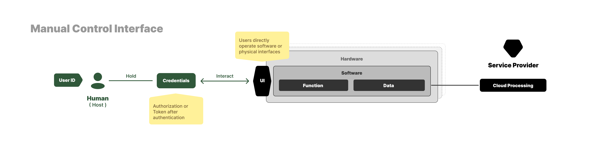

# Fin de la Era de la Operación Manual

El Capítulo 1 esbozó los puntos de dolor actuales de la era Fay. Este capítulo los devuelve al contexto histórico para ver con claridad una y la misma cosa: el mecanismo de asignación de responsabilidad que ha sostenido tres décadas de sociedad digital en la Era de la Operación Manual está saliendo silenciosamente de escena.

## "Operación es responsabilidad" es una vieja cadena invisible

Antes de los Fays, cada interacción entre los humanos y el mundo digital se apoyaba en un hecho llano: **la persona que opera es la persona responsable**.

Abrir una aplicación, escribir texto, pulsar un botón, encender una lámpara en un punto remoto, transferir una suma desde una cuenta — cada acción era iniciada por una persona específica, y cada consecuencia recaía finalmente sobre esa persona. Ya fuera en la capa del sistema operativo, en la capa del formulario web o en la capa de terminal IoT, los dedos, los ojos y el juicio humanos quedaban incrustados en la cadena de cada acto. En la auditoría, el sistema solo necesitaba registrar un hecho: esta cuenta, en este momento, hizo esto. La persona detrás de la cuenta era el término de la responsabilidad.

Esta llana cadena de responsabilidad atravesó toda la era digital. Los acuerdos de usuario fijaban la responsabilidad a la cuenta registrada, el control interno empresarial la fijaba al código de puesto, la regulación financiera la fijaba a la identidad de nombre real, y el derecho penal, al rastrear delitos cibernéticos, terminaba rastreando a la persona específica sentada frente a la pantalla. El modelo tripartito "titular del dato — encargado — responsable" de GDPR y PIPL, la lógica "el usuario autoriza a la aplicación" de OAuth y la asunción "la cuenta vincula los permisos" de IAM se apoyan todos en esta misma cadena invisible.

Cada punto de dolor del Capítulo 1 se apoya esencialmente en esta vieja cadena. Resultan inquietantes porque la gente sigue presuponiendo subconscientemente "el actor es la parte responsable". Una vez que entra un Fay, esa presunción deja silenciosamente de sostenerse, y toda la infraestructura social construida sobre ella aún no se ha dado cuenta — esa es la verdadera fuente del malestar.

## Dónde se rompe la cadena

Cuando un Fay actúa en un terminal en lugar de un Human Prime, tres cosas ocurren al mismo tiempo que antes nunca:

- el iniciador de la acción ya no es el Human Prime, sino el Fay;
- el contenido de la acción ya no es dictado paso a paso por el Human Prime, sino inferido de forma autónoma por el Fay;
- las consecuencias de la acción siguen recayendo sobre el Human Prime y sobre las personas y organizaciones a las que pertenece.

Una fisura estructural se abre entre los dos primeros y el tercero. Esta fisura no es una falla técnica, ni la "pérdida de control" de un Fay individual. Es el efecto secundario estructural que sigue necesariamente cuando esta nueva especie, el Fay, llega a existir: **por primera vez, el iniciador de la acción y el portador de la responsabilidad quedan sistemáticamente separados**.

Cuando un dron se descontrola, el iniciador es el Fay a bordo, y las consecuencias no pueden repartirse entre usuario, fabricante y autoridades de la ciudad; en el discurso en nombre de alguien, el iniciador es el Fay, y las consecuencias caen sobre la persona cuya cuenta lo aloja; en la custodia de privacidad, lo que "retiene los datos y actúa" es el Fay, y las consecuencias por cualquier infracción no tienen destino claro; en el vacío regulatorio, cada país ve parte del acto, y ningún país ve la cadena entera de responsabilidad. Sea cual sea la dimensión que mire, el cuerpo de la fisura es el mismo: el iniciador del acto ya no equivale al portador de la responsabilidad.

El estado producido por esta separación sistémica es el **vacío de responsabilidad**.

Una vez que se tolera un vacío de responsabilidad, erosiona rápidamente los cimientos sobre los que opera toda la sociedad digital. Derecho, seguros, crédito, opinión pública, regulación — todos están construidos sobre la premisa de que "un acto puede rastrearse hasta algún sujeto responsable". Cuando los Fays saturen la sociedad a escala, esta premisa ya no se sostendrá por defecto; debe ser reconstruida.

## Tres caminos teóricos, solo uno es transitable

Frente al vacío de responsabilidad, hay en teoría tres caminos.

El primero es prohibir que los Fays actúen. Esto equivale a prohibir los coches en las carreteras, la electricidad en las redes, la difusión de Internet. Es realizable en ingeniería, pero en términos civilizatorios es una regresión — todo valor de la era Fay descrito en el Capítulo 1 se abandona por este camino. El Faying Protocol no lo adopta.

El segundo es dejar que el Fay asuma la responsabilidad él mismo. Eso requiere que el Fay tenga personalidad jurídica, capacidad financiera, crédito independiente y un mecanismo de responsabilidad emocional compartida. Como proposición filosófica es interesante, pero en el horizonte previsible ninguna jurisprudencia o infraestructura social puede recibir una "entidad inteligente que no es ni persona física ni persona jurídica y que sin embargo asume responsabilidad de forma independiente". Este camino está fuera de la vista en el período actual.

El tercero es ligar control y responsabilidad mediante un **contrato explícito** — mientras el Fay esté dentro de este contrato, sus actos son atribuidos a un Human Prime específico; en cuanto sale del contrato, debe detenerse inmediatamente.

El tercer camino no requiere reescribir la ley, inventar nueva personalidad ni esperar a la reforma del consenso social. Solo requiere actualizar la vieja cadena de "operación es responsabilidad" de la Era de la Operación Manual a una cadena contractual que pueda conmutarse explícitamente entre humano y Fay.

Este camino no es óptimo. Es el **único camino transitable** que puede aterrizar hoy, que no abandona el valor Fay, y que puede impedir que el vacío de responsabilidad se propague. Ese contrato es el Faying Protocol.

## Qué hace, y qué no hace

El Faying Protocol no es una definición de la capacidad Fay, ni un código de conducta Fay. Es el subprotocolo dentro de la familia de protocolos iFay responsable de la semántica de "control bajo custodia y control delegado", respondiendo a una pregunta que parece simple pero que ha sido respondida silenciosamente durante miles de años en la Era de la Operación Manual:

> **Para este acto, ahora mismo, ¿quién es finalmente responsable?**

La respuesta de la Era de la Operación Manual era obvia — la persona cuya mano operaba. En la era Fay esta respuesta ya no se sostiene por defecto; un contrato debe, de manera explícita, verificable y revocable, dejar clara la respuesta.

El Faying Protocol abstrae el núcleo de este contrato en dos primitivas interdependientes. **Faying** denota que un Fay, un terminal o una aplicación de software se encuentra bajo la custodia de algún Human Prime; una vez establecido el Faying, todos los actos del Fay se atribuyen a ese Human Prime. **Rogue State (Rogue Fay)** denota que un Fay no se encuentra actualmente en ninguna relación Faying; en este estado el Fay debe detener inmediatamente toda acción hacia el exterior — su existencia está permitida, su acción no.

La relación entre estas dos primitivas no es un "interruptor" técnico; es una línea ética de fondo cuya ruptura no puede tolerarse:

> **No existe ninguna acción de Fay sin parte responsable.**

El propósito entero por el que existe el Faying Protocol es mantener esta línea de fondo técnicamente cumplida con fidelidad incluso después de que los Fays saturen la sociedad a escala. Lo que los capítulos posteriores responden no es "¿necesitamos este contrato?" — eso ya lo ha respondido la realidad — sino "¿cómo aterrizamos este contrato en la capa de protocolo, en la práctica de ingeniería, y entre soberanos y proveedores en entornos productivos?".

