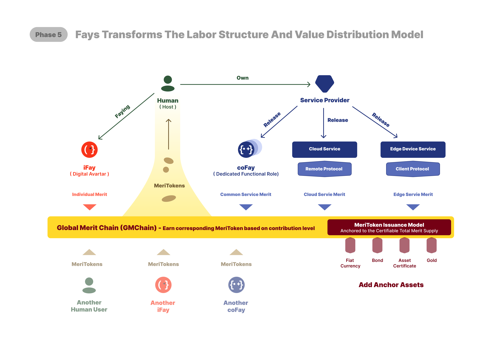

# Phase 5: Estado Final del Ecosistema

Phase 5 es la perspectiva de estado final de la Mission Path. No introduce ningún nuevo tipo de relación para el Faying Protocol; en cambio, responde a una pregunta de mayor alcance:

> **Cuando todos los tipos de relación de las Phases 1 a 4 se extienden por la sociedad, se entrelazan y operan a escala, ¿qué imagen global presenta el ecosistema Faying?**

Para Phase 5, Faying cubre Human Prime ↔ iFay (Phase 1), la asunción derivada de terminales por iFay (Phase 2), la asunción derivada de aplicaciones de software por iFay (Phase 3), la delegación y colaboración iFay ↔ coFay (Phase 4) y la colaboración multidireccional iFay ↔ iFay a través de organizaciones y ecosistemas que se sigue de manera natural de estas relaciones fundacionales.

La clave en Phase 5 no es "extender un tipo más de relación" sino mantener consistente en atribución todo el ecosistema Faying mientras opera a escala. Este es el compromiso más profundo a lo largo de toda la Mission Path.

## Cuatro juicios clave

Los detalles concretos del protocolo para Phase 5 están aún lejos del presente. Este capítulo ofrece, en el plano del blueprint, solo unos pocos juicios que sirvan de referencia para el trabajo posterior de las specs.

**La consistencia de la atribución no se permitirá que se diluya a medida que crece la escala**. Sin importar si el número total de relaciones Faying crece desde los cientos de millones actuales hasta los cientos de miles de millones, la línea ética del Capítulo 13 — "No existe ninguna acción de Fay sin parte responsable" — debe seguir sosteniéndose. La escala no es razón para relajar la línea de fondo.

**La colaboración entre custodias debe expresar explícitamente la ruta de la transferencia de atribución**. En el entorno masivamente entrelazado de Phase 5, una acción puede ser completada por múltiples Fays colaborando a través de múltiples Faying States. Todo acto específico debe ser trazable a un Human Prime específico o a un rol específico, y no se permite que se convierta en "la responsabilidad del ecosistema en su conjunto".

**La visibilidad del Faying debe resistir la operación a escala social**. El Human View del Capítulo 11 se enfrentará a una verdadera prueba de estrés en el entorno de Phase 5: cuando un Human Prime ordinario pueda estar bajo custodia de docenas o cientos de Fays y terminales derivados al mismo tiempo, la "alcance de la información" y la "ruta de intervención siempre abierta" deben respaldarse en la capa de protocolo mediante ingeniería, sin depender de que el Human Prime vigile en cada momento. El diseño de protocolo de Phase 5 debe reforzar específicamente mecanismos — alertas automáticas, degradación automática, transición automática a Rogue — que ahorren la atención del Human Prime.

**La interoperabilidad entre ecosistemas se construye sobre Faying**. Una vez que el ecosistema Faying esté lo bastante maduro, la colaboración Fay entre proveedores y plataformas usará la relación Faying como el punto de entrada de la confianza. Cuando cualquier Fay entre en colaboración entre ecosistemas, la otra parte debe poder verificar "¿está actualmente en Faying State, y a quién pertenece?", en lugar de depender de la capa de cumplimiento a medida de cada proveedor. Esto eleva el Faying Protocol a un papel similar al de TCP/IP en los primeros días de Internet — una especie de "infraestructura para la atribución de responsabilidad" entre ecosistemas.

## Relación con la forma social

La perspectiva esbozada por Phase 5 conecta con la "nueva imagen social" propuesta en [ifay.ai](https://ifay.ai): la salida del trabajo humano del trabajo, el aplanamiento del conocimiento, las garantías universales de subsistencia, la nueva creación de valor, la nueva estratificación social. Estas evoluciones del plano social son condiciones externas para la operación del ecosistema Faying en Phase 5 — el ecosistema Faying sirve a las nuevas formas sociales, y las nuevas formas sociales también necesitan al ecosistema Faying como su base operativa.

El Faying Protocol no resuelve la conformación de la forma social en sí; eso pertenece a los temas de mayor nivel del panorama de ifay.ai. Pero el Faying Protocol debe ser capaz de portar todo requisito que las nuevas formas sociales pongan sobre la responsabilidad, la custodia y la atribución, en lugar de dejar que las nuevas formas sociales corran al desnudo en la capa de protocolo.

> Phase 5 no proporciona un diagrama de arquitectura en el conjunto actual de ilustraciones. Esta etapa está aún distante; la arquitectura específica en la capa de ingeniería todavía no es adecuada para congelarse de forma prematura como ilustración final.
