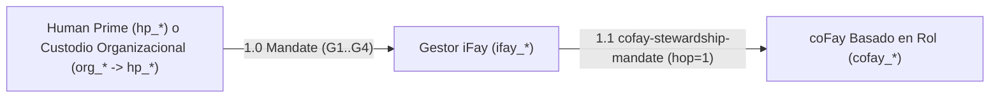

## §1 Descripción General y Alcance

Esta especificación define **Faying Protocol/1.1 (`coFay` Delegated Stewardship Profile)**. Cumple estrictamente las reglas de extensión `MINOR` retrocompatible de `Faying Protocol/1.0` §1.7.2: todos los mensajes, máquinas de estados y códigos de error de `Faying Protocol/1.0` (`2025-10-25` Final y `schemas/fap-1.0.cddl`) permanecen intactos. Los pares que solo admiten `1.0` negocian `Faying Protocol/1.0` según §1.7.3 o ignoran de forma segura las extensiones opcionales desconocidas.

En el ecosistema iFay (`Fay = iFay + coFay`), un `iFay` está vinculado a un único Human Prime, mientras que un `coFay` es una entidad digital de silicio basada en roles regida por una Role Charter sin réplica de personalidad individual. Para garantizar que **toda acción externa de cualquier entidad de silicio se atribuya sin ambigüedad a un Human Prime responsable**, este perfil extiende la cadena `Human Prime ↔ iFay` mediante un mandato criptográfico `iFay Manager → coFay` y una autorización atómica de transferencia con doble firma.

### §1.1 Lenguaje Normativo (RFC 2119 y RFC 8174)

Las palabras clave `MUST`, `MUST NOT`, `REQUIRED`, `SHALL`, `SHALL NOT`, `SHOULD`, `SHOULD NOT`, `RECOMMENDED`, `NOT RECOMMENDED`, `MAY` y `OPTIONAL` en este documento deben interpretarse según [BCP 14](https://www.rfc-editor.org/info/bcp14) ([RFC 2119](https://www.rfc-editor.org/rfc/rfc2119) y [RFC 8174](https://www.rfc-editor.org/rfc/rfc8174)) únicamente cuando aparecen en mayúsculas. En caso de discrepancia entre traducciones, prevalecen el texto en chino simplificado (`zh-CN`) y `schemas/fap-1.1-cofay.cddl`.

---

## §2 Cadena de Atribución de Responsabilidad de Tres Niveles

Un `coFay` `MUST NOT` autoemitir un mandato raíz y `MUST NOT` operar bajo una entidad anónima sin anclaje en un Human Prime. Todo `cofay-stewardship-mandate` válido `MUST` formar la siguiente cadena de tres niveles:

1. **Ancla de Responsabilidad Última (`steward_entity` + `accountable_human_prime`)**: Para custodia individual (`hp_*`), `MUST` coincidir con `accountable_human_prime`; para custodia organizacional (`org_*`), `MUST` declarar un `accountable_human_prime` (`hp_*`) válido (de lo contrario se rechaza con `1010 E_HUMAN_WITNESS_REQUIRED`).
2. **Nivel de Agente Gestor (`manager_fay_id`)**: `MUST` ser un `ifay_*` con mandato `Faying Protocol/1.0` activo; un `cofay_*` `MUST NOT` actuar como emisor.
3. **Nivel de Sujeto Ejecutor (`subject_cofay_id`)**: `MUST` ser un `cofay_*` regido por `charter_id`, cuya conformidad se verifica mediante `coFACTS` (separado de `iFACTS` para `iFay`).

---

## §3 Cuatro Invariantes de Seguridad contra Amplificación (Normative)

Los verificadores de un `cofay-stewardship-mandate` `MUST` aplicar en orden estricto:

1. **Parada Segura en Cascada ante `G0` o Revocación (`safe-state-halt`)**: Si el Human Prime o el gestor `iFay` superior entra en `G0` (`EmergencyOverride`) o `Revoked`, el `coFay` `MUST` pasar de inmediato a `safe-state-halt` devolviendo `1024 E_UPSTREAM_EMERGENCY_HALT`, y `MUST NOT` invocar terminales Host ni habilidades externas usando estado en caché.
2. **Techo de Un Solo Salto**: `hop_count == 1` y `max_stewardship_hops == 1` son obligatorios (`MUST`); cualquier subdelegación devuelve `1023 E_STEWARDSHIP_HOP_LIMIT`.
3. **No Amplificación de Grado**: `grade <= manager_grade` (`0..4`) es obligatorio (`MUST`); cualquier exceso se rechaza con `1021 E_GRADE_AMPLIFICATION`.
4. **Doble Convergencia de Alcance y Ventana Temporal**: `scope` (`domains`, `actions`, `terminals` opcionales y límites de `budget`) `MUST` ser subconjunto simultáneo de `charter_scope` y `manager_scope`, y `[not_before, not_after]` `MUST` estar contenido en `[manager_not_before, manager_not_after]` (violaciones devuelven `1022 E_SCOPE_ESCAPE`).

---

## §4 Transferencia Atómica con Doble Firma (`cofay-transfer`)

Ante rotaciones de puesto o cambios organizativos, la transferencia de custodia `MUST` ejecutarse atómicamente mediante `cofay-transfer-authorization`:

- **Entrada Canónica con Separación de Dominio**: Tanto `from_steward` como `to_steward` `MUST` firmar la secuencia UTF-8 `"ifay.faying.cofay-transfer.v1:"` concatenada con la serialización RFC 8785 JCS del objeto sin firmas.
- **Criterios de Aceptación Atómica**: La autotransferencia (`from_steward == to_steward`), las ventanas vencidas o los identificadores inválidos se rechazan con `1026 E_TRANSFER_WINDOW_OR_PARTY_INVALID`; si falta o falla cualquiera de las dos firmas, se revierte toda la operación con `1025 E_TRANSFER_DUAL_SIG_REQUIRED`. El historial en GMChain permanece auditable y MeriToken (`μ`) conserva estrictamente su carácter de reputación no monetaria.

---

## §5 Esquemas Normativos, Códigos de Error y Vectores

| Código | Nombre | Condición | Acción en Tiempo de Ejecución |
| --- | --- | --- | --- |
| `1010` | `E_HUMAN_WITNESS_REQUIRED` | Falta un `accountable_human_prime` válido | Rechazar mandato |
| `1021` | `E_GRADE_AMPLIFICATION` | `grade > manager_grade` o grado fuera de rango | Rechazar mandato |
| `1022` | `E_SCOPE_ESCAPE` | `scope` o ventana fuera de `charter_scope ∩ manager_scope` | Rechazar mandato |
| `1023` | `E_STEWARDSHIP_HOP_LIMIT` | `hop_count != 1` o subdelegación no emitida por `ifay_*` | Rechazar mandato |
| `1024` | `E_UPSTREAM_EMERGENCY_HALT` | Estado superior en `G0` o `Revoked` | Entrar en `safe-state-halt` |
| `1025` | `E_TRANSFER_DUAL_SIG_REQUIRED` | Falta o es inválida la firma de una de las partes | Revertir transferencia |
| `1026` | `E_TRANSFER_WINDOW_OR_PARTY_INVALID` | Autotransferencia, ventana expirada o ID inválido | Rechazar transferencia |

- **Esquema CDDL Autoritativo**: `schemas/fap-1.1-cofay.cddl`
- **Vista JSON Schema**: `schemas/fap-1.1-cofay.json`
- **Vectores de Conformidad**: `vectors/cofay-stewardship-v1.1.json` (`V01`–`V10`, verificados en TypeScript y Rust).
