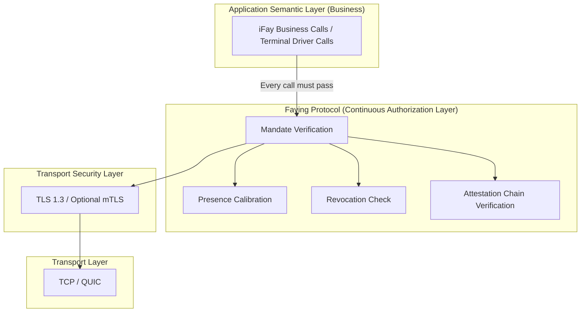
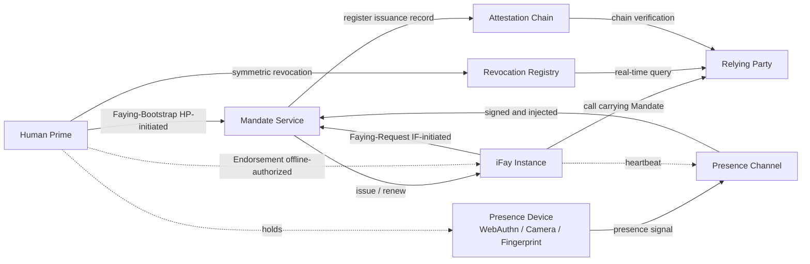
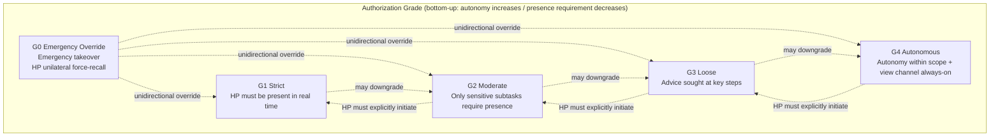
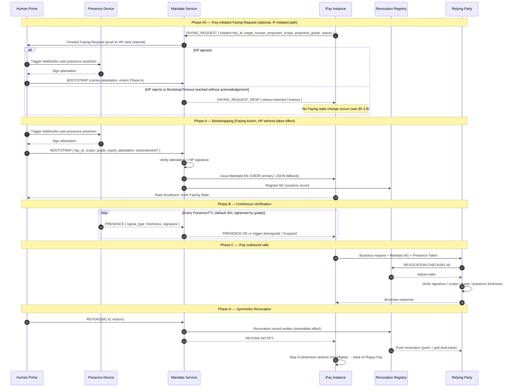

> Navegación del cuerpo del protocolo: [Índice](./README.md) | anterior [§1 Visión general](./01-Vision-General.md) | siguiente [§3 Componentes e interfaces](./03-Componentes-e-Interfaces.md)

## §2 Arquitectura

Este capítulo ofrece la vista arquitectónica global del Faying Protocol a nivel de protocolo:

- **§2.1 Posición en la pila del protocolo**: caracteriza la posición de capa del Faying Protocol sobre TLS 1.3 y por debajo de la semántica de negocio, explicitando la restricción dura de que «toda acción saliente de un iFay debe atravesar la puerta de verificación del Mandate»;
- **§2.2 Relaciones entre entidades**: enumera las 7 clases de entidad que el protocolo involucra y sus límites de responsabilidad, y ofrece las aristas Faying bidireccionales (iniciada por HP / iniciada por IF) junto con la arista de endoso offline (Endorsed Mandate);
- **§2.3 Jerarquía de niveles de autorización**: presenta el espectro de niveles y las direcciones de conmutación para los cinco niveles G0–G4 a lo largo de las dos dimensiones de autonomía / requisito de presencia;
- **§2.4 Secuencia de interacción central**: cose BOOTSTRAP (incluida la vía iniciada por IF de la Fase A0) + Verificación continua + Acción + Revocación simétrica en una única secuencia de extremo a extremo, sirviendo de ancla visual para los capítulos posteriores (§5 Mensajes / §7 Niveles / §8 Ciclo de vida / §10 Manejo de errores);
- **§2.5 Principios de diseño**: enuncia los 6 principios de diseño que la capa de protocolo debe seguir siempre (Default-Deny / Least-Privilege / Continuous-Verification / Auditable-by-Construction / Human-Override / Graceful-Degradation).

> **Nota sobre la trazabilidad EARS**: cada restricción dura de nivel arquitectónico de este capítulo va seguida de una línea `Trace:` que enumera los identificadores de subcláusula EARS correspondientes (de la base de requisitos) con la forma `R<requirement>.<criterion>.<clause>`.
>
> **Alineación de terminología**: los nombres de entidad que aparecen en este capítulo (Human Prime / iFay Instance / Presence Device / Mandate Service / Presence Channel / Attestation Chain / Revocation Registry / Relying Party, etc.) son plenamente coherentes con la referencia rápida de alineación de terminología del Anexo A; siempre que este capítulo y el Anexo A parezcan ambiguos en cuanto a terminología, **prevalece el Anexo A**.

### §2.1 Posición en la pila del protocolo

**Postura de diseño**: el Faying Protocol no sustituye a TLS, ni reinventa OAuth; se sitúa sobre TLS y por debajo de la semántica de negocio, obligando a que **toda acción saliente de un iFay** atraviese la puerta de verificación del Mandate. Cualquier llamada saliente que eluda la puerta del Faying Protocol se trata como una Rogue Action y debe ser rechazada por un middleware situado por encima de la capa de transporte y por debajo de la capa de negocio.

**Restricciones duras a nivel de protocolo**:

- **A-Stack-1 (toda llamada debe pasar la verificación de cuatro elementos)**: antes de aceptar cualquier llamada saliente individual de un iFay Instance, un Relying Party debe completar, en orden, la verificación del Mandate / la calibración de presencia / la comprobación de revocación / la verificación de la cadena de atestación — los cuatro; la ausencia de cualquiera de ellos se trata como una Rogue Action que elude la puerta y se rechaza por Default-Deny.
  - **Trace**: `R2.1.1` (sin Mandate → rechazo por defecto), `R2.1.2` (comprobación de alcance), `R2.1.3` (campo ausente → rechazo), `R2.1.4` (RR inalcanzable → rechazo Default-Deny).
- **A-Stack-2 (separación de funciones entre la capa de canal y la de autorización)**: la confidencialidad del canal y la identidad del extremo remoto las soporta TLS 1.3 / mTLS opcional, y el Faying Protocol no las rehace; el Faying Protocol es responsable únicamente de la semántica de «autorización continua» y no introduce funciones de handshake o acuerdo de claves a nivel de protocolo que se solapen con TLS.

### §2.2 Relaciones entre entidades

**Notas sobre la arista Faying bidireccional**:

- `HP --> MS (Faying-Bootstrap, iniciada por HP)`: el Human Prime inicia Faying de forma proactiva (establecimiento o ajuste) a través del canal BOOTSTRAP (véase §5.3.1).
- `IF --> MS (Faying-Request, iniciada por IF)`: el iFay Instance busca Faying de forma proactiva ante el Human Prime; la solicitud pasa primero por Mandate Service, y luego el Human Prime la reconoce mediante BOOTSTRAP para que cobre efecto (véase §2.4 Fase A0, §5.3.6 FAYING_REQUEST).
- `HP -. Endorsement (autorizado offline) .-> IF`: la declaración de endoso de un Endorsed Mandate porta semántica de preautorización offline — en el momento de BOOTSTRAP el HP empaqueta `endorsed_scope` / `endorsed_grade` / `endorsed_lifetime` en el Mandate de una sola vez, permitiendo que el iFay opere de forma autónoma dentro de un envoltorio restringido durante la desconexión física; esta arista no es «comunicación en tiempo de ejecución» sino más bien «semántica precargada portada en campos del Mandate» (véase el campo `endorsement` de §4.1, §7.5 Endorsement Grades).

**Responsabilidades de las entidades**:

| Entidad | Funciones a nivel de protocolo | Límite de responsabilidad / autoridad |
| --- | --- | --- |
| **Human Prime (HP)** | La única entidad que puede iniciar una Faying Action; la única entidad que posee el poder de revocación; el único punto final último que asume la responsabilidad | En cualquier instante la acción saliente del iFay puede atribuirse inequívocamente a un único HP; cualquier cambio de estado Faying debe obtener un reconocimiento explícito, no engañado y verificable del HP |
| **iFay Instance (IF)** | La entidad agente mandatada, identificada de forma única por FayID; debe presentar un Mandate válido en cada llamada saliente; puede buscar Faying de forma proactiva ante el HP (FAYING_REQUEST) o solicitar la desconexión de Faying | No posee el poder de revocar su propio Mandate; no existe vía legítima para autoelevaciones de nivel; FAYING_REQUEST solo cobra efecto con el reconocimiento explícito del HP |
| **Presence Device (PD)** | Hardware que porta las credenciales WebAuthn / FIDO2 y las capacidades biométricas; la fuente física de las señales de presencia | Toda Presence Signal debe estar firmada por el PD y portar `nonce + produced_at + device_attestation`; la ventana de frescura no la porta la señal sino que la da el `presence_req.max_staleness_ms` del Mandate correspondiente |
| **Mandate Service (MS)** | El servicio lógico que emite / renueva / degrada / revoca Mandates en nombre del HP | No existe vía legítima para «MS decidir el bootstrap por sí mismo» ni para «MS sustituir al HP en completar el reconocimiento Faying»; cuando el MS es inalcanzable, converger a Default-Deny |
| **Presence Channel (PC)** | El flujo de presencia de baja latencia y resistente a repetición desde el PD al MS; también soporta la fuente de señal subyacente del Liveness Channel de §3.5 | el nonce es de un solo uso; una señal que supera el `presence_req.max_staleness_ms` del Mandate correspondiente se trata como obsoleta; el mismo nonce puede aceptarse como máximo una vez dentro de `2 × max_message_lifetime` |
| **Attestation Chain (AC)** | La cadena de firmas trazable en reverso formada por todas las acciones de emisión HP → MS → IF → IF derivado | Cada nodo de la cadena debe estar firmado por su padre y tener una marca de tiempo dentro de la ventana de validez del padre; cualquier nodo ausente o con firma inválida vuelve no confiable la cadena entera |
| **Revocation Registry (RR)** | Servicio de estado de revocación en tiempo real (sondeo corto tipo OCSP + empuje activo + reserva conservadora) | La latencia de visibilidad de la revocación ≤ `RevocationVisibilityBudget`; cuando el RR es inalcanzable y ≥ `StaleBudget` el RP debe rechazar (no se permite «paso optimista») |
| **Relying Party (RP)** | El terminal, aplicación o servicio llamado por el iFay | En cada llamada, verifica obligatoriamente la tupla de cuatro elementos (Mandate / Presence / Attestation / Revocation); el fallo de cualquiera → rechazo |

**Restricciones duras a nivel de protocolo**:

- **A-Ent-1 (punto final único que asume la responsabilidad)**: para cualquier llamada saliente aceptada por el RP, el nodo raíz de la Attestation Chain de su Mandate corresponde a exactamente un Human Prime; cuando coexisten varios emisores, rechazar con `E_PROTOCOL`.
  - **Trace**: `R1.1.1` (la raíz de la AC corresponde a exactamente un HP), `R1.1.2` (cuando varios Mandates están Active simultáneamente, el Mandate seleccionado y los Mandates coexistentes deben compartir el mismo emisor HP), `R1.1.3` (discrepancia de emisor → rechazo con `E_PROTOCOL` y escritura en la AC + empuje al canal de vista del HP).
- **A-Ent-2 (sin Faying = Rogue Fay)**: el estado de comportamiento de un iFay Instance en cualquier instante pertenece al conjunto binario `{Faying State, Rogue Fay}`; no existe un tercer estado, ni ninguna zona gris de «ni Faying ni Rogue».
  - **Trace**: `R1.1.4` (la quíntupla del registro de auditoría reconstruye el punto final que asume la responsabilidad, lo que entraña la observabilidad del estado binario — esta subcláusula cae dentro del conjunto de Requirements declarado por esta tarea).

### §2.3 Jerarquía de niveles de autorización

**Reglas centrales**:

- Las **degradaciones** (G_ST → G_MO → G_LO → G_AU) pueden ser disparadas automáticamente por el protocolo bajo reglas embebidas en el Mandate (p. ej. señal de presencia perdida → degradación automática a un nivel más estricto; nota: presencia perdida → «más estricto» significa G_AU → G_LO y «direcciones inversas» similares; véase §7).
- Las **elevaciones** (hacia mayor autonomía) deben ser iniciadas explícitamente por el HP mediante una nueva Faying Action; no se permite ninguna elevación autónoma por parte del iFay o del MS.
- **G0 Emergency Override** puede ser iniciado unilateralmente por el HP en todo momento, anulando cualquier nivel actual, empujando inmediatamente al iFay a Suspended a la espera de revisión humana.

**Restricciones duras a nivel de protocolo**:

- **A-Grade-1 (las elevaciones deben portar testimonio del HP)**: cuando GRADE_SWITCH tiene `target_grade.autonomy > current_grade.autonomy`, la solicitud debe portar un `human_witness` verificable (forma predeterminada: aserción de presencia de usuario WebAuthn); ausencia o firma inválida → rechazo con `E_HUMAN_WITNESS_REQUIRED`.
  - **Trace**: `R6.1.1` (las elevaciones deben portar testimonio del HP), `R6.1.2` (ausencia o firma inválida → `E_HUMAN_WITNESS_REQUIRED`).
- **A-Grade-2 (la dirección de pérdida de presencia se ajusta monótonamente)**: cuando se pierden las señales de presencia, la siguiente transición de estado migra a `Degraded(grade')` o `Suspended`, con `grade'.autonomy < current.autonomy`; permanecer en el nivel original está prohibido, conmutar hacia mayor autonomía está prohibido.
  - **Trace**: `R5.2.1` (migrar a un grade' más estricto), `R5.2.2` (no permanecer / no optimismo inverso).
- **A-Grade-3 (G0 tiene la máxima prioridad y es exclusivo del HP)**: G0 Emergency Override se procesa con la máxima prioridad sobre cualquier nivel actual y cualquier cola de eventos actual; solo el HP puede iniciar explícitamente G0; un G0 autoiniciado por IF / MS / SA se rechaza uniformemente con `E_PROTOCOL`.
  - **Trace**: `R6.2.1` (G0 máxima prioridad), `R6.2.4` (solo el HP puede iniciar G0).

### §2.4 Secuencia de interacción central (Bootstrap + Heartbeat + Action)

**Restricciones clave de la Fase A0**:

- Un FAYING_REQUEST iniciado por IF no produce directamente un Mandate; el MS actúa solo como reenviador, empujando la solicitud al canal de vista del HP.
- El reconocimiento del HP debe adoptar la forma de un mensaje BOOTSTRAP + atestación verificable; no existe vía legítima para «que el MS consienta por defecto en nombre del HP».
- Si el HP no da un reconocimiento explícito dentro de `BootstrapTimeout` (predeterminado 60 s, véase el Anexo B), el MS debe devolver `FAYING_REQUEST_RESP { status=timeout }` y escribir el evento en la Attestation Chain; mientras tanto, el FAYING_REQUEST debe registrarse con `E_FAYING_REQUEST_NOT_CONFIRMED` (código de error 1014).
- Véanse las definiciones de mensaje FAYING_REQUEST / FAYING_REQUEST_RESP de §5.3.6 y el código de error 1014 de §5.4.

**Restricciones duras a nivel de protocolo**:

- **A-Seq-1 (el testimonio del HP es insustituible)**: el BOOTSTRAP de la Fase A0 / Fase A debe portar un `human_witness` verificable; no existe vía legítima para que IF / MS / SA sustituyan al HP en completar el reconocimiento Faying.
  - **Trace**: `R1.3.1` (lo iniciado por HP debe presentar un reconocimiento explícito verificable), `R1.3.2` (la vía iniciada por IF solo cobra efecto tras el reconocimiento explícito del HP), `R1.3.5` (no se proporciona vía legítima para que IF / MS / SA sustituyan al HP en completar el reconocimiento).
- **A-Seq-2 (el timeout de lo iniciado por IF no produce cambio de estado)**: un FAYING_REQUEST iniciado por IF que no logre obtener el reconocimiento explícito del HP dentro de `BootstrapTimeout` caduca o es rechazado y no produce ningún cambio de estado Faying; el evento se escribe en la Attestation Chain independientemente de la efectividad.
  - **Trace**: `R1.3.3` (rechazo sin cambio de estado cuando transcurre `BootstrapTimeout` sin reconocimiento), `R1.3.4` (evento escrito en la AC independientemente de la efectividad).
- **A-Seq-3 (revocación simétrica de la Fase D)**: una vez que el REVOKE iniciado por HP se publica a través del MS, todas las consultas posteriores del RP deben devolver `revoked` dentro de `RevocationVisibilityBudget` (predeterminado 1 s); el MS empuja simultáneamente notificaciones REVOKE a los RP suscritos.
  - **Trace**: `R4.1.1` (cada entrada BOOTSTRAP corresponde al menos a una entrada REVOKE igualmente alcanzable), `R4.1.2` (la profundidad de la vía REVOKE ≤ la profundidad de la vía BOOTSTRAP), `R4.1.3` (la intensidad de autenticación de la entrada REVOKE no es más estricta que la de BOOTSTRAP).
- **A-Seq-4 (el canal de vista del HP debe alcanzarse)**: el reenvío de la Fase A0, la difusión de estado de la Fase A y las notificaciones REVOKE de la Fase D deben publicarse a través del canal de vista del HP; cualquier transición de estado debe hacerse visible para el HP tras su finalización.
  - **Trace**: `R3.3.1` (las transiciones de estado del Mandate se publican en el canal de vista del HP tras su finalización).

### §2.5 Principios de diseño

La tabla siguiente ofrece los 6 principios de diseño que el Faying Protocol debe seguir siempre a nivel de protocolo. Cada principio tiene dos columnas: **aterrizaje a nivel de protocolo** y **subcláusulas EARS correspondientes**, asegurando que los principios no se queden en el nivel de eslogan.

| Principio | Aterrizaje a nivel de protocolo | Subcláusulas EARS correspondientes |
| --- | --- | --- |
| **Default-Deny** | Sin Mandate → rechazo; ausencia de cualquiera de alcance / nivel / ventana de tiempo del Mandate → rechazo; cuando el RR es inalcanzable y ≥ `StaleBudget` → rechazo por Default-Deny | `R2.1.1`, `R2.1.2`, `R2.1.3`, `R2.1.4` |
| **Least-Privilege** | El Mandate debe declarar explícitamente `scope`; la «delegación de todos los poderes» está prohibida; los comodines / coincidencia por prefijo en `scope.actions` están prohibidos a nivel de protocolo; en la derivación `child.scope ⊆ parent.scope` converge estrictamente | `R2.1.2`, `R2.1.3` |
| **Continuous-Verification** | Cada llamada pasa por las comprobaciones de Presence y Revocation; sin caché de confianza; `PresenceState.last_freshness ≥ now − max_staleness_ms` es la precondición para aceptar una llamada; la frescura — no el periodo de sondeo del heartbeat — es la base para dejar pasar una llamada | `R5.1.1`, `R5.1.2`, `R5.1.3`, `R5.1.4` |
| **Auditable-by-Construction** | Toda Faying Action / Revoke / Grade-Switch / Delegate debe entrar en la Attestation Chain; cualquier evento de auditoría que no esté en la cadena se trata como no confiable; el canal de vista del HP debe alcanzarse | `R3.3.1` (el canal de vista del HP debe alcanzarse) |
| **Human-Override** | G0 Emergency Override tiene siempre la máxima prioridad; solo el HP puede iniciar explícitamente G0; un G0 autoiniciado por IF / MS / SA es uniformemente `E_PROTOCOL`; tras el manejo de G0 el Mandate objetivo debe quedar Suspended | `R6.2.1`, `R6.2.2`, `R6.2.3`, `R6.2.4` |
| **Graceful-Degradation** | Señal de presencia perdida → degradación automática a un nivel más estricto; el «optimismo inverso» está prohibido; heartbeat de G4 perdido → directamente Suspended; `Degraded` que supere `MaxDegradedDuration` debe → Suspended | `R5.2.1`, `R5.2.2`, `R5.2.3`, `R5.2.4` |

**Relaciones entre principios**:

- **Default-Deny ∧ Least-Privilege** convergen conjuntamente el «conjunto de paso»: Default-Deny converge el estado predeterminado a «denegar», y Least-Privilege converge el conjunto de permitidos a la tripleta mínima «alcance explícito ∩ nivel explícito ∩ presence_req explícito»; juntos constituyen la «línea base de seguridad» del Faying Protocol.
- **Continuous-Verification ∧ Graceful-Degradation** mantienen conjuntamente la «monotonía del espectro de niveles en tiempo de ejecución»: el primero hace que cada llamada repose sobre el hecho «aún fresco ahora», el segundo asegura que, en la dirección de pérdida de presencia, el nivel siempre se ajusta hacia más estricto, nunca al revés.
- **Auditable-by-Construction ∧ Human-Override** garantizan conjuntamente «reconstruibilidad a posteriori + recuperación en tiempo real»: el primero permite que cualquier Faying Action / Revoke / Grade-Switch individual sea reconstruido por un tercero independiente, el segundo permite que el HP recupere el control en cualquier instante en forma de G0.

> **Los principios no deben debilitarse**: los 6 principios de diseño anteriores son **compromisos de grado normativo** del cuerpo del protocolo; ninguna implementación de referencia / SDK / conjunto de pruebas de conformidad de interoperabilidad puede debilitar ninguno de ellos bajo el pretexto de «comodidad de ingeniería»; si se necesita un ajuste en una versión futura, debe ser aprobado mediante el proceso de resolución descrito en §11 Cuestiones abiertas por el Protocol Committee y publicarse bajo un nuevo número de versión (ya no Faying Protocol/1.0).
