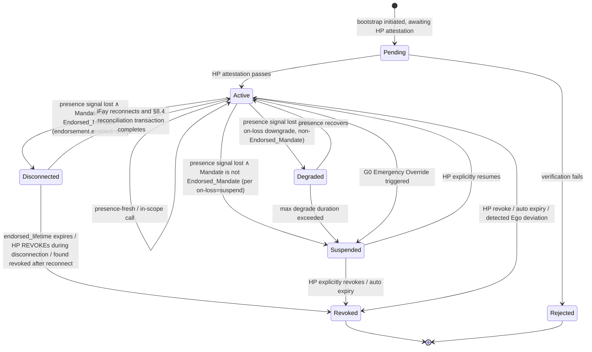

> Navegación del cuerpo del protocolo: [Índice](./README.md) | anterior [§3 Componentes e interfaces](./03-Componentes-e-Interfaces.md) | siguiente [§5 Mensajes del protocolo](./05-Mensajes-del-Protocolo.md)

## §4 Modelos de datos

Este capítulo presenta los modelos de datos centrales del Faying Protocol, en tres secciones:

- **§4.1 Vista legible por humanos en TypeScript (No normativa)** — un esqueleto legible por humanos dirigido al Protocol Committee, a los implementadores de SDK y a los revisores;
- **§4.2 Definición autoritativa en CDDL (Normativa)** — el esquema autoritativo para el formato primario CBOR; todos los bytes en la transmisión se rigen por esta sección;
- **§4.3 Máquina de estados del Mandate** — incluido el estado `Disconnected`, la matriz de condiciones de disparo de transición y la tabla de correspondencia «estado del Mandate ↔ estado de comportamiento del Fay».

> **Declaración autoritativa**: cuando la vista TypeScript de §4.1 y la CDDL de §4.2 sean incoherentes de cualquier modo, **prevalece la CDDL de §4.2**. §4.1 es solo para lectura humana y no entra en la entrada de firma en la transmisión; la codificación Deterministic CBOR de §4.2 es la única fuente de la entrada de firma (véase §6 Criptografía).
>
> **No manipulabilidad del campo endorsement**: la subestructura `endorsement` entra en la entrada de firma como campo de `mandate`; cualquier manipulación a posteriori de cualquiera de sus subcampos (`enabled` / `endorsed-scope` / `endorsed-grade` / `endorsed-lifetime-ms` / `offline-revocation-policy`) rompe la verificación de la firma del Mandate (coherente con la cláusula 3 del Requirement 11.1 y §6.3).

### §4.1 Tipos centrales (vista TypeScript, No normativa)

El bloque TypeScript siguiente ofrece, en forma legible por humanos, los tipos centrales FayID / Grade / Scope / Mandate / Endorsement / PresenceRequirement / PresenceSignal / Attestation; las definiciones autoritativas residen en §4.2.

```typescript
type FayID = string          // similar a ULID, p. ej. "fay:01HX...Z"
type HumanPrimeID = string   // p. ej. "hp:..." (anclable a un credentialId de WebAuthn)
type MandateID = string      // ULID
type Nonce = Uint8Array      // 16 bytes aleatorios

/** Nivel de autorización */
enum Grade {
  EmergencyOverride = 0,  // G0
  Strict            = 1,  // G1
  Moderate          = 2,  // G2
  Loose             = 3,  // G3
  Autonomous        = 4   // G4
}

/** Alcance de la autorización (mínimo privilegio) */
interface Scope {
  domains:    string[]    // dominios de recursos permitidos (patrón URL / similar a SPIFFE-ID)
  actions:    string[]    // acciones permitidas (read / write / control:drone:takeoff …)
  terminals?: string[]    // terminales permitidos (usados en la derivación de la fase 2)
  budget?:   ResourceBudget
}

interface ResourceBudget {
  time_window:    [IsoTime, IsoTime]
  max_invocations?: number
  max_cost_units?:  number  // unidades de recurso abstractas (dinero / cuota de inferencia / tráfico, etc.)
}

/** Mandate (sustituye al token) */
interface Mandate {
  version:       "Faying Protocol/1.0"
  id:            MandateID
  issued_at:     IsoTime
  not_before:    IsoTime
  not_after:     IsoTime          // debe ser finito: un Faying indefinido es un antipatrón
  issuer:        HumanPrimeID     // HP (o un MS autorizado por el HP)
  ms_id:         string           // el MS que emitió realmente
  subject:       FayID            // el iFay autorizado
  scope:         Scope
  grade:         Grade
  presence_req:  PresenceRequirement
  parent?:       MandateID        // apunta al Mandate padre en la derivación
  endorsement?:  Endorsement      // opcional: autorización endosada (Endorsed Mandate)
  attestation:   Attestation
  signature:     SignatureBundle  // véase §6
}

/** Endorsed Mandate — semántica precargada para la autonomía offline
 *
 * Si y solo si `enabled = true`, el iFay puede operar de forma autónoma
 * durante una desconexión física del estado Faying dentro de
 * endorsed_scope ⊆ scope y endorsed_grade.autonomy ≤ grade.autonomy;
 * endorsed_lifetime debe ser finito. El punto final que asume la responsabilidad sigue siendo siempre el issuer (Human Prime).
 */
interface Endorsement {
  enabled:                    boolean
  endorsed_scope:             Scope        // ⊆ Mandate.scope
  endorsed_grade:             Grade        // .autonomy ≤ Mandate.grade.autonomy
  endorsed_lifetime_ms:       number       // ≤ (not_after - not_before)
  offline_revocation_policy:  "stop-and-audit" | "stop-only" | "graceful-stop"
}

/** Nota sobre Scope.actions: los comodines / coincidencia por prefijo están prohibidos a nivel de protocolo (véase la restricción dura de Atomic_Action en §9 T2). */

/** Requisito de presencia (ligado al nivel) */
interface PresenceRequirement {
  signal_types:   PresenceSignalType[]
  max_staleness_ms: number     // superarlo dispara una degradación
  on_loss:        OnLossPolicy // "downgrade-to:G2" | "suspend" | "emergency-override"
}

/** Señal de presencia */
interface PresenceSignal {
  mandate_id:     MandateID
  signal_type:    PresenceSignalType
  produced_at:    IsoTime
  nonce:          Nonce
  device_id:      string
  device_attestation: Attestation
  signature:      SignatureBundle
}

/** Attestation (portador unificado de aserciones verificables) */
interface Attestation {
  format:        "webauthn" | "tpm-quote" | "platform-keystore" | "self-signed"
  payload:       Uint8Array       // autodescriptivo según el formato
  signer:        string           // id de la clave pública
  signature:     SignatureBundle
}
```

### §4.2 CDDL (formato primario CBOR, definición autoritativa)

El bloque CDDL siguiente es el **esquema autoritativo** para el formato de transmisión de Faying Protocol/1.0. Tanto los vectores de prueba oficiales de esta especificación (`vectors/`) como el conjunto de pruebas de conformidad de interoperabilidad (`conformance/`) se rigen por esta sección; el resultado de la decodificación de bytes CBOR de cualquier implementación debe ser exactamente coherente con esta sección.

```cddl
; Faying Protocol/1.0 — CBOR Data Definition Language
; Normative; this is the authoritative schema for Faying Protocol/1.0 wire format.
faying-grade = 0..4    ; 0=EmergencyOverride, 1=Strict, 2=Moderate, 3=Loose, 4=Autonomous

scope = {
  domains:    [* tstr],
  actions:    [* tstr],
  ? terminals: [* tstr],
  ? budget:   resource-budget
}

resource-budget = {
  time-window:        [iso-time, iso-time],
  ? max-invocations:  uint,
  ? max-cost-units:   uint
}

iso-time = #6.0(tstr)   ; CBOR tag 0 (RFC 3339 string)

presence-signal-type =
  "webauthn-uv-fresh" /
  "face-continuous"   /
  "fingerprint-tap"   /
  "presence-heartbeat-only" /
  "intent-ticket"

presence-requirement = {
  signal-types:        [+ presence-signal-type],
  max-staleness-ms:    uint,
  on-loss:             tstr            ; "downgrade-to:Gx" | "suspend" | "emergency-override"
}

attestation = {
  format:    "webauthn" / "tpm-quote" / "platform-keystore" / "self-signed",
  payload:   bstr,
  signer:    tstr,
  signature: signature-bundle
}

signature-bundle = {
  alg:       "Ed25519" / "ES256" / "ML-DSA-65",   ; PQC negotiation slot
  pubkey:    bstr,
  sig:       bstr,
  ? chain:   [* bstr]                              ; optional certificate chain
}

mandate = {
  version:        "Faying Protocol/1.0",
  id:             tstr,
  issued-at:      iso-time,
  not-before:     iso-time,
  not-after:      iso-time,
  issuer:         tstr,        ; Human Prime ID
  ms-id:          tstr,
  subject:        tstr,        ; FayID
  scope:          scope,
  grade:          faying-grade,
  presence-req:   presence-requirement,
  ? parent:       tstr,
  ? endorsement:  endorsement,
  attestation:    attestation,
  signature:      signature-bundle
}

endorsement = {
  enabled:                       bool,
  endorsed-scope:                scope,         ; must ⊆ main Mandate.scope
  endorsed-grade:                faying-grade,  ; must ≤ main Mandate.grade (autonomy weaker or equal, security higher)
  endorsed-lifetime-ms:          uint,          ; must ≤ (mandate.not-after - mandate.not-before)
  offline-revocation-policy:     "stop-and-audit" / "stop-only" / "graceful-stop"
}

presence-signal = {
  mandate-id:           tstr,
  signal-type:          presence-signal-type,
  produced-at:          iso-time,
  nonce:                bstr .size 16,
  device-id:            tstr,
  device-attestation:   attestation,
  signature:            signature-bundle
}
```

> **Correspondencia de nombres de campo**: CDDL usa `kebab-case` (convención del formato de transmisión); la vista TypeScript usa `snake_case` (convención de lectura humana). Los campos se corresponden uno a uno: `presence-req` ↔ `presence_req`, `endorsed-scope` ↔ `endorsed_scope`, `endorsed-lifetime-ms` ↔ `endorsed_lifetime_ms`, etc.

### §4.3 Máquina de estados del Mandate



**Semántica del estado `Disconnected`**: aplicable únicamente al Endorsed_Mandate (es decir, `endorsement.enabled = true`). Mientras se permanece en este estado:

- el iFay_Instance solo puede realizar acciones de dimensión D dentro de `endorsement.endorsed_scope`, restringido por `endorsement.endorsed_grade`;
- superar `endorsement.endorsed_lifetime` causa inmediatamente un soft-timeout → migra a Revoked, incluso mientras el iFay sigue físicamente desconectado;
- un REVOKE emitido por el HP durante la desconexión se procesa inmediatamente en cuanto el iFay se reconecta, conforme a `endorsement.offline_revocation_policy` (predeterminado `stop-and-audit`);
- la reconexión debe pasar por la transacción de reconciliación de §8.4; la «reanudación silenciosa» está prohibida.

**Matriz de condiciones de disparo de transición** (entrelazada con el Liveness Channel de §3.5 y los Requirement 11 / 12):

| Transición | Condición de disparo |
| --- | --- |
| Active → Degraded | `PresenceState.stale=true` ∧ el Mandate no es Endorsed_Mandate ∧ `on-loss = "downgrade-to:Gx"` |
| Active → Disconnected | `PresenceState.stale=true` ∧ el Mandate es Endorsed_Mandate (`endorsement.enabled=true`) |
| Active → Suspended | `PresenceState.stale=true` ∧ el Mandate no es Endorsed_Mandate ∧ `on-loss = "suspend"` |
| Disconnected → Active | el iFay se reconecta y la transacción de reconciliación de §8.4 se completa (incluidas la recuperación de Presence / el REVOKE pendiente / el GRADE_SWITCH, todos alineados) |
| Disconnected → Revoked | caduca `endorsed_lifetime` ∨ el HP ejecuta REVOKE durante la desconexión ∨ se descubre revocado tras la reconexión |

**Correspondencia estado del Mandate ↔ estado de comportamiento del Fay** (alineada con las dimensiones A/B/C/D del capítulo 13):

| Estado del Mandate | Estado de comportamiento Fay equivalente | Dimensión D (acción saliente) |
| --- | --- | --- |
| Pending | Rogue Fay | Prohibida |
| Active | Faying State | Permitida (dentro del alcance) |
| Degraded | Faying State (restringido) | Solo permitida dentro del alcance del nivel de degradación actual |
| Disconnected | Faying State (solo endosado) | Solo permitida dentro de `endorsement.endorsed_scope`, restringida por `endorsement.endorsed_grade` (véase §7.5 / §8.4) |
| Suspended | Faying State en pausa | Prohibida, pero el Mandate sigue siendo recuperable |
| Revoked | Rogue Fay | Prohibida |
| Rejected | Rogue Fay | Prohibida |
