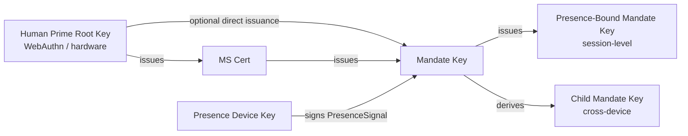

> Navegación del cuerpo del protocolo: [Índice](./README.md) | anterior [§5 Mensajes del protocolo](./05-Mensajes-del-Protocolo.md) | siguiente [§7 Niveles de autorización](./07-Niveles-de-Autorizacion.md)

## §6 Criptografía

Este capítulo presenta la especificación criptográfica de la capa del Faying Protocol, en tres secciones:

- **§6.1 Suites de algoritmos**: la tabla de negociación y las reglas para los tres escalones predeterminado / alternativo / PQC;
- **§6.2 Derivación de claves y roles**: la jerarquía de derivación y las restricciones duras desde la Human Prime Root Key hasta la Presence-Bound Mandate Key;
- **§6.3 Formato de firma**: firmas separadas (detached), entrada de firma en Deterministic CBOR, cadenas de múltiples firmas y el ancla de entrada de firma del Endorsed_Mandate.

> **Nota sobre la trazabilidad EARS**: cada regla de este capítulo va seguida de una línea `Trace:` que enumera los identificadores de subcláusula EARS correspondientes (de la base de requisitos) con la forma `R<requirement>.<criterion>.<clause>`.

### §6.1 Suites de algoritmos

| Uso | Predeterminado | Alternativo | Ranura de negociación PQC |
| --- | --- | --- | --- |
| Firma (Mandate / Presence / Attestation) | **Ed25519** | ECDSA-P256 | ML-DSA-65 (FIPS 204) |
| Hash | **SHA-256** | BLAKE3 | SHA3-256 |
| Derivación (KDF) | HKDF-SHA-256 | — | HKDF-SHA3-256 |
| Simétrico (p. ej. cuando se habilita el cifrado de stapling del Mandate) | ChaCha20-Poly1305 | AES-256-GCM | — |
| Capa de canal | TLS 1.3 obligatorio | mTLS opcional | TLS-1.3-PQ (híbrido X25519 + ML-KEM-768) |

**Reglas de negociación**:

- **N1 (cada lado declara)**: cliente y servidor deben declarar cada uno, en el momento de BOOTSTRAP, las suites de firma, hash, KDF, simétrica y de capa de canal que soportan; los valores finales para `SignatureBundle.alg`, `hash`, `kdf`, `channel-suite` deben ser los algoritmos más fuertes soportados conjuntamente.
  - **Trace**: `R8.1.1` (cada lado declara las suites soportadas en BOOTSTRAP), `R8.1.2` (se selecciona como valor final el algoritmo más fuerte soportado conjuntamente).

- **N2 (conjunto mínimo de implementación)**: toda implementación compatible debe soportar al menos el conjunto de algoritmos de firma `{Ed25519, ECDSA-P256}` simultáneamente; las suites PQC son OPTIONAL pero toda implementación debe reservar ranuras de negociación para futuras actualizaciones progresivas.
  - **Trace**: `R8.1.3` (debe soportar `{Ed25519, ECDSA-P256}` simultáneamente), `R8.2.3` (las suites PQC son `OPTIONAL` hasta marcarse como `MUST`, y BOOTSTRAP no debe rechazarse porque el par no soporte PQC).

- **N3 (sin suite común → `E_PROTOCOL`)**: si no existe ningún algoritmo de firma o hash soportado conjuntamente en el momento de BOOTSTRAP, Mandate_Service debe rechazar el BOOTSTRAP con `E_PROTOCOL`.
  - **Trace**: `R8.1.4` (rechazar BOOTSTRAP con `E_PROTOCOL` cuando no existe algoritmo común).

- **N4 (ranura de negociación PQC reservada + actualización progresiva)**: `Mandate.signature_bundle` debe proporcionar la ranura de algoritmo para soportar `ML-DSA-65` (FIPS 204) como algoritmo de firma opcional; la ranura de negociación de BOOTSTRAP debe reservar el soporte opcional para `TLS-1.3-PQ` (híbrido X25519 + ML-KEM-768); el protocolo debe permitir que la suite predeterminada se avance (roll forward) mediante la negociación de versión dentro de un ciclo de vida, sin romper la verificabilidad de los Mandates existentes.
  - **Trace**: `R8.2.1` (`Mandate.signature_bundle` proporciona la ranura de algoritmo `ML-DSA-65`), `R8.2.2` (la ranura de negociación de BOOTSTRAP reserva `TLS-1.3-PQ`), `R8.2.4` (la actualización progresiva negociada por versión preserva la verificabilidad de los Mandates existentes).

### §6.2 Derivación de claves y roles

El diagrama siguiente muestra la jerarquía de derivación de claves del Faying Protocol y las relaciones de rol: la HP Root Key nunca abandona el hardware en manos del humano y solo autoriza la MS Key y (bajo vías restringidas) la Mandate Key; la Mandate Key establece claves de sesión de corta vida al emitir las Presence-Bound y Child Mandate Keys; la Presence_Device Key se usa únicamente para firmar la PresenceSignal.



**Restricciones clave**:

- **K1 (anclaje hardware de la HP Root Key)**: la HP Root Key nunca abandona el hardware que el humano posee (autenticador WebAuthn / platform keystore / hardware wallet); no existe ninguna vía criptográfica a nivel de protocolo que requiera que la HP Root Key abandone el hardware.
  - **Trace**: `R9.2.4` (cada Mandate usa una clave de firma de sesión independiente y de corta vida — entraña la restricción de jerarquía de claves que separa la clave raíz de la clave de sesión), `R8.1.3` (propiedad de poder ser soportada por hardware del conjunto mínimo de implementación).

- **K2 (direccionalidad de la cadena de revocación)**: la revocación de la MS Key la ejecuta directamente la HP Root Key; el MS no puede revocarse a sí mismo. Esta restricción garantiza que la alcanzabilidad de la revocación esté arraigada en el HP, no en el propio MS.
  - **Trace**: `R9.2.4` (la Presence-Bound Mandate Key se ve forzada a rotar en cada GRADE_SWITCH — entraña la restricción inversa de que el MS no puede autorrevocar la clave raíz).

- **K3 (clave de sesión independiente por Mandate)**: cada Mandate tiene una clave de firma de sesión independiente (evitando el abuso de claves de larga vida); la Presence-Bound Mandate Key se ve forzada a rotar en cada GRADE_SWITCH.
  - **Trace**: `R9.2.4` (cada Mandate usa una clave de firma de sesión independiente y de corta vida; cada GRADE_SWITCH fuerza la rotación de la Presence-Bound Mandate Key).

- **K4 (vía de derivación vinculada al dispositivo)**: la Child Mandate Key debe vincularse al `device_id` y `device_attestation` del dispositivo objetivo; cualquier vía de «copiar un Mandate a otro terminal y usarlo directamente» debe rechazarse y exigir que pase por DELEGATE.
  - **Trace**: `R9.2.1` (vincula `device_id` y `device_attestation` en el momento de la emisión), `R9.2.2` (usar el mismo Mandate en otro terminal debe pasar por DELEGATE).

- **K5 (Channel Binding)**: cuando se habilita mTLS, un Mandate debe portar el valor de channel binding del TLS Exporter definido por [RFC 9266](https://www.rfc-editor.org/rfc/rfc9266), y Relying_Party debe comparar este valor en el momento de la verificación.
  - **Trace**: `R9.2.3` (con mTLS habilitado, portar el channel binding del TLS Exporter de RFC 9266, y el RP debe comparar).

### §6.3 Formato de firma

**S1 (firma separada)**: todas las firmas son separadas (detached) — el `signature_bundle` de CBOR está separado del payload, facilitando la auditoría y la refirma. `signature_bundle` no debe incrustar el propio payload ni una copia de él.
- **Trace**: `R10.2.2` (firma separada, `signature_bundle` separado del payload).

**S2 (definición canónica de la entrada de firma)**: todo objeto firmado debe ordenarse conforme a [RFC 8949 §4.2.1 Deterministic Encoding](https://www.rfc-editor.org/rfc/rfc8949#section-4.2.1) antes de firmarse; la entrada de firma debe calcularse como:

> `signature_input = H( Deterministic-CBOR( Envelope_without_signature ) )`

donde `H` es el algoritmo de hash final negociado (predeterminado SHA-256, alternativo BLAKE3, ranura de negociación PQC SHA3-256), y `Envelope_without_signature` denota la estructura residual del `Faying Protocol Envelope` tras eliminar el campo `signature_bundle`. **Esta fórmula se aplica a todo objeto de este protocolo que requiera firma** (incluidos Mandate, PresenceSignal y el propio Faying Protocol Envelope), haciendo que la entrada de firma sea independiente de la ambigüedad de la serialización JSON — el hash de la entrada de firma debe ser idéntico bajo las codificaciones CBOR y JSON.

- **Trace**: `R10.2.1` (ordenado conforme a RFC 8949 §4.2.1 Deterministic Encoding antes de firmar), `R10.2.4` (la entrada de firma es `H( Deterministic-CBOR(Envelope_without_signature) )`), `R10.1.4` (la serialización Deterministic CBOR antes de firmar hace que la entrada de firma sea independiente de la ambigüedad de la serialización JSON).

**S3 (cadena de múltiples firmas)**: en escenarios de múltiples firmas (p. ej. DELEGATE requiere la contrafirma del Mandate padre), las firmas de la cadena del padre se portan mediante el array `signature_bundle.chain`; el orden de los elementos de la cadena es «hijo → padre → padre del padre → … → raíz», y cada elemento de la cadena sigue a su vez la canonicalización de S2.
- **Trace**: `R10.2.3` (firmas de la cadena del padre portadas mediante el array `signature_bundle.chain` en escenarios de múltiples firmas).

**S4 (ancla de entrada de firma del Endorsed_Mandate)**: cuando un Mandate porta el campo `endorsement` (sea cual sea el valor de verdad de `enabled`), todos los subcampos de `endorsement` —

```
(enabled, endorsed_scope, endorsed_grade, endorsed_lifetime_ms,
 offline_revocation_policy)
```

— deben entrar en la entrada de firma. Es decir, al calcular `H( Deterministic-CBOR(Mandate_without_signature) )`, el subárbol `endorsement` **no debe excluirse**. Esta regla es coherente con P16.1 (Endorsement_Signature_Inclusion).

Cualquier manipulación a posteriori del campo `endorsement` (incluido pasar `enabled` de `false` a `true`, expandir `endorsed_scope`, relajar `endorsed_grade`, extender `endorsed_lifetime_ms`, modificar `offline_revocation_policy`) hará fallar la verificación de la firma: Relying_Party rechaza la llamada relacionada con `E_ATTESTATION_INVALID`, y Mandate_Service rechaza con `E_ENDORSEMENT_INVALID` y dispara Revoke de ese Mandate (véase el código de error 1013 de §5.4, §9.7, P16.1).

- **Trace**: `R11.1.3` (el campo `endorsement` de cada Endorsed_Mandate entra en la entrada de firma, haciendo que cualquier manipulación a posteriori rompa la verificación de la firma), `R11.1.4` (cuando se detecta la manipulación del campo `endorsement`, el RP rechaza con `E_ATTESTATION_INVALID` y el MS dispara Revoke).

**S5 (derivación de la no manipulabilidad del campo endorsement)**: derivada conjuntamente de S2 y S4 —

1. Por S4, el subárbol `endorsement` debe entrar en `Deterministic-CBOR(Mandate_without_signature)`;
2. Por S2, la entrada de firma es `H(Deterministic-CBOR(Mandate_without_signature))`;
3. Por tanto, cualquier modificación de cualquier subcampo de `endorsement` cambiará el resultado de la serialización Deterministic CBOR, cambiando con ello el hash de la entrada de firma;
4. Por la propiedad criptográfica de la verificación de firma, la firma original debe fallar la verificación sobre la nueva entrada de firma.

De ahí que la no manipulabilidad del campo `endorsement` se derive directamente de §6.3, sin requerir ningún mecanismo adicional a nivel de protocolo. **Esta no manipulabilidad es la piedra angular criptográfica de la cadena de responsabilidad del Endorsed_Mandate** (véase §11.4 y P16.5): cualquier manipulación a posteriori del endorsement se detecta de inmediato en la fase de verificación de firma, cortando toda vía posible para «eludir la asunción de responsabilidad manipulando las declaraciones de endoso».

- **Trace**: `R11.1.3` (la manipulación a posteriori rompe la verificación de la firma), `R10.2.4` (definición de la entrada de firma), `R11.1.4` (disposición a nivel de protocolo cuando se detecta la manipulación).
