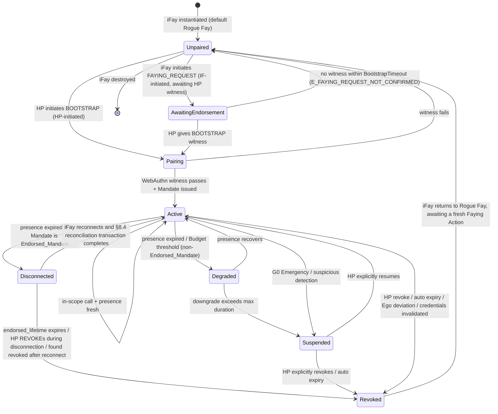
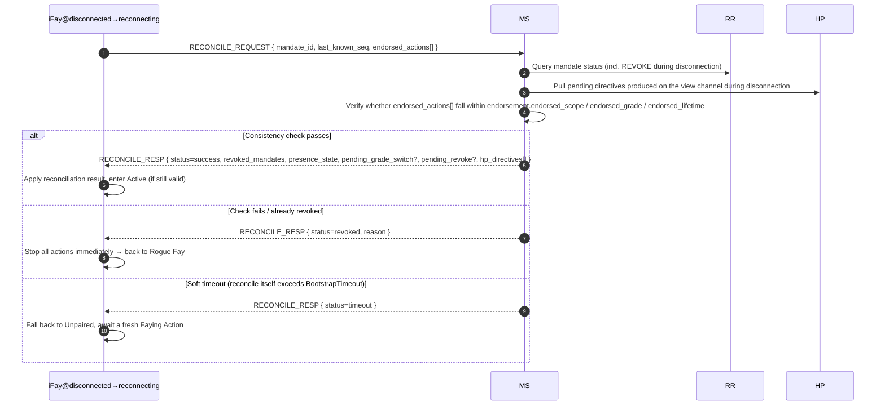

> Navegación del cuerpo del protocolo: [Índice](./README.md) | anterior [§7 Niveles de autorización](./07-Niveles-de-Autorizacion.md) | siguiente [§9 Consideraciones de seguridad](./09-Consideraciones-de-Seguridad.md)

## §8 Ciclo de vida

Este capítulo presenta el ciclo de vida de extremo a extremo del Faying Protocol: desde la instanciación del iFay, la iniciación de la Faying Action, el mantenimiento del Faying State, pasando por la degradación / desconexión / suspensión / revocación, hasta el regreso a Rogue Fay — el cierre de estados completo. La máquina de estados especificada por este capítulo es el portador de las invariantes a nivel de protocolo — la legitimidad de todas las acciones de dimensión D (salientes), la unicidad del punto final que asume la responsabilidad y la frontera de la «autonomía endosada» durante la desconexión se definen todas en este capítulo.

### §8.1 Máquina de estados del ciclo de vida completo

El diagrama siguiente cubre los 7 cierres de estado a nivel de protocolo (**Unpaired / Pairing / Active / Degraded / Disconnected / Suspended / Revoked**) y todas las transiciones legítimas entre ellos. `AwaitingEndorsement` es un estado intermedio transitorio en la vía Faying bidireccional iniciada por IF (véase §2.4 / §5.3.6); no constituye un cierre estable donde «las acciones son ejecutables», pero se muestra igualmente en el diagrama de estados para mantener completo el grafo de transiciones.

> Relación con la máquina de estados del Mandate de §4.3: §4.3 describe el estado del *objeto Mandate* (Pending / Active / Degraded / Disconnected / Suspended / Revoked / Rejected); esta sección describe el estado del ciclo de vida de la *entidad iFay*. Ambas se enlazan mediante la correspondencia «Mandate Active/Degraded/Disconnected ⇔ Faying State / Faying State solo endosado»; véase la tabla «correspondencia estado del Mandate ↔ estado de comportamiento del Fay» al final de §4.3.

### §8.2 Semántica de las fases

La tabla siguiente ofrece la semántica de los 7 cierres de estado. El valor de cada estado en la columna «acción saliente (dimensión D)» es la decisión de admisión de dimensión D a nivel de protocolo.

- **Unpaired**: equivalente a Rogue Fay en el blueprint. Solo se permiten las acciones A1–A4 (autopercepción), B1–B3 (expresión interna), C1–C2 (comunicación humana unidireccional, incluida la iniciación de FAYING_REQUEST). Las acciones de dimensión D están uniformemente prohibidas.

> **Determinación precisa de Rogue Fay (importante)**: una conexión rota por sí sola **no** equivale a Rogue Fay. Un iFay se determina como Rogue Fay si y solo si se cumple uno de los dos casos siguientes: (1) **desconectado Y sin autorización explícita** — es decir, ningún Mandate en `Active / Degraded / Disconnected` cubre su comportamiento actual (incluido no haber establecido nunca Faying, o que el Mandate haya sido revocado / caducado / suspendido); (2) **desconexión probada** — juzgado Perceived-Disconnected conforme a §9.9, Y el Mandate actual no es un Endorsed_Mandate válido (o el `endorsement` ha caducado / `enabled=false`).
>
> A la inversa: un iFay cuya conexión física está rota pero que posee un **Endorsed_Mandate válido** y sigue dentro de `endorsed_scope / endorsed_grade / endorsed_lifetime` está en el estado `Disconnected` y se encuentra en **Faying State (solo endosado), no Rogue Fay** — sus acciones de dimensión D durante la desconexión las asume `Mandate.issuer` (HP) mediante la preautorización offline establecida en BOOTSTRAP (véase §4.3 / §7.5 / §8.3 / §8.4). Solo cuando la vigencia del endoso caduca, se revoca o la reconciliación falla, ese iFay migra a Revoked → Unpaired y regresa a Rogue Fay.
- **AwaitingEndorsement**: un FAYING_REQUEST iniciado por iFay ha sido reenviado al canal de vista del HP, a la espera del reconocimiento del HP mediante BOOTSTRAP dentro de `BootstrapTimeout` (predeterminado 60 s); este estado no produce ningún Mandate; las acciones salientes están uniformemente prohibidas; en caso de timeout retrocede a Unpaired y se escribe en la Attestation Chain (código de error 1014 `E_FAYING_REQUEST_NOT_CONFIRMED`).
- **Pairing**: una Faying Action en curso, transitoria. Debe completar el testimonio WebAuthn + la emisión del Mandate dentro de `BootstrapTimeout`; el fallo → retroceso a Unpaired sin estado residual.
- **Active**: Faying State funcionando con normalidad. Existe exactamente un Mandate en estado Active que le corresponde; todas las llamadas de dimensión D se admiten conforme a `Mandate.scope` y `Mandate.grade`.
- **Degraded**: el Faying State se mantiene pero el nivel está ajustado (disparado por la caducidad de la señal de presencia). Aplicable únicamente a **Mandates no-Endorsed**. La duración no debe superar `MaxDegradedDuration` (predeterminado configurado por nivel, véase el Anexo B); superarlo → migrar a Suspended.
- **Disconnected**: el Faying State es válido solo dentro de `endorsement.endorsed_scope` y `endorsement.endorsed_lifetime`; aplicable a la ventana de acción «solo endosada» de un Endorsed_Mandate durante la desconexión física. Para la semántica concreta de admisión y desconexión véase §4.3 / §7.5 / §8.4.
- **Suspended**: Faying State temporalmente en pausa. Las acciones salientes están uniformemente prohibidas, pero los metadatos del Mandate se retienen para la recuperación explícita del HP o la auditoría; superar el punto de caducidad automática → migrar a Revoked.
- **Revoked**: Mandate terminado. El iFay regresa a Rogue Fay; cualquier llamada de dimensión D posterior debe pasar por una nueva Faying Action completa (nuevo `mandate_id`). Revoked es el estado absorbente de un Mandate (véase P10).

### §8.3 Secuencia de atribución de responsabilidad

> **En cualquier instante, acción saliente de IF → debe existir exactamente un Mandate en estado Active, Degraded o Disconnected → el `issuer` de ese Mandate es el punto final que asume la responsabilidad.**

Esta cláusula es la cláusula temporal formalizada para la «unicidad del punto final que asume la responsabilidad» a nivel de protocolo; no existe un tercer caso:

1. **Ningún Mandate conforme**: no existe ningún Mandate Active / Degraded / Disconnected ⟹ la acción saliente no se permite (dimensión D prohibida); el RP debe devolver `E_NO_MANDATE` (1001) o `E_PRESENCE_STALE` (1005).
2. **Coexistencia de varios Mandates conformes**: la capa de protocolo selecciona obligatoriamente el de «alcance más específico», y deben compartir el mismo `issuer` (HP); si existen varios Mandates conformes con emisores distintos, esto se trata como un error de protocolo y debe devolver `E_PROTOCOL` (1099).
3. **Acción saliente durante Disconnected**: sigue atribuyéndose a `Mandate.issuer` (HP). El `endorsement` solo restringe el `endorsed_scope` / `endorsed_grade` / `endorsed_lifetime` ejecutable de la acción y no cambia el punto final que asume la responsabilidad; no existe vía legítima para que «el endoso transfiera la responsabilidad al propio iFay / MS / Supervisory Agent» (véase P16.5).

De esta cláusula se derivan de inmediato los siguientes puntos:

- Para cualquier llamada aceptada `c`, la quíntupla de auditoría `(mandate_id, endorsement_id?, action, ts, signature_chain)` tiene como nodo raíz de su `signature_chain` necesaria y exclusivamente `Mandate.issuer`;
- el iFay no tiene ninguna vía legítima de «autoatribución»; MS / Supervisory Agent no deben sustituir la identidad `issuer` del HP por su propio testimonio de agente;
- el punto final que asume la responsabilidad no puede cambiar dentro del ciclo de vida de un Mandate; cualquier cambio debe pasar por revocación + nuevo BOOTSTRAP (nuevo `mandate_id`, nuevo `issuer`).

### §8.4 Reconciliación de reconexión

> **Propósito**: converger la «autonomía endosada» del iFay durante Disconnected con los cambios de estado de la vista central del protocolo (MS / RR / canal de vista del HP) a un estado consistente, y prohibir explícitamente «reconexión = reanudar acción» como antipatrón.

#### §8.4.1 Flujo

#### §8.4.2 Contenido de retorno de la transacción de reconciliación

En caso de éxito de la transacción (`status = success`), `RECONCILE_RESP` debe devolver los siguientes campos (en correspondencia uno a uno con el Requirement 12.4):

1. **`revoked_mandates`**: lista de Mandates revocados durante la desconexión (incluidos los Mandates hijos en cascada);
2. **`presence_state`**: el PresenceState actual (usado para decidir si la dimensión D puede continuar);
3. **`pending_grade_switch`**: eventos GRADE_SWITCH incompletos (si los hay);
4. **`pending_revoke`**: eventos REVOKE incompletos (si los hay);
5. **`hp_directives`**: directivas pendientes producidas en el canal de vista del HP durante la desconexión (p. ej. G0 Emergency Override, REVOKE explícito, degradación forzada, etc.).

#### §8.4.3 Enumeración de resultados de la transacción

El resultado de la transacción de reconciliación es exactamente uno de los tres siguientes, coherente con la formalización P17.4 `reconcile_result(M) ∈ {success, revoked, timeout}`:

| Resultado | Condición de disparo | Estado posterior | Requisito de auditoría |
| --- | --- | --- | --- |
| `success` | La comprobación de consistencia pasa ∧ el Mandate sigue válido ∧ completado dentro de BootstrapTimeout | Disconnected → Active | Escrito en la Attestation Chain, incluida la auditoría completa de endorsed_actions |
| `revoked` | endorsed_lifetime caducado ∨ el HP emitió REVOKE durante la desconexión ∨ se descubre revocado tras la reconexión ∨ endorsed_actions fuera de límites | Disconnected → Revoked → Unpaired | Escrito en la Attestation Chain; maneja la auditoría del periodo de desconexión conforme a `endorsement.offline_revocation_policy` |
| `timeout` | La propia transacción de reconciliación supera `BootstrapTimeout` sin alcanzar success / revoked | Disconnected → Unpaired | Escrito en la Attestation Chain, marcado `reason=reconcile-timeout` |

#### §8.4.4 Restricciones duras a nivel de protocolo

- **Prohibición de dimensión D**: antes de que la transacción de reconciliación se complete, el iFay no debe realizar ninguna acción de dimensión D; cualquier llamada que llegue al RP dentro de esta ventana debe rechazarse con `E_PRESENCE_STALE` (1005) o `E_REVOKED` (1006). Esta prohibición rige dentro de `[t_reconnect, t_reconnect + reconcile_complete_ms]` (coherente con P17.4).
- **Timeout = retroceso a Rogue Fay**: la transacción de reconciliación debe completarse dentro de `BootstrapTimeout`; en caso de timeout el iFay retrocede a Unpaired, a la espera de una nueva Faying Action (el reintento automático de BOOTSTRAP está prohibido).
- **Los tres resultados deben entrar en la AC**: los tres resultados `success` / `revoked` / `timeout` de la propia transacción de reconciliación deben escribirse todos en la Attestation Chain; maneja la auditoría de acciones del periodo de desconexión conforme a `endorsement.offline_revocation_policy`:
  - `stop-and-audit` (predeterminado): detener inmediatamente + enviar la auditoría completa de endorsed_actions + retroceder a Rogue Fay;
  - `stop-only`: detener inmediatamente + auditoría no exigida (aplicable solo a escenarios irreversibles / de emergencia; requiere resolución del Protocol Committee);
  - `graceful-stop`: permitir un cierre limitado (cierre de escritura / guardado de estado) antes de detenerse; las acciones de cierre siguen restringidas por el endoso.
- **Sin autorreintento tras el retroceso**: cuando el resultado de la transacción de reconciliación es `revoked` o `timeout` y el iFay retrocede a Rogue Fay, el iFay no debe reintentar BOOTSTRAP por su cuenta; debe esperar a que el HP reinicie (iniciado por HP) o a un nuevo FAYING_REQUEST reconocido explícitamente por el HP (iniciado por IF).
- **Reanudación silenciosa prohibida**: no se permite ninguna vía de implementación de «reconexión = reanudar». Cualquier implementación que eluda la transacción de reconciliación de §8.4 y migre Disconnected directamente a Active se trata como no conforme; el conjunto de pruebas de conformidad de interoperabilidad debe marcarla como fallida.
