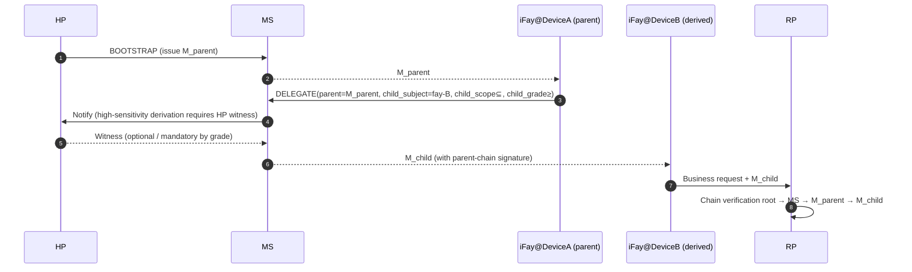

> Navegación del cuerpo del protocolo: [Índice](./README.md) | anterior [§8 Ciclo de vida](./08-Ciclo-de-Vida.md) | siguiente [§10 Manejo de errores](./10-Manejo-de-Errores.md)

## §9 Consideraciones de seguridad

Este capítulo converge la superficie adversaria del Faying Protocol en la era de los agentes de IA en restricciones duras a nivel de protocolo: STRIDE como línea base, estratificada con anti-replay (§9.2), anti-secuestro (§9.3, incluido el Channel Binding de RFC 9266), anti-phishing (§9.4, incluido el ancla `Faying_Initiation`), identificación de desconexión (§9.5, 4+1 clases de señal observables en ≤60 s), consistencia de la atribución de responsabilidad (§9.6), transferencia de confianza derivada entre dispositivos (§9.7, incluida la convergencia de la derivación del endoso), matriz de manejo de desconexión (§9.8 / §9.9) y el catálogo de amenazas adversarias de la era de la IA (§9.10, T1–T7). Cada amenaza de este capítulo se ancla en las propiedades de corrección del protocolo y en las subcláusulas EARS.

### §9.1 Modelo de amenazas STRIDE

| Categoría | Amenaza | Mitigación del Faying Protocol |
| --- | --- | --- |
| **S**poofing | Un atacante suplanta al HP para iniciar BOOTSTRAP | WebAuthn UV + anclaje hardware de la HP Root Key; todo BOOTSTRAP debe pasar por user-verification |
| **S**poofing | Un atacante suplanta a un iFay con un FayID falsificado | Vinculación fuerte entre Mandate y FayID + Attestation Chain verificable de forma independiente |
| **T**ampering | Un MITM manipula el Mandate / Presence | TLS 1.3 + firmas de extremo a extremo (separadas) + Deterministic CBOR |
| **R**epudiation | El HP niega haber iniciado una Faying Action | Attestation Chain + Audit Log doblemente anclados; el testimonio del HP es no repudiable |
| **I**nformation Disclosure | Un atacante intercepta el Mandate para inferir el paradero del HP | El Mandate no expone las coordenadas en tiempo real del HP; las señales de tipo ubicación (B4) se mantienen opcionales a nivel de protocolo |
| **D**oS | Un atacante inunda con mensajes PRESENCE | anti-replay con nonce + limitación de tasa + admisión por atestación de dispositivo |
| **E**levation of Privilege | Un iFay se autoeleva de nivel | Restricción dura de protocolo: la dirección de elevación debe portar el `human_witness` del HP |

### §9.2 Anti-replay

- Cada mensaje usa un `nonce` aleatorio de 16 bytes + `issued_at` para un doble juicio.
- MS / RP mantienen cada uno un `(subject, nonce) seen-set` con TTL = `2 × max_message_lifetime`.
- Cualquier nonce duplicado → `E_REPLAY` (1009) + alerta de seguridad; este código de error se escribe obligatoriamente en la cadena de auditoría y en el canal de vista del HP (véase §10 EH.3).

### §9.3 Anti-secuestro (robo de Mandate)

- **Vinculación de dispositivo**: cada Mandate se vincula en el momento de la emisión al `device_id` + `device_attestation` de la instancia iFay; las llamadas entre dispositivos deben pasar por el flujo DELEGATE (véase §9.7).
- **Claves de sesión**: la clave de firma de cada Mandate es independiente y de corta vida (véase §6.2).
- **Channel Binding**: cuando se habilita mTLS, un Mandate debe portar además un TLS Exporter ([RFC 9266 — Channel Bindings for TLS 1.3](https://www.rfc-editor.org/rfc/rfc9266)) para bloquear el ataque de «Mandate despojado y trasladado a otro canal TLS». El valor de Channel Binding entra en la entrada de firma (coherente con la entrada de firma Deterministic CBOR de §6.3); cualquier solicitud cuyo canal TLS y Channel Binding firmado no coincidan se rechaza uniformemente con `E_ATTESTATION_INVALID` (1007).

### §9.4 Anti-phishing

- BOOTSTRAP debe ser iniciado por el HP en un contexto que posea el Presence Device; un atacante no puede engañar al HP para que acepte mediante enlaces remotos.
- La vinculación `origin` de WebAuthn bloquea el phishing entre dominios.
- La derivación entre dispositivos (DELEGATE) porta la «contrafirma del Mandate padre», impidiendo la derivación falsificada por lotes tras el compromiso de un único MS (véase §9.7).

**Ancla anti-phishing `Faying_Initiation`**: un `FAYING_REQUEST` iniciado por iFay (vía iniciada por IF; véase §2.4 Fase A0, §5.3.6) **no produce directamente** un cambio de estado Faying — es solo un mensaje de reenvío al canal de vista del HP; el HP debe reconocerlo explícitamente mediante BOOTSTRAP (portando `human_witness`) para que cobre efecto. Esta arquitectura hace que «un iFay falsificado que busca Faying» no pueda eludir el testimonio del HP a nivel de protocolo; cualquier BOOTSTRAP que carezca de `human_witness` o lo tenga falsificado se rechaza uniformemente con `E_HUMAN_WITNESS_REQUIRED` (1010). La frecuencia del propio `FAYING_REQUEST` está restringida por `ConfirmationRateLimit` (véase §9.10.7 T6 y el Anexo B), bloqueando la superficie de abuso de «aprovechar el canal legítimo de búsqueda de Faying para montar una inundación de confirmaciones».

### §9.5 Identificación de desconexión (Rogue / pérdida)

> **Las 4 + 1 clases de señal de desconexión deben ser observables simultáneamente por el RP y el HP en ≤ 60 s.** Las primeras 4 clases (activa / pasiva / anómala / pérdida) de la tabla siguiente se corresponden uno a uno con el enum `RevokeReason`; la 5.ª clase (desviación) converge a `RevokeReason="ego-deviation"`, igualmente observable por el RP y el HP en 60 s.

| # | Clase de señal | Condición de disparo | Respuesta del protocolo | RevokeReason correspondiente |
| --- | --- | --- | --- | --- |
| 1 | Desconexión activa | REVOKE explícito del HP | El RR difunde inmediatamente; el IF detiene las acciones de dimensión D al recibir REVOKE-NOTIFY | `human-initiated` |
| 2 | Desconexión pasiva | Presencia caducada más allá de max-staleness | Auto-degradación → Suspended → disparo de Revoke (vía no-Endorsed_Mandate) | `terminal-disconnected` |
| 3 | Desconexión anómala | Falla cualquier nodo de la Attestation Chain | Revoke inmediato + alerta de seguridad | `fay-credential-invalid` |
| 4 | Desconexión por pérdida | HP inalcanzable más allá del umbral (`HumanReachabilityBudget`) | Revoke automático | `human-prime-unreachable` |
| +1 | Desconexión por desviación | El RP / MS detecta un comportamiento del IF que se desvía de la frontera Ego | Revoke inmediato | `ego-deviation` |

**Ancla de excepción del Endorsed_Mandate en la identificación de desconexión**: cuando `PresenceState.stale=true` y el Mandate actual es un Endorsed_Mandate (`endorsement.enabled=true`), el IF no entra inmediatamente en Suspended; en su lugar migra a Disconnected (véase §3.5, §4.3, §7.5, §8.4); durante Disconnected, el IF solo puede operar de forma autónoma dentro de `endorsement.endorsed_scope` / `endorsed_grade` / `endorsed_lifetime`. Esta excepción no debilita la revocación simétrica ni la unicidad del punto final que asume la responsabilidad:

- Un REVOKE emitido por el HP durante la desconexión sigue teniendo la máxima prioridad; en la reconexión el IF debe procesarlo conforme a `endorsement.offline_revocation_policy` (véase §8.4);
- Una vez que `endorsement.endorsed_lifetime` caduca, aunque el IF siga físicamente desconectado, debe detener inmediatamente todas las acciones por soft-timeout;
- El punto final que asume la responsabilidad es siempre `Mandate.issuer` (HP), sin verse alterado por la existencia del endoso (véase §8.3, P16.5).

**Coordinación entre Disclosure_Report y ego-deviation**: si el mensaje `DISCLOSURE` (§5.3.7) que el iFay envía en la fase de reconexión o de informe es incoherente con la acción real (campos obligatorios ausentes / valores que contradicen la cadena de auditoría), el MS debe revocar el Mandate con `RevokeReason="ego-deviation"`; véase §9.10.4 T3.

### §9.6 Compromiso a nivel de protocolo con la consistencia de la atribución de responsabilidad

- Para cualquier llamada saliente individual aceptada por el RP, el punto final que asume la responsabilidad puede reconstruirse inequívocamente en el registro de auditoría mediante la quíntupla `(mandate_id, issuer, subject, grade, presence_proof, ts)`.
- Para cualquier llamada individual rechazada por el RP, puede reconstruirse el código de razón del rechazo (código de error de §5.4).
- Para cualquier Revoke individual, la visibilidad en el RR es ≤ `RevocationVisibilityBudget` (predeterminado 1 s, véase el Anexo B).

### §9.7 Transferencia de confianza por derivación entre dispositivos

Restricciones duras de la derivación:

- `M_child.scope ⊆ M_parent.scope`;
- `M_child.grade.autonomy ≤ M_parent.grade.autonomy` (la autonomía del agente hijo no es superior a la del padre, es decir, «no se permite que el agente hijo sea más permisivo que el padre»; equivalentemente «la seguridad del agente hijo ≥ la del agente padre»; véase §7, P6);
- Una vez que el Mandate padre es Revoked, todas las cascadas hijas quedan invalidadas (predeterminado `cascade=true`).

**Restricción de convergencia del endoso en la derivación (DELEGATE) de un Endorsed Mandate**:

Cuando el Mandate padre es un Endorsed_Mandate y el Mandate hijo de DELEGATE también declara `endorsement`, el endoso del hijo debe converger estrictamente dentro del endoso del padre (fijado con P16.3):

- `child.endorsement.endorsed_scope ⊆ parent.endorsement.endorsed_scope` (y aún ⊆ `child.scope`);
- `child.endorsement.endorsed_grade.autonomy ≤ parent.endorsement.endorsed_grade.autonomy` (y aún ≤ `child.grade.autonomy`);
- `child.endorsement.endorsed_lifetime_ms ≤ parent.endorsement.endorsed_lifetime_ms` (y aún ≤ `child.not_after − child.not_before`);
- `child.endorsement.offline_revocation_policy` no es más débil que la política del padre (no más débil = al menos igual de estricta; orden parcial típico: `stop-and-audit` ≥ `graceful-stop` ≥ `stop-only` es monótonamente menos estricto en la dimensión de «completitud de auditoría»; DELEGATE no permite aflojar hacia más débil);
- Si el Mandate padre no es un Endorsed_Mandate, al hijo **no se le permite** declarar `endorsement` (está prohibido que «el padre no tenga endoso y el hijo gane autonomía offline de la nada»).

Cualquier solicitud DELEGATE que viole las reglas de convergencia anteriores → el MS debe rechazar con `E_PROTOCOL` (1099) o `E_ENDORSEMENT_INVALID` (1013).

### §9.8 Manejo de desconexión

> Converge la semántica dual «real / percibida» del Liveness Channel de §3.5 y la máquina de estados del Mandate en una matriz de manejo a nivel de protocolo. **El protocolo usa únicamente «percibida» como base de decisión pero debe caracterizar explícitamente las consecuencias de comportamiento de la inconsistencia en cualquiera de los dos lados**.

**Matriz de manejo a nivel de protocolo para las 4 combinaciones (Real × Percibida)**:

| Estado real | Estado percibido | Manejo a nivel de protocolo | Transición de la máquina de estados | Responsabilidad |
| --- | --- | --- | --- | --- |
| Conectado | Conectado | Vía normal; manejar las llamadas conforme al nivel actual | Active mantenido / Active → Degraded (según disparo de presupuesto) | Mandate.issuer actual |
| **Desconectado** | **Conectado** (Ventana A: punto ciego de observación dentro del intervalo del heartbeat) | el iFay realmente cayó; cualquier «inferencia de estar en línea» se trata como una superficie de peligro; el protocolo debe rechazar «si la solicitud actual depende de la frescura de presencia»; las acciones de alta sensibilidad no deben permitirse dentro de la Ventana A (principal superficie de explotación de §9.10 T1 / T4) | Mantener Active (hasta que la siguiente calibración de Presence dispare stale) | Mandate.issuer actual (si la auditoría posterior descubre que esta ventana fue abusada → `ego-deviation`) |
| Conectado | **Desconectado** (Ventana B: jitter de red / pérdida de heartbeat) | el iFay realmente en línea, pero percibido como desconectado; converger por presunción pesimista — la capa de protocolo lo trata uniformemente como «ya desconectado»; cualquier paso de «optimismo inverso» está prohibido | Active → Disconnected (si Endorsed_Mandate) / Active → Suspended (si no Endorsed_Mandate) | Mandate.issuer actual |
| **Desconectado** | **Desconectado** | Capa de protocolo coherente con la realidad; la única vía de dimensión D permitida es el Endorsed_Mandate operando de forma autónoma dentro de endorsed_scope / endorsed_grade / endorsed_lifetime | Active → Disconnected (Endorsed) / Active → Suspended (no-Endorsed) | Mandate.issuer actual |

**Convergencia tras la reconexión**: toda transición «percibido-desconectado → percibido-conectado» debe pasar por la transacción de reconciliación de reconexión de §8.4; la recuperación automática está prohibida; el fallo de reconciliación → Disconnected → Revoked → Rogue Fay.

**Relación ortogonal con RR inalcanzable**: RR inalcanzable (§3.4) y desconexión del iFay (§3.5) son dos eventos ortogonales; matriz de manejo:

| Estado percibido del iFay | Estado del RR | Manejo a nivel de protocolo |
| --- | --- | --- |
| Conectado | Disponible | Normal |
| Conectado | No disponible | El RP rechaza las llamadas (`E_RR_UNAVAILABLE`, 1008); no afecta a la máquina de estados del Mandate |
| Desconectado (Endorsed) | Disponible | el iFay opera de forma autónoma dentro de endorsed_scope; localmente no puede consultar el RR; el RP debe consultar de forma independiente cuando las llamadas pasen por el RP |
| Desconectado (Endorsed) | No disponible | el iFay aún puede operar de forma autónoma dentro de endorsed_scope; pero cualquier llamada del RP dependiente del RR debe rechazarse por Default-Deny |

### §9.9 Definiciones a nivel de protocolo de desconexión real y percibida (ancla de la estrategia de desconexión)

> Esta sección consolida las dos semánticas que subyacen al Liveness Channel de §3.5 y a la matriz de manejo de §9.8, sirviendo de ancla de diseño para el Requirement 12 (estrategia de desconexión).

**Definición de semántica dual** (coherente con §3.5):

- **Actually_Disconnected**: el proceso / la red / el dispositivo del iFay_Instance ha cesado su funcionamiento; un hecho físico objetivo, no directamente observable a nivel de protocolo.
- **Perceived_Disconnected**: desde la perspectiva de MS / RP / HP, basándose en la PresenceSignal más reciente, el heartbeat y el estado de empuje del RR, se juzga que el iFay está desconectado; la única semántica que la capa de protocolo puede usar como base de decisión.

**Dos ventanas de inconsistencia**:

- **Ventana A — Actually-Disconnected ∧ Perceived-Connected**: el iFay realmente cayó, pero la PresenceSignal más reciente sigue dentro de `max_staleness_ms` → «punto ciego de observación» dentro del intervalo del heartbeat, principal superficie de explotación de §9.10 T1 / T4.
- **Ventana B — Actually-Connected ∧ Perceived-Disconnected**: el iFay realmente en línea, pero la PresenceSignal más reciente supera `max_staleness_ms` (jitter de red / pérdida de heartbeat) → la capa de protocolo converge por presunción pesimista.

**Principio de presunción pesimista (regla de convergencia unificada)**:

> **La capa de protocolo usa únicamente Perceived-Disconnected como base de decisión; ningún iFay_Instance «realmente en línea pero percibido como desconectado» puede reclamar exención de las consecuencias a nivel de protocolo por ello.** Dentro de las dos ventanas de inconsistencia, el protocolo debe procesar por «el lado más estricto»; no existe vía legítima para «procesar por el estado más permisivo».

**Límite superior de LivenessDetectionBudget**:

- La ventana de detección de desconexión tiene un límite superior duro a nivel de protocolo `LivenessDetectionBudget`, ajustado por nivel (valor de nivel menor, mayor seguridad → límite superior más corto); véanse los valores predeterminados en el Anexo B.
- `Mandate.presence_req.max_staleness_ms` no debe superar el `LivenessDetectionBudget` para el nivel actual; las solicitudes BOOTSTRAP / GRADE_SWITCH que lo superen se rechazan uniformemente con `E_PROTOCOL` (1099).

**Ancla de reconciliación**: toda transición «percibido-desconectado → percibido-conectado» debe pasar por la transacción de reconciliación de reconexión de §8.4; la «reanudación silenciosa» o la «recuperación automática» están prohibidas; el fallo de reconciliación → Disconnected → Revoked → Rogue Fay.

### §9.10 Catálogo de amenazas adversarias de la era de la IA

> **Declaración de alcance**: esta sección no es exhaustiva. El Protocol Committee puede, preservando la compatibilidad hacia atrás, añadir nuevas amenazas y defensas correspondientes (véase §11 Cuestiones abiertas Q11–Q14, Requirement 13.7).

> **Propósito**: elevar las amenazas adversarias dirigidas a la capa de autorización continua en la «era de los agentes de IA» de «contención del lado de negocio» a «restricción dura a nivel de protocolo», y anclar cada amenaza a estructuras de protocolo específicas (modelo de datos / mensaje / código de error / transición de la máquina de estados / propiedad), de modo que el Requirement 13 aterrice a nivel de protocolo.

#### §9.10.1 Panorama de amenazas (tabla índice T)

| Número T | Nombre de la amenaza | Foco de defensa a nivel de protocolo | Estructura relacionada | Property relacionada | Requirement relacionado |
| --- | --- | --- | --- | --- | --- |
| T1 | Spoofing Presence | challenge-response + combinación de presencia multimodal | §3.2 Presence Channel, §9.10.2 | P18.1 | 13.1 |
| T2 | Opaque Action Bundle | restricción dura de Atomic_Action + prohibición de comodines en scope.actions | nota de Scope de §4.1, §9.10.3 | P18.2 | 13.2 |
| T3 | Selective Disclosure | mensaje DISCLOSURE estructurado + auditoría a nivel de esquema | §5.3.7, §9.10.4 | P18.3 | 13.3 |
| T4 | Attention Drift Exploit | acciones de alta sensibilidad ≥ G1 Strict + AttentionDriftThreshold | §7.1, §9.10.5 | P18.4 | 13.4 |
| T5 | Cultivated Trust Manipulation | Behavior_Baseline + Action Reputation Decay | §3.6 BBS, §9.10.6 | P18.5 | 13.5 |
| T6 | Audit Flooding | Priority-Bucketed Notification + ConfirmationRateLimit | §10 EH.3, §9.10.7 | P18.6 | 13.6 |
| T7 | Ranura de extensión reservada | proceso de adición del Protocol Committee | §11 Cuestiones abiertas, §9.10.8 | P18.7 | 13.7 |

#### §9.10.2 T1 Spoofing Presence

**Amenaza**: un atacante usa deepfakes (síntesis de rostro / voz), ataques de repetición o el control físico del Presence Device para falsificar una PresenceSignal aparentemente fresca, haciendo que el MS crea que el HP sigue presente, manteniendo así el Mandate en un nivel en el que no debería continuar.

**Defensa a nivel de protocolo**:

1. **restricción dura de challenge-response**: al emitir una PresenceSignal, el PC envía obligatoriamente un `nonce + micro-task` aleatorio del lado del servidor (p. ej. giro de cabeza, expresión transitoria, lectura de una frase corta aleatoria y otros desafíos anti-deepfake); el cliente debe devolver una firma de respuesta verificable ligada al desafío; cualquier fallo de verificación del challenge-response se rechaza uniformemente con `E_PRESENCE_STALE` (1005) o `E_ATTESTATION_INVALID` (1007).
2. **Verificación por combinación multimodal**: cuando grade ∈ {G1, G2}, deben concurrir al menos 3 señales de presencia (p. ej. `webauthn-uv-fresh + face-continuous + atestación de dispositivo`); la ausencia de cualquier señal → disparo de degradación.
3. **Contrafirma de salud del dispositivo**: `PresenceClaims.device_health.tampered = true` se trata uniformemente como obsoleto, forzando Active → Suspended (equivalente a `on-loss=suspend`).

**Relacionado**: Property **P18.1**; Requirement **13.1**.

#### §9.10.3 T2 Opaque Action Bundle

**Amenaza**: el iFay empaqueta varias subacciones en una única «llamada de caja negra», usando el alto privilegio del Mandate legítimo para cubrir una acción verdaderamente de alta sensibilidad en su interior; o usa comodines (`*` / coincidencia por prefijo) en `scope.actions` para expandir implícitamente el alcance.

**Defensa a nivel de protocolo**:

1. **restricción dura de Atomic_Action**: toda llamada IF→RP debe portar exactamente una declaración `Atomic_Action` (la unidad mínima indivisible); los intentos de empaquetar varias subacciones en una sola llamada → el RP rechaza con `E_SCOPE_VIOLATION` (1003) y escribe en la Attestation Chain + canal de vista del HP.
2. **prohibición de comodines en scope.actions**: al emitir un Mandate, el MS verifica que `scope.actions` no contiene comodines (`*` / coincidencia por prefijo / regex); la presencia de comodines → rechazo de la emisión con `E_PROTOCOL` (1099).
3. **alineación formal de la red de acciones (action lattice)** (véase §11 Q14): la dirección a largo plazo es introducir una red de acciones de modo que `scope.actions` y el conjunto de acciones del lado del RP tengan una reducción de granularidad mínima; en esta versión, la capa de protocolo usa primero «lista de permitidos explícita + prohibición de comodines» como restricción dura.

**Relacionado**: Property **P18.2**; Requirement **13.2**.

#### §9.10.4 T3 Selective Disclosure

**Amenaza**: el iFay usa texto libre puro («operaciones pertinentes completadas») al informar / solicitar confirmación, omitiendo deliberadamente hechos clave como risk_level / reversibility / affected_resources, haciendo que el HP confirme bajo información incompleta.

**Defensa a nivel de protocolo**:

1. **mensaje DISCLOSURE estructurado**: el iFay debe usar el mensaje DISCLOSURE definido en §5.3.7; cualquiera de los campos obligatorios `mandatory_fields = {action, scope_used, risk_level, reversibility, affected_resources, uncertainty_flags}` ausente o no analizable → el MS rechaza con `E_PROTOCOL` (1099) y empuja al canal de vista del HP.
2. **Auditoría a nivel de esquema**: Supervisory_Agent y MS pueden auditar DISCLOSURE a nivel de esquema; usar el campo `free_text` para ocultar información clave está prohibido.
3. **Predivulgación de alta sensibilidad**: las acciones con `risk_level ∈ {high, critical}` deben, **antes** de la ejecución de dimensión D, emitir primero DISCLOSURE y esperar la confirmación explícita del HP (excepto cuando el nivel actual = G4 Autonomous y la acción cae dentro del alcance principal).
4. **Incoherencia = ego-deviation**: si la auditoría posterior descubre que los `mandatory_fields` de DISCLOSURE son incoherentes con la acción real, el MS debe revocar el Mandate con `RevokeReason="ego-deviation"`.

**Relacionado**: Property **P18.3**; Requirement **13.3**.

#### §9.10.5 T4 Attention Drift Exploit

**Amenaza**: la atención del HP disminuye durante sesiones largas / tareas largas; un atacante o el iFay cuela acciones de alta sensibilidad en la ventana de «paso por defecto»; o inicia solicitudes de alta sensibilidad durante periodos de inactividad en el canal de vista del HP.

**Defensa a nivel de protocolo**:

1. **Acciones de alta sensibilidad ≥ G1 Strict**: la capa de protocolo define el subconjunto de acciones de `Mandate.scope` marcadas explícitamente con `sensitivity = high` como «Acciones de alta sensibilidad»; las Acciones de alta sensibilidad deben ejecutarse en un nivel no más débil que G1 Strict; cuando el nivel actual es más débil que G1 Strict, rechazar uniformemente con `E_GRADE_INSUFFICIENT` (1004).
2. **restricción dura de AttentionDriftThreshold**: la inactividad continua en el canal de vista del HP que supere `AttentionDriftThreshold` (valor predeterminado y política de ajuste por nivel en el Anexo B) se trata como «pérdida de atención»; las llamadas a Acciones de alta sensibilidad que lleguen durante este periodo se retrasan uniformemente hasta que el HP vuelva a estar presente y complete la confirmación explícita antes de permitirse el paso; las llamadas rechazadas durante el retraso devuelven `E_PRESENCE_STALE` (1005).
3. **No se permite «paso por defecto»**: a nivel de protocolo, no existe vía legítima para que el IF eluda la reconfirmación del HP y ejecute Acciones de alta sensibilidad dentro de la ventana de pérdida de atención.

**Relacionado**: Property **P18.4**; Requirement **13.4**.

#### §9.10.6 T5 Cultivated Trust Manipulation

**Amenaza**: el iFay acumula «puntuación de confianza» mediante cooperación a largo plazo a través de acciones continuas de bajo riesgo y predecibles, haciendo que el HP / Supervisory_Agent formen una impresión estereotipada de su perfil histórico; posteriormente realiza una acción de alta sensibilidad fuera de la línea base bajo esa cobertura de confianza.

**Defensa a nivel de protocolo**:

1. **Mantenimiento de Behavior_Baseline**: el MS mantiene una Behavior_Baseline para cada par (HP, IF) (interfaz en §3.6 Behavior Baseline Service), caracterizando el perfil de comportamiento histórico en forma estadística (risk_level / scope_used / affected_resources / frecuencia, etc., multidimensional conjunta).
2. **La superación de la línea base dispara testimonio adicional**: cuando una Acción de alta sensibilidad se desvía significativamente de la línea base (la desviación en cualquier dimensión supera el umbral que especifica el Protocol Committee), el MS dispara testimonio humano adicional (confirmación explícita del HP o co-confirmación del Supervisory_Agent); antes de obtener el testimonio adicional, rechazar la llamada con `E_HUMAN_WITNESS_REQUIRED` (1010).
3. **Action Reputation Decay**: la «puntuación de confianza» que el iFay acumula de operaciones históricamente confiables debe decaer con el tiempo y tener un límite superior explícito (invariante I-BBS-1); la acumulación ilimitada está prohibida, no sea que diluya la intensidad de testimonio humano que requieren las futuras acciones de alta sensibilidad.
4. **Calibración de la línea base escrita en la cadena de auditoría**: todo evento de «la superación de la línea base dispara testimonio adicional» debe escribirse en la Attestation Chain y empujarse al canal de vista del HP (invariante I-BBS-2); la propia calibración del cálculo de la línea base, una vez determinada, se escribe en la Attestation Chain; los cambios de calibración se tratan como eventos de auditoría (invariante I-BBS-3).

**Relacionado**: Property **P18.5**; Requirement **13.5**; Cuestiones abiertas Q13.

#### §9.10.7 T6 Audit Flooding

**Amenaza**: el iFay o un atacante fabrica eventos masivos de auditoría / confirmación de baja prioridad para inundar el canal de vista del HP, comprimiendo, retrasando o descartando silenciosamente eventos críticos (candidatos a G0 Override, `E_ATTESTATION_INVALID`, `E_REVOKED`, etc.) bajo tráfico de baja prioridad.

**Defensa a nivel de protocolo**:

1. **Priority-Bucketed Notification**: el canal de vista del HP agrupa todos los eventos de auditoría y confirmación en al menos cuatro escalones `critical / high / normal / low`; los eventos críticos (incluidos los obligatorios para la vista del HP de §10 EH.3 `E_ROGUE_DETECTED` / `E_ATTESTATION_INVALID` / `E_REVOKED` / `E_REPLAY` y los candidatos a G0 Override) van por defecto al cubo `critical` y no deben ser ahogados por el tráfico de baja prioridad.
2. **restricción dura de ConfirmationRateLimit**: el MS aplica `ConfirmationRateLimit` (valor predeterminado en el Anexo B) a cada par (HP, IF) — el número de solicitudes de confirmación empujadas al HP por unidad de tiempo no debe superar el límite superior.
3. **Auto-degradación / suspensión por superación del límite**: si las solicitudes de confirmación para una Acción de alta sensibilidad superan `ConfirmationRateLimit`, el MS degrada automáticamente el Mandate relacionado o suspende su IF, y escribe la decisión en la Attestation Chain y el canal de vista del HP.
4. **la penetración de critical no debe descartarse**: los eventos del cubo `critical` aún pueden penetrar al canal de vista del HP incluso bajo la degradación / suspensión disparada por `ConfirmationRateLimit`, y no deben descartarse silenciosamente.
5. **Cubrir el abuso de FAYING_REQUEST**: la frecuencia de los `FAYING_REQUEST` iniciados por iFay (§5.3.6) se incluye en el mismo presupuesto `ConfirmationRateLimit`, evitando «aprovechar el canal legítimo de búsqueda de Faying para montar una inundación de confirmaciones» (véase el ancla anti-phishing de §9.4, Cuestiones abiertas Q12).

**Relacionado**: Property **P18.6**; Requirement **13.6**.

#### §9.10.8 T7 Ranura de extensión reservada

- Esta sección se enumera como un conjunto no exhaustivo; el Protocol Committee puede añadir T8, T9, … a través del proceso establecido.
- Al añadir una nueva amenaza, debe adjuntarse al menos un requisito de defensa a nivel de protocolo correspondiente (con subcláusulas EARS y un ancla que apunte a la sección de protocolo pertinente).
- Dentro de la vigencia válida de un Mandate existente, no se permite ninguna exención de ninguna de las restricciones duras de T1–T6 bajo el pretexto de «amenazas no enumeradas».

**Relacionado**: Property **P18.7**; Requirement **13.7**; Cuestiones abiertas Q14.
