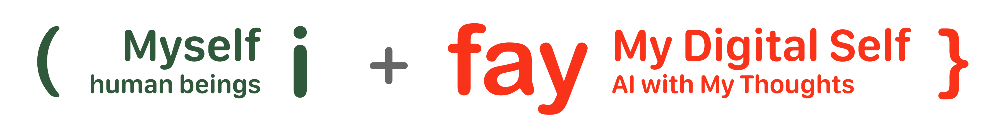

# iFay vs Agent — La Différence Essentielle

iFay n'est pas un « Agent plus puissant ». C'est un Agent sous tutelle. La différence d'un seul mot n'est pas de la rhétorique ; c'est la base entière sur laquelle le Faying Protocol se distingue de la conception courante de l'AI Agent.

## « Plus autonome, mieux c'est » est la philosophie de conception de l'Agent

Au cours des dernières années, l'AI Agent a été le plus souvent évoqué dans une phrase qui se condense en « plus autonome, mieux c'est ». L'Agent sépare l'initiateur d'une tâche de l'exécuteur, laissant à l'humain le soin de décider « quoi faire » et confiant au système le « comment le faire ». Les Agents peuvent en outre se composer — un Agent en appelant un autre, collaborant automatiquement pour accomplir des tâches plus larges.

Cette philosophie est séduisante en ingénierie. Elle n'a pas besoin d'un nouveau concept juridique ni d'une nouvelle partie responsable ; il suffit de rendre les capacités de l'Agent fortes, son appel d'outils complet, ses chaînes de raisonnement profondes, et le problème d'attribution restant peut être « rapiécé par une couche de conformité périphérique ». Cette hypothèse sous-tend l'orientation de conception de la plupart des produits Agent aujourd'hui.

iFay ressemble beaucoup à Agent. Il peut aussi inférer de manière autonome, exécuter de manière autonome et donner un retour de manière autonome, avec une capacité de mandat proche du niveau humain au niveau de la tâche. Mais iFay se sépare d'Agent sur un point fondamental :

> **L'autonomie d'un iFay doit être construite à l'intérieur de Faying State.**

Agent traite l'« autonomie » comme l'objectif suprême ; iFay traite l'« autonomie » comme une capacité sous tutelle.

## Comparaison côte à côte de deux perspectives

| Dimension | Perspective Agent | Perspective iFay |
| --- | --- | --- |
| Objectif de conception | Maximiser l'autonomie | Autonomie contrainte par Faying State |
| Partie responsable | Pas de concept intégré ; couvert extérieurement par une couche de conformité | Explicitement exprimé au niveau du protocole : Human Prime |
| Initiation de l'action | Agit dès réception d'une tâche | Doit avoir une Faying Action préalable avant d'agir |
| État par défaut | « En ligne signifie au travail » | Rogue Fay par défaut ; non autorisé à agir |
| Gestion de la perte de lien | Tendance à « accomplir la tâche du mieux possible » | Cesser d'agir immédiatement et entrer en Rogue Fay |
| Collaboration inter-Agent | Peut être initiée arbitrairement ; attribution faible | Le côté initiateur de la communication doit être en Faying State ; la chaîne de responsabilité ne peut sauter |
| Plug-in réglementaire | Principalement rempli par une plateforme externe ou un système de conformité | Intégré dans le protocole lui-même ; un élément de conception de premier rang |
| Mode de défaillance | « Un Agent qui a fait la mauvaise chose » | Au niveau du blueprint, un « iFay qui a fait la mauvaise chose » est interdit — soit il n'agit pas, soit son Human Prime est responsable |

La clé du tableau n'est pas une ligne particulière mais la direction d'ensemble. Agent traite la responsabilité, la tutelle et l'attribution comme des « sujets périphériques », les appelants, les plateformes et les parties de conformité construisant une coque protectrice autour de l'Agent. iFay traite la responsabilité, la tutelle et l'attribution comme des « sujets du noyau », exigeant que le protocole lui-même soit le porteur de ces propriétés.

## Pourquoi le rapiéçage périphérique ne suffit pas

Une contre-question loyale : avec Agent plus une couche de conformité de plateforme, plus IAM, plus journaux, plus revue humaine, peut-on obtenir le même effet qu'iFay ?

Dans des scénarios à petite échelle, à faible autonomie et à faible criticité, le rapiéçage périphérique est en effet suffisant. Un Agent de service client strictement encadré dans un workflow SaaS peut voir toute sa responsabilité reçue par la conformité périphérique.

Mais une fois que les Fays saturent la société à grande échelle, le rapiéçage périphérique échoue dans trois directions.

La première défaillance est le problème de la frontière. Lorsqu'un Agent pilote directement le matériel terminal et collabore à travers plateformes et réseaux, aucune couche de conformité d'une seule plateforme ne peut couvrir tous les comportements. Plus un Agent est capable, plus son rayon d'activité dépasse la frontière qu'une seule plateforme peut gouverner.

La seconde défaillance est le problème de la latence. Une fois qu'un Agent a déclenché une action physique irréversible — livraison par drone, transport par bras robotisé, transfert de fonds — l'audit après coup ne peut rappeler ce qui s'est déjà produit. L'essence de la conformité périphérique est l'examen post hoc, mais les conséquences physiques n'acceptent pas l'examen post hoc.

La troisième défaillance est le problème de l'attribution. Lorsque plusieurs Agents collaborent à travers des fournisseurs pour accomplir un acte, l'audit après coup peut juger « quels maillons ont erré », mais ne peut répondre « à qui appartient cet acte dans son ensemble » — et l'attribution est précisément le corps même de la responsabilité. C'est l'argument déjà développé sous G1–G4 au Chapitre 1 : IAM résout qui est le compte, OAuth résout la légitimité de l'appel, la conformité de plateforme résout l'intégration des comptes, AI Alignment résout ce que le Fay veut faire. Ils résolvent tous des problèmes adjacents ; aucun ne résout « à qui appartient l'acte ».

Le choix de conception d'iFay est de dissoudre ces trois problèmes au niveau du protocole, plutôt que de les laisser à la périphérie. Ce n'est pas une optimisation d'ingénierie ; c'est une réponse frontale à l'insupportable vide de responsabilité de l'ère des Fays.

## iFay = Agent + Faying Protocol

S'il faut utiliser une équation simplifiée pour exprimer la relation entre iFay et Agent :

> **iFay = Agent + contrat de tutelle du Faying Protocol**

Cette équation ne dit pas qu'un iFay doit, en ingénierie, être « Agent plus un morceau de middleware ». Ce qu'elle exprime est une addition structurelle : iFay conserve toutes les capacités techniques d'Agent en inférence autonome, exécution de tâches et apprentissage en contexte ; mais chaque capacité autonome d'iFay doit être contrainte par un contrat explicite, témoignable, symétriquement révocable. Ce contrat est le Faying Protocol.

Le Faying Protocol n'est pas un module plug-in d'iFay, ni un renforcement de conformité optionnel. C'est l'identité même par laquelle iFay se distingue d'un simple Agent. Une entité qui s'appelle iFay mais n'accepte pas la contrainte du Faying Protocol n'est, sous la définition du présent blueprint, pas un iFay mais un simple Agent. L'inverse vaut également : un simple Agent, une fois explicitement enrôlé par le Faying Protocol dans le contrat de tutelle « Human Prime ↔ iFay », existe en tant qu'iFay pendant la période de validité de ce contrat ; une fois le contrat caduc, il retombe dans l'état rogue (Rogue Fay).

Ôtez le Faying Protocol, et iFay redevient Agent ; ajoutez le Faying Protocol, et Agent est enrôlé en tant qu'iFay avec une partie responsable claire.

