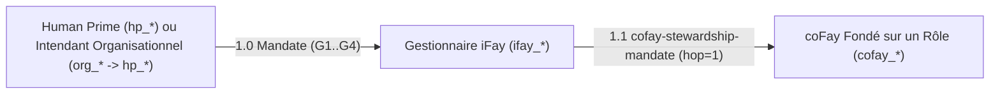

## §1 Vue d’ensemble et périmètre

Cette spécification définit **Faying Protocol/1.1 (`coFay` Delegated Stewardship Profile)**. Elle respecte strictement les règles d’extension `MINOR` rétrocompatible de `Faying Protocol/1.0` §1.7.2 : l’ensemble des messages, automates d’états et codes d’erreur de `Faying Protocol/1.0` (`2025-10-25` Final et `schemas/fap-1.0.cddl`) demeure inchangé. Les pairs ne prenant en charge que `1.0` négocient `Faying Protocol/1.0` conformément au §1.7.3 ou ignorent sans risque les extensions optionnelles inconnues.

Dans l’écosystème iFay (`Fay = iFay + coFay`), un `iFay` est rattaché à un unique Human Prime, tandis qu’un `coFay` est une entité numérique sur silicium fondée sur un rôle et régie par une Role Charter sans réplication de personnalité individuelle. Afin de garantir que **toute action externe d’une entité sur silicium soit imputable sans ambiguïté à un Human Prime responsable**, ce profil prolonge la chaîne `Human Prime ↔ iFay` par un mandat cryptographique `iFay Manager → coFay` et une autorisation atomique de transfert à double signature.

### §1.1 Terminologie normative (RFC 2119 et RFC 8174)

Les mots-clés `MUST`, `MUST NOT`, `REQUIRED`, `SHALL`, `SHALL NOT`, `SHOULD`, `SHOULD NOT`, `RECOMMENDED`, `NOT RECOMMENDED`, `MAY` et `OPTIONAL` dans ce document doivent être interprétés conformément au [BCP 14](https://www.rfc-editor.org/info/bcp14) ([RFC 2119](https://www.rfc-editor.org/rfc/rfc2119) et [RFC 8174](https://www.rfc-editor.org/rfc/rfc8174)) uniquement lorsqu’ils apparaissent en majuscules. En cas de divergence entre traductions, le texte chinois simplifié (`zh-CN`) et `schemas/fap-1.1-cofay.cddl` font foi.

---

## §2 Chaîne d’imputation de responsabilité à trois niveaux

Un `coFay` `MUST NOT` s’auto-délivrer un mandat racine et `MUST NOT` opérer sous une entité anonyme dépourvue d’ancrage Human Prime. Tout `cofay-stewardship-mandate` valide `MUST` établir la chaîne à trois niveaux suivante :

1. **Ancrage de responsabilité ultime (`steward_entity` + `accountable_human_prime`)** : pour une intendance individuelle (`hp_*`), il `MUST` être identique à `accountable_human_prime` ; pour une intendance organisationnelle (`org_*`), il `MUST` désigner explicitement un `accountable_human_prime` (`hp_*`) valide (sinon rejet avec `1010 E_HUMAN_WITNESS_REQUIRED`).
2. **Niveau d’agent gestionnaire (`manager_fay_id`)** : `MUST` être un `ifay_*` titulaire d’un mandat `Faying Protocol/1.0` actif ; un `cofay_*` `MUST NOT` émettre d’intendance en amont.
3. **Niveau de sujet exécutant (`subject_cofay_id`)** : `MUST` être un `cofay_*` régi par `charter_id`, dont la conformité relève de `coFACTS` (distinct d’`iFACTS` réservé à `iFay`).

---

## §3 Quatre invariants de sécurité sans amplification (Normative)

Tout vérificateur évaluant un `cofay-stewardship-mandate` `MUST` appliquer dans l’ordre strict :

1. **Arrêt de sécurité en cascade sur `G0` ou révocation (`safe-state-halt`)** : lorsque le Human Prime ou le gestionnaire `iFay` amont est en état `G0` (`EmergencyOverride`) ou `Revoked`, le `coFay` `MUST` basculer immédiatement en `safe-state-halt` avec le code `1024 E_UPSTREAM_EMERGENCY_HALT`, et `MUST NOT` invoquer des terminaux Host ou des compétences externes à partir d’un état mis en cache.
2. **Plafond à un seul saut** : `hop_count == 1` et `max_stewardship_hops == 1` sont obligatoires (`MUST`) ; toute sous-délégation renvoie `1023 E_STEWARDSHIP_HOP_LIMIT`.
3. **Non-amplification monotone du grade** : `grade <= manager_grade` (`0..4`) est obligatoire (`MUST`) ; tout dépassement est rejeté avec `1021 E_GRADE_AMPLIFICATION`.
4. **Double convergence du périmètre et de la fenêtre temporelle** : `scope` (`domains`, `actions`, `terminals` optionnels et plafonds `budget`) `MUST` être inclus à la fois dans `charter_scope` et dans `manager_scope`, et `[not_before, not_after]` `MUST` être inclus dans `[manager_not_before, manager_not_after]` (sinon `1022 E_SCOPE_ESCAPE`).

---

## §4 Transfert atomique d’intendance à double signature (`cofay-transfer`)

Lors d’une rotation de poste ou d’une réorganisation, le transfert d’intendance `MUST` s’exécuter de manière atomique via `cofay-transfer-authorization` :

- **Entrée canonique à séparation de domaine** : `from_steward` et `to_steward` `MUST` tous deux signer la séquence UTF-8 `"ifay.faying.cofay-transfer.v1:"` concaténée avec la forme canonique RFC 8785 JCS de l’objet sans signatures.
- **Critères d’acceptation atomique** : l’auto-transfert (`from_steward == to_steward`), une fenêtre expirée ou un identifiant invalide sont rejetés avec `1026 E_TRANSFER_WINDOW_OR_PARTY_INVALID` ; l’absence ou l’échec de l’une des deux signatures annule le transfert avec `1025 E_TRANSFER_DUAL_SIG_REQUIRED`. L’historique sur GMChain demeure continûment vérifiable et le MeriToken (`μ`) conserve strictement sa nature non monétaire.

---

## §5 Schémas normatifs, codes d’erreur et vecteurs de conformité

| Code | Nom | Condition de déclenchement | Action d’exécution |
| --- | --- | --- | --- |
| `1010` | `E_HUMAN_WITNESS_REQUIRED` | Absence d’ancrage `accountable_human_prime` valide | Rejeter le mandat |
| `1021` | `E_GRADE_AMPLIFICATION` | `grade > manager_grade` ou grade hors plage | Rejeter le mandat |
| `1022` | `E_SCOPE_ESCAPE` | `scope` ou fenêtre hors de `charter_scope ∩ manager_scope` | Rejeter le mandat |
| `1023` | `E_STEWARDSHIP_HOP_LIMIT` | `hop_count != 1` ou sous-délégation hors `ifay_*` | Rejeter le mandat |
| `1024` | `E_UPSTREAM_EMERGENCY_HALT` | État amont en `G0` ou `Revoked` | Basculer en `safe-state-halt` |
| `1025` | `E_TRANSFER_DUAL_SIG_REQUIRED` | Signature manquante ou invalide d’une des deux parties | Annuler le transfert |
| `1026` | `E_TRANSFER_WINDOW_OR_PARTY_INVALID` | Auto-transfert, fenêtre expirée ou ID de partie invalide | Rejeter le transfert |

- **Schéma CDDL faisant foi** : `schemas/fap-1.1-cofay.cddl`
- **Vue JSON Schema** : `schemas/fap-1.1-cofay.json`
- **Vecteurs de conformité inter-langages** : `vectors/cofay-stewardship-v1.1.json` (`V01`–`V10`, vérifiés en TypeScript et en Rust).
