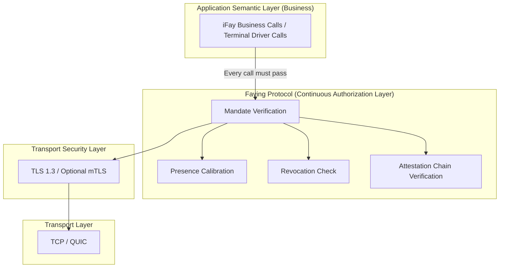
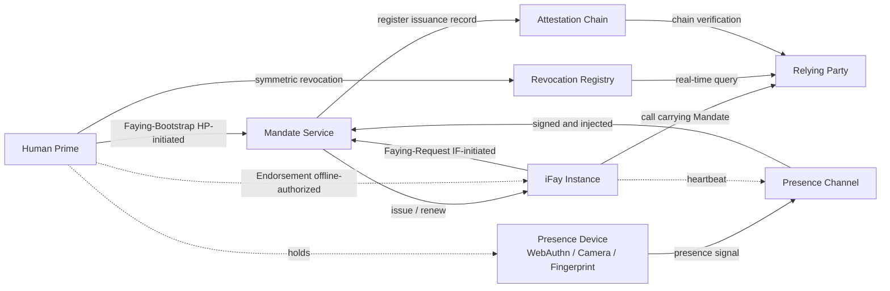
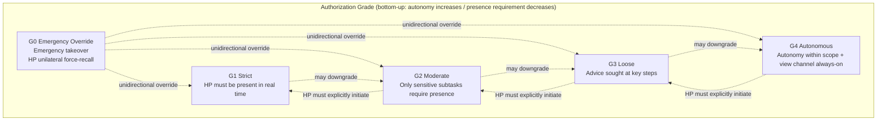
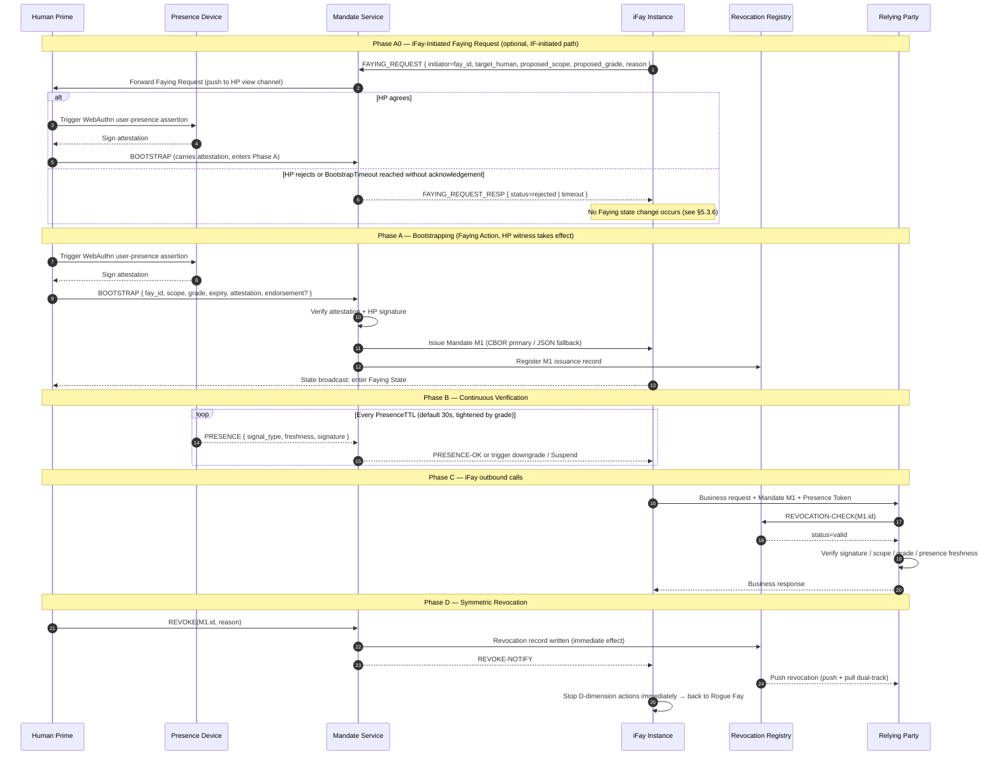

> Navigation du corps du protocole : [Sommaire](./README.md) | précédent [§1 Vue d'ensemble](./01-Vue-d-ensemble.md) | suivant [§3 Composants et Interfaces](./03-Composants-et-Interfaces.md)

## §2 Architecture

Ce chapitre présente la vue architecturale d'ensemble de Faying Protocol au niveau du protocole :

- **§2.1 Position dans la pile du protocole** : caractérise la position de couche de Faying Protocol au-dessus de TLS 1.3 et sous la sémantique métier, en explicitant la contrainte dure selon laquelle « chaque action sortante d'un iFay doit franchir la porte de vérification du Mandate » ;
- **§2.2 Relations entre entités** : énumère les 7 classes d'entités impliquées par le protocole et leurs frontières de responsabilité, et donne les arêtes Faying bidirectionnelles (initiée par le HP / initiée par l'IF) ainsi que l'arête d'endossement hors ligne (Endorsed Mandate) ;
- **§2.3 Hiérarchie des niveaux d'autorisation** : présente le spectre des niveaux et les directions de commutation pour les cinq niveaux G0–G4 selon les deux dimensions autonomie / exigence de présence ;
- **§2.4 Séquence d'interaction principale** : assemble BOOTSTRAP (y compris le chemin Phase A0 initié par l'IF) + Vérification continue + Action + Révocation symétrique en une seule séquence de bout en bout, servant d'ancrage visuel pour les chapitres ultérieurs (§5 Messages / §7 Niveaux / §8 Cycle de vie / §10 Gestion des erreurs) ;
- **§2.5 Principes de conception** : énonce les 6 principes de conception que la couche protocole doit toujours suivre (Refus par défaut / Moindre privilège / Vérification continue / Auditabilité par construction / Surpassement humain / Dégradation gracieuse).

> **Note de traçabilité EARS** : chaque contrainte dure de niveau architectural de ce chapitre est suivie d'une ligne `Trace:` qui énumère les identifiants des sous-clauses EARS correspondantes (issues du référentiel des exigences) sous la forme `R<exigence>.<critère>.<clause>`.
>
> **Alignement terminologique** : les noms d'entités apparaissant dans ce chapitre (Human Prime / iFay Instance / Presence Device / Mandate Service / Presence Channel / Attestation Chain / Revocation Registry / Relying Party, etc.) sont pleinement cohérents avec l'aide-mémoire d'alignement terminologique de l'Annexe A ; chaque fois que ce chapitre et l'Annexe A semblent ambigus sur la terminologie, **l'Annexe A fait foi**.

### §2.1 Position dans la pile du protocole

**Posture de conception** : Faying Protocol ne remplace pas TLS et ne réinvente pas OAuth ; il se situe au-dessus de TLS et sous la sémantique métier, et impose que **chaque action sortante d'un iFay** franchisse la porte de vérification du Mandate. Tout appel sortant qui contourne la porte de Faying Protocol est traité comme une Rogue Action et doit être rejeté par un intergiciel placé au-dessus de la couche de transport et sous la couche métier.

**Contraintes dures au niveau du protocole** :

- **A-Stack-1 (chaque appel doit franchir la vérification des quatre éléments)** : avant d'accepter le moindre appel sortant d'une iFay Instance, une Relying Party doit compléter, dans l'ordre, la vérification du Mandate / la calibration de présence / le contrôle de révocation / la vérification de la chaîne d'attestation — les quatre ; toute absence de l'un d'eux est traitée comme une Rogue Action contournant la porte et rejetée par Refus par défaut.
  - **Trace** : `R2.1.1` (aucun Mandate → refus par défaut), `R2.1.2` (contrôle du périmètre), `R2.1.3` (champ manquant → rejet), `R2.1.4` (RR inaccessible → rejet par Refus par défaut).
- **A-Stack-2 (séparation des responsabilités entre couche canal et couche autorisation)** : la confidentialité du canal et l'identité du pair sont portées par TLS 1.3 / mTLS optionnel, et Faying Protocol ne refait pas ce travail ; Faying Protocol n'est responsable que de la sémantique d'« autorisation continue » et n'introduit pas de tâches de handshake ou d'accord de clés au niveau du protocole qui chevaucheraient TLS.

### §2.2 Relations entre entités

**Notes sur les arêtes Faying bidirectionnelles** :

- `HP --> MS (Faying-Bootstrap, HP-initiated)` : le Human Prime initie proactivement le Faying (établissement ou ajustement) via le canal BOOTSTRAP (voir §5.3.1).
- `IF --> MS (Faying-Request, IF-initiated)` : l'iFay Instance sollicite proactivement un Faying auprès du Human Prime ; la requête passe d'abord par Mandate Service, puis le Human Prime l'acquitte via BOOTSTRAP pour la rendre effective (voir §2.4 Phase A0, §5.3.6 FAYING_REQUEST).
- `HP -. Endorsement (offline-authorized) .-> IF` : l'énoncé d'endossement d'un Endorsed Mandate porte une sémantique de pré-autorisation hors ligne — au moment du BOOTSTRAP, le HP empaquette `endorsed_scope` / `endorsed_grade` / `endorsed_lifetime` dans le Mandate en une fois, permettant à l'iFay d'opérer de façon autonome dans une enveloppe contrainte pendant une déconnexion physique ; cette arête n'est pas une « communication à l'exécution » mais plutôt une « sémantique pré-portée transportée dans les champs du Mandate » (voir §4.1 champ `endorsement`, §7.5 Endorsement Grades).

**Responsabilités des entités** :

| Entité | Tâches au niveau du protocole | Frontière de responsabilité / d'autorité |
| --- | --- | --- |
| **Human Prime (HP)** | La seule entité qui peut initier une Faying Action ; la seule entité qui détient le pouvoir de révocation ; le seul point terminal ultime porteur de responsabilité | À tout instant, l'action sortante de l'iFay peut être attribuée sans ambiguïté à un unique HP ; tout changement d'état Faying doit obtenir du HP un acquittement explicite, non trompé et vérifiable |
| **iFay Instance (IF)** | L'entité agente mandatée, identifiée de façon unique par FayID ; doit présenter un Mandate valide à chaque appel sortant ; peut solliciter proactivement un Faying auprès du HP (FAYING_REQUEST) ou demander la déconnexion du Faying | Ne détient pas le pouvoir de révoquer son propre Mandate ; aucun chemin légitime n'existe pour des rehaussements de niveau auto-initiés ; FAYING_REQUEST ne prend effet qu'à l'acquittement explicite du HP |
| **Presence Device (PD)** | Matériel portant les identifiants WebAuthn / FIDO2 et les capacités biométriques ; la source physique des signaux de présence | Chaque Presence Signal doit être signé par le PD et porter `nonce + produced_at + device_attestation` ; la fenêtre de fraîcheur n'est pas portée par le signal mais donnée par le `presence_req.max_staleness_ms` du Mandate correspondant |
| **Mandate Service (MS)** | Le service logique qui émet / renouvelle / abaisse / révoque les Mandate pour le compte du HP | Aucun chemin légitime n'existe pour un « MS décidant lui-même de l'amorçage » ni pour un « MS se substituant au HP pour compléter l'acquittement Faying » ; lorsque le MS est inaccessible, converger vers Refus par défaut |
| **Presence Channel (PC)** | Le flux de présence à faible latence et anti-rejeu du PD vers le MS ; porte aussi la source de signal sous-jacente pour le §3.5 Liveness Channel | le nonce est à usage unique ; un signal au-delà du `presence_req.max_staleness_ms` du Mandate correspondant est traité comme périmé ; le même nonce peut être accepté au plus une fois dans une fenêtre de `2 × max_message_lifetime` |
| **Attestation Chain (AC)** | La chaîne de signatures traçable à rebours formée par toutes les actions d'émission HP → MS → IF → IF dérivé | Chaque nœud de la chaîne doit être signé par son parent et horodaté dans la fenêtre de validité du parent ; tout nœud manquant ou à signature invalide rend toute la chaîne non fiable |
| **Revocation Registry (RR)** | Service d'état de révocation en temps réel (interrogation courte de type OCSP + poussée active + repli conservateur) | Latence de visibilité de révocation ≤ `RevocationVisibilityBudget` ; lorsque le RR est inaccessible et ≥ `StaleBudget`, la RP doit rejeter (aucun « passage optimiste » autorisé) |
| **Relying Party (RP)** | Le terminal, l'application ou le service appelé par l'iFay | À chaque appel, vérifie obligatoirement le quadruplet (Mandate / Presence / Attestation / Revocation) ; toute défaillance de l'un → rejet |

**Contraintes dures au niveau du protocole** :

- **A-Ent-1 (point terminal unique porteur de responsabilité)** : pour tout appel sortant accepté par la RP, le nœud racine de l'Attestation Chain de son Mandate correspond à exactement un Human Prime ; lorsque plusieurs émetteurs coexistent, rejeter avec `E_PROTOCOL`.
  - **Trace** : `R1.1.1` (la racine de l'AC correspond à exactement un HP), `R1.1.2` (lorsque plusieurs Mandate sont simultanément Active, le Mandate sélectionné et les Mandate coexistants doivent partager le même émetteur HP), `R1.1.3` (incohérence d'émetteur → rejet avec `E_PROTOCOL`, inscription dans l'AC + poussée vers le canal de vue du HP).
- **A-Ent-2 (pas de Faying = Rogue Fay)** : l'état comportemental d'une iFay Instance à tout instant appartient à l'ensemble binaire `{Faying State, Rogue Fay}` ; aucun troisième état n'existe, ni aucune zone grise « ni Faying ni Rogue ».
  - **Trace** : `R1.1.4` (le quintuplet du journal d'audit reconstitue le point terminal porteur de responsabilité, ce qui implique l'observabilité de l'état binaire — cette sous-clause relève de l'ensemble des Requirements déclaré par cette tâche).

### §2.3 Hiérarchie des niveaux d'autorisation

**Règles fondamentales** :

- Les **abaissements** (G_ST → G_MO → G_LO → G_AU) peuvent être déclenchés automatiquement par le protocole selon les règles intégrées au Mandate (p. ex. signal de présence perdu → abaissement automatique vers un niveau plus strict ; note : présence perdue → « plus strict » signifie G_AU → G_LO et des « directions inverses » similaires ; voir §7).
- Les **rehaussements** (vers une autonomie supérieure) doivent être explicitement initiés par le HP au moyen d'une nouvelle Faying Action ; aucun rehaussement autonome par l'iFay ou le MS n'est autorisé.
- **G0 Emergency Override** peut toujours être initié unilatéralement par le HP, surpassant tout niveau courant, poussant immédiatement l'iFay vers Suspended en attente de revue humaine.

**Contraintes dures au niveau du protocole** :

- **A-Grade-1 (les rehaussements doivent porter le témoignage du HP)** : lorsque GRADE_SWITCH a `target_grade.autonomy > current_grade.autonomy`, la requête doit porter un `human_witness` vérifiable (forme par défaut : assertion de présence utilisateur WebAuthn) ; signature manquante ou invalide → rejet avec `E_HUMAN_WITNESS_REQUIRED`.
  - **Trace** : `R6.1.1` (les rehaussements doivent porter le témoignage du HP), `R6.1.2` (signature manquante ou invalide → `E_HUMAN_WITNESS_REQUIRED`).
- **A-Grade-2 (la direction perte-de-présence est monotonement resserrante)** : lorsque les signaux de présence sont perdus, la transition d'état suivante migre vers `Degraded(grade')` ou `Suspended`, avec `grade'.autonomy < current.autonomy` ; rester au niveau d'origine est interdit, basculer vers une autonomie supérieure est interdit.
  - **Trace** : `R5.2.1` (migrer vers un grade' plus strict), `R5.2.2` (pas de maintien / pas d'optimisme inversé).
- **A-Grade-3 (G0 a la plus haute priorité et est réservé au HP)** : G0 Emergency Override est traité à la plus haute priorité par-dessus tout niveau courant et toute file d'événements courante ; seul le HP peut initier explicitement G0 ; un G0 auto-initié par IF / MS / SA est uniformément rejeté avec `E_PROTOCOL`.
  - **Trace** : `R6.2.1` (G0 plus haute priorité), `R6.2.4` (seul le HP peut initier G0).

### §2.4 Séquence d'interaction principale (Bootstrap + Heartbeat + Action)

**Contraintes clés de la Phase A0** :

- Une FAYING_REQUEST initiée par l'IF ne produit pas directement de Mandate ; le MS agit seulement comme relais, poussant la requête vers le canal de vue du HP.
- L'acquittement du HP doit prendre la forme d'un message BOOTSTRAP + une attestation vérifiable ; aucun chemin légitime n'existe pour un « MS consentant par défaut pour le compte du HP ».
- Si le HP ne donne pas d'acquittement explicite dans le délai `BootstrapTimeout` (60 s par défaut, voir Annexe B), le MS doit renvoyer `FAYING_REQUEST_RESP { status=timeout }` et inscrire l'événement dans l'Attestation Chain ; parallèlement, la FAYING_REQUEST doit être enregistrée avec `E_FAYING_REQUEST_NOT_CONFIRMED` (code d'erreur 1014).
- Voir §5.3.6 pour les définitions des messages FAYING_REQUEST / FAYING_REQUEST_RESP et §5.4 pour le code d'erreur 1014.

**Contraintes dures au niveau du protocole** :

- **A-Seq-1 (le témoignage du HP est irremplaçable)** : le BOOTSTRAP en Phase A0 / Phase A doit porter un `human_witness` vérifiable ; aucun chemin légitime n'existe pour IF / MS / SA de se substituer au HP pour compléter l'acquittement Faying.
  - **Trace** : `R1.3.1` (l'initiation par le HP doit présenter un acquittement explicite vérifiable), `R1.3.2` (le chemin initié par l'IF ne prend effet qu'après l'acquittement explicite du HP), `R1.3.5` (aucun chemin légitime fourni pour IF / MS / SA de se substituer au HP pour compléter l'acquittement).
- **A-Seq-2 (un dépassement de délai sur initiation par l'IF ne produit aucun changement d'état)** : une FAYING_REQUEST initiée par l'IF qui n'obtient pas l'acquittement explicite du HP dans le délai `BootstrapTimeout` expire ou est rejetée et ne produit aucun changement d'état Faying ; l'événement est inscrit dans l'Attestation Chain quelle que soit l'effectivité.
  - **Trace** : `R1.3.3` (rejet sans changement d'état lorsque `BootstrapTimeout` s'écoule sans acquittement), `R1.3.4` (événement inscrit dans l'AC quelle que soit l'effectivité).
- **A-Seq-3 (révocation symétrique de la Phase D)** : une fois le REVOKE initié par le HP publié via le MS, toutes les requêtes RP ultérieures doivent renvoyer `revoked` dans le délai `RevocationVisibilityBudget` (1 s par défaut) ; le MS pousse simultanément des notifications REVOKE vers les RP abonnées.
  - **Trace** : `R4.1.1` (chaque entrée BOOTSTRAP correspond à au moins une entrée REVOKE également accessible), `R4.1.2` (profondeur de chemin REVOKE ≤ profondeur de chemin BOOTSTRAP), `R4.1.3` (la force d'authentification de l'entrée REVOKE n'est pas plus stricte que celle du BOOTSTRAP).
- **A-Seq-4 (le canal de vue du HP doit être atteint)** : le relais de la Phase A0, la diffusion d'état de la Phase A et les notifications REVOKE de la Phase D doivent être publiés via le canal de vue du HP ; toute transition d'état doit devenir visible pour le HP une fois terminée.
  - **Trace** : `R3.3.1` (les transitions d'état du Mandate sont publiées vers le canal de vue du HP une fois terminées).

### §2.5 Principes de conception

Le tableau ci-dessous donne les 6 principes de conception que Faying Protocol doit toujours suivre au niveau du protocole. Chaque principe comporte deux colonnes : **concrétisation au niveau du protocole** et **sous-clauses EARS correspondantes**, garantissant que les principes ne restent pas au niveau du slogan.

| Principe | Concrétisation au niveau du protocole | Sous-clauses EARS correspondantes |
| --- | --- | --- |
| **Refus par défaut** | Aucun Mandate → rejet ; absence de l'un parmi périmètre / niveau / fenêtre temporelle du Mandate → rejet ; lorsque le RR est inaccessible et ≥ `StaleBudget` → rejet par Refus par défaut | `R2.1.1`, `R2.1.2`, `R2.1.3`, `R2.1.4` |
| **Moindre privilège** | Le Mandate doit déclarer explicitement `scope` ; la « délégation de tous pouvoirs » est interdite ; les jokers / la correspondance par préfixe dans `scope.actions` sont interdits au niveau du protocole ; lors d'une dérivation, `child.scope ⊆ parent.scope` converge strictement | `R2.1.2`, `R2.1.3` |
| **Vérification continue** | Chaque appel passe par les contrôles de présence et de révocation ; aucune mise en cache de la confiance ; `PresenceState.last_freshness ≥ now − max_staleness_ms` est le préalable à l'acceptation d'un appel ; c'est la fraîcheur — et non la période d'interrogation du heartbeat — qui sert de base au passage d'un appel | `R5.1.1`, `R5.1.2`, `R5.1.3`, `R5.1.4` |
| **Auditabilité par construction** | Toute Faying Action / Revoke / Grade-Switch / Delegate doit entrer dans l'Attestation Chain ; tout événement d'audit hors chaîne est traité comme non fiable ; le canal de vue du HP doit être atteint | `R3.3.1` (le canal de vue du HP doit être atteint) |
| **Surpassement humain** | G0 Emergency Override a toujours la plus haute priorité ; seul le HP peut initier explicitement G0 ; un G0 auto-initié par IF / MS / SA est uniformément `E_PROTOCOL` ; après traitement de G0, le Mandate cible doit être Suspended | `R6.2.1`, `R6.2.2`, `R6.2.3`, `R6.2.4` |
| **Dégradation gracieuse** | Signal de présence perdu → abaissement automatique vers un niveau plus strict ; « optimisme inversé » interdit ; heartbeat G4 perdu → Suspended directement ; un `Degraded` dépassant `MaxDegradedDuration` doit → Suspended | `R5.2.1`, `R5.2.2`, `R5.2.3`, `R5.2.4` |

**Relations entre principes** :

- **Refus par défaut ∧ Moindre privilège** convergent conjointement « l'ensemble des passages » : Refus par défaut fait converger l'état par défaut vers « refuser », et Moindre privilège fait converger l'ensemble des autorisations vers le triplet minimal « périmètre explicite ∩ niveau explicite ∩ presence_req explicite » ; ensemble ils constituent la « ligne de base de sécurité » de Faying Protocol.
- **Vérification continue ∧ Dégradation gracieuse** maintiennent conjointement la « monotonie du spectre des niveaux à l'exécution » : la première fait reposer chaque appel sur le fait « encore frais maintenant », la seconde garantit que, dans la direction de perte de présence, le niveau se resserre toujours vers plus strict, jamais l'inverse.
- **Auditabilité par construction ∧ Surpassement humain** garantissent conjointement « reconstructibilité a posteriori + rappel en temps réel » : la première permet à un tiers indépendant de reconstituer toute Faying Action / Revoke / Grade-Switch unique, la seconde permet au HP de reprendre le contrôle à tout instant sous forme de G0.

> **Les principes ne doivent pas être affaiblis** : les 6 principes de conception ci-dessus sont des **engagements de rang normatif** du corps du protocole ; aucune implémentation de référence / SDK / suite de tests de conformité d'interopérabilité ne peut en affaiblir un seul sous prétexte de « commodité d'ingénierie » ; si un ajustement est nécessaire dans une version future, il doit être approuvé via le processus de résolution décrit en §11 Questions ouvertes par le Protocol Committee et publié sous un nouveau numéro de version (plus Faying Protocol/1.0).
