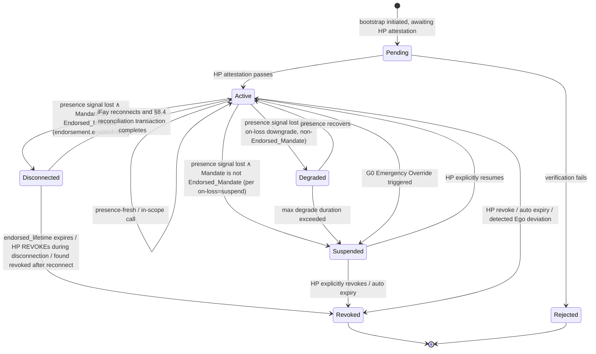

> Navigation du corps du protocole : [Sommaire](./README.md) | précédent [§3 Composants et Interfaces](./03-Composants-et-Interfaces.md) | suivant [§5 Messages du Protocole](./05-Messages-du-Protocole.md)

## §4 Modèles de Données

Ce chapitre présente les modèles de données centraux de Faying Protocol, en trois sections :

- **§4.1 Vue lisible TypeScript (non normative)** — un squelette lisible par l'humain destiné au Protocol Committee, aux implémenteurs de SDK et aux relecteurs ;
- **§4.2 Définition CDDL faisant autorité (Normative)** — le schéma faisant autorité pour le format primaire CBOR ; tous les octets sur le fil sont régis par cette section ;
- **§4.3 Machine à états du Mandate** — incluant l'état `Disconnected`, la matrice des conditions de déclenchement de transition et la table de correspondance « état du Mandate ↔ état comportemental du Fay ».

> **Déclaration faisant autorité** : lorsque la vue TypeScript de §4.1 et le CDDL de §4.2 sont incohérents de quelque manière que ce soit, **le CDDL de §4.2 fait foi**. §4.1 sert uniquement à la lecture humaine et n'entre pas dans l'entrée de signature sur le fil ; l'encodage CBOR déterministe de §4.2 est l'unique source d'entrée de signature (voir §6 Cryptographie).
>
> **Non-altérabilité du champ endorsement** : la sous-structure `endorsement` entre dans l'entrée de signature en tant que champ de `mandate` ; toute altération a posteriori de l'un quelconque de ses sous-champs (`enabled` / `endorsed-scope` / `endorsed-grade` / `endorsed-lifetime-ms` / `offline-revocation-policy`) casse la vérification de signature du Mandate (cohérent avec la Requirement 11.1 clause 3 et §6.3).

### §4.1 Types centraux (vue TypeScript, non normative)

Le bloc TypeScript ci-dessous donne, sous forme lisible par l'humain, les types centraux FayID / Grade / Scope / Mandate / Endorsement / PresenceRequirement / PresenceSignal / Attestation ; les définitions faisant autorité résident en §4.2.

```typescript
type FayID = string          // de type ULID, p. ex. "fay:01HX...Z"
type HumanPrimeID = string   // p. ex. "hp:..." (ancrable à un credentialId WebAuthn)
type MandateID = string      // ULID
type Nonce = Uint8Array      // 16 octets aléatoires

/** Niveau d'autorisation */
enum Grade {
  EmergencyOverride = 0,  // G0
  Strict            = 1,  // G1
  Moderate          = 2,  // G2
  Loose             = 3,  // G3
  Autonomous        = 4   // G4
}

/** Périmètre d'autorisation (moindre privilège) */
interface Scope {
  domains:    string[]    // domaines de ressources autorisés (motif d'URL / de type SPIFFE-ID)
  actions:    string[]    // actions autorisées (read / write / control:drone:takeoff …)
  terminals?: string[]    // terminaux autorisés (utilisé en dérivation Phase 2)
  budget?:   ResourceBudget
}

interface ResourceBudget {
  time_window:    [IsoTime, IsoTime]
  max_invocations?: number
  max_cost_units?:  number  // unités de ressources abstraites (argent / quota d'inférence / trafic, etc.)
}

/** Mandate (remplace le jeton) */
interface Mandate {
  version:       "Faying Protocol/1.0"
  id:            MandateID
  issued_at:     IsoTime
  not_before:    IsoTime
  not_after:     IsoTime          // doit être fini : un Faying indéfini est un anti-motif
  issuer:        HumanPrimeID     // HP (ou un MS autorisé par le HP)
  ms_id:         string           // le MS qui a réellement émis
  subject:       FayID            // l'iFay autorisé
  scope:         Scope
  grade:         Grade
  presence_req:  PresenceRequirement
  parent?:       MandateID        // pointe vers le Mandate parent lors d'une dérivation
  endorsement?:  Endorsement      // optionnel : autorisation endossée (Endorsed Mandate)
  attestation:   Attestation
  signature:     SignatureBundle  // voir §6
}

/** Endorsed Mandate — sémantique pré-portée pour l'autonomie hors ligne
 *
 * Si et seulement si `enabled = true`, l'iFay peut opérer de façon autonome
 * pendant une déconnexion physique de l'état Faying, dans les limites de
 * endorsed_scope ⊆ scope et endorsed_grade.autonomy ≤ grade.autonomy ;
 * endorsed_lifetime doit être fini. Le point terminal porteur de responsabilité demeure toujours l'émetteur (Human Prime).
 */
interface Endorsement {
  enabled:                    boolean
  endorsed_scope:             Scope        // ⊆ Mandate.scope
  endorsed_grade:             Grade        // .autonomy ≤ Mandate.grade.autonomy
  endorsed_lifetime_ms:       number       // ≤ (not_after - not_before)
  offline_revocation_policy:  "stop-and-audit" | "stop-only" | "graceful-stop"
}

/** Note sur Scope.actions : les jokers / la correspondance par préfixe sont interdits au niveau du protocole (voir la contrainte dure Atomic_Action §9 T2). */

/** Exigence de présence (liée au niveau) */
interface PresenceRequirement {
  signal_types:   PresenceSignalType[]
  max_staleness_ms: number     // un dépassement déclenche un abaissement
  on_loss:        OnLossPolicy // "downgrade-to:G2" | "suspend" | "emergency-override"
}

/** Signal de présence */
interface PresenceSignal {
  mandate_id:     MandateID
  signal_type:    PresenceSignalType
  produced_at:    IsoTime
  nonce:          Nonce
  device_id:      string
  device_attestation: Attestation
  signature:      SignatureBundle
}

/** Attestation (porteur unifié d'assertion vérifiable) */
interface Attestation {
  format:        "webauthn" | "tpm-quote" | "platform-keystore" | "self-signed"
  payload:       Uint8Array       // auto-descriptif selon le format
  signer:        string           // identifiant de clé publique
  signature:     SignatureBundle
}
```

### §4.2 CDDL (format primaire CBOR, définition faisant autorité)

Le bloc CDDL ci-dessous est le **schéma faisant autorité** pour le format de transmission de Faying Protocol/1.0. Tant les vecteurs de test officiels de cette spécification (`vectors/`) que la suite de tests de conformité d'interopérabilité (`conformance/`) sont régis par cette section ; le résultat de décodage des octets CBOR de toute implémentation doit être exactement cohérent avec cette section.

```cddl
; Faying Protocol/1.0 — CBOR Data Definition Language
; Normative; this is the authoritative schema for Faying Protocol/1.0 wire format.
faying-grade = 0..4    ; 0=EmergencyOverride, 1=Strict, 2=Moderate, 3=Loose, 4=Autonomous

scope = {
  domains:    [* tstr],
  actions:    [* tstr],
  ? terminals: [* tstr],
  ? budget:   resource-budget
}

resource-budget = {
  time-window:        [iso-time, iso-time],
  ? max-invocations:  uint,
  ? max-cost-units:   uint
}

iso-time = #6.0(tstr)   ; CBOR tag 0 (RFC 3339 string)

presence-signal-type =
  "webauthn-uv-fresh" /
  "face-continuous"   /
  "fingerprint-tap"   /
  "presence-heartbeat-only" /
  "intent-ticket"

presence-requirement = {
  signal-types:        [+ presence-signal-type],
  max-staleness-ms:    uint,
  on-loss:             tstr            ; "downgrade-to:Gx" | "suspend" | "emergency-override"
}

attestation = {
  format:    "webauthn" / "tpm-quote" / "platform-keystore" / "self-signed",
  payload:   bstr,
  signer:    tstr,
  signature: signature-bundle
}

signature-bundle = {
  alg:       "Ed25519" / "ES256" / "ML-DSA-65",   ; PQC negotiation slot
  pubkey:    bstr,
  sig:       bstr,
  ? chain:   [* bstr]                              ; optional certificate chain
}

mandate = {
  version:        "Faying Protocol/1.0",
  id:             tstr,
  issued-at:      iso-time,
  not-before:     iso-time,
  not-after:      iso-time,
  issuer:         tstr,        ; Human Prime ID
  ms-id:          tstr,
  subject:        tstr,        ; FayID
  scope:          scope,
  grade:          faying-grade,
  presence-req:   presence-requirement,
  ? parent:       tstr,
  ? endorsement:  endorsement,
  attestation:    attestation,
  signature:      signature-bundle
}

endorsement = {
  enabled:                       bool,
  endorsed-scope:                scope,         ; must ⊆ main Mandate.scope
  endorsed-grade:                faying-grade,  ; must ≤ main Mandate.grade (autonomy weaker or equal, security higher)
  endorsed-lifetime-ms:          uint,          ; must ≤ (mandate.not-after - mandate.not-before)
  offline-revocation-policy:     "stop-and-audit" / "stop-only" / "graceful-stop"
}

presence-signal = {
  mandate-id:           tstr,
  signal-type:          presence-signal-type,
  produced-at:          iso-time,
  nonce:                bstr .size 16,
  device-id:            tstr,
  device-attestation:   attestation,
  signature:            signature-bundle
}
```

> **Correspondance de nommage des champs** : le CDDL utilise `kebab-case` (convention du format de transmission) ; la vue TypeScript utilise `snake_case` (convention de lecture humaine). Les champs se correspondent un à un : `presence-req` ↔ `presence_req`, `endorsed-scope` ↔ `endorsed_scope`, `endorsed-lifetime-ms` ↔ `endorsed_lifetime_ms`, etc.

### §4.3 Machine à états du Mandate



**Sémantique de l'état `Disconnected`** : applicable uniquement à un Endorsed_Mandate (c.-à-d. `endorsement.enabled = true`). Pendant cet état :

- l'iFay_Instance est autorisée à effectuer des actions de dimension D uniquement dans `endorsement.endorsed_scope`, contraintes par `endorsement.endorsed_grade` ;
- un dépassement de `endorsement.endorsed_lifetime` provoque immédiatement un dépassement de délai léger → migration vers Revoked, même si l'iFay est encore physiquement déconnectée ;
- un REVOKE émis par le HP pendant la déconnexion est traité immédiatement à la reconnexion de l'iFay selon `endorsement.offline_revocation_policy` (par défaut `stop-and-audit`) ;
- la reconnexion doit passer par la transaction de réconciliation §8.4 ; la « reprise silencieuse » est interdite.

**Matrice des conditions de déclenchement de transition** (verrouillée avec le §3.5 Liveness Channel et les Requirement 11 / 12) :

| Transition | Condition de déclenchement |
| --- | --- |
| Active → Degraded | `PresenceState.stale=true` ∧ le Mandate n'est pas un Endorsed_Mandate ∧ `on-loss = "downgrade-to:Gx"` |
| Active → Disconnected | `PresenceState.stale=true` ∧ le Mandate est un Endorsed_Mandate (`endorsement.enabled=true`) |
| Active → Suspended | `PresenceState.stale=true` ∧ le Mandate n'est pas un Endorsed_Mandate ∧ `on-loss = "suspend"` |
| Disconnected → Active | l'iFay se reconnecte et la transaction de réconciliation §8.4 se termine (incluant récupération de la présence / REVOKE en attente / GRADE_SWITCH tous alignés) |
| Disconnected → Revoked | `endorsed_lifetime` expire ∨ le HP REVOKE pendant la déconnexion ∨ trouvé révoqué après reconnexion |

**Correspondance état du Mandate ↔ état comportemental du Fay** (alignée sur les dimensions A/B/C/D du chapitre 13) :

| État du Mandate | État comportemental équivalent du Fay | Dimension D (action sortante) |
| --- | --- | --- |
| Pending | Rogue Fay | Interdite |
| Active | Faying State | Autorisée (dans le périmètre) |
| Degraded | Faying State (contraint) | Autorisée uniquement dans le périmètre du niveau abaissé courant |
| Disconnected | Faying State (endorsed-only) | Autorisée uniquement dans `endorsement.endorsed_scope`, contrainte par `endorsement.endorsed_grade` (voir §7.5 / §8.4) |
| Suspended | Faying State en pause | Interdite, mais le Mandate reste récupérable |
| Revoked | Rogue Fay | Interdite |
| Rejected | Rogue Fay | Interdite |
