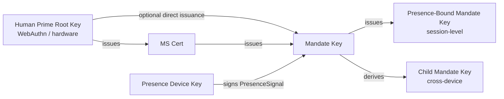

> Navigation du corps du protocole : [Sommaire](./README.md) | précédent [§5 Messages du Protocole](./05-Messages-du-Protocole.md) | suivant [§7 Niveaux d'Autorisation](./07-Niveaux-d-Autorisation.md)

## §6 Cryptographie

Ce chapitre présente la spécification cryptographique au niveau de Faying Protocol, en trois sections :

- **§6.1 Suites d'algorithmes** : la table de négociation et les règles pour les trois paliers par défaut / alternatif / PQC ;
- **§6.2 Dérivation de clés et rôles** : la hiérarchie de dérivation et les contraintes dures depuis la Human Prime Root Key jusqu'à la Presence-Bound Mandate Key ;
- **§6.3 Format de signature** : signatures détachées, entrée de signature en CBOR déterministe, chaînes multi-signatures et l'ancrage de l'entrée de signature pour l'Endorsed_Mandate.

> **Note de traçabilité EARS** : chaque règle de ce chapitre est suivie d'une ligne `Trace:` qui énumère les identifiants des sous-clauses EARS correspondantes (issues du référentiel des exigences) sous la forme `R<exigence>.<critère>.<clause>`.

### §6.1 Suites d'algorithmes

| Usage | Par défaut | Alternatif | Emplacement de négociation PQC |
| --- | --- | --- | --- |
| Signature (Mandate / Presence / Attestation) | **Ed25519** | ECDSA-P256 | ML-DSA-65 (FIPS 204) |
| Hachage | **SHA-256** | BLAKE3 | SHA3-256 |
| Dérivation (KDF) | HKDF-SHA-256 | — | HKDF-SHA3-256 |
| Symétrique (p. ex. lorsque le chiffrement par stapling du Mandate est activé) | ChaCha20-Poly1305 | AES-256-GCM | — |
| Couche canal | TLS 1.3 obligatoire | mTLS optionnel | TLS-1.3-PQ (hybride X25519 + ML-KEM-768) |

**Règles de négociation** :

- **N1 (chaque partie déclare)** : le client et le serveur doivent déclarer chacun, au moment du BOOTSTRAP, les suites de signature, de hachage, de KDF, symétrique et de couche canal qu'ils prennent en charge ; les valeurs finales de `SignatureBundle.alg`, `hash`, `kdf`, `channel-suite` doivent être les algorithmes les plus forts pris en charge conjointement.
  - **Trace** : `R8.1.1` (chaque partie déclare les suites prises en charge au BOOTSTRAP), `R8.1.2` (l'algorithme le plus fort pris en charge conjointement est sélectionné comme valeur finale).

- **N2 (ensemble d'implémentation minimal)** : toute implémentation compatible doit prendre en charge au moins l'ensemble d'algorithmes de signature `{Ed25519, ECDSA-P256}` simultanément ; les suites PQC sont OPTIONNELLES mais toute implémentation doit réserver des emplacements de négociation pour de futures mises à niveau progressives.
  - **Trace** : `R8.1.3` (doit prendre en charge `{Ed25519, ECDSA-P256}` simultanément), `R8.2.3` (les suites PQC sont `OPTIONAL` jusqu'à être marquées `MUST`, et le BOOTSTRAP ne doit pas être rejeté parce que le pair ne prend pas en charge PQC).

- **N3 (aucune suite commune → `E_PROTOCOL`)** : si aucun algorithme de signature ou de hachage pris en charge conjointement n'existe au moment du BOOTSTRAP, Mandate_Service doit rejeter le BOOTSTRAP avec `E_PROTOCOL`.
  - **Trace** : `R8.1.4` (rejeter le BOOTSTRAP avec `E_PROTOCOL` lorsqu'aucun algorithme commun n'existe).

- **N4 (emplacement de négociation PQC réservé + mise à niveau progressive)** : `Mandate.signature_bundle` doit fournir l'emplacement d'algorithme pour prendre en charge `ML-DSA-65` (FIPS 204) comme algorithme de signature optionnel ; l'emplacement de négociation BOOTSTRAP doit réserver une prise en charge optionnelle de `TLS-1.3-PQ` (hybride X25519 + ML-KEM-768) ; le protocole doit permettre d'avancer la suite par défaut par paliers via la négociation de version au cours d'un cycle de vie, sans casser la vérifiabilité des Mandate existants.
  - **Trace** : `R8.2.1` (`Mandate.signature_bundle` fournit l'emplacement d'algorithme `ML-DSA-65`), `R8.2.2` (l'emplacement de négociation BOOTSTRAP réserve `TLS-1.3-PQ`), `R8.2.4` (la mise à niveau progressive négociée par version préserve la vérifiabilité des Mandate existants).

### §6.2 Dérivation de clés et rôles

Le diagramme ci-dessous montre la hiérarchie de dérivation de clés de Faying Protocol et les relations entre rôles : la HP Root Key ne quitte jamais le matériel détenu par l'humain et n'autorise que la MS Key et (sous des chemins restreints) la Mandate Key ; la Mandate Key établit des clés de session de courte durée lors de l'émission des Presence-Bound et Child Mandate Keys ; la Presence_Device Key sert uniquement à signer le PresenceSignal.



**Contraintes clés** :

- **K1 (ancrage matériel de la HP Root Key)** : la HP Root Key ne quitte jamais le matériel que l'humain détient (authentificateur WebAuthn / platform keystore / portefeuille matériel) ; aucun chemin cryptographique n'existe au niveau du protocole qui exige que la HP Root Key quitte le matériel.
  - **Trace** : `R9.2.4` (chaque Mandate utilise une clé de signature de session indépendante et de courte durée — entraîne la contrainte de hiérarchie de clés séparant clé racine et clé de session), `R8.1.3` (propriété de portabilité matérielle de l'ensemble d'implémentation minimal).

- **K2 (directionnalité de la chaîne de révocation)** : la révocation de la MS Key est exécutée directement par la HP Root Key ; le MS ne peut se révoquer lui-même. Cette contrainte garantit que l'accessibilité de la révocation est enracinée dans le HP, non dans le MS lui-même.
  - **Trace** : `R9.2.4` (la Presence-Bound Mandate Key est forcée à tourner à chaque GRADE_SWITCH — entraîne la contrainte inverse que le MS ne peut auto-révoquer la clé racine).

- **K3 (clé de session indépendante par Mandate)** : chaque Mandate a une clé de signature de session indépendante (évitant l'abus de clé à longue durée) ; la Presence-Bound Mandate Key est forcée à tourner à chaque GRADE_SWITCH.
  - **Trace** : `R9.2.4` (chaque Mandate utilise une clé de signature de session indépendante et de courte durée ; chaque GRADE_SWITCH force la rotation de la Presence-Bound Mandate Key).

- **K4 (chemin de dérivation lié à l'appareil)** : la Child Mandate Key doit être liée au `device_id` et à la `device_attestation` de l'appareil cible ; tout chemin de « copier un Mandate vers un autre terminal et l'utiliser directement » doit être rejeté et contraint à passer par DELEGATE.
  - **Trace** : `R9.2.1` (lie `device_id` et `device_attestation` au moment de l'émission), `R9.2.2` (utiliser le même Mandate sur un autre terminal doit passer par DELEGATE).

- **K5 (Channel Binding)** : lorsque mTLS est activé, un Mandate doit porter la valeur de channel binding TLS Exporter définie par [RFC 9266](https://www.rfc-editor.org/rfc/rfc9266), et la Relying_Party doit comparer cette valeur au moment de la vérification.
  - **Trace** : `R9.2.3` (avec mTLS activé, porter le channel binding TLS Exporter RFC 9266, et la RP doit comparer).

### §6.3 Format de signature

**S1 (signature détachée)** : toutes les signatures sont détachées — le `signature_bundle` CBOR est séparé du payload, facilitant l'audit et la re-signature. `signature_bundle` ne doit pas incorporer le payload lui-même ni une copie.
- **Trace** : `R10.2.2` (signature détachée, `signature_bundle` séparé du payload).

**S2 (définition canonique de l'entrée de signature)** : tout objet signé doit être trié selon [RFC 8949 §4.2.1 Deterministic Encoding](https://www.rfc-editor.org/rfc/rfc8949#section-4.2.1) avant la signature ; l'entrée de signature doit être calculée comme :

> `signature_input = H( Deterministic-CBOR( Envelope_without_signature ) )`

où `H` est l'algorithme de hachage final négocié (par défaut SHA-256, alternatif BLAKE3, emplacement de négociation PQC SHA3-256), et `Envelope_without_signature` désigne la structure résiduelle du `Faying Protocol Envelope` après suppression du champ `signature_bundle`. **Cette formule s'applique à tout objet de ce protocole nécessitant une signature** (y compris Mandate, PresenceSignal, le Faying Protocol Envelope lui-même), rendant l'entrée de signature indépendante de l'ambiguïté de la sérialisation JSON — le hachage d'entrée de signature doit être identique sous les encodages CBOR et JSON.

- **Trace** : `R10.2.1` (trié selon RFC 8949 §4.2.1 Deterministic Encoding avant la signature), `R10.2.4` (l'entrée de signature est `H( Deterministic-CBOR(Envelope_without_signature) )`), `R10.1.4` (la sérialisation CBOR déterministe avant la signature rend l'entrée de signature indépendante de l'ambiguïté de la sérialisation JSON).

**S3 (chaîne multi-signatures)** : dans les scénarios multi-signatures (p. ex. DELEGATE exige le contreseing du Mandate parent), les signatures de chaîne parente sont portées via le tableau `signature_bundle.chain` ; l'ordre des éléments de la chaîne est « enfant → parent → parent du parent → … → racine », et chaque élément de chaîne suit lui-même la canonicalisation de S2.
- **Trace** : `R10.2.3` (signatures de chaîne parente portées via le tableau `signature_bundle.chain` dans les scénarios multi-signatures).

**S4 (ancrage de l'entrée de signature de l'Endorsed_Mandate)** : lorsqu'un Mandate porte le champ `endorsement` (quelle que soit la valeur de vérité de `enabled`), tous les sous-champs de `endorsement` —

```
(enabled, endorsed_scope, endorsed_grade, endorsed_lifetime_ms,
 offline_revocation_policy)
```

— doivent entrer dans l'entrée de signature. Autrement dit, lors du calcul de `H( Deterministic-CBOR(Mandate_without_signature) )`, le sous-arbre `endorsement` **ne doit pas être exclu**. Cette règle est cohérente avec P16.1 (Endorsement_Signature_Inclusion).

Toute altération a posteriori du champ `endorsement` (y compris faire passer `enabled` de `false` à `true`, étendre `endorsed_scope`, relâcher `endorsed_grade`, prolonger `endorsed_lifetime_ms`, modifier `offline_revocation_policy`) entraînera l'échec de la vérification de signature : la Relying_Party rejette l'appel concerné avec `E_ATTESTATION_INVALID`, et Mandate_Service rejette avec `E_ENDORSEMENT_INVALID` et déclenche le Revoke de ce Mandate (voir §5.4 code d'erreur 1013, §9.7, P16.1).

- **Trace** : `R11.1.3` (le champ `endorsement` de chaque Endorsed_Mandate entre dans l'entrée de signature, faisant que toute altération a posteriori casse la vérification de signature), `R11.1.4` (lorsqu'une altération du champ `endorsement` est détectée, la RP rejette avec `E_ATTESTATION_INVALID` et le MS déclenche Revoke).

**S5 (dérivation de la non-altérabilité du champ endorsement)** : dérivée conjointement de S2 et S4 —

1. Par S4, le sous-arbre `endorsement` doit entrer dans `Deterministic-CBOR(Mandate_without_signature)` ;
2. Par S2, l'entrée de signature est `H(Deterministic-CBOR(Mandate_without_signature))` ;
3. Donc toute modification d'un sous-champ quelconque de `endorsement` changera le résultat de la sérialisation CBOR déterministe, changeant par là le hachage d'entrée de signature ;
4. Par la propriété cryptographique de la vérification de signature, la signature originale doit échouer à la vérification sur la nouvelle entrée de signature.

Ainsi la non-altérabilité du champ `endorsement` est directement dérivée de §6.3, ne requérant aucun mécanisme supplémentaire au niveau du protocole. **Cette non-altérabilité est la pierre angulaire cryptographique de la chaîne d'imputabilité de l'Endorsed_Mandate** (voir §11.4 et P16.5) : toute altération a posteriori de l'endossement est immédiatement détectée à l'étape de vérification de signature, coupant tout chemin possible pour « échapper à la responsabilité en altérant les énoncés d'endossement ».

- **Trace** : `R11.1.3` (l'altération a posteriori casse la vérification de signature), `R10.2.4` (définition de l'entrée de signature), `R11.1.4` (disposition au niveau du protocole lorsqu'une altération est détectée).
