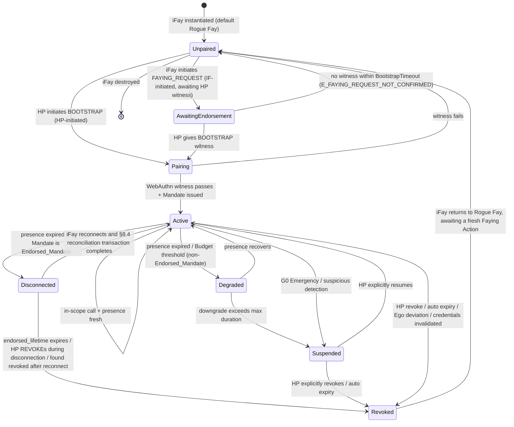
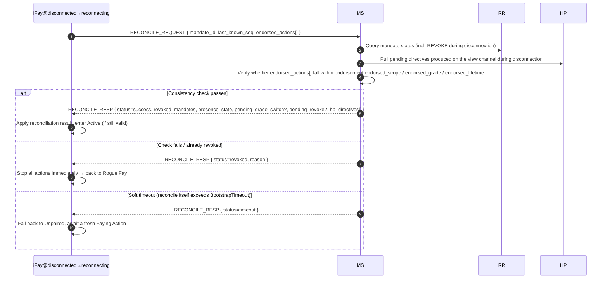

> Navigation du corps du protocole : [Sommaire](./README.md) | précédent [§7 Niveaux d'Autorisation](./07-Niveaux-d-Autorisation.md) | suivant [§9 Considérations de Sécurité](./09-Considerations-de-Securite.md)

## §8 Cycle de Vie

Ce chapitre présente le cycle de vie de bout en bout de Faying Protocol : depuis l'instanciation de l'iFay, l'initiation de la Faying Action, le maintien de l'état Faying, en passant par l'abaissement / la déconnexion / la suspension / la révocation, jusqu'au retour à Rogue Fay — la clôture d'état complète. La machine à états spécifiée par ce chapitre est le support des invariants au niveau du protocole — la légitimité de toutes les actions de dimension D (sortantes), l'unicité du point terminal porteur de responsabilité et la frontière de l'« autonomie endossée » pendant la déconnexion sont toutes définies dans ce chapitre.

### §8.1 Machine à états du cycle de vie complet

Le diagramme ci-dessous couvre les 7 clôtures d'état au niveau du protocole (**Unpaired / Pairing / Active / Degraded / Disconnected / Suspended / Revoked**) et toutes les transitions légitimes entre elles. `AwaitingEndorsement` est un état transitoire intermédiaire sur le chemin Faying bidirectionnel initié par l'IF (voir §2.4 / §5.3.6) ; il ne constitue pas une clôture stable où « les actions sont exécutables », mais il est tout de même présenté dans le diagramme d'état pour garder le graphe de transitions complet.

> Relation avec la machine à états du Mandate §4.3 : §4.3 décrit l'état de *l'objet Mandate* (Pending / Active / Degraded / Disconnected / Suspended / Revoked / Rejected) ; cette section décrit l'état de cycle de vie de *l'entité iFay*. Les deux sont reliés via la correspondance « Mandate Active/Degraded/Disconnected ⇔ Faying State / Faying State endorsed-only » ; voir la table « correspondance état du Mandate ↔ état comportemental du Fay » à la fin de §4.3.

### §8.2 Sémantique des phases

Le tableau ci-dessous donne la sémantique des 7 clôtures d'état. La valeur de chaque état dans la colonne « action sortante (dimension D) » est la décision d'admission de dimension D au niveau du protocole.

- **Unpaired** : équivalent à Rogue Fay dans la note de cadrage. Seules les actions A1–A4 (auto-perception), B1–B3 (expression interne), C1–C2 (communication humaine unidirectionnelle, y compris l'initiation de FAYING_REQUEST) sont autorisées. Les actions de dimension D sont uniformément interdites.

> **Détermination précise de Rogue Fay (important)** : une connexion rompue par elle-même **n'équivaut pas** à Rogue Fay. Une iFay est déterminée comme Rogue Fay si et seulement si l'un des deux cas suivants tient : (1) **déconnectée ET aucune autorisation explicite n'existe** — c.-à-d. aucun Mandate en `Active / Degraded / Disconnected` ne couvre son comportement courant (y compris n'avoir jamais établi de Faying, ou le Mandate ayant été révoqué / expiré / suspendu) ; (2) **déconnexion prouvée** — jugée Perceived-Disconnected selon §9.9, ET le Mandate courant n'est pas un Endorsed_Mandate valide (ou `endorsement` a expiré / `enabled=false`).
>
> À l'inverse : une iFay dont la connexion physique est rompue mais qui détient un **Endorsed_Mandate valide** et est encore dans `endorsed_scope / endorsed_grade / endorsed_lifetime` est dans l'état `Disconnected` et en **Faying State (endorsed-only), non Rogue Fay** — ses actions de dimension D pendant la déconnexion sont portées par `Mandate.issuer` (HP) via la pré-autorisation hors ligne établie au BOOTSTRAP (voir §4.3 / §7.5 / §8.3 / §8.4). Ce n'est que lorsque la durée de vie de l'endossement expire, qu'il est révoqué ou que la réconciliation échoue que cette iFay migre vers Revoked → Unpaired et retourne à Rogue Fay.
- **AwaitingEndorsement** : une FAYING_REQUEST initiée par l'iFay a été relayée vers le canal de vue du HP, en attente de l'acquittement du HP via BOOTSTRAP dans le délai `BootstrapTimeout` (60 s par défaut) ; cet état ne produit aucun Mandate ; les actions sortantes sont uniformément interdites ; au dépassement de délai, il retombe vers Unpaired et est inscrit dans l'Attestation Chain (code d'erreur 1014 `E_FAYING_REQUEST_NOT_CONFIRMED`).
- **Pairing** : une Faying Action en cours, transitoire. Doit compléter le témoignage WebAuthn + l'émission du Mandate dans le délai `BootstrapTimeout` ; échec → retombe vers Unpaired sans état résiduel.
- **Active** : Faying State fonctionnant normalement. Il existe exactement un Mandate en état Active qui lui correspond ; tous les appels de dimension D sont admis selon `Mandate.scope` et `Mandate.grade`.
- **Degraded** : Faying State tient encore mais le niveau est resserré (déclenché par l'expiration du signal de présence). Applicable uniquement aux **non-Endorsed_Mandate**. La durée ne doit pas dépasser `MaxDegradedDuration` (par défaut configuré par niveau, voir Annexe B) ; dépassement → migration vers Suspended.
- **Disconnected** : Faying State valide uniquement dans `endorsement.endorsed_scope` et `endorsement.endorsed_lifetime` ; applicable à la fenêtre d'action « endorsed-only » d'un Endorsed_Mandate pendant une déconnexion physique. Pour l'admission et la sémantique de déconnexion spécifiques, voir §4.3 / §7.5 / §8.4.
- **Suspended** : Faying State temporairement en attente. Les actions sortantes sont uniformément interdites, mais les métadonnées du Mandate sont conservées pour la récupération explicite par le HP ou l'audit ; dépassement du point d'expiration automatique → migration vers Revoked.
- **Revoked** : Mandate terminé. L'iFay retourne à Rogue Fay ; tout appel de dimension D ultérieur doit passer par une nouvelle Faying Action complète (nouveau `mandate_id`). Revoked est l'état absorbant d'un Mandate (voir P10).

### §8.3 Séquence d'attribution de responsabilité

> **À tout instant, action sortante de l'IF → il doit exister exactement un Mandate Active, Degraded ou Disconnected → l'`issuer` de ce Mandate est le point terminal porteur de responsabilité.**

Cette clause est la clause temporelle formalisée de l'« unicité du point terminal porteur de responsabilité » au niveau du protocole ; aucun troisième cas n'existe :

1. **Aucun Mandate conforme** : aucun Mandate Active / Degraded / Disconnected n'existe ⟹ l'action sortante n'est pas autorisée (dimension D interdite) ; la RP doit renvoyer `E_NO_MANDATE` (1001) ou `E_PRESENCE_STALE` (1005).
2. **Plusieurs Mandate conformes coexistent** : la couche protocole sélectionne obligatoirement celui au « périmètre le plus spécifique », et ils doivent partager le même `issuer` (HP) ; si plusieurs Mandate conformes existent avec des émetteurs différents, cela est traité comme une erreur de protocole et doit renvoyer `E_PROTOCOL` (1099).
3. **Action sortante pendant Disconnected** : toujours attribuée à `Mandate.issuer` (HP). `endorsement` ne contraint que les `endorsed_scope` / `endorsed_grade` / `endorsed_lifetime` exécutables de l'action et ne change pas le point terminal porteur de responsabilité ; aucun chemin légitime n'existe pour « que l'endossement transfère la responsabilité à l'iFay elle-même / au MS / au Supervisory Agent » (voir P16.5).

Les éléments suivants sont immédiatement dérivables de cette clause :

- Pour tout appel accepté `c`, le quintuplet d'audit `(mandate_id, endorsement_id?, action, ts, signature_chain)` a son nœud racine de `signature_chain` nécessairement et exclusivement `Mandate.issuer` ;
- L'iFay n'a aucun chemin légitime d'« auto-attribution » ; MS / Supervisory Agent ne doivent pas substituer leur propre témoignage d'agent à l'identité `issuer` du HP ;
- Le point terminal porteur de responsabilité ne peut changer au sein du cycle de vie d'un Mandate ; tout changement doit passer par révocation + nouveau BOOTSTRAP (nouveau `mandate_id`, nouvel `issuer`).

### §8.4 Réconciliation à la reconnexion

> **Objet** : faire converger l'« autonomie endossée » de l'iFay pendant Disconnected avec les changements d'état de la vue centrale du protocole (MS / RR / canal de vue du HP) vers un état cohérent, et interdire explicitement « reconnexion = reprise d'action » comme anti-motif.

#### §8.4.1 Flux

#### §8.4.2 Contenu de retour de la transaction de réconciliation

En cas de succès de la transaction (`status = success`), `RECONCILE_RESP` doit renvoyer les champs suivants (en correspondance un à un avec la Requirement 12.4) :

1. **`revoked_mandates`** : liste des Mandate révoqués pendant la déconnexion (y compris les Mandate enfants en cascade) ;
2. **`presence_state`** : le PresenceState courant (utilisé pour décider si la dimension D peut continuer) ;
3. **`pending_grade_switch`** : événements GRADE_SWITCH incomplets (le cas échéant) ;
4. **`pending_revoke`** : événements REVOKE incomplets (le cas échéant) ;
5. **`hp_directives`** : directives en attente produites sur le canal de vue du HP pendant la déconnexion (p. ex. G0 Emergency Override, REVOKE explicite, abaissement forcé, etc.).

#### §8.4.3 Énumération des issues de la transaction

L'issue de la transaction de réconciliation est exactement l'une des trois suivantes, cohérente avec la formalisation P17.4 `reconcile_result(M) ∈ {success, revoked, timeout}` :

| Issue | Condition de déclenchement | Post-état | Exigence d'audit |
| --- | --- | --- | --- |
| `success` | Contrôle de cohérence réussi ∧ Mandate encore valide ∧ achevé dans BootstrapTimeout | Disconnected → Active | Inscrit dans l'Attestation Chain, incluant l'audit complet de endorsed_actions |
| `revoked` | endorsed_lifetime expiré ∨ HP a émis REVOKE pendant la déconnexion ∨ trouvé révoqué après reconnexion ∨ endorsed_actions hors limites | Disconnected → Revoked → Unpaired | Inscrit dans l'Attestation Chain ; traiter l'audit de la période de déconnexion selon `endorsement.offline_revocation_policy` |
| `timeout` | La transaction de réconciliation elle-même dépasse `BootstrapTimeout` sans atteindre success / revoked | Disconnected → Unpaired | Inscrit dans l'Attestation Chain, marqué `reason=reconcile-timeout` |

#### §8.4.4 Contraintes dures au niveau du protocole

- **Interdiction de dimension D** : avant l'achèvement de la transaction de réconciliation, l'iFay ne doit effectuer aucune action de dimension D ; tout appel arrivant à la RP dans cette fenêtre doit être rejeté avec `E_PRESENCE_STALE` (1005) ou `E_REVOKED` (1006). Cette interdiction tient dans `[t_reconnect, t_reconnect + reconcile_complete_ms]` (cohérent avec P17.4).
- **Dépassement de délai = retomber vers Rogue Fay** : la transaction de réconciliation doit s'achever dans le délai `BootstrapTimeout` ; au dépassement de délai, l'iFay retombe vers Unpaired, en attente d'une nouvelle Faying Action (la nouvelle tentative automatique de BOOTSTRAP est interdite).
- **Les trois issues doivent entrer dans l'AC** : les trois issues `success` / `revoked` / `timeout` de la transaction de réconciliation elle-même doivent toutes être inscrites dans l'Attestation Chain ; traiter l'audit des actions de la période de déconnexion selon `endorsement.offline_revocation_policy` :
  - `stop-and-audit` (par défaut) : arrêt immédiat + soumission de l'audit complet de endorsed_actions + retour à Rogue Fay ;
  - `stop-only` : arrêt immédiat + audit non imposé (applicable uniquement aux scénarios irréversibles / d'urgence ; requiert une résolution du Protocol Committee) ;
  - `graceful-stop` : autorise une finalisation limitée (clôture d'écriture / sauvegarde d'état) avant l'arrêt ; les actions de finalisation restent contraintes par l'endossement.
- **Pas d'auto-relance après le repli** : lorsque l'issue de la transaction de réconciliation est `revoked` ou `timeout` et que l'iFay retombe vers Rogue Fay, l'iFay ne doit pas relancer le BOOTSTRAP de sa propre initiative ; elle doit attendre que le HP réinitie (HP-initiated) ou qu'une nouvelle FAYING_REQUEST soit explicitement acquittée par le HP (IF-initiated).
- **Reprise silencieuse interdite** : aucun chemin d'implémentation de « reconnexion = reprise » n'est autorisé. Toute implémentation qui contourne la transaction de réconciliation §8.4 et migre Disconnected directement vers Active est traitée comme non conforme ; la suite de tests de conformité d'interopérabilité doit la marquer comme échec.
