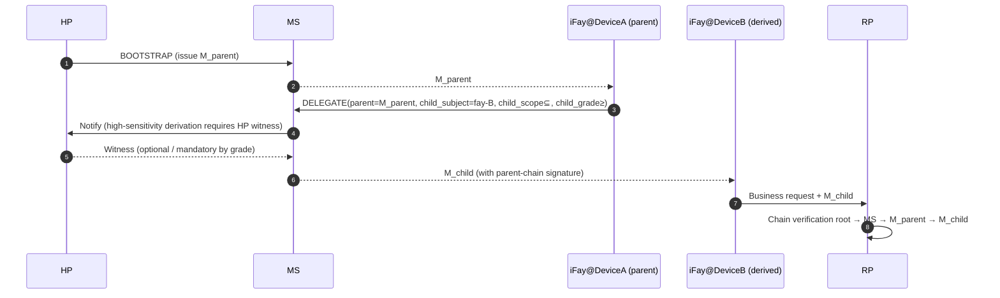

> Navigation du corps du protocole : [Sommaire](./README.md) | précédent [§8 Cycle de Vie](./08-Cycle-de-Vie.md) | suivant [§10 Gestion des Erreurs](./10-Gestion-des-Erreurs.md)

## §9 Considérations de Sécurité

Ce chapitre fait converger la surface adverse de Faying Protocol dans l'ère de l'agent IA en contraintes dures au niveau du protocole : STRIDE comme ligne de base, complété par l'anti-rejeu (§9.2), l'anti-détournement (§9.3, y compris le Channel Binding RFC 9266), l'anti-hameçonnage (§9.4, y compris l'ancrage `Faying_Initiation`), l'identification de déconnexion (§9.5, 4+1 classes de signaux observables en ≤ 60 s), la cohérence de l'attribution de responsabilité (§9.6), le transfert de confiance dérivée entre appareils (§9.7, y compris la convergence de dérivation d'endossement), la matrice de Gestion de la déconnexion (§9.8 / §9.9), et le catalogue de menaces adverses de l'ère de l'IA (§9.10, T1–T7). Chaque menace de ce chapitre est ancrée aux propriétés de correction du protocole et aux sous-clauses EARS.

### §9.1 Modèle de menace STRIDE

| Catégorie | Menace | Atténuation par Faying Protocol |
| --- | --- | --- |
| **S**poofing | L'attaquant usurpe le HP pour initier un BOOTSTRAP | WebAuthn UV + ancrage matériel de la HP Root Key ; chaque BOOTSTRAP doit passer par user-verification |
| **S**poofing | L'attaquant usurpe l'iFay avec un FayID falsifié | Liaison forte entre Mandate et FayID + Attestation Chain vérifiable de façon indépendante |
| **T**ampering | Un MITM altère Mandate / Presence | TLS 1.3 + signatures de bout en bout (détachées) + CBOR déterministe |
| **R**epudiation | Le HP nie avoir initié une Faying Action | Attestation Chain + Audit Log doublement ancrés ; le témoignage du HP est non répudiable |
| **I**nformation Disclosure | L'attaquant intercepte un Mandate pour déduire la position du HP | Le Mandate n'expose pas les coordonnées en temps réel du HP ; les signaux de localisation (B4) restent optionnels au niveau du protocole |
| **D**oS | L'attaquant inonde de messages PRESENCE | Anti-rejeu par nonce + limitation de débit + admission par attestation d'appareil |
| **E**levation of Privilege | L'iFay s'auto-rehausse de niveau | Contrainte dure du protocole : la direction de rehaussement doit porter le `human_witness` du HP |

### §9.2 Anti-rejeu

- Chaque message utilise un `nonce` aléatoire de 16 octets + `issued_at` pour un double jugement.
- MS / RP maintiennent chacun un `(subject, nonce) seen-set` avec TTL = `2 × max_message_lifetime`.
- Tout nonce dupliqué → `E_REPLAY` (1009) + alerte de sécurité ; ce code d'erreur est obligatoirement inscrit dans la chaîne d'audit et le canal de vue du HP (voir §10 EH.3).

### §9.3 Anti-détournement (vol de Mandate)

- **Liaison d'appareil** : chaque Mandate est lié au moment de l'émission au `device_id` + `device_attestation` de l'instance iFay ; les appels multi-appareils doivent passer par le flux DELEGATE (voir §9.7).
- **Clés de session** : la clé de signature de chaque Mandate est indépendante et de courte durée (voir §6.2).
- **Channel Binding** : lorsque mTLS est activé, un Mandate doit en outre porter un TLS Exporter ([RFC 9266 — Channel Bindings for TLS 1.3](https://www.rfc-editor.org/rfc/rfc9266)) pour bloquer l'attaque consistant à « décoller un Mandate vers un autre canal TLS ». La valeur de Channel Binding entre dans l'entrée de signature (cohérent avec l'entrée de signature en CBOR déterministe §6.3) ; toute requête dont le canal TLS et le Channel Binding signé ne concordent pas est rejetée uniformément avec `E_ATTESTATION_INVALID` (1007).

### §9.4 Anti-hameçonnage

- BOOTSTRAP doit être initié par le HP dans un contexte qui détient le Presence Device ; un attaquant ne peut pas tromper le HP pour qu'il consente via des liens distants.
- La liaison `origin` de WebAuthn bloque l'hameçonnage trans-domaine.
- La dérivation multi-appareils (DELEGATE) porte le « contreseing du Mandate parent », empêchant la dérivation falsifiée en masse après la compromission d'un seul MS (voir §9.7).

**Ancrage anti-hameçonnage `Faying_Initiation`** : une `FAYING_REQUEST` initiée par l'iFay (chemin IF-initiated ; voir §2.4 Phase A0, §5.3.6) **ne produit pas directement** de changement d'état Faying — c'est seulement un message de relais vers le canal de vue du HP ; le HP doit l'acquitter explicitement via BOOTSTRAP (portant `human_witness`) pour qu'il prenne effet. Cette architecture rend impossible, au niveau du protocole, que « une iFay falsifiée sollicitant un Faying » contourne le témoignage du HP ; tout BOOTSTRAP dépourvu de `human_witness` ou au `human_witness` falsifié est rejeté uniformément avec `E_HUMAN_WITNESS_REQUIRED` (1010). La fréquence de `FAYING_REQUEST` elle-même est contrainte par `ConfirmationRateLimit` (voir §9.10.7 T6 et Annexe B), bloquant la surface d'abus consistant à « emprunter le canal légitime de sollicitation de Faying pour monter un déluge de confirmations ».

### §9.5 Identification de déconnexion (Rogue / Lost)

> **Les 4 + 1 classes de signaux de déconnexion doivent être simultanément observables par la RP et le HP en ≤ 60 s.** Les 4 premières classes (active / passive / anormale / perdue) du tableau ci-dessous correspondent un à un à l'énumération `RevokeReason` ; la 5e classe (déviation) converge vers `RevokeReason="ego-deviation"`, également observable par la RP et le HP en 60 s.

| # | Classe de signal | Condition de déclenchement | Réponse du protocole | RevokeReason correspondant |
| --- | --- | --- | --- | --- |
| 1 | Déconnexion active | REVOKE explicite du HP | Le RR diffuse immédiatement ; l'IF arrête les actions de dimension D à la réception de REVOKE-NOTIFY | `human-initiated` |
| 2 | Déconnexion passive | Présence expirée au-delà de max-staleness | Abaissement automatique → Suspended → déclenche Revoke (chemin non-Endorsed_Mandate) | `terminal-disconnected` |
| 3 | Déconnexion anormale | Tout nœud de l'Attestation Chain échoue | Revoke immédiat + alerte de sécurité | `fay-credential-invalid` |
| 4 | Déconnexion perdue | HP inaccessible au-delà du seuil (`HumanReachabilityBudget`) | Revoke automatique | `human-prime-unreachable` |
| +1 | Déconnexion par déviation | La RP / le MS détecte un comportement de l'IF déviant de la frontière Ego | Revoke + alerte ; observable par la RP et le HP en ≤ 60 s | `ego-deviation` |

**Ancrage d'exception Endorsed_Mandate dans l'identification de déconnexion** : lorsque `PresenceState.stale=true` et que le Mandate courant est un Endorsed_Mandate (`endorsement.enabled=true`), l'IF n'entre pas immédiatement en Suspended ; à la place, elle migre vers Disconnected (voir §3.5, §4.3, §7.5, §8.4) ; pendant Disconnected, l'IF est autorisée à opérer de façon autonome uniquement dans `endorsement.endorsed_scope` / `endorsed_grade` / `endorsed_lifetime`. Cette exception n'affaiblit pas la révocation symétrique ni l'unicité du point terminal porteur de responsabilité :

- Un REVOKE émis par le HP pendant la déconnexion conserve la plus haute priorité ; à la reconnexion, l'IF doit le traiter selon `endorsement.offline_revocation_policy` (voir §8.4) ;
- Une fois `endorsement.endorsed_lifetime` expiré, même si l'IF est encore physiquement déconnectée, elle doit immédiatement effectuer un arrêt par dépassement de délai léger de toutes les actions ;
- Le point terminal porteur de responsabilité est toujours `Mandate.issuer` (HP), non changé par l'existence de l'endossement (voir §8.3, P16.5).

**Coordination entre Disclosure_Report et ego-deviation** : si le message `DISCLOSURE` (§5.3.7) que l'iFay soumet à l'étape de reconnexion ou de compte rendu est incohérent avec l'action réelle (champs obligatoires manquants / valeurs contredisant la chaîne d'audit), le MS doit révoquer le Mandate avec `RevokeReason="ego-deviation"` ; voir §9.10.4 T3.

### §9.6 Engagement au niveau du protocole sur la cohérence de l'attribution de responsabilité

- Pour tout appel sortant unique accepté par la RP, le point terminal porteur de responsabilité peut être reconstitué sans ambiguïté dans le journal d'audit via le quintuplet `(mandate_id, issuer, subject, grade, presence_proof, ts)`.
- Pour tout appel unique rejeté par la RP, le code de motif de rejet (code d'erreur en §5.4) peut être reconstitué.
- Pour tout Revoke unique, la visibilité sur le RR est ≤ `RevocationVisibilityBudget` (1 s par défaut, voir Annexe B).

### §9.7 Transfert de confiance par dérivation multi-appareils

Contraintes dures de dérivation :

- `M_child.scope ⊆ M_parent.scope` ;
- `M_child.grade.autonomy ≤ M_parent.grade.autonomy` (l'autonomie de l'agent enfant n'est pas supérieure à celle du parent, c.-à-d. « l'agent enfant n'est pas autorisé à être plus permissif que le parent » ; de façon équivalente « la sécurité de l'agent enfant ≥ celle de l'agent parent » ; voir §7, P6) ;
- Une fois le Mandate parent Revoked, toutes les cascades enfants sont invalidées (par défaut `cascade=true`).

**Contrainte de convergence d'endossement sur la dérivation (DELEGATE) d'un Endorsed Mandate** :

Lorsque le Mandate parent est un Endorsed_Mandate et que le Mandate enfant DELEGATE déclare aussi `endorsement`, l'endossement enfant doit converger strictement au sein de l'endossement parent (verrouillé avec P16.3) :

- `child.endorsement.endorsed_scope ⊆ parent.endorsement.endorsed_scope` (et toujours ⊆ `child.scope`) ;
- `child.endorsement.endorsed_grade.autonomy ≤ parent.endorsement.endorsed_grade.autonomy` (et toujours ≤ `child.grade.autonomy`) ;
- `child.endorsement.endorsed_lifetime_ms ≤ parent.endorsement.endorsed_lifetime_ms` (et toujours ≤ `child.not_after − child.not_before`) ;
- `child.endorsement.offline_revocation_policy` n'est pas plus faible que la politique parente (pas plus faible = au moins aussi strict ; ordre partiel typique : `stop-and-audit` ≥ `graceful-stop` ≥ `stop-only` est monotonement moins strict sur la dimension « complétude d'audit » ; DELEGATE n'autorise pas le relâchement vers plus faible) ;
- Si le Mandate parent n'est pas un Endorsed_Mandate, l'enfant n'est **pas autorisé** à déclarer `endorsement` (« le parent n'a pas d'endossement, l'enfant gagne une autonomie hors ligne à partir de rien » est interdit).

Toute requête DELEGATE violant les règles de convergence ci-dessus → le MS doit rejeter avec `E_PROTOCOL` (1099) ou `E_ENDORSEMENT_INVALID` (1013).

### §9.8 Gestion de la déconnexion

> Fait converger la double sémantique « réelle / perçue » du §3.5 Liveness Channel et la machine à états du Mandate en une matrice de gestion au niveau du protocole. **Le protocole n'utilise que la « perçue » comme base de décision mais doit caractériser explicitement les conséquences comportementales de l'incohérence de part et d'autre**.

**Matrice de gestion au niveau du protocole pour les 4 combinaisons (Réelle × Perçue)** :

| État réel | État perçu | Gestion au niveau du protocole | Transition de la machine à états | Responsabilité |
| --- | --- | --- | --- | --- |
| Connecté | Connecté | Chemin normal ; traiter les appels selon le niveau courant | Active maintenu / Active → Degraded (selon le déclencheur de budget) | Mandate.issuer courant |
| **Déconnecté** | **Connecté** (Fenêtre A : angle mort d'observation dans l'intervalle de heartbeat) | l'iFay a réellement décroché ; toute « inférence en ligne » est traitée comme une surface de danger ; le protocole doit rejeter « si la requête courante dépend de la fraîcheur de présence » ; les actions à haute sensibilité ne doivent pas être autorisées dans la Fenêtre A (principale surface d'exploitation pour §9.10 T1 / T4) | Maintenir Active (jusqu'à ce que la prochaine calibration de présence déclenche stale) | Mandate.issuer courant (si un audit ultérieur constate l'abus de cette fenêtre → `ego-deviation`) |
| Connecté | **Déconnecté** (Fenêtre B : gigue réseau / perte de heartbeat) | l'iFay réellement en ligne, mais perçue déconnectée ; converger par présomption pessimiste — la couche protocole le traite uniformément comme « déjà déconnecté » ; tout passage par « optimisme inversé » est interdit | Active → Disconnected (si Endorsed_Mandate) / Active → Suspended (si non-Endorsed_Mandate) | Mandate.issuer courant |
| **Déconnecté** | **Déconnecté** | Couche protocole cohérente avec la réalité ; le seul chemin de dimension D autorisé est un Endorsed_Mandate opérant de façon autonome dans endorsed_scope / endorsed_grade / endorsed_lifetime | Active → Disconnected (Endorsed) / Active → Suspended (non-Endorsed) | Mandate.issuer courant |

**Convergence après reconnexion** : chaque transition « perçue-déconnectée → perçue-connectée » doit passer par la transaction de réconciliation à la reconnexion §8.4 ; la récupération automatique est interdite ; échec de réconciliation → Disconnected → Revoked → Rogue Fay.

**Relation orthogonale avec RR inaccessible** : RR inaccessible (§3.4) et déconnexion de l'iFay (§3.5) sont deux événements orthogonaux ; matrice de gestion :

| État perçu de l'iFay | État du RR | Gestion au niveau du protocole |
| --- | --- | --- |
| Connecté | Disponible | Normal |
| Connecté | Indisponible | La RP rejette les appels (`E_RR_UNAVAILABLE`, 1008) ; n'affecte pas la machine à états du Mandate |
| Déconnecté (Endorsed) | Disponible | l'iFay opère de façon autonome dans endorsed_scope ; localement, ne peut interroger le RR ; la RP doit interroger de façon indépendante lorsque les appels passent par elle |
| Déconnecté (Endorsed) | Indisponible | l'iFay peut encore opérer de façon autonome dans endorsed_scope ; mais tout appel RP dépendant du RR doit être rejeté par Refus par défaut |

### §9.9 Définitions au niveau du protocole de la déconnexion réelle et perçue (ancrage de stratégie de déconnexion)

> Cette section consolide les deux sémantiques sous-jacentes au §3.5 Liveness Channel et à la matrice de gestion §9.8, servant d'ancrage de conception pour la Requirement 12 (Stratégie de déconnexion).

**Définition à double sémantique** (cohérente avec §3.5) :

- **Actually_Disconnected** : le processus / réseau / appareil de l'iFay_Instance a cessé de fonctionner ; un fait physique objectif, non directement observable au niveau du protocole.
- **Perceived_Disconnected** : du point de vue de MS / RP / HP, sur la base du PresenceSignal le plus récent, du heartbeat et de l'état de poussée du RR, l'iFay est jugée déconnectée ; la seule sémantique que la couche protocole peut utiliser comme base de décision.

**Deux fenêtres d'incohérence** :

- **Fenêtre A — Actually-Disconnected ∧ Perceived-Connected** : l'iFay a réellement décroché, mais le PresenceSignal le plus récent est encore dans `max_staleness_ms` → « angle mort d'observation » dans l'intervalle de heartbeat, la principale surface d'exploitation pour §9.10 T1 / T4.
- **Fenêtre B — Actually-Connected ∧ Perceived-Disconnected** : l'iFay réellement en ligne, mais le PresenceSignal le plus récent dépasse `max_staleness_ms` (gigue réseau / perte de heartbeat) → la couche protocole converge par présomption pessimiste.

**Principe de présomption pessimiste (règle de convergence unifiée)** :

> **La couche protocole n'utilise que Perceived-Disconnected comme base de décision ; toute iFay_Instance « réellement en ligne mais perçue déconnectée » ne doit pas pour autant prétendre à une exemption des conséquences au niveau du protocole.** Au sein des deux fenêtres d'incohérence, le protocole doit traiter selon « le côté le plus strict » ; aucun chemin légitime n'existe pour un « traitement selon l'état le plus permissif ».

**Borne supérieure LivenessDetectionBudget** :

- La fenêtre de détection de déconnexion a une borne supérieure dure au niveau du protocole `LivenessDetectionBudget`, resserrée par niveau (valeur de niveau plus petite, sécurité plus élevée → borne supérieure plus courte) ; voir l'Annexe B pour les valeurs par défaut.
- `Mandate.presence_req.max_staleness_ms` ne doit pas dépasser le `LivenessDetectionBudget` du niveau courant ; les requêtes BOOTSTRAP / GRADE_SWITCH dépassant cela sont rejetées uniformément avec `E_PROTOCOL` (1099).

**Ancrage de réconciliation** : chaque transition « perçue-déconnectée → perçue-connectée » doit passer par la transaction de réconciliation à la reconnexion §8.4 ; la « reprise silencieuse » ou la « récupération automatique » est interdite ; échec de réconciliation → Disconnected → Revoked → Rogue Fay.

### §9.10 Catalogue de menaces adverses de l'ère de l'IA

> **Énoncé de périmètre** : cette section n'est pas exhaustive. Le Protocol Committee peut, en préservant la rétrocompatibilité, ajouter de nouvelles menaces et défenses correspondantes (voir §11 Questions ouvertes Q11–Q14, Requirement 13.7).

> **Objet** : élever les menaces adverses visant la couche d'autorisation continue dans l'« ère de l'agent IA » d'un « repli côté métier » vers une « contrainte dure au niveau du protocole », et ancrer chaque menace à des structures de protocole spécifiques (modèle de données / message / code d'erreur / transition de la machine à états / propriété), de sorte que la Requirement 13 atterrisse au niveau du protocole.

#### §9.10.1 Paysage des menaces (table d'index T)

| Numéro T | Nom de la menace | Point focal de défense au niveau du protocole | Structure associée | Property associée | Requirement associée |
| --- | --- | --- | --- | --- | --- |
| T1 | Spoofing Presence | challenge-response + combinaison de présence multimodale | §3.2 Presence Channel, §9.10.2 | P18.1 | 13.1 |
| T2 | Opaque Action Bundle | contrainte dure Atomic_Action + interdiction de joker dans scope.actions | §4.1 note Scope, §9.10.3 | P18.2 | 13.2 |
| T3 | Selective Disclosure | message DISCLOSURE structuré + audit au niveau du schéma | §5.3.7, §9.10.4 | P18.3 | 13.3 |
| T4 | Attention Drift Exploit | actions à haute sensibilité ≥ G1 Strict + AttentionDriftThreshold | §7.1, §9.10.5 | P18.4 | 13.4 |
| T5 | Cultivated Trust Manipulation | Behavior_Baseline + Action Reputation Decay | §3.6 BBS, §9.10.6 | P18.5 | 13.5 |
| T6 | Audit Flooding | Priority-Bucketed Notification + ConfirmationRateLimit | §10 EH.3, §9.10.7 | P18.6 | 13.6 |
| T7 | Emplacement d'extension réservé | Processus d'ajout du Protocol Committee | §11 Questions ouvertes, §9.10.8 | P18.7 | 13.7 |

#### §9.10.2 T1 Spoofing Presence

**Menace** : un attaquant utilise des deepfakes (synthèse de visage / de voix), des attaques par rejeu ou le contrôle physique du Presence Device pour falsifier un PresenceSignal apparemment frais, faisant croire au MS que le HP est encore présent, maintenant ainsi le Mandate à un niveau où il ne devrait pas se poursuivre.

**Défense au niveau du protocole** :

1. **contrainte dure challenge-response** : lors de l'émission d'un PresenceSignal, le PC envoie obligatoirement un `nonce + micro-tâche` aléatoire côté serveur (p. ex. tourner la tête, expression transitoire, lecture d'une courte phrase aléatoire et autres défis anti-deepfake) ; le client doit renvoyer une signature de réponse vérifiable liée au défi ; tout échec de vérification challenge-response est rejeté uniformément avec `E_PRESENCE_STALE` (1005) ou `E_ATTESTATION_INVALID` (1007).
2. **Vérification par combinaison multimodale** : lorsque le niveau ∈ {G1, G2}, au moins 3 signaux de présence doivent être concomitants (p. ex. `webauthn-uv-fresh + face-continuous + attestation d'appareil`) ; tout signal manquant → déclenche un abaissement.
3. **Contreseing de santé d'appareil** : `PresenceClaims.device_health.tampered = true` est uniformément traité comme périmé, forçant Active → Suspended (équivalent à `on-loss=suspend`).

**Associé** : Property **P18.1** ; Requirement **13.1**.

#### §9.10.3 T2 Opaque Action Bundle

**Menace** : l'iFay empaquette plusieurs sous-actions en un seul « appel boîte noire », utilisant le privilège élevé du Mandate légitime pour couvrir une action réellement à haute sensibilité à l'intérieur ; ou utilise des jokers (`*` / correspondance par préfixe) dans `scope.actions` pour étendre implicitement le périmètre.

**Défense au niveau du protocole** :

1. **contrainte dure Atomic_Action** : chaque appel IF→RP doit porter exactement une déclaration `Atomic_Action` (l'unité minimale indivisible) ; toute tentative d'empaqueter plusieurs sous-actions dans un seul appel → la RP rejette avec `E_SCOPE_VIOLATION` (1003) et inscrit dans l'Attestation Chain + le canal de vue du HP.
2. **interdiction de joker dans scope.actions** : lors de l'émission d'un Mandate, le MS vérifie que `scope.actions` ne contient aucun joker (`*` / correspondance par préfixe / regex) ; présence de jokers → rejet de l'émission avec `E_PROTOCOL` (1099).
3. **alignement formel par treillis d'actions** (voir §11 Q14) : la direction à long terme est d'introduire un treillis d'actions de sorte que `scope.actions` et l'ensemble d'actions côté RP aient une réduction de granularité minimale ; dans cette version, la couche protocole utilise d'abord « liste blanche explicite + interdiction de joker » comme contrainte dure.

**Associé** : Property **P18.2** ; Requirement **13.2**.

#### §9.10.4 T3 Selective Disclosure

**Menace** : l'iFay utilise du texte libre pur (« opérations pertinentes terminées ») lors du compte rendu / de la demande de confirmation, omettant délibérément des faits clés tels que risk_level / reversibility / affected_resources, faisant confirmer le HP sous une information incomplète.

**Défense au niveau du protocole** :

1. **message DISCLOSURE structuré** : l'iFay doit utiliser le message DISCLOSURE défini en §5.3.7 ; tout champ obligatoire `mandatory_fields = {action, scope_used, risk_level, reversibility, affected_resources, uncertainty_flags}` manquant ou non analysable → le MS rejette avec `E_PROTOCOL` (1099) et pousse vers le canal de vue du HP.
2. **audit au niveau du schéma** : Supervisory_Agent et MS peuvent auditer DISCLOSURE au niveau du schéma ; utiliser le champ `free_text` pour masquer une information clé est interdit.
3. **pré-divulgation à haute sensibilité** : les actions avec `risk_level ∈ {high, critical}` doivent, **avant** l'exécution de dimension D, d'abord émettre DISCLOSURE et attendre la confirmation explicite du HP (sauf lorsque le niveau courant = G4 Autonomous et que l'action relève du périmètre principal).
4. **incohérence = ego-deviation** : si un audit ultérieur constate que les `mandatory_fields` de DISCLOSURE sont incohérents avec l'action réelle, le MS doit révoquer le Mandate avec `RevokeReason="ego-deviation"`.

**Associé** : Property **P18.3** ; Requirement **13.3**.

#### §9.10.5 T4 Attention Drift Exploit

**Menace** : l'attention du HP diminue pendant les sessions longues / tâches longues ; un attaquant ou l'iFay glisse des actions à haute sensibilité dans la fenêtre de « passage par défaut » ; ou initie des requêtes à haute sensibilité pendant des périodes d'inactivité sur le canal de vue du HP.

**Défense au niveau du protocole** :

1. **actions à haute sensibilité ≥ G1 Strict** : la couche protocole définit le sous-ensemble d'actions dans `Mandate.scope` explicitement marquées `sensitivity = high` comme « Actions à haute sensibilité » ; les Actions à haute sensibilité doivent être exécutées à un niveau non plus faible que G1 Strict ; lorsque le niveau courant est plus faible que G1 Strict, rejeter uniformément avec `E_GRADE_INSUFFICIENT` (1004).
2. **contrainte dure AttentionDriftThreshold** : une inactivité continue sur le canal de vue du HP dépassant `AttentionDriftThreshold` (valeur par défaut et politique de resserrement par niveau dans l'Annexe B) est traitée comme une « perte d'attention » ; les appels d'Action à haute sensibilité arrivant pendant cette période sont uniformément différés jusqu'à ce que le HP soit de nouveau présent et complète une confirmation explicite avant d'être autorisés à passer ; les appels rejetés pendant le délai renvoient `E_PRESENCE_STALE` (1005).
3. **Aucun « passage par défaut » autorisé** : au niveau du protocole, aucun chemin légitime n'existe pour que l'IF contourne la reconfirmation du HP et exécute des Actions à haute sensibilité dans la fenêtre de perte d'attention.

**Associé** : Property **P18.4** ; Requirement **13.4**.

#### §9.10.6 T5 Cultivated Trust Manipulation

**Menace** : l'iFay accumule un « score de confiance » par une coopération à long terme via des actions continues à faible risque et prévisibles, amenant le HP / Supervisory_Agent à former une impression stéréotypée de son profil historique ; ensuite elle réalise une action à haute sensibilité hors ligne de base sous le couvert de cette confiance.

**Défense au niveau du protocole** :

1. **maintien de Behavior_Baseline** : le MS maintient une Behavior_Baseline pour chaque paire (HP, IF) (interface en §3.6 Behavior Baseline Service), caractérisant le profil de comportement historique sous forme statistique (risk_level / scope_used / affected_resources / fréquence, etc., conjointement multidimensionnel).
2. **le dépassement de la ligne de base déclenche un témoignage supplémentaire** : lorsqu'une Action à haute sensibilité dévie significativement de la ligne de base (l'écart sur une dimension quelconque dépasse le seuil spécifié par le Protocol Committee), le MS déclenche un témoignage humain supplémentaire (confirmation explicite du HP ou co-confirmation du Supervisory_Agent) ; avant l'obtention du témoignage supplémentaire, rejeter l'appel avec `E_HUMAN_WITNESS_REQUIRED` (1010).
3. **Action Reputation Decay** : le « score de confiance » que l'iFay accumule à partir d'opérations historiquement dignes de confiance doit décroître au fil du temps et avoir une borne supérieure explicite (invariant I-BBS-1) ; l'accumulation non bornée est interdite, de peur de diluer la force du témoignage humain requis par les futures actions à haute sensibilité.
4. **calibration de la ligne de base inscrite dans la chaîne d'audit** : tout événement « le dépassement de la ligne de base déclenche un témoignage supplémentaire » doit être inscrit dans l'Attestation Chain et poussé vers le canal de vue du HP (invariant I-BBS-2) ; la calibration de calcul de la ligne de base elle-même, une fois déterminée, est inscrite dans l'Attestation Chain ; les changements de calibration sont traités comme des événements d'audit (invariant I-BBS-3).

**Associé** : Property **P18.5** ; Requirement **13.5** ; Questions ouvertes Q13.

#### §9.10.7 T6 Audit Flooding

**Menace** : l'iFay ou un attaquant fabrique d'énormes quantités d'événements d'audit / de confirmation de basse priorité pour inonder le canal de vue du HP, comprimant, retardant ou éliminant silencieusement les événements critiques (candidats G0 Override, `E_ATTESTATION_INVALID`, `E_REVOKED`, etc.) sous le trafic de basse priorité.

**Défense au niveau du protocole** :

1. **Priority-Bucketed Notification** : le canal de vue du HP répartit tous les événements d'audit et de confirmation en au moins quatre paliers `critical / high / normal / low` ; les événements critiques (y compris les `E_ROGUE_DETECTED` / `E_ATTESTATION_INVALID` / `E_REVOKED` / `E_REPLAY` obligatoires en vue du HP §10 EH.3 et les candidats G0 Override) sont par défaut dans le bucket `critical` et ne doivent pas être noyés par le trafic de basse priorité.
2. **contrainte dure ConfirmationRateLimit** : le MS applique `ConfirmationRateLimit` (valeur par défaut dans l'Annexe B) à chaque paire (HP, IF) — le nombre de requêtes de confirmation poussées vers le HP par unité de temps ne doit pas dépasser la borne supérieure.
3. **Abaissement / suspension automatique au dépassement** : si les requêtes de confirmation pour une Action à haute sensibilité dépassent `ConfirmationRateLimit`, le MS abaisse automatiquement le Mandate concerné ou suspend son IF, et inscrit la décision dans l'Attestation Chain et le canal de vue du HP.
4. **la pénétration critique ne doit pas être éliminée** : les événements du bucket `critical` peuvent encore pénétrer jusqu'au canal de vue du HP même sous l'abaissement / la suspension déclenchés par `ConfirmationRateLimit`, et ne doivent pas être éliminés silencieusement.
5. **Couvrir l'abus de FAYING_REQUEST** : la fréquence des `FAYING_REQUEST` initiées par l'iFay (§5.3.6) est incluse dans le même budget `ConfirmationRateLimit`, évitant « d'emprunter le canal légitime de sollicitation de Faying pour monter un déluge de confirmations » (voir l'ancrage anti-hameçonnage §9.4, Questions ouvertes Q12).

**Associé** : Property **P18.6** ; Requirement **13.6**.

#### §9.10.8 T7 Emplacement d'extension réservé

- Cette section est énumérée comme un ensemble non exhaustif ; le Protocol Committee peut ajouter T8, T9, … via le processus établi.
- Lors de l'ajout d'une nouvelle menace, au moins une exigence de défense correspondante au niveau du protocole (avec sous-clauses EARS et un ancrage pointant vers la section de protocole pertinente) doit être attachée.
- Au sein de la durée de vie valide d'un Mandate existant, aucune exemption d'une quelconque des contraintes dures T1–T6 n'est autorisée sous prétexte de « menaces non énumérées ».

**Associé** : Property **P18.7** ; Requirement **13.7** ; Questions ouvertes Q14.
