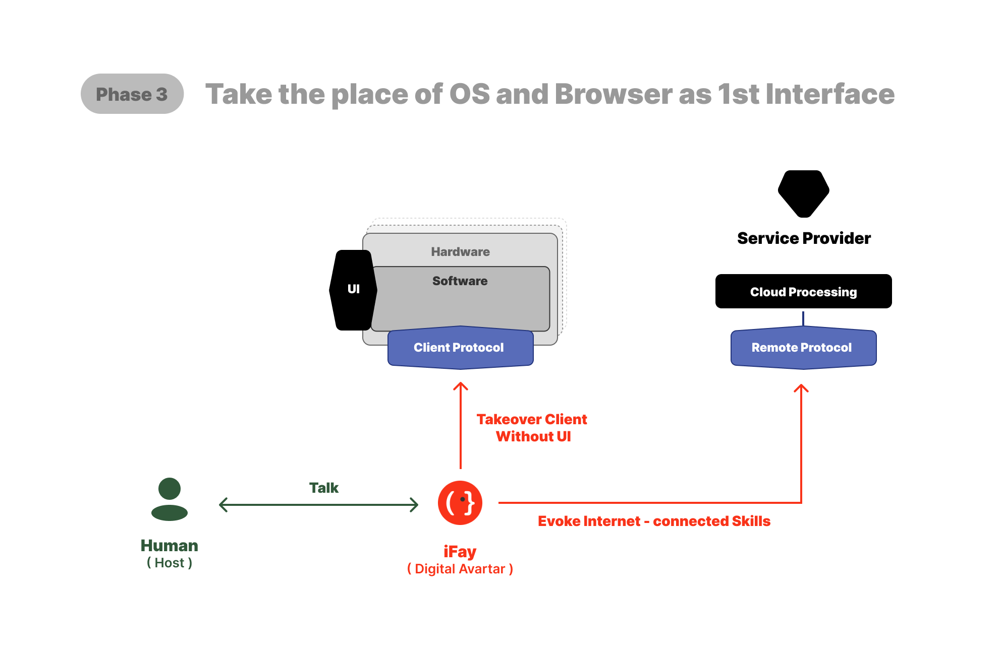
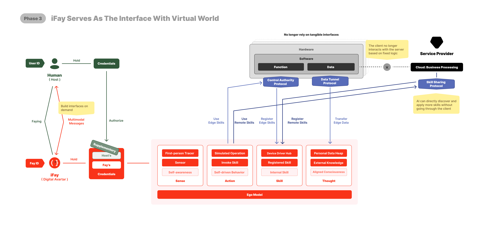

# Phase 3：iFay によるソフトウェアアプリの派生的な引き継ぎ

Phase 3 は拡張方向を端末ハードウェアからソフトウェアアプリへ移します——ローカルアプリ、クラウドサービス、In-APP の組み込みシナリオです。

ソフトウェアアプリとハードウェア端末には一つの鍵となる違いがあります。ハードウェア端末の状態は比較的集中的であり、一機のドローン、一台のロボットがそれぞれ一つの監護対象です。一方、ソフトウェアアプリの境界はしばしばプロセス化、モジュール化、跨ネットワーク化されています。iFay によって引き継がれた EC クライアントは、複数のドメイン、複数の API、複数のサードパーティサービスを跨いで協働する可能性があります。Phase 3 の難しさは「引き継ぎ」ではなく、引き継ぎの境界が明確に記述されているかどうかにあります。

## Phase 2 と同源の派生構造

Phase 3 は構造上 Phase 2 と対称的であり、依然として「Human Prime ↔ ソフトウェアアプリ」の直接関係は導入しません。

> **そのソフトウェアアプリは対応する Human Prime の iFay を経由して Faying State に入る。**

責任端は依然として Human Prime です。iFay が Faying State を経由して派生的にソフトウェアアプリを引き継ぐメカニズムは、Phase 2 で端末を引き継ぐメカニズムと同源です。ソフトウェアアプリ自体は Faying State に独立して存在しません。

## 三つの鍵となる差異

Phase 3 は Phase 2 の構造的基盤の上に、特別に処理が必要な三つの複雑性を追加します。

**引き継ぎ粒度がより細かい**。iFay はソフトウェアの一部の機能だけを引き継ぐ可能性があります——例えば代理発注は許可するが、アカウントセキュリティポリシーの変更代理は許可しない、など。Phase 3 はそのため、プロトコル層で「引き継ぎ範囲」の精緻化を表現しなければならず、これは第 12 章の「Faying Action は有限範囲でなければならない」原則と同源です。

**跨境界協働がより密集**。引き継がれたソフトウェアは内部で複数の外部サービス、サードパーティ API、リモートクラウド関数を呼び出す可能性があります。Phase 3 は次のことを保証しなければなりません。iFay が引き継いだソフトウェアを経由して外部に発起する任意の呼び出しの帰責は、依然として元の Human Prime に落ち、跨サービス呼び出しチェーンの中で責任が静かに失われることを許さない、と。この要求は第 1 章で描いた「呼び出しチェーン上のデータがどの主体を経由するか誰も明確に語れない」現実の痛点に直接呼応します。

**副作用がより隠蔽的**。物理動作と比べ、ソフトウェアの副作用（データ書き込み、サブスクリプション変更、サードパーティアカウント連動）は Human Prime が直感的に察知することが容易ではありません。Phase 3 は第 11 章 Human View の「情報到達可能」要求をより明示的に着地させなければなりません——副作用は Human Prime が合理的な代価で知りうる方式で開示されねばならず、呼び出しチェーンの深部に埋もれてはなりません。

## 本期範囲との関係

**Phase 3 は本期のプロトコル設計範囲には含まれない**。本章で Phase 3 の存在を描くのは、Faying Protocol の進化方向を説明するためであり、本期での提供を約束するためではありません。Phase 3 の具体的プロトコル形態は後続の独立 spec が引き受けます。

Phase 3 完成後、Faying Protocol はすでに Fay とハードウェア、ソフトウェア二類の実行端の関係をカバーしますが、すべての論議は依然として「一人の Human Prime + 一つの iFay」を中心に展開しています。次の段階の Phase 4 は視点を組織にまで拡張します。Fay が一つだけではないとき、責任端がもはや単一の自然人ではないとき、Faying 関係はいかにして一貫した帰責を保つかです。

