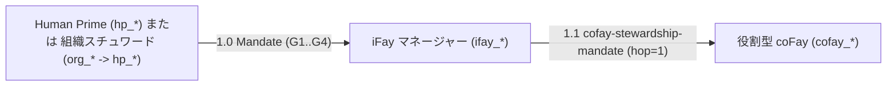

## §1 概要と位置付け

本仕様は **Faying Protocol/1.1（coFay Delegated Stewardship Profile、coFay 委任スチュワードシップ拡張）** を定義する。本仕様は `Faying Protocol/1.0` §1.7.2 の `MINOR` 後方互換追加規則に厳密に従い、`Faying Protocol/1.0`（`2025-10-25` 確定版および `schemas/fap-1.0.cddl`）の全メッセージ・状態遷移・エラーコードを一切変更しない。`1.0` のみをサポートするピアは §1.7.3 に従い `Faying Protocol/1.0` へネゴシエートするか、未知の任意拡張を安全に無視する。

iFay エコシステム（`Fay = iFay + coFay`）において、`iFay` は単一の Human Prime（人間プライム）に紐づく一方、`coFay` は Role Charter（役割憲章）に基づき稼働する役割特化型のシリコン・デジタル生命であり、個人の人格複製パッケージを持たない。「**いかなるシリコン実体の対外行動も、最終的に一意の Human Prime に帰責されなければならない**」という第一原則を守るため、本仕様は `Human Prime ↔ iFay` 認可チェーンの末端に、暗号学的に検証可能な `iFay Manager → coFay` 委任スチュワードシップとアトミック二重署名移管を導入する。

### §1.1 規範的キーワードの宣言（RFC 2119 & RFC 8174）

本仕様書における英大文字キーワード `MUST`、`MUST NOT`、`REQUIRED`、`SHALL`、`SHALL NOT`、`SHOULD`、`SHOULD NOT`、`RECOMMENDED`、`NOT RECOMMENDED`、`MAY`、および `OPTIONAL` は、[BCP 14](https://www.rfc-editor.org/info/bcp14)（[RFC 2119](https://www.rfc-editor.org/rfc/rfc2119) および [RFC 8174](https://www.rfc-editor.org/rfc/rfc8174)）に従って解釈される。多言語版に解釈上の差異が生じた場合は、簡体字中国語（`zh-CN`）原文および `schemas/fap-1.1-cofay.cddl` を正本とする。

---

## §2 三層責任帰属チェーン

`coFay` はルート Mandate を自己発行してはならず（`MUST NOT`）、Human Prime の説明責任から切り離された匿名主体に紐づいてはならない（`MUST NOT`）。すべての有効な `cofay-stewardship-mandate` は以下の三層責任帰属チェーンを構成しなければならない（`MUST`）：

1. **最終責任アンカー層（`steward_entity` + `accountable_human_prime`）**：個人スチュワード（`hp_*`）の場合は `accountable_human_prime` と完全一致しなければならず、組織スチュワード（`org_*`）の場合は最終責任を負う `accountable_human_prime`（`hp_*`）を明示しなければならない（欠落・不正時は `1010 E_HUMAN_WITNESS_REQUIRED` で拒否）。
2. **管理エージェント層（`manager_fay_id`）**：有効な `Faying Protocol/1.0` Mandate を保持する `ifay_*` でなければならず、`cofay_*` が上流発行者となることは禁止される（`MUST NOT`）。
3. **実行主体層（`subject_cofay_id`）**：`charter_id` に従う `cofay_*` であり、適合性検証は `iFay` 向けの `iFACTS` ではなく `coFACTS` が担う。

---

## §3 四つの非増幅セキュリティ不変条件（Normative）

検証器は `cofay-stewardship-mandate` を評価する際、以下の 4 条件を順に強制しなければならない（`MUST`）：

1. **上流 `G0`・失効のカスケード安全停止（`safe-state-halt`）**：上流の Human Prime または `iFay` マネージャーが `G0`（`EmergencyOverride`）または `Revoked` にあるとき、`coFay` は直ちに `safe-state-halt` に遷移し `1024 E_UPSTREAM_EMERGENCY_HALT` を返さなければならず、キャッシュされた権限でホスト端末（Host）や外部スキルを呼び出してはならない（`MUST NOT`）。
2. **単一ホップ上限（Single-Hop Ceiling）**：`hop_count == 1` かつ `max_stewardship_hops == 1` でなければならず、違反または非 `ifay_*` 発行者は `1023 E_STEWARDSHIP_HOP_LIMIT` で拒否する。`coFay` による再委任は厳禁とする（`MUST NOT`）。
3. **グレード非増幅（Grade Non-Amplification）**：`grade <= manager_grade`（`0..4`）を満たさなければならず、超過時は `1021 E_GRADE_AMPLIFICATION` で拒否する。
4. **スコープおよび有効期間の二重収束**：`scope`（`domains`、`actions`、任意の `terminals` および予算上限）は `charter_scope` と `manager_scope` の双方の部分集合であり、`[not_before, not_after]` は `[manager_not_before, manager_not_after]` の内側に収まり評価時刻を含まなければならない（違反時は `1022 E_SCOPE_ESCAPE`）。

---

## §4 アトミック二重署名移管（`cofay-transfer`）

担当交代や組織再編に伴うスチュワードシップ移管は、一方的な奪取や責任空白を防ぐため `cofay-transfer-authorization` によってアトミックに実行されなければならない（`MUST`）：

- **ドメイン分離付き JCS 署名入力**：移管元（`from_steward`）と移管先（`to_steward`）の双方が、署名フィールドを除いたオブジェクトの RFC 8785 JCS 正規化文字列に `"ifay.faying.cofay-transfer.v1:"` を前置したバイト列へ有効な暗号署名を付与しなければならない（`MUST`）。
- **アトミック成立条件**：自己移管（`from_steward == to_steward`）や有効期限外・不正識別子は `1026 E_TRANSFER_WINDOW_OR_PARTY_INVALID` で拒否し、いずれか一方でも署名が欠落または検証失敗した場合は全体をロールバックして `1025 E_TRANSFER_DUAL_SIG_REQUIRED` を返す。移管後も GMChain 上の履歴は連続的に監査可能であり、MeriToken（`μ`）は非貨幣的な評判計量単位としての性質を厳格に維持する。

---

## §5 権威スキーマ・エラーコード・適合性テストベクター

| コード | エラー名 | 発生条件 | ランタイム動作 |
| --- | --- | --- | --- |
| `1010` | `E_HUMAN_WITNESS_REQUIRED` | 有効な `accountable_human_prime` アンカーの欠落 | 委任拒否 |
| `1021` | `E_GRADE_AMPLIFICATION` | `grade > manager_grade` または範囲外グレード | 委任拒否 |
| `1022` | `E_SCOPE_ESCAPE` | `scope` または期間が `charter_scope ∩ manager_scope` を逸脱 | 委任拒否 |
| `1023` | `E_STEWARDSHIP_HOP_LIMIT` | `hop_count != 1` または非 `ifay_*` による再委任 | 委任拒否 |
| `1024` | `E_UPSTREAM_EMERGENCY_HALT` | 上流が `G0` または `Revoked` | `safe-state-halt` へ遷移 |
| `1025` | `E_TRANSFER_DUAL_SIG_REQUIRED` | 移管元または移管先の有効な署名が欠落・不一致 | 移管ロールバック |
| `1026` | `E_TRANSFER_WINDOW_OR_PARTY_INVALID` | 自己移管、期限切れ、または当事者 ID 不正 | 移管拒否 |

- **権威 CDDL スキーマ**：`schemas/fap-1.1-cofay.cddl`
- **JSON Schema ビュー**：`schemas/fap-1.1-cofay.json`
- **言語横断テストベクター**：`vectors/cofay-stewardship-v1.1.json`（`V01`–`V10` 全 10 件、TypeScript / Rust 両参照実装で検証済み）。
