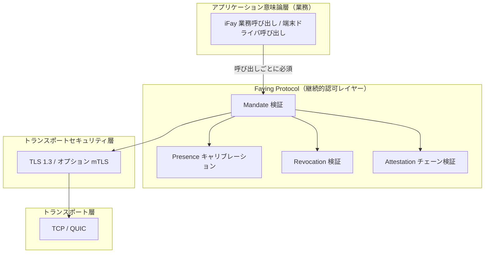
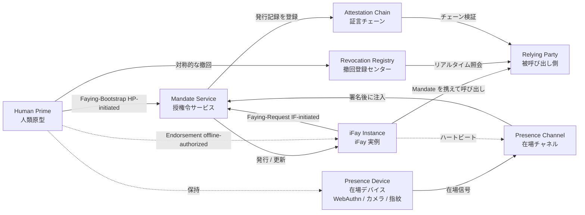
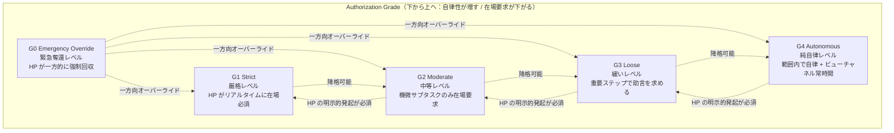
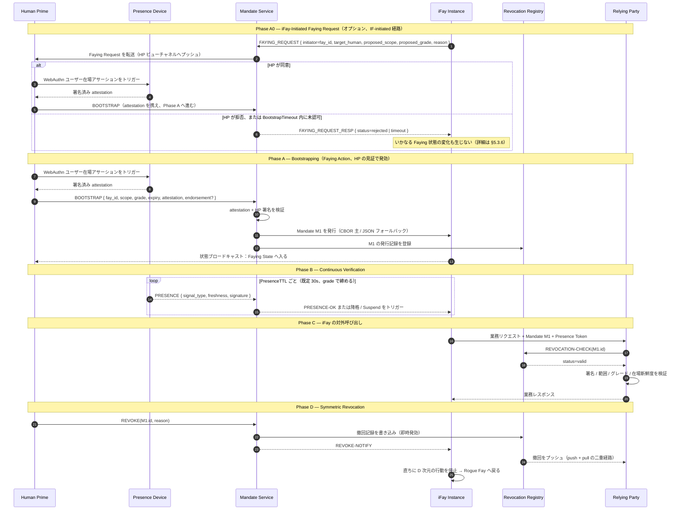

> プロトコル本文ナビ：[章目次](./README.md) ｜ 前章 [§1 概要](./01-概要.md) ｜ 次章 [§3 コンポーネントとインターフェース](./03-コンポーネントとインターフェース.md)

## §2 Architecture

本章はアーキテクチャの視点から Faying Protocol の姿を説明する。

- **§2.1 プロトコルスタック上の位置**：Faying Protocol が TLS 1.3 の上、業務意味論の下に占める階層的位置を描き、「iFay のあらゆる対外行為は必ず Mandate 検証ゲートを通る」というハード制約を明確にする。
- **§2.2 エンティティ関係**：プロトコルが関与する 7 種のエンティティとその責務境界を列挙し、双方向 Faying エッジ（HP-initiated / IF-initiated）とオフライン裏書きエッジ（Endorsed Mandate）を示す。
- **§2.3 認可グレード階層**：G0–G4 の 5 段階グレードを、自律性 / 在場要求の 2 つの次元における相対位置として提示し、グレード譜と切り替え方向を表す。
- **§2.4 中核となる対話シーケンス**：BOOTSTRAP（Phase A0 の IF-initiated 経路を含む）+ Continuous Verification + Action + Symmetric Revocation を 1 本のエンドツーエンドのシーケンスに連ね、後続章（§5 メッセージ / §7 グレード / §8 ライフサイクル / §10 エラー処理）の視覚的アンカーとする。
- **§2.5 設計原則**：プロトコル層が常に遵守しなければならない 6 項目の設計原則（Default-Deny / Least-Privilege / Continuous-Verification / Auditable-by-Construction / Human-Override / Graceful-Degradation）を述べる。

> **EARS 追跡の説明**：本章の各アーキテクチャレベルのハード制約の後ろに、対応する EARS 細目条項番号を `Trace:` として列記する（出典は本仕様の要件ベースライン）。形式は `R<requirement>.<criterion>.<clause>` である。
>
> **用語アライメント**：本章に登場するエンティティ名（Human Prime / iFay Instance / Presence Device / Mandate Service / Presence Channel / Attestation Chain / Revocation Registry / Relying Party など）は付録 A 用語アライメント早見表と完全に一致する。本章と付録 A の間で用語に何らかの差異が生じた場合は、**付録 A を正とする**。

### §2.1 プロトコルスタック上の位置

**設計上の立場**：Faying Protocol は TLS を置き換えるものでも、OAuth を再発明するものでもない。TLS の上、業務意味論の下に位置し、**iFay のあらゆる対外行為**を Mandate 検証ゲートに通すことを強制する。Faying Protocol のゲートを迂回する対外呼び出しはすべて Rogue Action とみなされ、トランスポート層より上・業務層より下のミドルウェアで拒否されなければならない。

**プロトコル層のハード制約**：

- **A-Stack-1（呼び出しごとに四要素検証が必須）**：Relying Party は、iFay Instance からの任意の対外呼び出しを受理する前に、Mandate 検証 / Presence キャリブレーション / Revocation 検証 / Attestation チェーン検証の 4 項目を順に完了しなければならない。いずれかが欠落すればゲートを迂回した Rogue Action とみなし、Default-Deny で拒否する。
  - **Trace**：`R2.1.1`（Mandate なしはデフォルト拒否）、`R2.1.2`（scope 検証）、`R2.1.3`（フィールド欠落で即拒否）、`R2.1.4`（RR 到達不能なら Default-Deny で拒否）。
- **A-Stack-2（チャネル層と認可層の責務分離）**：チャネルの機密性と相手側身元は TLS 1.3 / オプション mTLS が担い、Faying Protocol は作り直さない。Faying Protocol は「継続的認可」の意味論のみを担い、TLS と重複するハンドシェイクや鍵ネゴシエーションの責務をプロトコル層に持ち込まない。

### §2.2 エンティティ関係

**双方向 Faying エッジの説明**：

- `HP --> MS（Faying-Bootstrap, HP-initiated）`：Human Prime が能動的に Faying（確立または調整）を発起し、BOOTSTRAP チャネルを通る（詳細は §5.3.1）。
- `IF --> MS（Faying-Request, IF-initiated）`：iFay Instance が能動的に Human Prime へ Faying を求める。まず Mandate Service が転送し、次いで Human Prime が BOOTSTRAP 応答によって認可・発効させる（詳細は §2.4 Phase A0、§5.3.6 FAYING_REQUEST）。
- `HP -. Endorsement (offline-authorized) .-> IF`：Endorsed Mandate の裏書き宣言はオフライン事前認可の意味論に属する——HP が BOOTSTRAP 段階で一度に `endorsed_scope` / `endorsed_grade` / `endorsed_lifetime` を明示的に Mandate へパッケージし、iFay が物理的に連絡を絶たれている間も限定範囲内で自律できるようにする。このエッジは「実行時の通信」ではなく「Mandate フィールドが担う事前の引き受け」である（詳細は §4.1 `endorsement` フィールド、§7.5 Endorsement Grades）。

**エンティティの責務**：

| エンティティ | プロトコル層の責務 | 責任 / 権限の境界 |
| --- | --- | --- |
| **Human Prime（HP）** | Faying Action を発起できる唯一のエンティティ。撤回権を持つ唯一のエンティティ。最終的な責任を引き受ける唯一の端 | 任意の時点で iFay の対外行為は必ず一人の HP に曖昧さなく帰責できる。あらゆる Faying 状態の変化は、HP が明確で、欺かれておらず、検証可能な認可確認を与えることを要する |
| **iFay Instance（IF）** | 監護される代理エンティティ。FayID で一意に識別される。対外呼び出しのたびに有効な Mandate を提示しなければならない。能動的に HP へ Faying を求める（FAYING_REQUEST）か、Faying の切断を要求できる | 自身の Mandate を撤回する権限を持たない。grade 昇格を自律的に発起する正当な経路は存在しない。FAYING_REQUEST の発効は HP の明確な認可確認を前提とする |
| **Presence Device（PD）** | WebAuthn / FIDO2 資格情報、生体認証能力を載せるハードウェア。在場信号の物理的な源 | 各 Presence Signal は PD が署名し、`nonce + produced_at + device_attestation` を携えなければならない。新鮮度ウィンドウは対応する Mandate の `presence_req.max_staleness_ms` が与え、信号自身が持つのではない |
| **Mandate Service（MS）** | HP を代表して Mandate を発行 / 更新 / 降格 / 撤回する論理サービス | 「MS が自ら bootstrap を決定する」あるいは「MS が HP に代わって Faying の認可確認を完了する」正当な経路は存在しない。MS が到達不能なときは Default-Deny に収束する |
| **Presence Channel（PC）** | PD から MS への低遅延・リプレイ耐性のある在場ストリーム。同時に §3.5 Liveness Channel の下層信号源を担う | nonce は単回消費。対応する Mandate の `presence_req.max_staleness_ms` を超えれば stale とみなす。同一 nonce は `2 × max_message_lifetime` 内で最大 1 回しか受理しない |
| **Attestation Chain（AC）** | HP → MS → IF → 派生 IF のすべての発行アクションが形成する、逆方向に追跡可能な署名チェーン | チェーン上の各ノードは親ノードが署名し、タイムスタンプが親ノードの validity window 内になければならない。いずれかのノードの欠落または署名無効はチェーン全体を信頼不能とみなす |
| **Revocation Registry（RR）** | リアルタイム撤回状態サービス（OCSP-like 短ポーリング + 能動プッシュ + 保守的 fallback） | 撤回の可視遅延 ≤ `RevocationVisibilityBudget`。RR が到達不能でかつ ≥ `StaleBudget` のとき RP は必ず拒否する（「楽観的な通過」は許さない） |
| **Relying Party（RP）** | iFay に呼び出される端末、アプリケーション、サービス | 呼び出しごとに四要素（Mandate / Presence / Attestation / Revocation）の検証を強制し、いずれかが通らなければ拒否する |

**プロトコル層のハード制約**：

- **A-Ent-1（責任引き受け端の一意性）**：RP に受理される任意の対外呼び出しについて、その Mandate の Attestation Chain ルートノードはちょうど 1 人の Human Prime に対応する。複数 issuer が併存する場合は `E_PROTOCOL` で拒否する。
  - **Trace**：`R1.1.1`（AC ルートノードはちょうど 1 人の HP に対応）、`R1.1.2`（複数 Mandate が同時に Active のとき、選択された Mandate と併存 Mandate の issuer は同一 HP でなければならない）、`R1.1.3`（issuer 不一致は `E_PROTOCOL` 拒否し、AC へ書き込み + HP ビューへプッシュ）。
- **A-Ent-2（Faying なくば Rogue Fay）**：iFay Instance の任意の時点の行為状態は二項集合 `{Faying State, Rogue Fay}` に属する。第 3 の状態は存在せず、「Faying でも Rogue でもない」グレーゾーンも存在しない。
  - **Trace**：`R1.1.4`（audit-log 5 つ組による責任引き受け端の復元。状態の二項性の可観測性を含意する。当該細目条項は本タスクで宣言された Requirement 集合に属する）。

### §2.3 認可グレード階層

**中核規則**：

- **降格**（G_ST → G_MO → G_LO → G_AU）は、Mandate 内蔵の規則のもとでプロトコルが自動的にトリガーすることを許す（例：在場信号の喪失 → より厳格なグレードへの自動降格。注意：在場喪失 → 「より厳格」とは G_AU → G_LO といった「逆方向」を意味する、詳細は §7）。
- **昇格**（自律性がより高い方向）は HP が明示的に新たな Faying Action を発起しなければならず、iFay や MS による自律的な昇格は許さない。
- **G0 Emergency Override** は常に HP が一方的に発起でき、現在のいかなるグレードもオーバーライドして、直ちに iFay を Suspended へ押し込み、人手による検査を待つ。

**プロトコル層のハード制約**：

- **A-Grade-1（昇格方向は必ず HP の見証を伴う）**：GRADE_SWITCH の `target_grade.autonomy > current_grade.autonomy` のとき、リクエストには検証可能な `human_witness`（既定の形態は WebAuthn のユーザー在場アサーション）を携えなければならない。欠落または署名検証失敗はすべて `E_HUMAN_WITNESS_REQUIRED`。
  - **Trace**：`R6.1.1`（昇格方向は必ず HP の見証を伴う）、`R6.1.2`（欠落または署名検証失敗 → `E_HUMAN_WITNESS_REQUIRED`）。
- **A-Grade-2（在場喪失方向は単調に締まる）**：在場信号が喪失したとき、次の状態遷移は `Degraded(grade')` または `Suspended` へ遷移し、かつ `grade'.autonomy < current.autonomy` とする。元の grade の維持は禁止、自律性のより高い方向への切り替えも禁止。
  - **Trace**：`R5.2.1`（より厳しい grade' へ遷移）、`R5.2.2`（維持しない / 逆方向に楽観視しない）。
- **A-Grade-3（G0 は最優先かつ HP のみ発起可）**：G0 Emergency Override は任意の現在 grade と任意の現在イベントキューにおいて最優先で処理される。HP のみが明示的に発起でき、IF / MS / SA が自ら発起した G0 はすべて `E_PROTOCOL`。
  - **Trace**：`R6.2.1`（G0 は最優先）、`R6.2.4`（G0 を発起できるのは HP のみ）。

### §2.4 中核となる対話シーケンス（Bootstrap + Heartbeat + Action）

**Phase A0 の重要制約**：

- iFay が能動的に発起した FAYING_REQUEST は直接 Mandate を生まない。MS は転送者にすぎず、リクエストを HP ビューチャネルへプッシュする。
- HP の認可は BOOTSTRAP メッセージ + 検証可能な attestation の形態で現れなければならない。「MS が HP に代わって既定で同意する」正当な経路は存在しない。
- HP が `BootstrapTimeout`（既定 60s、詳細は付録 B）以内に明確な認可確認を与えなければ、MS は `FAYING_REQUEST_RESP { status=timeout }` で返し、当該イベントを Attestation Chain へ書き込まなければならない。同時に当該 FAYING_REQUEST は `E_FAYING_REQUEST_NOT_CONFIRMED`（エラーコード 1014）の形で記録されなければならない。
- 詳細は §5.3.6 FAYING_REQUEST / FAYING_REQUEST_RESP のメッセージ定義と §5.4 エラーコード 1014 を参照のこと。

**プロトコル層のハード制約**：

- **A-Seq-1（HP の見証は代替不能）**：Phase A0 / Phase A における BOOTSTRAP は検証可能な `human_witness` を携えなければならない。IF / MS / SA が HP に代わって Faying の認可確認を完了する正当な経路は一切存在しない。
  - **Trace**：`R1.3.1`（HP が能動的に発起するときは検証可能な明確な認可確認を提示）、`R1.3.2`（IF-initiated 経路は HP の明確な認可後にのみ発効）、`R1.3.5`（IF / MS / SA が HP に代わって認可確認を完了する正当な経路を提供しない）。
- **A-Seq-2（IF-initiated のタイムアウトは状態変化を生まない）**：iFay が能動的に発起した FAYING_REQUEST が `BootstrapTimeout` 以内に HP の明確な認可を得られず期限切れまたは拒否となれば、いかなる Faying 状態の変化も生じない。発効の有無にかかわらず、イベントは Attestation Chain へ書き込まれる。
  - **Trace**：`R1.3.3`（`BootstrapTimeout` 以内に認可されなければ拒否し、状態変化を生じない）、`R1.3.4`（発効の有無にかかわらず AC へ書き込む）。
- **A-Seq-3（Phase D 対称的撤回）**：HP が MS を通じて発起した REVOKE は、いったん publish されれば、以降すべての RP の query に対し `RevocationVisibilityBudget`（既定 1s）を超えない時間内に必ず `revoked` を返さなければならない。MS は同時に、購読済みの RP へ REVOKE 通知をプッシュする。
  - **Trace**：`R4.1.1`（各 BOOTSTRAP 入口は少なくとも同等の到達性を持つ REVOKE 入口に対応）、`R4.1.2`（REVOKE 経路の深さ ≤ BOOTSTRAP 経路の深さ）、`R4.1.3`（REVOKE 入口の認証強度は BOOTSTRAP より厳しくない）。
- **A-Seq-4（HP ビューチャネルへの必達）**：Phase A0 の転送、Phase A の状態ブロードキャスト、Phase D の REVOKE 通知は HP ビューチャネルを通じて発行しなければならない。いかなる状態遷移も、遷移完了後に HP から可視でなければならない。
  - **Trace**：`R3.3.1`（Mandate 状態遷移は遷移完了後に HP ビューチャネルへ発行する）。

### §2.5 設計原則

下表は Faying Protocol がプロトコル層で常に遵守しなければならない 6 項目の設計原則を示す。各原則について**プロトコル層の落とし込み形態**と**対応する EARS 細目条項**の 2 欄を与え、原則がスローガンの域にとどまらないようにする。

| 原則 | プロトコル層の落とし込み | 対応 EARS 細目条項 |
| --- | --- | --- |
| **Default-Deny** | Mandate なしはすべて拒否。Mandate の範囲 / グレード / 時間窓のいずれかが欠落すれば拒否。RR が到達不能でかつ ≥ `StaleBudget` のときは Default-Deny で拒否 | `R2.1.1`、`R2.1.2`、`R2.1.3`、`R2.1.4` |
| **Least-Privilege** | Mandate は `scope` を明示的に宣言しなければならず、「全権委任」を禁止する。`scope.actions` はプロトコル層でワイルドカード / プレフィックスマッチの使用を禁止。派生時は `child.scope ⊆ parent.scope` で厳密に収束 | `R2.1.2`、`R2.1.3` |
| **Continuous-Verification** | 呼び出しごとに Presence + Revocation の二重検証を必ず通し、信頼をキャッシュしない。`PresenceState.last_freshness ≥ now − max_staleness_ms` が呼び出し受理の前提条件。ハートビートのポーリング周期ではなく新鮮度を通過の根拠とする | `R5.1.1`、`R5.1.2`、`R5.1.3`、`R5.1.4` |
| **Auditable-by-Construction** | すべての Faying Action / Revoke / Grade-Switch / Delegate は Attestation Chain に入らなければならない。いずれかの監査イベントがチェーンに入らなければ信頼不能とみなす。HP ビューチャネルへの必達 | `R3.3.1`（HP ビューチャネルへの必達） |
| **Human-Override** | G0 Emergency Override は常に最優先を持つ。HP のみが明示的に G0 を発起できる。IF / MS / SA が自ら発起した G0 はすべて `E_PROTOCOL`。G0 処理後の対象 Mandate は必ず Suspended | `R6.2.1`、`R6.2.2`、`R6.2.3`、`R6.2.4` |
| **Graceful-Degradation** | 在場信号の喪失 → より厳格なグレードへ自動降格。「逆方向の楽観視」を禁止。G4 のハートビート喪失は直ちに → Suspended。`Degraded` が `MaxDegradedDuration` を超えれば必ず → Suspended | `R5.2.1`、`R5.2.2`、`R5.2.3`、`R5.2.4` |

**原則間の相互関係**：

- **Default-Deny ∧ Least-Privilege** は共に「通過集合」を収束させる。Default-Deny は既定状態を「拒否」へ収束させ、Least-Privilege は許可集合を「明示的 scope ∩ 明示的 grade ∩ 明示的 presence_req」の最小三つ組へ収束させる。両者が Faying Protocol の「セキュリティベースライン」を構成する。
- **Continuous-Verification ∧ Graceful-Degradation** は共に「実行時グレード譜の単調性」を維持する。前者は呼び出しごとを「今なお新鮮」という事実に基づかせ、後者は在場喪失方向において grade が常により厳しい方向へ締まり、逆方向へは向かわないことを保証する。
- **Auditable-by-Construction ∧ Human-Override** は共に「事後に復元可能 + リアルタイムに奪還可能」を保障する。前者は任意の Faying Action / Revoke / Grade-Switch を独立した第三者が復元できるようにし、後者は HP が任意の時点で G0 の形態で制御権を取り戻せるようにする。

> **原則は弱体化できない**：上記 6 項目の設計原則はプロトコル本文の**規範レベルの約束**であり、いかなる参考実装 / SDK / 相互運用コンプライアンステストスイートも「工学上の便宜」を理由にそのいずれの原則も弱体化してはならない。将来のバージョンで調整が必要な場合は、§11 Open Questions に記載の決議プロセスに従ってプロトコル委員会の承認を経たうえで、新たなバージョン番号（もはや Faying Protocol/1.0 ではない）で公開しなければならない。
