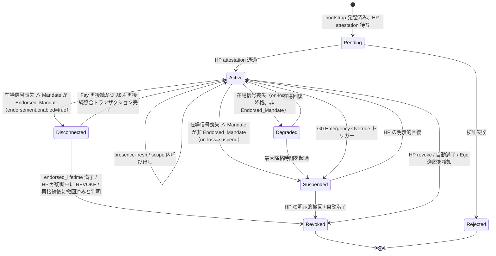

> プロトコル本文ナビ：[章目次](./README.md) ｜ 前章 [§3 コンポーネントとインターフェース](./03-コンポーネントとインターフェース.md) ｜ 次章 [§5 プロトコルメッセージ](./05-プロトコルメッセージ.md)

## §4 Data Models

本章はプロトコルの中核データモデルを定義する。3 節に分かれる。

- **§4.1 TypeScript の人間向けビュー（Non-normative）**——プロトコル委員会、SDK 実装者、レビュアー向けの人間向け骨格。
- **§4.2 CDDL による権威定義（Normative）**——CBOR 主フォーマットの権威 schema。ワイヤ上のすべてのバイトは本節を正とする。
- **§4.3 Mandate の状態機械**——`Disconnected` 状態、遷移トリガー条件行列、「Mandate 状態 ↔ Fay 行為状態」マッピング表を含む。

> **権威性の宣言**：§4.1 の TypeScript ビューと §4.2 の CDDL に何らかの不一致が生じた場合は、**§4.2 CDDL を正とする**。§4.1 は人間向けのみで、ワイヤ上の署名入力には入らない。§4.2 の Deterministic CBOR エンコーディングが署名入力の唯一の源である（詳細は §6 Cryptography）。
>
> **Endorsement フィールドの改竄不能性**：`endorsement` サブ構造は `mandate` のフィールドとして署名入力に入る。そのいずれかのサブフィールド（`enabled` / `endorsed-scope` / `endorsed-grade` / `endorsed-lifetime-ms` / `offline-revocation-policy`）への事後改竄は、いずれも Mandate の署名検証を破壊する（Requirement 11.1 第 3 条、§6.3 と整合）。

### §4.1 中核型（TypeScript ビュー、Non-normative）

下記の TypeScript ブロックは、FayID / Grade / Scope / Mandate / Endorsement / PresenceRequirement / PresenceSignal / Attestation などの中核型を人間向けの形で与える。権威定義は §4.2 を参照。

```typescript
type FayID = string          // "fay:01HX...Z" のような ULID-like
type HumanPrimeID = string   // "hp:..." のような形式（WebAuthn credentialId に錨を打てる）
type MandateID = string      // ULID
type Nonce = Uint8Array      // 16 bytes random

/** 認可グレード */
enum Grade {
  EmergencyOverride = 0,  // G0
  Strict            = 1,  // G1
  Moderate          = 2,  // G2
  Loose             = 3,  // G3
  Autonomous        = 4   // G4
}

/** 認可範囲（least-privilege） */
interface Scope {
  domains:    string[]    // アクセス許可されたリソースドメイン（URL pattern / SPIFFE-ID-like）
  actions:    string[]    // 許可されたアクション（read / write / control:drone:takeoff …）
  terminals?: string[]    // 許可された端末集合（Phase 2 の派生用）
  budget?:   ResourceBudget
}

interface ResourceBudget {
  time_window:    [IsoTime, IsoTime]
  max_invocations?: number
  max_cost_units?:  number  // 抽象的なリソース単位（金額 / 推論量 / トラフィックなど）
}

/** Mandate（token の代替） */
interface Mandate {
  version:       "Faying Protocol/1.0"
  id:            MandateID
  issued_at:     IsoTime
  not_before:    IsoTime
  not_after:     IsoTime          // 必ず有限：無期限の Faying はアンチパターン
  issuer:        HumanPrimeID     // HP（その認可した MS でもよい）
  ms_id:         string           // 実際に発行した MS
  subject:       FayID            // 認可される iFay
  scope:         Scope
  grade:         Grade
  presence_req:  PresenceRequirement
  parent?:       MandateID        // 派生時に親 Mandate を指す
  endorsement?:  Endorsement      // オプション：裏書き式認可（Endorsed Mandate）
  attestation:   Attestation
  signature:     SignatureBundle  // §6 参照
}

/** 裏書き式認可（Endorsed Mandate）—— オフライン自律の事前引き受け
 *
 * `enabled = true` のときに限り、iFay は物理的な Faying 状態が切断されている間も
 * endorsed_scope ⊆ scope、endorsed_grade.autonomy ≤ grade.autonomy の
 * 範囲内で自律できる。endorsed_lifetime は必ず有限。責任引き受け端は常に issuer（Human Prime）。
 */
interface Endorsement {
  enabled:                    boolean
  endorsed_scope:             Scope        // ⊆ Mandate.scope
  endorsed_grade:             Grade        // .autonomy ≤ Mandate.grade.autonomy
  endorsed_lifetime_ms:       number       // ≤ (not_after - not_before)
  offline_revocation_policy:  "stop-and-audit" | "stop-only" | "graceful-stop"
}

/** Scope.actions の注記：プロトコル層はワイルドカード / プレフィックスマッチの使用を禁止する（§9 T2 Atomic_Action 強制制約を参照）。 */

/** 在場要求（grade にバインド） */
interface PresenceRequirement {
  signal_types:   PresenceSignalType[]
  max_staleness_ms: number     // 超過すれば降格をトリガー
  on_loss:        OnLossPolicy // "downgrade-to:G2" | "suspend" | "emergency-override"
}

/** 在場信号 */
interface PresenceSignal {
  mandate_id:     MandateID
  signal_type:    PresenceSignalType
  produced_at:    IsoTime
  nonce:          Nonce
  device_id:      string
  device_attestation: Attestation
  signature:      SignatureBundle
}

/** 証言（統一された検証可能なアサーションの載体） */
interface Attestation {
  format:        "webauthn" | "tpm-quote" | "platform-keystore" | "self-signed"
  payload:       Uint8Array       // 各 format が自己記述する
  signer:        string           // public key id
  signature:     SignatureBundle
}
```

### §4.2 CDDL（CBOR 主フォーマット、権威定義）

下記の CDDL ブロックは Faying Protocol/1.0 のワイヤフォーマットの**権威 schema** である。本プロトコル仕様の公式テストベクトル（`vectors/`）と相互運用コンプライアンステストスイート（`conformance/`）はいずれも本節を正とする。いかなる実装の CBOR バイトのデコード結果も、本節の定義と完全に一致しなければならない。

```cddl
; Faying Protocol/1.0 — CBOR Data Definition Language
; Normative; this is the authoritative schema for Faying Protocol/1.0 wire format.
faying-grade = 0..4    ; 0=EmergencyOverride, 1=Strict, 2=Moderate, 3=Loose, 4=Autonomous

scope = {
  domains:    [* tstr],
  actions:    [* tstr],
  ? terminals: [* tstr],
  ? budget:   resource-budget
}

resource-budget = {
  time-window:        [iso-time, iso-time],
  ? max-invocations:  uint,
  ? max-cost-units:   uint
}

iso-time = #6.0(tstr)   ; CBOR tag 0 (RFC 3339 string)

presence-signal-type =
  "webauthn-uv-fresh" /
  "face-continuous"   /
  "fingerprint-tap"   /
  "presence-heartbeat-only" /
  "intent-ticket"

presence-requirement = {
  signal-types:        [+ presence-signal-type],
  max-staleness-ms:    uint,
  on-loss:             tstr            ; "downgrade-to:Gx" | "suspend" | "emergency-override"
}

attestation = {
  format:    "webauthn" / "tpm-quote" / "platform-keystore" / "self-signed",
  payload:   bstr,
  signer:    tstr,
  signature: signature-bundle
}

signature-bundle = {
  alg:       "Ed25519" / "ES256" / "ML-DSA-65",   ; PQC ネゴシエーションビット
  pubkey:    bstr,
  sig:       bstr,
  ? chain:   [* bstr]                              ; オプションの証明書チェーン
}

mandate = {
  version:        "Faying Protocol/1.0",
  id:             tstr,
  issued-at:      iso-time,
  not-before:     iso-time,
  not-after:      iso-time,
  issuer:         tstr,        ; Human Prime ID
  ms-id:          tstr,
  subject:        tstr,        ; FayID
  scope:          scope,
  grade:          faying-grade,
  presence-req:   presence-requirement,
  ? parent:       tstr,
  ? endorsement:  endorsement,
  attestation:    attestation,
  signature:      signature-bundle
}

endorsement = {
  enabled:                       bool,
  endorsed-scope:                scope,         ; 必ず ⊆ 主 Mandate.scope
  endorsed-grade:                faying-grade,  ; 必ず ≤ 主 Mandate.grade（自律性がより弱いか等しく、安全性がより高い）
  endorsed-lifetime-ms:          uint,          ; 必ず ≤ (mandate.not-after - mandate.not-before)
  offline-revocation-policy:     "stop-and-audit" / "stop-only" / "graceful-stop"
}

presence-signal = {
  mandate-id:           tstr,
  signal-type:          presence-signal-type,
  produced-at:          iso-time,
  nonce:                bstr .size 16,
  device-id:            tstr,
  device-attestation:   attestation,
  signature:            signature-bundle
}
```

> **フィールド命名のマッピング**：CDDL は `kebab-case`（ワイヤフォーマットの慣行）を用い、TypeScript ビューは `snake_case`（人間向けの慣行）を用いる。両者のフィールドは一対一に対応する：`presence-req` ↔ `presence_req`、`endorsed-scope` ↔ `endorsed_scope`、`endorsed-lifetime-ms` ↔ `endorsed_lifetime_ms` など。

### §4.3 Mandate の状態機械



**`Disconnected` 状態の意味論**：Endorsed_Mandate（すなわち `endorsement.enabled = true`）にのみ適用される。この状態にあるとき：

- iFay_Instance は `endorsement.endorsed_scope` 内で、`endorsement.endorsed_grade` の制約に従ってのみ D 次元の行為を実行できる。
- `endorsement.endorsed_lifetime` を超過すれば直ちにソフトタイムアウト → Revoked へ遷移する。たとえ iFay がなお物理的に切断中であってもである。
- HP が切断中に発起した REVOKE は、iFay の再接続後に直ちに `endorsement.offline_revocation_policy`（既定 `stop-and-audit`）に従って処理する。
- 再接続は必ず §8.4 照合トランザクションを経なければならず、「サイレントな続行」を禁止する。

**遷移トリガー条件行列**（§3.5 Liveness Channel、Requirement 11 / 12 と連動）：

| 遷移 | トリガー条件 |
| --- | --- |
| Active → Degraded | `PresenceState.stale=true` ∧ Mandate が非 Endorsed_Mandate ∧ `on-loss = "downgrade-to:Gx"` |
| Active → Disconnected | `PresenceState.stale=true` ∧ Mandate が Endorsed_Mandate（`endorsement.enabled=true`） |
| Active → Suspended | `PresenceState.stale=true` ∧ Mandate が非 Endorsed_Mandate ∧ `on-loss = "suspend"` |
| Disconnected → Active | iFay 再接続かつ §8.4 再接続照合トランザクション完了（Presence 回復 / 保留 REVOKE / GRADE_SWITCH のすべての整合を含む） |
| Disconnected → Revoked | `endorsed_lifetime` 満了 ∨ HP が切断中に REVOKE ∨ 再接続で撤回済みと判明 |

**Mandate 状態 ↔ Fay 行為状態マッピング**（第 13 章 A/B/C/D 次元と整合）：

| Mandate 状態 | 等価な Fay 行為状態 | D 次元（対外行動） |
| --- | --- | --- |
| Pending | Rogue Fay | 禁止 |
| Active | Faying State | 許可（scope 内） |
| Degraded | Faying State（制限付き） | 現在の降格グレードの scope 内のみ許可 |
| Disconnected | Faying State（endorsed-only） | `endorsement.endorsed_scope` 内で `endorsement.endorsed_grade` の制約に従ってのみ許可（詳細は §7.5 / §8.4） |
| Suspended | Faying State の一時停止 | 禁止。ただし Mandate は回復可能な状態を保つ |
| Revoked | Rogue Fay | 禁止 |
| Rejected | Rogue Fay | 禁止 |
