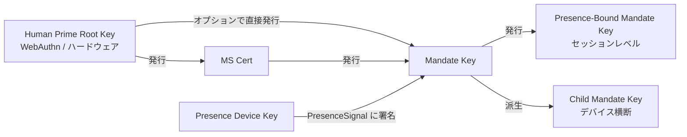

> プロトコル本文ナビ：[章目次](./README.md) ｜ 前章 [§5 プロトコルメッセージ](./05-プロトコルメッセージ.md) ｜ 次章 [§7 認可グレード](./07-認可グレード.md)

## §6 Cryptography

本章はプロトコルの暗号部分を規定する。3 節に分かれる。

- **§6.1 アルゴリズムスイート**：既定 / 代替 / PQC の 3 段階のアルゴリズムネゴシエーション表とネゴシエーション規則。
- **§6.2 鍵派生と役割**：Human Prime Root Key から Presence-Bound Mandate Key までの派生関係とハード制約。
- **§6.3 署名フォーマット**：detached signature、Deterministic CBOR 署名入力、多重署名チェーン、および Endorsed_Mandate の署名入力アンカー。

> **EARS 追跡の説明**：本章の各規則の後ろに、対応する EARS 細目条項番号を `Trace:` として列記する（出典は本仕様の要件ベースライン）。形式は `R<requirement>.<criterion>.<clause>` である。

### §6.1 アルゴリズムスイート

| 用途 | 既定 | 代替 | PQC ネゴシエーションビット |
| --- | --- | --- | --- |
| 署名（Mandate / Presence / Attestation） | **Ed25519** | ECDSA-P256 | ML-DSA-65（FIPS 204） |
| ハッシュ | **SHA-256** | BLAKE3 | SHA3-256 |
| 派生（KDF） | HKDF-SHA-256 | — | HKDF-SHA3-256 |
| 対称（Mandate stapling 暗号化を有効化する場合など） | ChaCha20-Poly1305 | AES-256-GCM | — |
| チャネル層 | TLS 1.3 mandatory | mTLS optional | TLS-1.3-PQ（hybrid X25519 + ML-KEM-768） |

**ネゴシエーション規則**：

- **N1（双方が各自宣言）**：クライアントとサーバーは BOOTSTRAP 時に各自がサポートする署名、ハッシュ、KDF、対称、チャネル層のアルゴリズムスイートを宣言しなければならない。`SignatureBundle.alg`、`hash`、`kdf`、`channel-suite` の最終値は、双方が共通でサポートする最強のアルゴリズムでなければならない。
  - **Trace**：`R8.1.1`（BOOTSTRAP 時に各自がサポートするアルゴリズムスイートを宣言）、`R8.1.2`（双方が共通でサポートする最強アルゴリズムを最終値として選択）。

- **N2（最低実装集合）**：すべての互換実装は、少なくとも署名アルゴリズム集合 `{Ed25519, ECDSA-P256}` を同時にサポートしなければならない。PQC スイートは OPTIONAL だが、すべての実装は将来のローリングアップグレードに備えてネゴシエーションビットを保持しなければならない。
  - **Trace**：`R8.1.3`（少なくとも `{Ed25519, ECDSA-P256}` を同時にサポート）、`R8.2.3`（PQC スイートが `MUST` と指定される前は実装上 `OPTIONAL` であり、相手側が PQC をサポートしないことを理由に BOOTSTRAP を拒否してはならない）。

- **N3（共通スイートなし → `E_PROTOCOL`）**：双方が BOOTSTRAP 時に共通でサポートする署名アルゴリズムもハッシュアルゴリズムも存在しなければ、Mandate_Service は `E_PROTOCOL` で当該 BOOTSTRAP を拒否しなければならない。
  - **Trace**：`R8.1.4`（共通アルゴリズムがないとき `E_PROTOCOL` で BOOTSTRAP を拒否）。

- **N4（PQC ネゴシエーションビットの予約とローリングアップグレード可能性）**：`Mandate.signature_bundle` は `ML-DSA-65`（FIPS 204）をオプション署名アルゴリズムとしてサポートするためのアルゴリズムビットを提供しなければならない。BOOTSTRAP ネゴシエーションビット中に `TLS-1.3-PQ`（hybrid X25519 + ML-KEM-768）へのオプションサポートを予約しなければならない。プロトコルはライフサイクル内でバージョンネゴシエーションを通じて既定アルゴリズムスイートをローリングアップグレードでき、かつ既存 Mandate の検証可能性を壊さないことを許さなければならない。
  - **Trace**：`R8.2.1`（`Mandate.signature_bundle` が `ML-DSA-65` アルゴリズムビットを提供）、`R8.2.2`（BOOTSTRAP ネゴシエーションビットが `TLS-1.3-PQ` を予約）、`R8.2.4`（バージョンネゴシエーションによるローリングアップグレードが既存 Mandate の検証可能性を壊さない）。

### §6.2 鍵派生と役割

下図は Faying Protocol の鍵派生階層と役割関係を示す。HP Root Key は人間が保持するハードウェアから決して出ず、MS Key と（制限された経路下での）Mandate Key のみを認可する。Mandate Key は Presence-Bound および Child Mandate Key を発行する際に短寿命のセッション鍵を確立し、Presence_Device Key は PresenceSignal の署名にのみ用いる。



**主要な制約**：

- **K1（HP Root Key のハードウェア錨定）**：HP Root Key は人間が保持するハードウェア（WebAuthn authenticator / プラットフォーム keystore / ハードウェアウォレット）から決して出ない。HP Root Key がハードウェアから出ることを要求する暗号経路は、プロトコル層に存在しない。
  - **Trace**：`R9.2.4`（各 Mandate は独立した短寿命のセッション署名鍵を用いる——ルート鍵とセッション鍵の分離という鍵階層制約を含意）、`R8.1.3`（最低実装集合のハードウェア収容可能性）。

- **K2（撤回チェーンの方向性）**：MS Key の撤回は HP Root Key が直接実行する。MS は自分自身を撤回できない。この制約は、撤回の到達性の根が MS 自身ではなく HP に錨を打つことを保証する。
  - **Trace**：`R9.2.4`（Presence-Bound Mandate Key は GRADE_SWITCH のたびに強制 rotate——MS が自身のルート鍵を撤回できないという逆方向制約を含意）。

- **K3（Mandate ごとに独立したセッション鍵）**：各 Mandate は独立したセッション署名鍵を持つ（長寿命鍵の濫用を避ける）。Presence-Bound Mandate Key は GRADE_SWITCH のたびに強制的に rotate する。
  - **Trace**：`R9.2.4`（各 Mandate は独立した短寿命のセッション署名鍵を用い、GRADE_SWITCH のたびに Presence-Bound Mandate Key を強制 rotate）。

- **K4（デバイスにバインドされた派生経路）**：Child Mandate Key は対象デバイスの `device_id` と `device_attestation` にバインドしなければならない。「Mandate を別の端末へコピーして直接使用する」経路はすべて拒否し、DELEGATE フローへ切り替えることを要求する。
  - **Trace**：`R9.2.1`（発行時に `device_id` と `device_attestation` をバインド）、`R9.2.2`（別の端末で同一 Mandate を使用するには DELEGATE へ切り替えなければならない）。

- **K5（Channel Binding）**：mTLS が有効化されているとき、Mandate は [RFC 9266](https://www.rfc-editor.org/rfc/rfc9266) が定義する TLS Exporter チャネルバインディング値を携えなければならず、かつ Relying_Party は検証段階でその値を照合しなければならない。
  - **Trace**：`R9.2.3`（mTLS 有効時に RFC 9266 TLS Exporter チャネルバインディングを携え、RP が照合する）。

### §6.3 署名フォーマット

**S1（Detached signature）**：すべて detached signature を用いる——CBOR `signature_bundle` と payload を分離し、監査と再署名を容易にする。`signature_bundle` は payload 自身またはその複製を内包してはならない。
- **Trace**：`R10.2.2`（detached signature、`signature_bundle` と payload を分離）。

**S2（署名入力の正規化定義）**：すべての署名対象は [RFC 8949 §4.2.1 Deterministic Encoding](https://www.rfc-editor.org/rfc/rfc8949#section-4.2.1) 規則に従ってソートしてから署名しなければならない。署名入力は次のように計算しなければならない。

> `signature_input = H( Deterministic-CBOR( Envelope_without_signature ) )`

ここで `H` はネゴシエーション最終のハッシュアルゴリズム（既定 SHA-256、代替 BLAKE3、PQC ネゴシエーションビット SHA3-256）であり、`Envelope_without_signature` は `Faying Protocol Envelope` から `signature_bundle` フィールドを取り除いた残りの構造を表す。**この公式は本プロトコルにおける署名を要するすべての対象に適用される**（Mandate、PresenceSignal、Faying Protocol Envelope 自身を含む）。これにより署名入力は JSON シリアライズの曖昧さに依存しなくなる——CBOR と JSON の 2 種のエンコーディング下で署名入力のハッシュは同一でなければならない。

- **Trace**：`R10.2.1`（RFC 8949 §4.2.1 Deterministic Encoding 規則に従ってソートしてから署名）、`R10.2.4`（署名入力は `H( Deterministic-CBOR(Envelope_without_signature) )`）、`R10.1.4`（署名前に Deterministic CBOR シリアライズを行い、署名入力を JSON シリアライズの曖昧さに依存させない）。

**S3（多重署名チェーン）**：多重署名の場面（DELEGATE が親 Mandate の副署を要するなど）では、親チェーンの署名を `signature_bundle.chain` 配列で担う。チェーン要素の順序は「子 → 親 → 親の親 → … → 根」であり、各チェーン要素自身も S2 の署名入力正規化に従う。
- **Trace**：`R10.2.3`（多重署名の場面で `signature_bundle.chain` 配列により親チェーンの署名を担う）。

**S4（Endorsed_Mandate 署名入力アンカー）**：Mandate が `endorsement` フィールドを携える場合（`enabled` の真偽を問わず）、`endorsement` のすべてのサブフィールド——

```
(enabled, endorsed_scope, endorsed_grade, endorsed_lifetime_ms,
 offline_revocation_policy)
```

——は署名入力に入らなければならない。すなわち `H( Deterministic-CBOR(Mandate_without_signature) )` を計算する際に `endorsement` サブツリーを**除外してはならない**。この規則は P16.1（Endorsement_Signature_Inclusion）と整合する。

`endorsement` フィールドへのいかなる事後改竄（`enabled` を `false` から `true` へ反転、`endorsed_scope` の拡張、`endorsed_grade` の緩和、`endorsed_lifetime_ms` の延長、`offline_revocation_policy` の変更を含む）も、署名検証を失敗させる。Relying_Party は `E_ATTESTATION_INVALID` で関連呼び出しを拒否し、Mandate_Service は `E_ENDORSEMENT_INVALID` で拒否して当該 Mandate の Revoke をトリガーする（詳細は §5.4 エラーコード 1013、§9.7、P16.1）。

- **Trace**：`R11.1.3`（各 Endorsed_Mandate の `endorsement` フィールドを署名入力に入れ、いかなる事後改竄も署名検証を破壊させる）、`R11.1.4`（`endorsement` フィールドの改竄を検知したとき RP は `E_ATTESTATION_INVALID` で拒否し、MS が Revoke をトリガーする）。

**S5（endorsement フィールドの改竄不能性の導出）**：S2 と S4 の組み合わせから導かれる——

1. S4 より、`endorsement` サブツリーは必ず `Deterministic-CBOR(Mandate_without_signature)` に入る。
2. S2 より、署名入力は `H(Deterministic-CBOR(Mandate_without_signature))` である。
3. したがって `endorsement` のいずれかのサブフィールドの変更は、Deterministic CBOR シリアライズ結果を変え、ひいては署名入力のハッシュを変える。
4. 署名検証の暗号学的性質により、元の署名は新しい署名入力に対して必ず検証に失敗する。

ゆえに `endorsement` フィールドの改竄不能性は §6.3 から直接導出され、追加のプロトコル層メカニズムを要しない。**この改竄不能性は Endorsed_Mandate の責任帰属チェーン（詳細は §11.4 と P16.5）の暗号学的礎石である**：endorsement へのいかなる事後改竄も署名検証段階で直ちに発見され、「裏書き宣言の改竄を通じて責任引き受けを逃れる」あらゆる可能な経路を断つ。

- **Trace**：`R11.1.3`（事後改竄が署名検証を破壊）、`R10.2.4`（署名入力の定義）、`R11.1.4`（改竄発見時のプロトコル層処置）。
