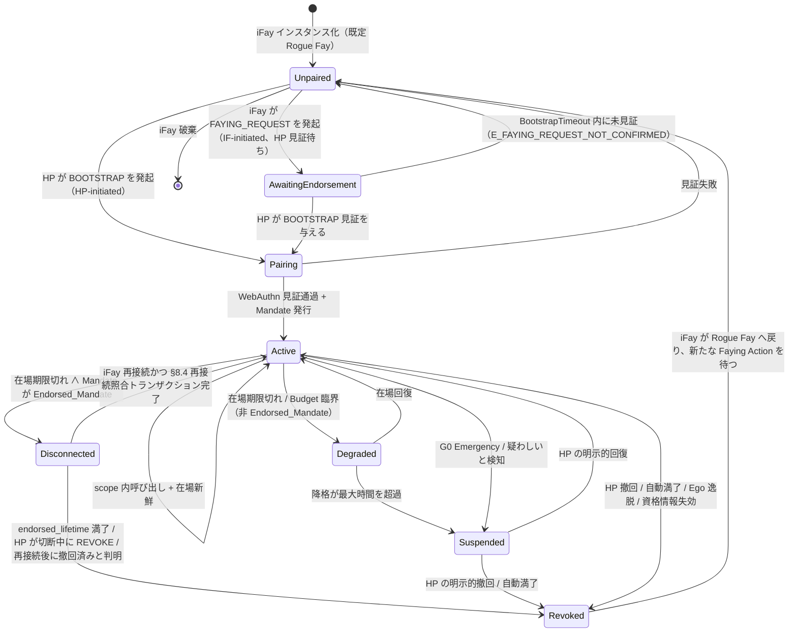
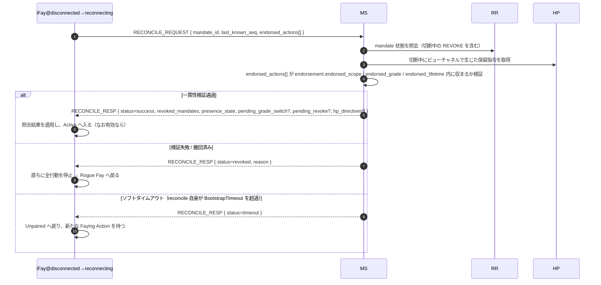

> プロトコル本文ナビ：[章目次](./README.md) ｜ 前章 [§7 認可グレード](./07-認可グレード.md) ｜ 次章 [§9 セキュリティ考慮事項](./09-セキュリティ考慮事項.md)

## §8 Lifecycle

本章は iFay の完全なライフサイクルを述べる。インスタンス化、Faying Action の発起、Faying State の維持から、降格、連絡途絶、一時停止、撤回、そして最後に Rogue Fay へ戻るまでである。この状態機械はプロトコル層の中核となる不変条件を担う——対外行動が合法か、責任端が一意か、連絡途絶の期間中どこまで自律できるか、いずれも本章が定義する。

### §8.1 完全なライフサイクル状態機械

下図はプロトコル層の 7 つの状態閉包（**Unpaired / Pairing / Active / Degraded / Disconnected / Suspended / Revoked**）と、それらの間のすべての合法遷移をカバーする。`AwaitingEndorsement` は IF-initiated 双方向 Faying 経路上の中間的な一時状態（詳細は §2.4 / §5.3.6）であり、「行動が実行可能」な安定閉包を構成しないが、遷移図の完備性を保つため状態図には依然として現れる。

> §4.3 Mandate 状態機械との関係：§4.3 は *Mandate オブジェクト* の状態（Pending / Active / Degraded / Disconnected / Suspended / Revoked / Rejected）を描き、本節は *iFay エンティティ* のライフサイクル状態を描く。両者は「Active/Degraded/Disconnected Mandate ⇔ Faying State / endorsed-only Faying State」のマッピングで接続する。詳細は §4.3 末尾の「Mandate 状態 ↔ Fay 行為状態マッピング」表を参照。

### §8.2 各段階の意味論

下表は 7 つの状態閉包の意味論を示す。各状態の「対外行動（D 次元）」列の値が、すなわちプロトコル層の D 次元アクセス決定である。

- **Unpaired**：ブループリントの Rogue Fay と等価。A1–A4（自己認識）、B1–B3（対内表現）、C1–C2（人への一方向コミュニケーション、FAYING_REQUEST の発起を含む）次元の行為のみを許す。D 次元は一律禁止。

> **Rogue Fay の厳密な判定（重要）**：接続の切断それ自体は Rogue Fay と**等しくない**。ある iFay が Rogue Fay と認定されるのは、下記 2 種の情形のいずれかを満たすとき、かつそのときに限る：（1）**接続が切断されており、かつ明確な認可が一切存在しない**——すなわち、その時点の行為をカバーする `Active / Degraded / Disconnected` 状態の Mandate が一切ない（Faying をそもそも確立していない、Mandate が撤回 / 期限切れ / 一時停止されている場合を含む）。（2）**連絡途絶が証明されている**——§9.9 に従って Perceived-Disconnected（知覚上の連絡途絶）と判定され、かつ現在の Mandate が有効な Endorsed_Mandate でない（または `endorsement` が期限切れ / `enabled=false`）。
>
> 逆に言えば：物理接続は切れていても、**有効な Endorsed_Mandate** を保持し、なお `endorsed_scope / endorsed_grade / endorsed_lifetime` 内にある iFay は `Disconnected` 状態にあり、**Faying State（endorsed-only）であって Rogue Fay ではない**——その切断期間中の D 次元行為は `Mandate.issuer`（HP）が BOOTSTRAP 段階で行ったオフライン事前認可が引き受ける（詳細は §4.3 / §7.5 / §8.3 / §8.4）。裏書きの寿命が満了するか、撤回されるか、照合に失敗したときに初めて、当該 iFay は Revoked → Unpaired へ遷移し、Rogue Fay へ戻る。
- **AwaitingEndorsement**：iFay が発起した FAYING_REQUEST がすでに HP ビューチャネルへ転送され、HP が `BootstrapTimeout`（既定 60s）以内に BOOTSTRAP を通じて認可確認を与えるのを待つ状態。この状態はいかなる Mandate も生まず、対外行動は一律禁止。タイムアウトすれば Unpaired へ戻り、Attestation Chain へ書き込む（エラーコード 1014 `E_FAYING_REQUEST_NOT_CONFIRMED`）。
- **Pairing**：Faying Action の進行中、一時状態。`BootstrapTimeout` 以内に WebAuthn 見証 + Mandate 発行を完了しなければならない。失敗すれば Unpaired へ戻り、残留状態はない。
- **Active**：Faying State の正常運転。これに対応する Active 状態の Mandate がちょうど 1 つ存在する。すべての D 次元呼び出しは `Mandate.scope` と `Mandate.grade` に従ってアクセス可否を決める。
- **Degraded**：Faying State はなお成立するが、グレードが締められている（在場信号の期限切れがトリガー）。**非 Endorsed_Mandate** にのみ適用される。継続時間は `MaxDegradedDuration`（既定は grade ごとに設定、付録 B 参照）を超えてはならない。超過すれば Suspended へ遷移する。
- **Disconnected**：Faying State は `endorsement.endorsed_scope` と `endorsement.endorsed_lifetime` 内でのみ有効。Endorsed_Mandate が物理連絡途絶の期間中に持つ「endorsed-only」の行為ウィンドウに適用される。具体的なアクセス可否と連絡途絶の意味論の詳細は §4.3 / §7.5 / §8.4 を参照。
- **Suspended**：Faying State の一時的な保留。対外行動は一律禁止だが、HP の明示的回復や監査のため Mandate メタデータを保持する。自動満了点を超えれば Revoked へ遷移する。
- **Revoked**：Mandate の終了。iFay は Rogue Fay へ戻る。以降のいかなる D 次元呼び出しも、新たな完全な Faying Action（新 `mandate_id`）を経なければならない。Revoked は Mandate の吸収状態である（詳細は P10）。

### §8.3 責任帰属のシーケンス

> **任意の時点の IF の対外行動 → 必ず一意の Active、Degraded、または Disconnected の Mandate が存在しなければならない → その Mandate の `issuer` が責任引き受け端である。**

本款はプロトコル層の「責任引き受け端の一意性」の形式的シーケンス条項であり、第 3 の情形は存在しない。

1. **合法な Mandate が存在しない**：Active / Degraded / Disconnected 状態の Mandate が一切ない ⟹ 対外行動を許さず（D 次元が禁止される）、RP は `E_NO_MANDATE`（1001）または `E_PRESENCE_STALE`（1005）を返さなければならない。
2. **複数の合法な Mandate が併存する**：プロトコル層は「最も具体的な作用域」の 1 つを強制選択し、かつ同一の `issuer`（HP）を共有しなければならない。異なる issuer の複数の合法 Mandate が存在すれば、プロトコルエラーとみなし、`E_PROTOCOL`（1099）を返さなければならない。
3. **Disconnected 期間中の対外行動**：同様に `Mandate.issuer`（HP）へ帰責する。`endorsement` は行動が実行可能な `endorsed_scope` / `endorsed_grade` / `endorsed_lifetime` を制約するのみで、責任引き受け端を変えない。「endorsement によって責任を iFay 自身 / MS / Supervisory Agent へ移転する」正当な経路は存在しない（詳細は P16.5）。

本款から直ちに次が導かれる。

- 受理された任意の呼び出し `c` について、その監査 5 つ組 `(mandate_id, endorsement_id?, action, ts, signature_chain)` 中の `signature_chain` のルートノードは、必ずかつ `Mandate.issuer` のみである。
- iFay には「自己帰責」の正当な経路が存在せず、MS / Supervisory Agent も代理見証で HP の `issuer` 身元を代替してはならない。
- 責任引き受け端は Mandate のライフサイクル内で変更不能である。変更を要する場合は撤回 + 新 BOOTSTRAP（新 `mandate_id`、新 `issuer`）を経なければならない。

### §8.4 再接続照合（Reconciliation）

> **目的**：iFay が Disconnected 期間中に行った「endorsed 自律」と、プロトコル中心ビュー（MS / RR / HP ビューチャネル）の状態変化とを一致へ収束させ、「再接続すれば行動を続けられる」をアンチパターンとして明示的に禁止する。

#### §8.4.1 フロー

#### §8.4.2 照合トランザクションの返却内容

トランザクション成功（`status = success`）時、`RECONCILE_RESP` は以下のフィールドを返さなければならない（Requirement 12.4 と一対一に対応）。

1. **`revoked_mandates`**：切断中に撤回された Mandate のリスト（連鎖子 Mandate を含む）。
2. **`presence_state`**：現在の PresenceState（D 次元を継続できるかを決めるため）。
3. **`pending_grade_switch`**：未完了の GRADE_SWITCH イベント（あれば）。
4. **`pending_revoke`**：未完了の REVOKE イベント（あれば）。
5. **`hp_directives`**：切断中に HP ビューチャネルで生じた保留指令（G0 Emergency Override、明示的 REVOKE、強制降格など）。

#### §8.4.3 トランザクション結末の列挙

照合トランザクションの結末は下記 3 種のいずれか 1 つに限られ、P17.4 `reconcile_result(M) ∈ {success, revoked, timeout}` の形式的定義と整合する。

| 結末 | トリガー条件 | 後置状態 | 監査要求 |
| --- | --- | --- | --- |
| `success` | 一貫性検証通過 ∧ Mandate がなお有効 ∧ BootstrapTimeout 以内に完了 | Disconnected → Active | Attestation Chain へ書き込み、endorsed_actions の完全な監査を含む |
| `revoked` | endorsed_lifetime がすでに満了 ∨ HP が切断中に REVOKE を発起 ∨ 再接続後に撤回済みと判明 ∨ endorsed_actions が越界 | Disconnected → Revoked → Unpaired | Attestation Chain へ書き込み、`endorsement.offline_revocation_policy` に従って切断中の監査を処理 |
| `timeout` | 照合トランザクション自身が `BootstrapTimeout` を超過してなお success / revoked に達せず | Disconnected → Unpaired | Attestation Chain へ書き込み、`reason=reconcile-timeout` と標記 |

#### §8.4.4 プロトコル層のハード制約

- **D 次元禁令**：照合トランザクションが完了する前は、iFay はいかなる D 次元行動も禁止される。このウィンドウ内に RP へ到達したいかなる呼び出しも `E_PRESENCE_STALE`（1005）または `E_REVOKED`（1006）で拒否しなければならない。この禁令は `[t_reconnect, t_reconnect + reconcile_complete_ms]` の区間内で成立する（P17.4 と整合）。
- **タイムアウトすれば Rogue Fay へ戻る**：照合トランザクションは `BootstrapTimeout` 以内に完了しなければならない。タイムアウトすれば iFay は Unpaired へ戻り、新たな Faying Action を待つ（BOOTSTRAP の自動リトライは許さない）。
- **3 種の結末はすべて AC へ入る**：照合トランザクション自身の `success` / `revoked` / `timeout` の 3 種の結末はすべて Attestation Chain へ書き込み、`endorsement.offline_revocation_policy` に従って切断中の行動監査を処理しなければならない。
  - `stop-and-audit`（既定）：直ちに停止 + 完全な endorsed_actions 監査を提出 + Rogue Fay へ戻る。
  - `stop-only`：直ちに停止 + 監査を強制しない（不可逆 / 緊急の場面にのみ適用、プロトコル委員会の決議を要する）。
  - `graceful-stop`：限定的な収尾（書き込みのクローズ / 状態保存）の後に停止することを許す。収尾アクションも依然 endorsement の制約を受ける。
- **失敗による後退後は自リトライ禁止**：照合トランザクションの結末が `revoked` または `timeout` で Rogue Fay へ戻ったとき、iFay は自ら BOOTSTRAP をリトライしてはならず、HP の再発起（HP-initiated）または HP の明示的認可を経た新たな FAYING_REQUEST（IF-initiated）を待たねばならない。
- **サイレントな続行の禁止**：いかなる「再接続すれば継続」の実装経路も禁止する。§8.4 照合トランザクションを迂回して Disconnected を直接 Active へ遷移させるいかなる実装も、不適合な実装とみなし、相互運用コンプライアンステストスイートはこれを fail と判定しなければならない。
