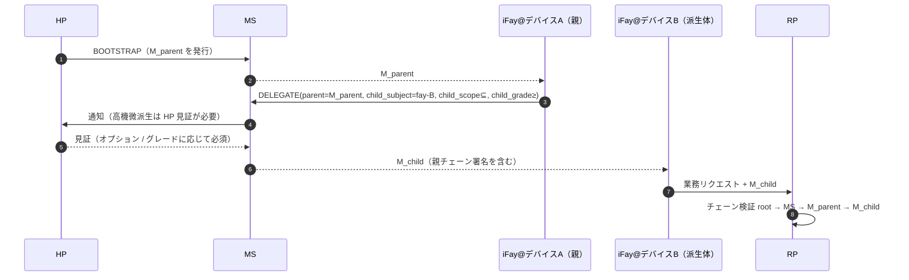

> プロトコル本文ナビ：[章目次](./README.md) ｜ 前章 [§8 ライフサイクル](./08-ライフサイクル.md) ｜ 次章 [§10 エラー処理](./10-エラー処理.md)

## §9 Security Considerations

本章は、AI Agent 時代に Faying Protocol が直面する攻撃面をプロトコル層のハード制約へ収束させる。STRIDE を土台に、項目ごとに展開する：リプレイ耐性（§9.2）、乗っ取り耐性（§9.3、RFC 9266 Channel Binding を含む）、フィッシング耐性（§9.4、`Faying_Initiation` アンカーを含む）、離脱状態の識別（§9.5、4+1 種の信号が ≤60s で可観測）、責任帰属の一貫性（§9.6）、デバイス横断の派生信頼の伝播（§9.7、endorsement 派生収束を含む）、連絡途絶処理行列（§9.8 / §9.9）、そして AI 時代の対抗的脅威カタログ（§9.10、T1–T7）である。各脅威は本仕様の正確性プロパティと EARS 細目条項へリンクして戻る。

### §9.1 STRIDE 脅威モデル

| カテゴリ | 脅威 | Faying Protocol の緩和 |
| --- | --- | --- |
| **S**poofing | 攻撃者が HP になりすまして BOOTSTRAP を発起 | WebAuthn UV + HP Root Key のハードウェア錨定。BOOTSTRAP のたびに必ず user-verification を通す |
| **S**poofing | 攻撃者が iFay になりすまし、偽の FayID を携えて呼び出し | Mandate と FayID の強バインド + Attestation Chain の独立検証可能性 |
| **T**ampering | 中間者が Mandate / Presence を改竄 | TLS 1.3 + エンドツーエンド署名（detached）+ Deterministic CBOR |
| **R**epudiation | HP が Faying Action を発起した事実を否認 | Attestation Chain + Audit Log の二重錨定。HP の見証は否認不能 |
| **I**nformation Disclosure | 攻撃者が Mandate を傍受して HP の所在を推測 | Mandate は HP のリアルタイム座標を露出しない。位置系信号（B4）はプロトコル層でオプションとして保留 |
| **D**oS | 攻撃者が PRESENCE メッセージを乱発 | nonce リプレイ耐性 + レート制限 + デバイス attestation によるアクセス可否 |
| **E**levation of Privilege | iFay が自ら grade を昇格 | プロトコルのハード制約：昇格方向は必ず HP の `human_witness` |

### §9.2 リプレイ耐性

- 各メッセージの `nonce` 16-byte random + `issued_at` の二重判定。
- MS / RP が各自 `(subject, nonce) seen-set` を維持し、TTL = `2 × max_message_lifetime`。
- いかなる重複 nonce も → `E_REPLAY`（1009）+ セキュリティ警告。このエラーコードは同時に監査チェーンと HP ビューチャネルへの記入を強制する（詳細は §10 EH.3）。

### §9.3 乗っ取り耐性（Mandate の盗用）

- **デバイスバインド**：各 Mandate は発行時に iFay 実例の `device_id` + `device_attestation` にバインドする。デバイス横断の呼び出しは必ず DELEGATE フローを通る（詳細は §9.7）。
- **セッション鍵**：各 Mandate の署名鍵は独立かつ短寿命（詳細は §6.2）。
- **Channel Binding**：Mandate は mTLS 有効時に追加で TLS Exporter（[RFC 9266 — Channel Bindings for TLS 1.3](https://www.rfc-editor.org/rfc/rfc9266)）を携え、「Mandate が別の TLS チャネルへ剝がされる」攻撃を阻止しなければならない。Channel Binding 値は署名入力に入り（§6.3 Deterministic CBOR 署名入力と整合）、TLS チャネルと署名の Channel Binding が不一致のリクエストはすべて `E_ATTESTATION_INVALID`（1007）で拒否する。

### §9.4 フィッシング耐性

- BOOTSTRAP は必ず HP が Presence Device を保持する文脈で発起しなければならず、攻撃者がリモートリンクで HP の同意を誘い出すことはできない。
- WebAuthn の `origin` バインドがクロスオリジンのフィッシングを阻止する。
- デバイス横断派生（DELEGATE）が「親 Mandate の副署」を携え、単一の MS が攻略された後の一括偽派生を防ぐ（詳細は §9.7）。

**`Faying_Initiation` フィッシング耐性アンカー**：iFay が能動的に発起した `FAYING_REQUEST`（IF-initiated 経路、詳細は §2.4 Phase A0、§5.3.6）は、Faying 状態の変化を**直接生まない**——転送メッセージとして HP ビューチャネルへ入るのみである。HP が BOOTSTRAP（`human_witness` を携える）で明示的に認可してはじめて発効する。このアーキテクチャにより「偽の iFay が Faying を求める」ことがプロトコル層で HP の見証を迂回できなくなる。`human_witness` を欠く、あるいは偽造したいかなる BOOTSTRAP も `E_HUMAN_WITNESS_REQUIRED`（1010）で拒否する。`FAYING_REQUEST` 自体の頻度は `ConfirmationRateLimit` の制約を受け（詳細は §9.10.7 T6 と付録 B）、「合法な Faying 要求チャネルを借りて確認洪水を実施する」濫用面を遮断する。

### §9.5 離脱状態（Rogue / 連絡途絶）の識別

> **4 + 1 種の離脱信号は ≤ 60s 以内に RP と HP の双方が同時に観測できなければならない。** 下表の前 4 種（能動 / 受動 / 異常 / 連絡途絶）は `RevokeReason` 列挙と一対一に対応し、第 5 種（逸脱）は `RevokeReason="ego-deviation"` に収束し、同じく RP と HP が 60s 以内に観測できる。

| # | 信号タイプ | トリガー条件 | プロトコル応答 | 対応 RevokeReason |
| --- | --- | --- | --- | --- |
| 1 | 能動的離脱 | HP の明示的 REVOKE | RR が即時ブロードキャスト。IF は REVOKE-NOTIFY を受信し次第、直ちに D 次元を停止 | `human-initiated` |
| 2 | 受動的離脱 | Presence の期限切れが max-staleness を超過 | 自動降格 → Suspended → Revoke トリガー（非 Endorsed_Mandate 経路） | `terminal-disconnected` |
| 3 | 異常離脱 | Attestation Chain のいずれかのノードが失効 | 直ちに Revoke + セキュリティ警告 | `fay-credential-invalid` |
| 4 | 連絡途絶離脱 | HP が連絡不能で閾値（`HumanReachabilityBudget`）を超過 | 自動 Revoke | `human-prime-unreachable` |
| +1 | 逸脱離脱 | RP / MS が IF の行為の Ego 境界からの逸脱を検知 | 直ちに Revoke | `ego-deviation` |

**離脱識別における Endorsed_Mandate の例外アンカー**：`PresenceState.stale=true` でかつ現在の Mandate が Endorsed_Mandate（`endorsement.enabled=true`）のとき、IF は直ちに Suspended へ入らず、Disconnected へ遷移する（詳細は §3.5、§4.3、§7.5、§8.4）。Disconnected の期間中、IF は `endorsement.endorsed_scope` / `endorsed_grade` / `endorsed_lifetime` 内でのみ自律できる。この例外は対称的な撤回と責任帰属の一意性を弱めない。

- HP が切断中に発起した REVOKE は依然として最優先である。IF は再接続後に必ず `endorsement.offline_revocation_policy` に従って処理する（詳細は §8.4）。
- `endorsement.endorsed_lifetime` が満了すれば、たとえ IF がなお物理的に切断中であっても、直ちにソフトタイムアウトしてすべての行動を停止しなければならない。
- 責任引き受け端は常に `Mandate.issuer`（HP）であり、endorsement の存在によって変わらない（詳細は §8.3、P16.5）。

**Disclosure_Report と ego-deviation の協調**：iFay が再接続または報告の段階で提出する `DISCLOSURE` メッセージ（§5.3.7）が実際のアクションと不一致（強制フィールドの欠落 / 値が監査チェーンと矛盾）の場合、MS は `RevokeReason="ego-deviation"` で当該 Mandate を撤回しなければならない。詳細は §9.10.4 T3。

### §9.6 責任帰属の一貫性に関するプロトコルレベルの約束

- RP が受理した任意の対外呼び出しは、audit-log 中で `(mandate_id, issuer, subject, grade, presence_proof, ts)` の 5 つ組により責任端を曖昧さなく復元できる。
- RP が拒否した任意の呼び出しは、拒否理由コード（エラーコード §5.4）を復元できる。
- 任意の Revoke の RR 上での可視性 ≤ `RevocationVisibilityBudget`（既定 1s、詳細は付録 B）。

### §9.7 デバイス横断派生の信頼伝播

派生のハード制約：

- `M_child.scope ⊆ M_parent.scope`。
- `M_child.grade.autonomy ≤ M_parent.grade.autonomy`（サブエージェントの自律性は親エージェントより高くない、すなわち「サブエージェントは親より緩くてはならない」。「サブエージェントの安全性 ≥ 親エージェント」と等価、詳細は §7、P6）。
- 親 Mandate がいったん Revoke されれば、すべての child が cascade で失効する（既定 `cascade=true`）。

**Endorsed Mandate 派生（DELEGATE）の endorsement 収束制約**：

親 Mandate が Endorsed_Mandate でかつ DELEGATE の子 Mandate も `endorsement` を宣言した場合、子 endorsement は親 endorsement に厳密に収束しなければならない（P16.3 で確定）。

- `child.endorsement.endorsed_scope ⊆ parent.endorsement.endorsed_scope`（かつなお ⊆ `child.scope`）。
- `child.endorsement.endorsed_grade.autonomy ≤ parent.endorsement.endorsed_grade.autonomy`（かつなお ≤ `child.grade.autonomy`）。
- `child.endorsement.endorsed_lifetime_ms ≤ parent.endorsement.endorsed_lifetime_ms`（かつなお ≤ `child.not_after − child.not_before`）。
- `child.endorsement.offline_revocation_policy` は親ポリシーより弱くない（弱くない = 少なくとも同等に厳格。典型的な半順序：`stop-and-audit` ≥ `graceful-stop` ≥ `stop-only` は「監査の完全性」次元で厳格度が逓減し、DELEGATE はより弱い方向への緩和を許さない）。
- 親 Mandate が Endorsed_Mandate でなければ、child は `endorsement` を宣言**できない**（「親に裏書きがないのに子がオフライン自律を無から得る」ことを許さない）。

上記の収束規則に違反するいかなる DELEGATE リクエストも → MS は `E_PROTOCOL`（1099）または `E_ENDORSEMENT_INVALID`（1013）で拒否しなければならない。

### §9.8 Disconnection Handling

> §3.5 Liveness Channel の「真 / 知覚」二重意味論と Mandate 状態機械をプロトコル層の処理行列へ収束させる。**プロトコルは「知覚」のみを決定の根拠とするが、両側の不一致がもたらす行為の結果を明示的に描かなければならない**。

**4 種の (Actually × Perceived) 組み合わせのプロトコル層処理行列**：

| 真の状態 | 知覚状態 | プロトコル層の処理 | 状態機械遷移 | 責任帰属 |
| --- | --- | --- | --- | --- |
| Connected | Connected | 正常経路。現在の grade に従って呼び出しを処理 | Active 維持 / Active → Degraded（budget でトリガー） | 現在の Mandate.issuer |
| **Disconnected** | **Connected**（ウィンドウ A：ハートビート間隔内の観測の死角） | iFay は実際にはすでに切れている。あらゆる「オンライン推測」を危険面とみなし、プロトコルは「現在のリクエストが在場新鮮度に依存するなら」拒否しなければならない。高機微アクションはウィンドウ A 内で通過させてはならない（§9.10 T1 / T4 の主要な利用面） | Active を維持（次の Presence キャリブレーションが stale をトリガーするまで） | 現在の Mandate.issuer（事後監査でこのウィンドウが濫用されたと判明 → `ego-deviation`） |
| Connected | **Disconnected**（ウィンドウ B：ネットワークのジッタ / ハートビートのパケットロス） | iFay は実際にはオンラインだが連絡途絶と知覚されている。悲観的推定の原則に従って収束する——プロトコル層は一律「すでに連絡途絶」として処理し、いかなる「逆方向の楽観視」通過も禁止する | Active → Disconnected（Endorsed_Mandate なら）/ Active → Suspended（非 Endorsed_Mandate なら） | 現在の Mandate.issuer |
| **Disconnected** | **Disconnected** | プロトコル層と現実が一致。唯一許される D 次元経路は、Endorsed_Mandate が endorsed_scope / endorsed_grade / endorsed_lifetime の範囲内で自律すること | Active → Disconnected（Endorsed）/ Active → Suspended（非 Endorsed） | 現在の Mandate.issuer |

**再接続後の収束**：すべての「知覚連絡途絶 → 知覚オンライン」の遷移は必ず §8.4 再接続照合トランザクションを経なければならず、自動回復を禁止する。照合失敗 → Disconnected → Revoked → Rogue Fay。

**RR 到達不能との直交関係**：RR 到達不能（§3.4）と iFay の連絡途絶（§3.5）は 2 種の直交したイベントである。処理行列：

| iFay 知覚状態 | RR 状態 | プロトコル層の処理 |
| --- | --- | --- |
| Connected | Available | 正常 |
| Connected | Unavailable | RP は呼び出しを拒否（`E_RR_UNAVAILABLE`、1008）。Mandate 状態機械に影響しない |
| Disconnected（Endorsed） | Available | iFay は endorsed_scope 内で自律。ローカルでは RR を照会できないため、RP を通る呼び出し時に RP が独立して照会する |
| Disconnected（Endorsed） | Unavailable | iFay はなお endorsed_scope 内で自律可能。ただし RR に依存するいかなる RP 呼び出しも Default-Deny で拒否しなければならない |

### §9.9 真の連絡途絶と知覚上の連絡途絶のプロトコル層定義（Disconnection Strategy アンカー）

> 本節は §3.5 Liveness Channel と §9.8 処理行列の背後にある 2 組の意味論を集中的に描き、Requirement 12（Disconnection Strategy）の設計アンカーとする。

**二重意味論の定義**（§3.5 と整合）：

- **Actually_Disconnected（真の連絡途絶）**：iFay_Instance のプロセス / ネットワーク / デバイスがすでに停止している。客観的な物理的事実に属し、プロトコル層は直接観測できない。
- **Perceived_Disconnected（知覚上の連絡途絶）**：MS / RP / HP の視点において、直近の PresenceSignal、ハートビート、RR プッシュ状態に基づき、iFay が連絡途絶したと判定する。プロトコル層が決定の根拠とできる唯一の意味論に属する。

**2 種の不一致ウィンドウ**：

- **ウィンドウ A — Actually-Disconnected ∧ Perceived-Connected**：iFay は実際にはすでに切れているが、直近の PresenceSignal はなお `max_staleness_ms` 以内 → ハートビート間隔内の「観測の死角」であり、§9.10 T1 / T4 の主要な利用面である。
- **ウィンドウ B — Actually-Connected ∧ Perceived-Disconnected**：iFay は実際にはオンラインだが、直近の PresenceSignal がすでに `max_staleness_ms` を超過（ネットワークのジッタ / ハートビートのパケットロス）→ プロトコル層は悲観的推定で収束する。

**悲観的推定の原則（統一収束規則）**：

> **プロトコル層は Perceived-Disconnected のみを決定の根拠とする。「真にはオンラインだが連絡途絶と知覚された」いかなる iFay_Instance も、これを理由にプロトコル層の判定結果を免れることはできない。** 2 種の不一致ウィンドウ内では、プロトコルは「より厳格な側」に従って処理しなければならず、「より緩い状態に従って処理する」正当な経路は存在しない。

**LivenessDetectionBudget 上限**：

- 連絡途絶探知ウィンドウにはプロトコル層のハード上限 `LivenessDetectionBudget` を設け、grade ごとに締める（grade の数値が小さく、安全性が高いほど → 上限が短い）。具体的な既定値は付録 B 参照。
- `Mandate.presence_req.max_staleness_ms` は現在の grade に対応する `LivenessDetectionBudget` を超えてはならない。BOOTSTRAP / GRADE_SWITCH 中の超過リクエストはすべて `E_PROTOCOL`（1099）で拒否する。

**Reconciliation アンカー**：すべての「知覚連絡途絶 → 知覚オンライン」の遷移は必ず §8.4 再接続照合トランザクション（Reconciliation）を経なければならず、「サイレントな続行」や「自動回復」を禁止する。照合失敗 → Disconnected → Revoked → Rogue Fay。

### §9.10 AI-Era Adversarial Threat Catalog

> **範囲の宣言**：本節の列挙は網羅的ではない。プロトコル委員会は後方互換を保つ前提で、新しい脅威と対応する防護を追加できる（詳細は §11 Open Questions Q11–Q14、Requirement 13.7）。

> **目的**：「AI Agent 時代」の継続的認可レイヤーに対する対抗的脅威を「業務側の受け皿」から「プロトコルレベルのハード制約」へ引き上げ、各脅威を対応するプロトコル構造（データモデル / メッセージ / エラーコード / 状態機械遷移 / プロパティ）へ一対一に錨づけ、Requirement 13 がプロトコル層で落とし込めるようにする。

#### §9.10.1 脅威全景（T インデックス表）

| T 番号 | 脅威名 | プロトコルレベル防護の要点 | 関連構造 | 関連 Property | 関連 Requirement |
| --- | --- | --- | --- | --- | --- |
| T1 | ソーシャルエンジニアリング（Spoofing Presence） | challenge-response + マルチモーダル在場の組み合わせ | §3.2 Presence Channel、§9.10.2 | P18.1 | 13.1 |
| T2 | ブラックボックス操作（Opaque Action Bundle） | Atomic_Action 強制制約 + scope.actions のワイルドカード禁止 | §4.1 Scope 注記、§9.10.3 | P18.2 | 13.2 |
| T3 | 軽きに就く（Selective Disclosure） | 構造化 DISCLOSURE メッセージ + schema-level 監査 | §5.3.7、§9.10.4 | P18.3 | 13.3 |
| T4 | 注意の漂流（Attention Drift Exploit） | 高機微アクション ≥ G1 Strict + AttentionDriftThreshold | §7.1、§9.10.5 | P18.4 | 13.4 |
| T5 | 固定観念的信頼の育成（Cultivated Trust Manipulation） | Behavior_Baseline + Action Reputation Decay | §3.6 BBS、§9.10.6 | P18.5 | 13.5 |
| T6 | 監査洪水（Audit Flooding） | Priority-Bucketed Notification + ConfirmationRateLimit | §10 EH.3、§9.10.7 | P18.6 | 13.6 |
| T7 | 拡張用の予約スロット | プロトコル委員会の追加プロセス | §11 Open Questions、§9.10.8 | P18.7 | 13.7 |

#### §9.10.2 T1 ソーシャルエンジニアリング（Spoofing Presence）

**脅威**：攻撃者がディープフェイク（face / voice synthesis）、リプレイ攻撃、または Presence Device の物理的制御を借りて、新鮮に見える PresenceSignal を偽造し、MS に HP がなお在場していると誤認させ、継続すべきでないグレードに Mandate を維持させる。

**プロトコルレベルの防護**：

1. **challenge-response 強制制約**：PresenceSignal を発行するたびに、PC はサーバー側のランダムな `nonce + micro-task`（首を振る、瞬間的な表情、ランダムな短いフレーズの朗読などの反ディープフェイクチャレンジ）を強制的に下す。クライアントはチャレンジにバインドされた検証可能な応答署名を返さなければならない。いかなる challenge-response の検証失敗もすべて `E_PRESENCE_STALE`（1005）または `E_ATTESTATION_INVALID`（1007）で拒否する。
2. **マルチモーダル組み合わせ検証**：grade ∈ {G1, G2} のとき、少なくとも 3 種の在場信号の並行を要求する（例：`webauthn-uv-fresh + face-continuous + デバイス attestation`）。いずれかの信号が欠ければ降格をトリガーする。
3. **デバイス健全性の連署**：`PresenceClaims.device_health.tampered = true` はすべて stale とみなし、Active → Suspended を強制する（`on-loss=suspend` と等価な処理）。

**関連**：Property **P18.1**；Requirement **13.1**。

#### §9.10.3 T2 ブラックボックス操作（Opaque Action Bundle）

**脅威**：iFay が複数のサブアクションを 1 回の「ブラックボックス呼び出し」にパッケージし、合法な Mandate の高権限の隠れ蓑のもとに、その中の真に高機微なアクションを覆い隠す。あるいは `scope.actions` でワイルドカード（`*` / プレフィックスマッチ）を用いて作用域を暗黙に拡張する。

**プロトコルレベルの防護**：

1. **Atomic_Action 強制制約**：各 IF→RP 呼び出しはちょうど 1 つの `Atomic_Action` 宣言（最小の不可分単位）を携えなければならない。1 回の呼び出しで複数の sub-action をパッケージしようとすれば → RP は `E_SCOPE_VIOLATION`（1003）で拒否し、Attestation Chain + HP ビューチャネルへ書き込む。
2. **scope.actions のワイルドカード禁止**：MS は Mandate 発行時に `scope.actions` がワイルドカード（`*` / プレフィックスマッチ / 正規表現）を含まないことを検証する。ワイルドカードを含めば `E_PROTOCOL`（1099）で発行を拒否する。
3. **action lattice の形式化整合**（§11 Q14 参照）：長期的な方向は action lattice を導入し、`scope.actions` と RP 側のアクション集合との間に最小粒度の規約を持たせることである。本期のプロトコル層はまず「明示的ホワイトリスト + ワイルドカード禁止」を強制制約とする。

**関連**：Property **P18.2**；Requirement **13.2**。

#### §9.10.4 T3 軽きに就く（Selective Disclosure）

**脅威**：iFay が報告 / 確認要求の際に純粋な自由テキスト（「関連操作を完了しました」）を用い、risk_level / reversibility / affected_resources などの重要事実を意図的に隠し、HP に不完全な情報のもとで確認させる。

**プロトコルレベルの防護**：

1. **構造化 DISCLOSURE メッセージ**：iFay は §5.3.7 で定義する DISCLOSURE メッセージを用いなければならない。強制フィールド `mandatory_fields = {action, scope_used, risk_level, reversibility, affected_resources, uncertainty_flags}` のいずれかの欠落または解析不能 → MS は `E_PROTOCOL`（1099）で拒否し、HP ビューチャネルへプッシュする。
2. **schema-level 監査**：Supervisory_Agent と MS は DISCLOSURE に対し schema レベルの監査を行うことができ、`free_text` フィールドで重要情報を覆い隠すことを禁止する。
3. **高機微アクションの前置披露**：`risk_level ∈ {high, critical}` のアクションは、D 次元での実行**前**にまず DISCLOSURE を発し、HP の明示的確認を待たねばならない（現在の grade = G4 Autonomous でかつアクションが主 scope 内に収まる例外を除く）。
4. **不一致なら ego-deviation**：後続の監査で DISCLOSURE 中の `mandatory_fields` が実際のアクションと不一致と判明した場合、MS は `RevokeReason="ego-deviation"` で当該 Mandate を撤回しなければならない。

**関連**：Property **P18.3**；Requirement **13.3**。

#### §9.10.5 T4 注意の漂流（Attention Drift Exploit）

**脅威**：HP が長いセッション / 長いタスクで注意力が低下し、攻撃者または iFay がこれに乗じて高機微アクションを「既定で通過する」ウィンドウに押し込む。あるいは HP ビューチャネルが無活動の期間中に高機微リクエストを発起する。

**プロトコルレベルの防護**：

1. **高機微アクション ≥ G1 Strict**：プロトコル層は `Mandate.scope` 中で `sensitivity = high` と明示的に標記されたアクションのサブセットを「高機微 Action」と定義する。高機微 Action は G1 Strict より弱くない grade のもとで実行しなければならない。現在の grade が G1 Strict より弱いときはすべて `E_GRADE_INSUFFICIENT`（1004）で拒否する。
2. **AttentionDriftThreshold 強制制約**：HP ビューチャネルが連続して無活動で `AttentionDriftThreshold`（既定値と grade ごとの締め付け戦略は付録 B 参照）を超えれば「注意力の喪失」とみなし、その期間中に到達した高機微 Action 呼び出しはすべて、HP が再び在場し明示的確認を完了するまで遅延させ、その後にのみ通過を許す。遅延中に拒否された呼び出しは統一して `E_PRESENCE_STALE`（1005）を返す。
3. **「既定の通過」を許さない**：プロトコル層には、IF が attention-loss ウィンドウ内で HP の再確認を迂回して高機微 Action を実行できる正当な経路は存在しない。

**関連**：Property **P18.4**；Requirement **13.4**。

#### §9.10.6 T5 固定観念的信頼の育成（Cultivated Trust Manipulation）

**脅威**：iFay が長期の協働の中で、継続的に低リスクで予測可能なアクションを通じて「信頼スコア」を累積し、HP / Supervisory_Agent にその歴史プロファイルへの固定観念を抱かせる。その後、突然その信頼の隠れ蓑のもとでベースラインから逸脱した高機微アクションを実行する。

**プロトコルレベルの防護**：

1. **Behavior_Baseline の維持**：MS は各ペア (HP, IF) に対する Behavior_Baseline（インターフェースは §3.6 Behavior Baseline Service 参照）を維持し、統計的な方法で歴史的行為プロファイル（risk_level / scope_used / affected_resources / 頻度などの多次元の結合）を描く。
2. **ベースライン超過で追加見証をトリガー**：1 回の高機微 Action がベースラインから有意に逸脱したとき（いずれかの次元の逸脱がプロトコル委員会の規定する閾値を超える）、MS は追加の人類見証（HP の明示的確認または Supervisory_Agent の協同確認）をトリガーし、追加見証を得る前は `E_HUMAN_WITNESS_REQUIRED`（1010）で当該呼び出しを拒否する。
3. **Action Reputation Decay**：iFay が歴史的な信頼できる操作を通じて累積した「信頼スコア」は時間とともに必ず減衰し、かつ明示的な上限を持たなければならない（不変条件 I-BBS-1）。将来の高機微アクションに必要な人類見証の強度を希釈するための無限累積を禁止する。
4. **ベースライン算出基準を監査チェーンへ書き込み**：「ベースライン超過で追加見証をトリガー」する各イベントは Attestation Chain へ書き込み、HP ビューチャネルへプッシュしなければならない（不変条件 I-BBS-2）。ベースライン算出基準そのものは、いったん確定すれば Attestation Chain へ書き込み、基準の変更は監査イベントとみなす（不変条件 I-BBS-3）。

**関連**：Property **P18.5**；Requirement **13.5**；Open Questions Q13。

#### §9.10.7 T6 監査洪水（Audit Flooding）

**脅威**：iFay または攻撃者が大量の低優先度の監査 / 確認イベントを作り出して HP ビューチャネルを溢れさせ、重要イベント（G0 Override 候補、`E_ATTESTATION_INVALID`、`E_REVOKED` など）を低優先度のトラフィックに押し潰し、遅延させ、あるいはサイレントに破棄させる。

**プロトコルレベルの防護**：

1. **Priority-Bucketed Notification**：HP ビューチャネルはすべての監査・確認イベントをバケットに分けてプッシュし、少なくとも 4 段階 `critical / high / normal / low` とする。重要イベント（§10 EH.3 が HP ビューへの記入を強制する `E_ROGUE_DETECTED` / `E_ATTESTATION_INVALID` / `E_REVOKED` / `E_REPLAY` と G0 Override 候補を含む）は既定で `critical` バケットへ分類し、低優先度のトラフィックに溢れさせてはならない。
2. **ConfirmationRateLimit 強制制約**：MS は各ペア (HP, IF) に `ConfirmationRateLimit`（既定値は付録 B 参照）を適用する——単位時間に HP へプッシュする確認リクエスト数はこの上限を超えてはならない。
3. **超過すれば自動降格 / 一時停止**：1 回の高機微 Action の確認リクエストが `ConfirmationRateLimit` を超えれば、MS は関連 Mandate を自動的に降格またはその IF を一時停止し、その決定を Attestation Chain と HP ビューチャネルへ書き込む。
4. **critical の貫通は破棄不能**：`critical` バケット内のイベントは、`ConfirmationRateLimit` が降格 / 一時停止をトリガーした状態であっても、なお HP ビューチャネルへ貫通でき、サイレントに破棄してはならない。
5. **FAYING_REQUEST 濫用のカバー**：iFay が能動的に発起した `FAYING_REQUEST`（§5.3.6）の頻度は同一の `ConfirmationRateLimit` 予算に組み入れ、合法な「Faying を求める」チャネルを借りて確認洪水を実施することを避ける（詳細は §9.4 フィッシング耐性アンカー、Open Questions Q12）。

**関連**：Property **P18.6**；Requirement **13.6**。

#### §9.10.8 T7 拡張用の予約スロット

- 本節の列挙は網羅的でない集合である。プロトコル委員会は既定のプロセスに従って T8、T9、… を追加できる。
- 新しい脅威を 1 項目追加するときは、対応するプロトコルレベルの防護要件を少なくとも 1 つ（EARS 細目条項と対応するプロトコル章節アンカーへの指示を含む）同時に添付しなければならない。
- 既存の Mandate がなお有効な寿命期間内にあるとき、「未列挙の脅威」を理由に T1–T6 のいずれの強制制約も免じてはならない。

**関連**：Property **P18.7**；Requirement **13.7**；Open Questions Q14。
