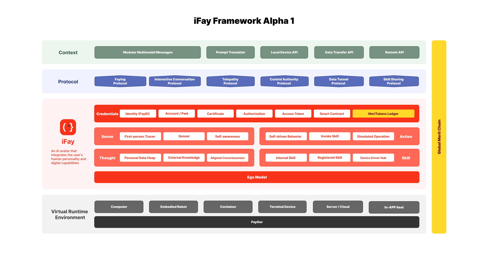
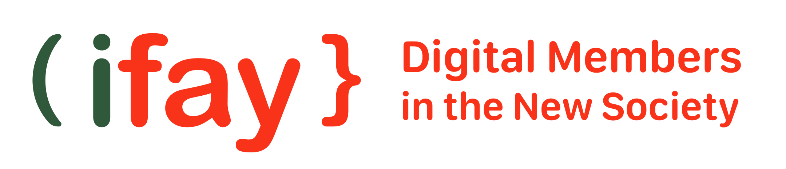

# iFay 프레임워크의 위치

본 장은 두 가지 질문에만 답합니다: iFay 프레임워크는 대략 어떤 모습인가? Faying Protocol 은 그 안에서 어떤 위치에 있는가?

iFay 프레임워크 자체는 커버 범위가 넓고, 구성 요소가 많으며, 어느 곳을 조금만 펼쳐도 필드, 프로토콜, 메시지 형식 등 구체적인 기술 디테일로 들어가게 됩니다. 본 저장소의 세 부류 자산——청사진, 프로토콜 규범, schema——은 Faying Protocol 한 항목만을 담아냅니다. iFay 프로토콜 군에서 Faying Protocol 외의 모든 구성원은 일률적으로 [ifay.ai](https://ifay.ai) 로의 링크 방식으로 인용되며, 본 저장소에서는 다시 서술하지도, 다시 쓰지도, 파생시키지도 않습니다.

## iFay 프레임워크의 윤곽

[ifay.ai](https://ifay.ai) 의 전체 설계에 따르면, iFay 프레임워크는 대략 4계층 구조로 이해할 수 있습니다.

**실체 계층** 은 프로토콜의 제약을 받는 두 부류의 지능 실체를 포함합니다. **iFay**（Individual Fay）는 한 명의 구체적인 Human Prime 에 대등하게 강제 마운트됩니다——이 귀속을 떠나면 더 이상 iFay 가 아닙니다. **coFay** 는 공유형 Fay 이며, 법적 책임 부담 능력을 가진 개인 또는 조직에 명확히 귀속될 때에만 운영이 허용됩니다. iFay 든 coFay 든, 본 청사진이 다루는 Faying Protocol 은 그것들을 동등하게 제약합니다: 귀속이 일단 실효되면, Fay 는 멈춰야 합니다.

**핵심 컴포넌트** 는 각 Fay 실체 내부에서 분리할 수 없는 몇 개의 부품을 포함합니다. **FayID** 는 Fay 의 통일된 유일 신원 식별자이며, 어떤 감호 관계에 진입하든 그 신원의 기초입니다. **Ego** 는 특정 개인 또는 역할 profile 과 정렬되는 베이스라인 패러다임이며, 가치 지향, 관심 선호, 습관, 인지 및 기능 경계, 권한 경계, 업무 스타일 등 차원에서 Fay 의 자율 행위 공간을 제약합니다. Ego 는 대형 AGI 모델이 아니라, 한 부의 "인격화된 경계"입니다. **Runtime** 은 Fay 의 가상 런타임이며, iFay 와 coFay 가 서로 다른 단말, 운영체제, 임베디드 응용 시나리오에서 호환적으로 작동할 수 있도록 합니다. FayID 와 Ego 는 Faying Protocol 이 작동할 수 있게 하는 두 가지 전제 조건입니다——전자는 신원 귀속을 담지하고, 후자는 행위 경계를 담지합니다.

**프로토콜 군** 은 iFay 가 세계와 연결, 감지, 협업하는 일련의 프로토콜을 포함합니다. 본 청사진의 주제인 **Faying Protocol** 외에도 최소한 다음을 포함합니다: 단말 제어 관련의 양방향 전송 프로토콜, 인간 사용자 인터페이스 친화적 UI 프로토콜, iFay 와 coFay 간의 UI 번역 계층을 제거한 의미론적 통신 프로토콜, 클라우드 능력의 브로드캐스트 및 구독 프로토콜, 그리고 향후 추가될 수 있는 기타 구성원. 이러한 프로토콜 군 구성원의 기술 디테일은 [ifay.ai](https://ifay.ai) 로 가시고, 본 저장소에서는 수록하지 않습니다.

**가치 구조** 는 새로운 노동 구조와 가치 분배 모델에 대응합니다. 이 계층은 인간 노동의 퇴장, 지식의 평탄화, 보편적 생존 보장, 새로운 가치 창출, 새로운 사회 계층 분화 등 체계적 변화를 포함하며, MeriToken 등 메커니즘을 가치 측정의 담지체로 둡니다. 이는 iFay 프레임워크의 원경 배경판이며, Faying Protocol 프로토콜 규범에 직접 떨어지지 않습니다. 자세한 것은 [ifay.ai](https://ifay.ai) 를 보시기 바랍니다.

## Faying Protocol 의 그 안에서의 위치

위의 4계층을 함께 놓고 보면, Faying Protocol 의 iFay 프레임워크 안 위치는 이렇게 정확히 고정될 수 있습니다:

> **Faying Protocol 은 "실체 계층"과 "핵심 컴포넌트"의 위에 있으며, 프로토콜 군 안에서 "수용, 감호, 위임 통제" 의미론을 전담하는 하위 프로토콜입니다. 이는 "FayID 가 어떤 Human Prime 에 귀속되는지"라는 근본 문제를, 구축・유지・철회 가능한 일군의 연결 상태와 동작으로 전환합니다.**

Fay 의 능력 정의가 아니므로, Fay 가 무엇을 할 수 있는지를 규정하지 않습니다. Fay 의 행동 지침이 아니므로, Fay 가 어떻게 해야 하는지를 규정하지 않습니다. 단지 한 가지 질문에만 답합니다:

> **이 순간 이 Fay 의 행동, 누구의 책임인가?**

바로 그렇기에, Faying Protocol 은 iFay 프레임워크에서 "가장 화려한" 프로토콜도 아니고, "가장 깊이 있는" 프로토콜도 아니지만, 가장 건너뛸 수 없는 그 하나입니다. 이것이 일단 부재하면, iFay 프레임워크 전체는 즉시 평범한 Agent 생태로 퇴화하여, 제 1 장에서 묘사한 책임 공백을 사회에 들여놓게 됩니다.

## 본 저장소와 iFay 프레임워크의 경계

```
                 +-------------------+
                 |   ifay.ai 전경    |
                 |  iFay 프레임워크 4계층 |
                 +-------------------+
                          │
                          │  본 저장소는 그중 한 구성원을 펼침
                          ▼
            +---------------------------+
            |   Faying Protocol 프로젝트  |
            |   （본 저장소의 모든 자산）  |
            +---------------------------+
                          │
            ┌─────────────┼──────────────┐
            ▼             ▼              ▼
        청사진         프로토콜 규범       schema
   docs/{lang}/    docs/{lang}/         schema/
    blueprint/    specification/       …（본기 미배포）
   （본 spec）   （후속 독립 spec）
```

본 저장소의 세 부류 자산은 모두 Faying Protocol 한 항목만을 담아냅니다. iFay 프레임워크의 다른 구성원에 대한 깊이 있는 펼침은 어떤 것도 본 저장소의 범위에 속하지 않으며, 직접 [ifay.ai](https://ifay.ai) 를 방문해 주시기 바랍니다.




