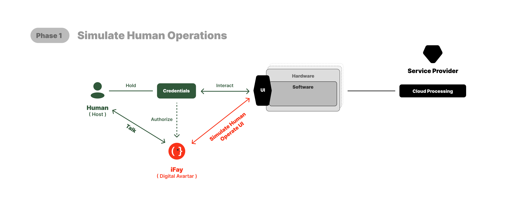
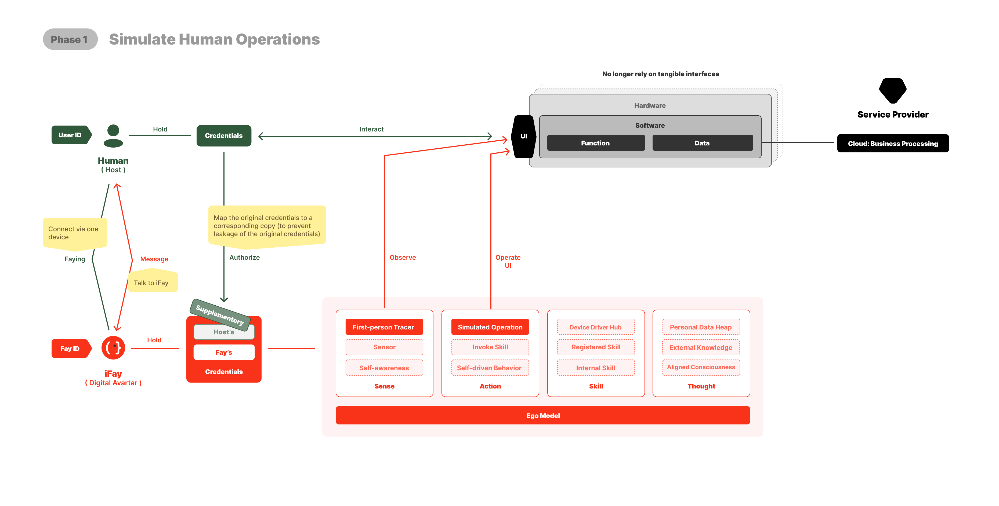

# Phase 1: Human Prime ↔ iFay

Phase 1 은 Faying Protocol 의 첫 번째 초석입니다: "Human Prime ↔ iFay"라는 가장 기초적인 감호 관계를 구축하고, 그것이 임의의 단말, 임의의 응용에서 충실하게 표현되고 지속적으로 유지될 수 있도록 합니다.

이 단계는 커버리지의 너비를 추구하지 않고, 깊이의 자기 일관성을 추구합니다: Phase 1 이 착지된 후에는, 임의의 iFay 가 어느 장치에, 어느 운영체제에, 어느 응용 컨테이너에서 작동하든, 두 가지 질문에 명확히 답할 수 있습니다——"나는 이 순간 Faying State 에 있는가?" "그렇다면, 나는 누구의 책임인가?"

이는 Faying Protocol 진화 전체에서 최소 사용 가능한 형태입니다. 이후의 Phase 2 부터 Phase 5 까지는 모두 Phase 1 위에 세워집니다: Phase 1 이 성립하지 않으면, 후속 확장은 디딜 곳이 없습니다.

## 커버리지 범위

Phase 1 은 한 부류의 관계만을 커버합니다:

> **Human Prime ↔ iFay**

관계의 책임 측은 어떤 구체적인 Human Prime（휴먼 프라임）이고; 관계의 다른 측은 그 Human Prime 의 어떤 iFay 이며; 관계의 내용은 iFay 가 그 Human Prime 의 감호 아래에서 디지털 행동을 펼치는 것입니다.

Phase 1 은 "Human Prime ↔ 단말" 또는 "Human Prime ↔ 소프트웨어 응용"을 직접 커버하지 않습니다. 어떤 드론, 어떤 가정용 로봇, 어떤 기업 프로세스 응용이 Faying 관계에 진입할 때, Phase 1 이 요구하는 표현 방식은:

> **그 단말 / 그 소프트웨어 응용은 대응하는 Human Prime 의 iFay 를 통해 Faying State 에 진입합니다**, 그것이 Human Prime 과 직접 Faying 관계를 구축하는 것이 아닙니다.

이 표현 방식은 의도적인 것입니다. iFay 는 Phase 1 에서 감호 계약을 받아낼 수 있는 유일하게 신뢰되는 실체 형태입니다. "드론 ↔ Jack"을 "드론이 Jack 의 iFay 를 통해 수용 상태에 진입"으로 이해함으로써, Phase 1 의 책임 사슬이 항상 간결하고 명확하게 유지되도록 하며, "다단 직접 Faying"의 복잡성을 미리 도입하는 것을 피합니다.

## 세 가지 핵심 의제

커버리지 범위가 엄격하게 "Human Prime ↔ iFay"로 한정되는 전제 아래, Phase 1 은 세 가지 핵심 의제를 해결해야 합니다.

**구축**——Faying Action 이 어떻게 Human Prime 에 의해 명시적으로 발기되고, 증인되며, 기록되어, iFay 를 Faying State 로 밀어넣는가. 이 의제는 제 12 장（Faying 이중 의미론）에서 펼쳐집니다.

**유지**——Faying State 가 iFay 의 전체 작업 수명 주기에서 어떻게 지속적으로 보정되는가. 매 시각 여전히 성립함을 보장하면서, 일단 더 이상 성립하지 않으면 즉시 퇴출함도 보장해야 합니다. 이 의제는 제 13 장（Rogue Fay 와 책임 귀속）의 9개 트리거 조건에 대응합니다.

**퇴출**——Faying State 퇴출 후, iFay 가 어떻게 Rogue Fay 로 전환되어 A/B/C 세 차원의 최소 행위 집합만 유지하고, D 차원의 모든 외부 행동을 금지하는가. 이 의제는 제 13 장의 A/B/C/D 4차원 규칙에 대응합니다.

이 세 의제는 Phase 1 의 "고급 기능"이 아니라, Phase 1 의 모든 내용입니다. 이들이 자기 일관적으로 착지하기 전에는, Phase 1 은 완성된 것으로 간주되지 않습니다. Phase 1 의 범위가 의도적으로 작게 설정된 것은, 이어지는 Phase 2 부터 Phase 5 까지가 이미 성립된 계약 토양 위에서 확장을 펼치게 하기 위함이며, 동시에 기초 형태와 씨름하지 않도록 하기 위함입니다.

