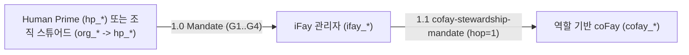

## §1 개요 및 위상

본 규격은 **Faying Protocol/1.1 (`coFay` Delegated Stewardship Profile, coFay 위임 스튜어드십 확장 프로파일)** 을 정의한다. 본 규격은 `Faying Protocol/1.0` §1.7.2의 `MINOR` 하위 호환 증보 규칙을 엄격히 준수하며, `Faying Protocol/1.0` (`2025-10-25` 확정판 및 `schemas/fap-1.0.cddl`)의 모든 메시지·상태 머신·오류 코드를 변경하지 않는다. `1.0`만 지원하는 피어는 §1.7.3에 따라 `Faying Protocol/1.0`으로 협상하거나 인식하지 못하는 선택적 확장을 안전하게 무시한다.

iFay 생태계(`Fay = iFay + coFay`)에서 `iFay`는 단일 Human Prime(인간 프라임)에 결합되는 반면, `coFay`는 Role Charter(역할 헌장)에 따라 지속 운영되는 역할 기반 실리콘 디지털 생명으로 개인 인격 복제 패키지를 갖지 않는다. "**모든 실리콘 개체의 대외 행위는 반드시 구체적인 Human Prime에게 유일하게 귀속되어야 한다**"는 핵심 윤리 원칙을 지키기 위해, 본 프로파일은 `Human Prime ↔ iFay` 권한 사슬 끝에 암호학적으로 검증되는 `iFay Manager → coFay` 위임 스튜어드십 및 원자적 이중 서명 이전 계약을 추가한다.

### §1.1 규범적 키워드 선언 (RFC 2119 & RFC 8174)

본 문서의 영문 대문자 키워드 `MUST`, `MUST NOT`, `REQUIRED`, `SHALL`, `SHALL NOT`, `SHOULD`, `SHOULD NOT`, `RECOMMENDED`, `NOT RECOMMENDED`, `MAY`, `OPTIONAL`은 [BCP 14](https://www.rfc-editor.org/info/bcp14) ([RFC 2119](https://www.rfc-editor.org/rfc/rfc2119) 및 [RFC 8174](https://www.rfc-editor.org/rfc/rfc8174))에 따라 해석된다. 다국어 번역본 간 해석 차이가 발생할 경우 간체 중국어(`zh-CN`) 원문과 `schemas/fap-1.1-cofay.cddl`을 권위 기준으로 삼는다.

---

## §2 3계층 책임 귀속 사슬

`coFay`는 루트 Mandate를 자체 발급해서는 안 되며(`MUST NOT`), Human Prime의 책임에서 분리된 익명 주체에 결합되어서도 안 된다(`MUST NOT`). 모든 유효한 `cofay-stewardship-mandate`는 다음의 3계층 책임 사슬을 형성해야 한다(`MUST`):

1. **최종 책임 앵커 계층 (`steward_entity` + `accountable_human_prime`)**: 개인 스튜어드(`hp_*`)인 경우 `accountable_human_prime`과 일치해야 하며, 조직 스튜어드(`org_*`)인 경우 최종 책임을 지는 `accountable_human_prime`(`hp_*`)을 명시해야 한다(누락 시 `1010 E_HUMAN_WITNESS_REQUIRED`로 거부).
2. **관리 에이전트 계층 (`manager_fay_id`)**: 유효한 `Faying Protocol/1.0` Mandate를 보유한 `ifay_*`여야 하며, `cofay_*`는 상위 발급자가 될 수 없다(`MUST NOT`).
3. **실행 주체 계층 (`subject_cofay_id`)**: `charter_id`의 제약을 받는 `cofay_*` 개체이며, 적합성 검증은 `iFACTS`가 아닌 `coFACTS`가 담당한다.

---

## §3 4대 비증폭 보안 불변식 (Normative)

검증기는 `cofay-stewardship-mandate` 평가 시 다음 네 가지 불변식을 순서대로 강제해야 한다(`MUST`):

1. **상위 `G0` 및 철회 연쇄 안전 정지 (`safe-state-halt`)**: 상위 Human Prime 또는 `iFay` 관리자가 `G0`(`EmergencyOverride`) 또는 `Revoked` 상태일 때 `coFay`는 즉시 `safe-state-halt`로 전환하고 `1024 E_UPSTREAM_EMERGENCY_HALT`를 반환해야 하며, 캐시된 권한으로 호스트 단말(Host)이나 외부 스킬을 호출해서는 안 된다(`MUST NOT`).
2. **단일 홉 상한 (Single-Hop Ceiling)**: `hop_count == 1` 및 `max_stewardship_hops == 1`이어야 하며, 위반 시 `1023 E_STEWARDSHIP_HOP_LIMIT`를 반환한다. `coFay`의 하위 재위임은 엄격히 금지된다(`MUST NOT`).
3. **권한 등급 비증폭 (Grade Non-Amplification)**: `grade <= manager_grade`(`0..4`)를 만족해야 하며, 초과 시 `1021 E_GRADE_AMPLIFICATION`으로 거부한다.
4. **범위 및 시간 창 이중 수렴**: `scope`(`domains`, `actions`, 선택적 `terminals` 및 예산 한도)는 `charter_scope`와 `manager_scope` 모두의 부분집합이어야 하며, `[not_before, not_after]`는 `[manager_not_before, manager_not_after]` 내부에 포함되고 평가 시각을 포함해야 한다(위반 시 `1022 E_SCOPE_ESCAPE`).

---

## §4 원자적 이중 서명 스튜어드십 이전 (`cofay-transfer`)

담당 순환이나 조직 개편에 따른 스튜어드십 이전은 일방적 탈취나 책임 공백을 막기 위해 `cofay-transfer-authorization`을 통해 원자적으로 수행되어야 한다(`MUST`):

- **도메인 분리 JCS 서명 입력**: 이전 주체(`from_steward`)와 인수 주체(`to_steward`) 모두 서명 필드를 제거한 객체의 RFC 8785 JCS 정규화 문자열 앞에 `"ifay.faying.cofay-transfer.v1:"`을 결합한 바이트열에 대해 유효한 암호 서명을 제공해야 한다(`MUST`).
- **원자적 승인 조건**: 자기 자신으로의 이전(`from_steward == to_steward`), 만료된 시간 창, 잘못된 주체 ID는 `1026 E_TRANSFER_WINDOW_OR_PARTY_INVALID`로 거부하며, 어느 한쪽이라도 서명이 누락되거나 검증에 실패하면 전체 이전을 롤백하고 `1025 E_TRANSFER_DUAL_SIG_REQUIRED`를 반환한다. 이전 이후에도 GMChain 상의 이력은 연속적으로 추적 가능하며, MeriToken(`μ`)은 비화폐적 평판 단위 속성을 엄격히 유지한다.

---

## §5 권위 스키마, 오류 코드 및 적합성 테스트 벡터

| 코드 | 오류 이름 | 발생 조건 | 런타임 동작 |
| --- | --- | --- | --- |
| `1010` | `E_HUMAN_WITNESS_REQUIRED` | 유효한 `accountable_human_prime` 앵커 누락 | 위임 거부 |
| `1021` | `E_GRADE_AMPLIFICATION` | `grade > manager_grade` 또는 등급 범위 초과 | 위임 거부 |
| `1022` | `E_SCOPE_ESCAPE` | `scope` 또는 유효 기간이 `charter_scope ∩ manager_scope`를 벗어남 | 위임 거부 |
| `1023` | `E_STEWARDSHIP_HOP_LIMIT` | `hop_count != 1` 또는 비-`ifay_*` 발급자의 재위임 | 위임 거부 |
| `1024` | `E_UPSTREAM_EMERGENCY_HALT` | 상위 상태가 `G0` 또는 `Revoked` | `safe-state-halt` 진입 |
| `1025` | `E_TRANSFER_DUAL_SIG_REQUIRED` | 양측 스튜어드 중 어느 한쪽의 유효 서명 누락/실패 | 이전 롤백 |
| `1026` | `E_TRANSFER_WINDOW_OR_PARTY_INVALID` | 자기 이전, 유효 기간 만료 또는 당사자 ID 오류 | 이전 거부 |

- **권위 CDDL 스키마**: `schemas/fap-1.1-cofay.cddl`
- **JSON Schema 뷰**: `schemas/fap-1.1-cofay.json`
- **다중 언어 테스트 벡터**: `vectors/cofay-stewardship-v1.1.json` (`V01`–`V10` 총 10건, TypeScript 및 Rust 참조 구현 교차 검증 완료).
