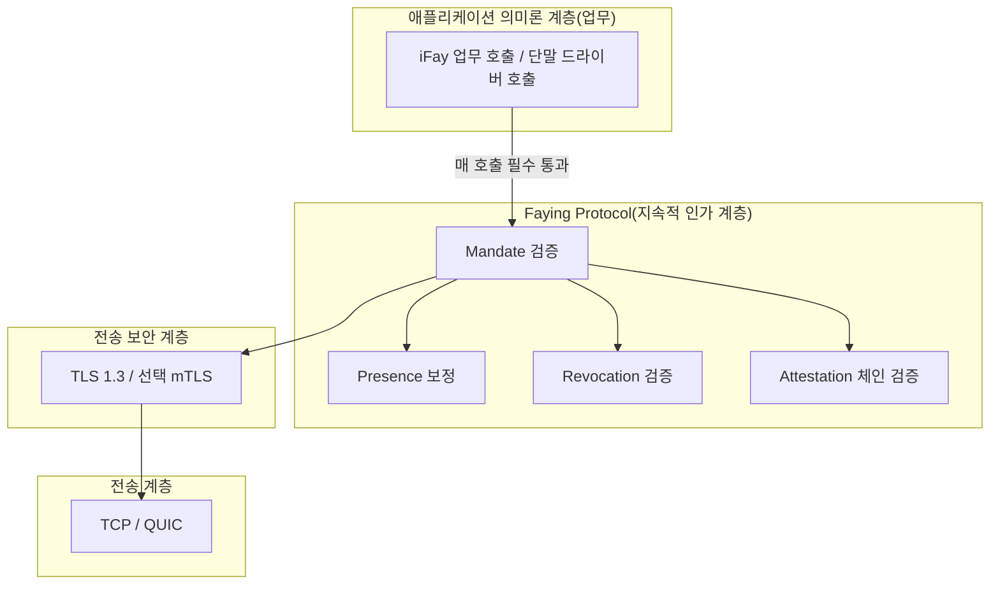
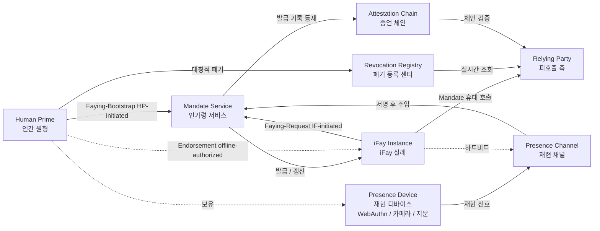
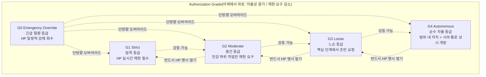

> 프로토콜 본문 내비게이션: [장 목차](./README.md) ｜ 이전 장 [§1 개요](./01-개요.md) ｜ 다음 장 [§3 구성요소와 인터페이스](./03-구성요소와인터페이스.md)

## §2 Architecture

이 장은 아키텍처 관점에서 Faying Protocol이 어떤 모습인지 설명한다.

- **§2.1 프로토콜 스택 위치**: TLS 1.3 위, 업무 의미론 아래라는 Faying Protocol의 계층적 위치를 그려내고, "iFay의 모든 대외 행위는 Mandate 검증 게이트를 반드시 통과한다"는 하드 제약을 명확히 한다.
- **§2.2 엔티티 관계**: 프로토콜이 다루는 7종 엔티티와 그 책임 경계를 나열하고, 양방향 Faying 엣지(HP-initiated / IF-initiated)와 오프라인 배서 엣지(Endorsed Mandate)를 제시한다.
- **§2.3 인가 등급 계층**: G0–G4 다섯 단계 등급을 자율성 / 재현 요구 두 차원에서의 상대 위치로 보여주어 등급 스펙트럼과 전환 방향을 드러낸다.
- **§2.4 핵심 상호작용 시퀀스**: BOOTSTRAP(Phase A0 IF-initiated 경로 포함) + Continuous Verification + Action + Symmetric Revocation을 하나의 종단 간 시퀀스로 엮어 이후 장(§5 메시지 / §7 등급 / §8 생명주기 / §10 오류 처리)의 시각적 앵커로 삼는다.
- **§2.5 설계 원칙**: 프로토콜 계층이 항상 따라야 하는 6가지 설계 원칙(Default-Deny / Least-Privilege / Continuous-Verification / Auditable-by-Construction / Human-Override / Graceful-Degradation)을 진술한다.

> **EARS 추적 설명**: 이 장에서는 각 아키텍처 수준 하드 제약 뒤에 `Trace:`로 대응하는 EARS 하위 조항 번호(출처는 본 규격의 요구사항 베이스라인)를 나열하며, 형식은 `R<requirement>.<criterion>.<clause>`다.
>
> **용어 정렬**: 이 장에 등장하는 엔티티명(Human Prime / iFay Instance / Presence Device / Mandate Service / Presence Channel / Attestation Chain / Revocation Registry / Relying Party 등)은 부록 A 용어 정렬 퀵 레퍼런스 표와 완전히 일치한다. 이 장과 부록 A의 용어에 모호함이 생기면 **부록 A를 정본으로 한다**.

### §2.1 프로토콜 스택 위치



**설계 입장**: Faying Protocol은 TLS를 대체하지 않고 OAuth를 다시 발명하지도 않는다. TLS 위, 업무 의미론 아래에서 **iFay의 모든 대외 행위**가 Mandate 검증 게이트를 반드시 통과하도록 강제한다. Faying Protocol 게이트를 우회하는 모든 대외 호출은 Rogue Action으로 간주되며, 전송 계층 위·업무 계층 아래의 미들웨어에서 반드시 거부되어야 한다.

**프로토콜 계층 하드 제약**:

- **A-Stack-1(매 호출 4요소 검증 필수)**: Relying Party는 iFay Instance로부터의 임의의 대외 호출을 받아들이기 전에 Mandate 검증 / Presence 보정 / Revocation 검증 / Attestation 체인 검증 네 가지를 순차적으로 완료해야 한다. 어느 하나라도 누락되면 게이트를 우회한 Rogue Action으로 간주하여 Default-Deny에 따라 거부한다.
  - **Trace**: `R2.1.1`(Mandate 없으면 기본 거부), `R2.1.2`(scope 검증), `R2.1.3`(필드 누락 즉시 거부), `R2.1.4`(RR 도달 불가 시 Default-Deny에 따라 거부).
- **A-Stack-2(채널과 인가 계층의 책임 분리)**: 채널 기밀성과 상대방 신원은 TLS 1.3 / 선택적 mTLS가 담당하며 Faying Protocol은 이를 다시 하지 않는다. Faying Protocol은 "지속적 인가" 의미론만 담당하고, TLS와 겹치는 핸드셰이크나 키 협상 책임을 프로토콜 계층에 도입하지 않는다.

### §2.2 엔티티 관계



**양방향 Faying 엣지 설명**:

- `HP --> MS(Faying-Bootstrap, HP-initiated)`: Human Prime이 능동적으로 Faying(수립 또는 조정)을 발기하며 BOOTSTRAP 통로를 탄다(§5.3.1 참조).
- `IF --> MS(Faying-Request, IF-initiated)`: iFay Instance가 능동적으로 Human Prime에게 Faying을 요청하며, 먼저 Mandate Service를 거쳐 전달되고 이후 Human Prime이 BOOTSTRAP 응답으로 승인하여 발효시킨다(§2.4 Phase A0, §5.3.6 FAYING_REQUEST 참조).
- `HP -. Endorsement (offline-authorized) .-> IF`: Endorsed Mandate의 배서 선언은 오프라인 사전 인가 의미론에 속한다. HP는 BOOTSTRAP 단계에서 `endorsed_scope` / `endorsed_grade` / `endorsed_lifetime`을 명시적으로 한 번에 Mandate에 담아, iFay가 물리적 실연(失聯) 기간에도 한정된 범위 안에서 자율적으로 행동할 수 있게 한다. 이 엣지는 "런타임 통신"이 아니라 "Mandate 필드가 담은 사전 인수"다(§4.1 `endorsement` 필드, §7.5 Endorsement Grades 참조).

**엔티티 책임**:

| 엔티티 | 프로토콜 계층 책임 | 책임 / 권한 경계 |
| --- | --- | --- |
| **Human Prime(HP)** | Faying Action을 발기할 수 있는 유일한 엔티티; 폐기권을 가진 유일한 엔티티; 최종 책임을 떠안는 유일한 주체 | 어느 시점에서든 iFay의 대외 행위는 한 명의 HP에게 모호함 없이 귀속될 수 있다; 어떤 Faying 상태 변화든 HP가 명확하고 기만당하지 않으며 검증 가능한 승인 확인을 내놓아야 한다 |
| **iFay Instance(IF)** | 감호받는 대리 엔티티로 FayID로 고유 식별; 매 대외 호출 시 유효한 Mandate를 제시해야 함; HP에게 능동적으로 Faying(FAYING_REQUEST)을 요청하거나 Faying 단절을 요청할 수 있음 | 자신의 Mandate를 폐기할 권한이 없음; grade 승급을 자율적으로 발기할 합법 경로가 없음; FAYING_REQUEST의 발효는 HP의 명확한 승인 확인을 전제로 함 |
| **Presence Device(PD)** | WebAuthn / FIDO2 자격증명, 생체 인식 능력을 담는 하드웨어; 재현 신호의 물리적 원천 | 각 Presence Signal은 PD가 서명하고 `nonce + produced_at + device_attestation`을 담아야 함; 신선도 창은 대응 Mandate의 `presence_req.max_staleness_ms`가 부여하며 신호가 자체적으로 갖지 않음 |
| **Mandate Service(MS)** | HP를 대표하여 Mandate를 발급 / 갱신 / 강등 / 폐기하는 논리 서비스 | "MS가 스스로 bootstrap을 결정"하거나 "MS가 HP를 대신해 Faying 승인 확인을 완료"하는 합법 경로가 없음; MS 도달 불가 시 Default-Deny로 수렴 |
| **Presence Channel(PC)** | PD에서 MS까지의 저지연·재전송 방지 재현 스트림; 동시에 §3.5 Liveness Channel의 하부 신호원 담당 | nonce 단일 소비; 대응 Mandate의 `presence_req.max_staleness_ms` 초과 시 stale로 간주; 동일 nonce는 `2 × max_message_lifetime` 안에서 최대 한 번만 수용 |
| **Attestation Chain(AC)** | HP → MS → IF → 파생 IF의 모든 발급 행위가 이루는 역추적 가능한 서명 체인 | 체인 위 각 노드는 부모 노드가 서명하고 타임스탬프가 부모 노드의 validity window 안에 있어야 함; 어느 노드라도 누락되거나 서명이 무효이면 전체 체인을 신뢰 불가로 간주 |
| **Revocation Registry(RR)** | 실시간 폐기 상태 서비스(OCSP 유사 단주기 폴링 + 능동 푸시 + 보수적 fallback) | 폐기 가시 지연 ≤ `RevocationVisibilityBudget`; RR 도달 불가하고 ≥ `StaleBudget`이면 RP가 반드시 거부("낙관적 통과" 불허) |
| **Relying Party(RP)** | iFay에 의해 호출되는 단말, 애플리케이션 또는 서비스 | 매 호출 시 4요소(Mandate / Presence / Attestation / Revocation)를 강제 검증, 어느 하나라도 통과하지 못하면 거부 |

**프로토콜 계층 하드 제약**:

- **A-Ent-1(책임 주체 유일성)**: RP가 받아들이는 임의의 대외 호출에서, 그 Mandate의 Attestation Chain 루트 노드는 정확히 한 명의 Human Prime에 대응한다. 다중 issuer가 공존하면 `E_PROTOCOL`로 거부한다.
  - **Trace**: `R1.1.1`(AC 루트 노드가 정확히 한 명의 HP에 대응), `R1.1.2`(다중 Mandate가 동시에 Active일 때 선택된 Mandate와 공존 Mandate의 issuer는 동일 HP여야 함), `R1.1.3`(issuer 불일치 시 `E_PROTOCOL`로 거부하고 AC에 기록 + HP 시야로 푸시).
- **A-Ent-2(Faying 없으면 Rogue Fay)**: iFay Instance의 어느 시점 행위 상태는 이진 집합 `{Faying State, Rogue Fay}`에 속한다. 제3의 상태도 없고 "Faying도 Rogue도 아닌" 회색지대도 없다.
  - **Trace**: `R1.1.4`(audit-log 5요소로 책임 주체 복원, 상태 이진성의 관측성을 함축; 이 하위 조항은 본 작업이 선언한 Requirement 집합 안에 속함).

### §2.3 인가 등급 계층



**핵심 규칙**:

- **강등**(G_ST → G_MO → G_LO → G_AU)은 Mandate 내장 규칙에 따라 프로토콜이 자동 트리거할 수 있다(예: 재현 신호 상실 → 더 엄격한 등급으로 자동 강등. 단, 재현 상실 → "더 엄격"은 G_AU → G_LO 같은 "역방향"을 의미함, §7 참조).
- **승급**(자율성이 더 높은 방향)은 반드시 HP가 새로운 Faying Action을 명시적으로 발기해야 하며, iFay나 MS가 자율적으로 승급하는 것은 허용되지 않는다.
- **G0 Emergency Override**는 언제든 HP가 일방적으로 발기할 수 있고, 현재 등급이 무엇이든 오버라이드하여 즉시 iFay를 Suspended로 밀어 넣고 수동 점검을 기다리게 한다.

**프로토콜 계층 하드 제약**:

- **A-Grade-1(승급 방향은 반드시 HP 입회 동반)**: GRADE_SWITCH의 `target_grade.autonomy > current_grade.autonomy`일 때, 요청은 검증 가능한 `human_witness`(기본 형태는 WebAuthn 사용자 재현 단언)를 반드시 담아야 한다. 누락되거나 서명 검증에 실패하면 일률적으로 `E_HUMAN_WITNESS_REQUIRED`.
  - **Trace**: `R6.1.1`(승급 방향은 반드시 HP 입회 동반), `R6.1.2`(누락 또는 서명 검증 실패 → `E_HUMAN_WITNESS_REQUIRED`).
- **A-Grade-2(재현 상실 방향은 단조롭게 조임)**: 재현 신호 상실 시 다음 상태 전이는 `Degraded(grade')` 또는 `Suspended`로 이동하며 `grade'.autonomy < current.autonomy`다. 원래 grade 유지 금지, 자율성이 더 높은 방향으로의 전환 금지.
  - **Trace**: `R5.2.1`(더 엄격한 grade'로 이전), `R5.2.2`(유지 안 함 / 역방향 낙관 안 함).
- **A-Grade-3(G0은 우선순위 최상위이며 HP만 발기 가능)**: G0 Emergency Override는 임의의 현재 grade와 임의의 현재 이벤트 큐 위에서 최상위 우선순위로 처리된다. HP만 명시적으로 발기할 수 있으며 IF / MS / SA가 발기한 G0은 일률적으로 `E_PROTOCOL`.
  - **Trace**: `R6.2.1`(G0 최상위 우선순위), `R6.2.4`(HP만 G0 발기 가능).

### §2.4 핵심 상호작용 시퀀스(Bootstrap + Heartbeat + Action)

```mermaid
sequenceDiagram
    autonumber
    participant HP as Human Prime
    participant PD as Presence Device
    participant MS as Mandate Service
    participant IF as iFay Instance
    participant RR as Revocation Registry
    participant RP as Relying Party

    Note over HP,RP: Phase A0 — iFay-Initiated Faying Request(선택, IF-initiated 경로)
    IF->>MS: FAYING_REQUEST { initiator=fay_id, target_human, proposed_scope, proposed_grade, reason }
    MS->>HP: Faying Request 전달(HP 시야 통로로 푸시)
    alt HP 동의
        HP->>PD: WebAuthn 사용자 재현 단언 트리거
        PD-->>HP: 서명 attestation
        HP->>MS: BOOTSTRAP(attestation 휴대; Phase A 진입)
    else HP 거부 또는 BootstrapTimeout 내 미승인
        MS-->>IF: FAYING_REQUEST_RESP { status=rejected | timeout }
        Note over IF: 어떤 Faying 상태 변화도 없음(§5.3.6 참조)
    end

    Note over HP,RP: Phase A — Bootstrapping(Faying Action, HP 입회로 발효)
    HP->>PD: WebAuthn 사용자 재현 단언 트리거
    PD-->>HP: 서명 attestation
    HP->>MS: BOOTSTRAP { fay_id, scope, grade, expiry, attestation, endorsement? }
    MS->>MS: attestation + HP 서명 검증
    MS->>IF: Mandate M1 발급(CBOR 주 / JSON 폴백)
    MS->>RR: M1 발급 기록 등재
    IF-->>HP: 상태 브로드캐스트: Faying State 진입

    Note over HP,RP: Phase B — Continuous Verification
    loop PresenceTTL마다(기본 30s, grade에 따라 조임)
        PD-->>MS: PRESENCE { signal_type, freshness, signature }
        MS-->>IF: PRESENCE-OK 또는 강등 / Suspend 트리거
    end

    Note over HP,RP: Phase C — iFay 대외 호출
    IF->>RP: 업무 요청 + Mandate M1 + Presence Token
    RP->>RR: REVOCATION-CHECK(M1.id)
    RR-->>RP: status=valid
    RP->>RP: 서명 / 범위 / 등급 / 재현 신선도 검증
    RP-->>IF: 업무 응답

    Note over HP,RP: Phase D — Symmetric Revocation
    HP->>MS: REVOKE(M1.id, reason)
    MS->>RR: 폐기 기록 기입(즉시 발효)
    MS-->>IF: REVOKE-NOTIFY
    RR-->>RP: 폐기 푸시(푸시 + 풀 이중 트랙)
    IF->>IF: 즉시 D 차원 행동 중지 → Rogue Fay로 복귀
```

**Phase A0 핵심 제약**:

- iFay가 능동 발기한 FAYING_REQUEST는 Mandate를 직접 생성하지 않는다. MS는 전달자로서만 요청을 HP 시야 통로로 푸시한다.
- HP의 승인은 반드시 BOOTSTRAP 메시지 + 검증 가능한 attestation 형태로 나타나야 한다. "MS가 HP를 대신해 기본 동의"하는 합법 경로는 없다.
- HP가 `BootstrapTimeout`(기본 60s, 부록 B 참조) 내에 명확한 승인 확인을 내놓지 않으면, MS는 반드시 `FAYING_REQUEST_RESP { status=timeout }`을 반환하고 이벤트를 Attestation Chain에 기록한다. 동시에 해당 FAYING_REQUEST는 반드시 `E_FAYING_REQUEST_NOT_CONFIRMED`(오류 코드 1014) 형태로 기록되어야 한다.
- 자세한 내용은 §5.3.6 FAYING_REQUEST / FAYING_REQUEST_RESP 메시지 정의와 §5.4 오류 코드 1014 참조.

**프로토콜 계층 하드 제약**:

- **A-Seq-1(HP 입회는 대체 불가)**: Phase A0 / Phase A의 BOOTSTRAP은 검증 가능한 `human_witness`를 반드시 담아야 한다. IF / MS / SA가 HP를 대신해 Faying 승인 확인을 완료하는 합법 경로는 일절 없다.
  - **Trace**: `R1.3.1`(HP 능동 발기 시 검증 가능한 명확한 승인 확인 제시), `R1.3.2`(IF-initiated 경로는 HP 명확 승인 후에만 발효), `R1.3.5`(IF / MS / SA가 HP를 대신해 승인 확인을 완료하는 합법 경로를 일절 제공하지 않음).
- **A-Seq-2(IF-initiated 타임아웃은 상태 변화를 일으키지 않음)**: iFay가 능동 발기한 FAYING_REQUEST가 `BootstrapTimeout` 내에 HP의 명확한 승인을 얻지 못하고 만료되거나 거부되면 어떤 Faying 상태 변화도 일으키지 않는다. 이벤트는 발효 여부와 무관하게 Attestation Chain에 기록된다.
  - **Trace**: `R1.3.3`(`BootstrapTimeout` 내 미승인 시 거부하고 상태 변화 없음), `R1.3.4`(발효 여부와 무관하게 AC에 기록).
- **A-Seq-3(Phase D 대칭적 폐기)**: HP가 MS를 통해 발기한 REVOKE는 일단 publish되면, 이후 모든 RP의 query에 대해 `RevocationVisibilityBudget`(기본 1s)를 넘지 않는 시간 내에 반드시 `revoked`를 반환한다. MS는 구독 중인 RP에게 동기적으로 REVOKE 통지를 푸시한다.
  - **Trace**: `R4.1.1`(각 BOOTSTRAP 입구에 대응하여 적어도 동등한 도달성의 REVOKE 입구 존재), `R4.1.2`(REVOKE 경로 깊이 ≤ BOOTSTRAP 경로 깊이), `R4.1.3`(REVOKE 입구 인증 강도가 BOOTSTRAP보다 엄격하지 않음).
- **A-Seq-4(HP 시야 통로 필달)**: Phase A0 전달, Phase A 상태 브로드캐스트, Phase D REVOKE 통지는 반드시 HP 시야 통로를 통해 발행되어야 한다. 어떤 상태 전이든 전이 완료 후 HP에게 가시화되어야 한다.
  - **Trace**: `R3.3.1`(Mandate 상태 전이를 전이 완료 후 HP 시야 통로로 발행).

### §2.5 설계 원칙

아래 표는 Faying Protocol이 프로토콜 계층에서 항상 따라야 하는 6가지 설계 원칙을 제시한다. 각 원칙은 **프로토콜 계층 구현 형태**와 **대응 EARS 하위 조항** 두 열을 제시하여, 원칙이 구호 수준에 머무르지 않도록 보장한다.

| 원칙 | 프로토콜 계층 구현 | 대응 EARS 하위 조항 |
| --- | --- | --- |
| **Default-Deny** | Mandate 없으면 일률 거부; Mandate 범위 / 등급 / 시간 창 중 어느 하나라도 누락되면 거부; RR 도달 불가하고 ≥ `StaleBudget`이면 Default-Deny에 따라 거부 | `R2.1.1`, `R2.1.2`, `R2.1.3`, `R2.1.4` |
| **Least-Privilege** | Mandate는 `scope`를 명시적으로 선언해야 함, "전권 위임" 금지; `scope.actions`는 프로토콜 계층에서 와일드카드 / 접두사 매칭 사용 금지; 파생 시 `child.scope ⊆ parent.scope` 엄격 수렴 | `R2.1.2`, `R2.1.3` |
| **Continuous-Verification** | 매 호출 시 Presence + Revocation 이중 검증 필수, 신뢰 캐시 안 함; `PresenceState.last_freshness ≥ now − max_staleness_ms`가 호출 수용의 전제 조건; 하트비트 폴링 주기가 아니라 신선도를 통과 근거로 삼음 | `R5.1.1`, `R5.1.2`, `R5.1.3`, `R5.1.4` |
| **Auditable-by-Construction** | 모든 Faying Action / Revoke / Grade-Switch / Delegate는 반드시 Attestation Chain에 들어가야 함; 어떤 감사 이벤트든 체인에 들어가지 않으면 신뢰 불가로 간주; HP 시야 통로 필달 | `R3.3.1`(HP 시야 통로 필달) |
| **Human-Override** | G0 Emergency Override는 항상 최상위 우선순위; HP만 G0 발기 가능; IF / MS / SA가 발기한 G0은 일률 `E_PROTOCOL`; G0 처리 후 대상 Mandate는 반드시 Suspended | `R6.2.1`, `R6.2.2`, `R6.2.3`, `R6.2.4` |
| **Graceful-Degradation** | 재현 신호 상실 → 더 엄격한 등급으로 자동 강등, "역방향 낙관" 금지; G4 하트비트 상실 즉시 → Suspended; `Degraded`가 `MaxDegradedDuration` 초과 시 반드시 → Suspended | `R5.2.1`, `R5.2.2`, `R5.2.3`, `R5.2.4` |

**원칙 간 상호 관계**:

- **Default-Deny ∧ Least-Privilege**가 함께 "통과 집합"을 수렴한다. Default-Deny는 기본 상태를 "거부"로 수렴하고, Least-Privilege는 허용 집합을 "명시적 scope ∩ 명시적 grade ∩ 명시적 presence_req"의 최소 삼중쌍으로 수렴한다. 둘은 Faying Protocol의 "보안 베이스라인"을 이룬다.
- **Continuous-Verification ∧ Graceful-Degradation**이 함께 "런타임 등급 스펙트럼 단조성"을 유지한다. 전자는 매 호출이 "지금도 신선한" 사실에 기반하게 하고, 후자는 재현 상실 방향에서 grade가 항상 더 엄격한 방향으로 조여지고 역방향으로 가지 않도록 보장한다.
- **Auditable-by-Construction ∧ Human-Override**가 함께 "사후 복원 + 실시간 탈환"을 보장한다. 전자는 임의의 Faying Action / Revoke / Grade-Switch를 독립적 제3자가 복원할 수 있게 하고, 후자는 HP가 어느 시점에서든 G0 형태로 제어권을 회수할 수 있게 한다.

> **원칙은 약화될 수 없다**: 위 6가지 설계 원칙은 프로토콜 본문의 **규격 수준 약속**이다. 어떤 참조 구현 / SDK / 상호운용 컴플라이언스 테스트 스위트도 "엔지니어링 편의"를 이유로 이 중 어느 원칙도 약화해서는 안 된다. 향후 버전에서 조정이 필요하면 반드시 프로토콜 위원회가 §11 Open Questions에 기술된 결의 절차에 따라 승인하고, 새 버전 번호(더 이상 Faying Protocol/1.0이 아닌)로 배포해야 한다.
