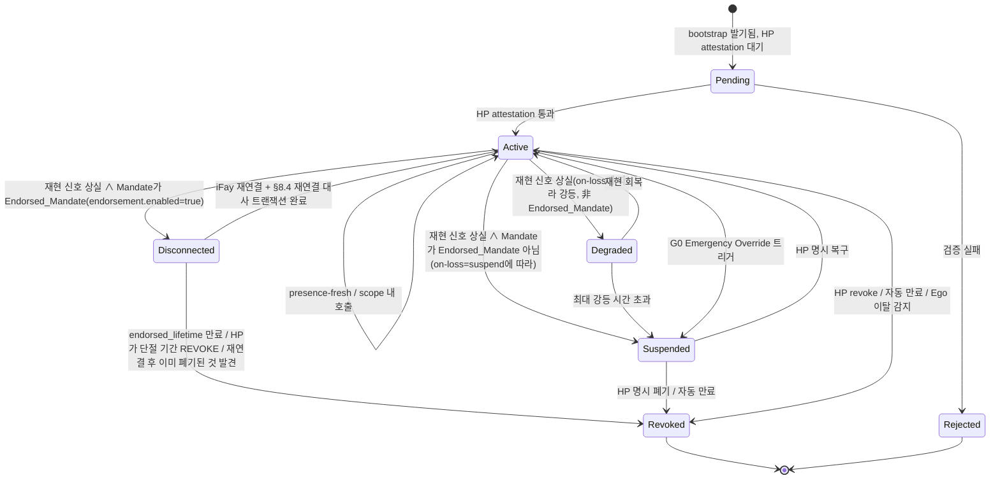

> 프로토콜 본문 내비게이션: [장 목차](./README.md) ｜ 이전 장 [§3 구성요소와 인터페이스](./03-구성요소와인터페이스.md) ｜ 다음 장 [§5 프로토콜 메시지](./05-프로토콜메시지.md)

## §4 Data Models

이 장은 프로토콜의 핵심 데이터 모델을 정의하며 세 절로 나눈다.

- **§4.1 TypeScript 사람이 읽는 뷰(Non-normative)** — 프로토콜 위원회, SDK 구현자, 검토자를 위한 사람이 읽는 골격.
- **§4.2 CDDL 권위 정의(Normative)** — CBOR 주 형식의 권위 schema, 모든 와이어 바이트는 이 절을 정본으로 한다.
- **§4.3 Mandate 상태 기계** — `Disconnected` 상태, 전이 트리거 조건 매트릭스, 「Mandate 상태 ↔ Fay 행위 상태」 매핑 표 포함.

> **권위성 선언**: §4.1의 TypeScript 뷰와 §4.2의 CDDL이 불일치하면 **§4.2 CDDL을 정본으로 한다**. §4.1은 사람이 읽기 위한 것일 뿐 와이어 서명 입력에 들어가지 않는다. §4.2의 Deterministic CBOR 인코딩이 서명 입력의 유일한 출처다(§6 Cryptography 참조).
>
> **Endorsement 필드 변조 불가능성**: `endorsement` 하위 구조는 `mandate`의 필드로서 서명 입력에 들어가며, 그 어느 하위 필드(`enabled` / `endorsed-scope` / `endorsed-grade` / `endorsed-lifetime-ms` / `offline-revocation-policy`)에 대한 사후 변조도 Mandate 서명 검증을 깨뜨린다(Requirement 11.1 제3조, §6.3과 일치).

### §4.1 핵심 타입(TypeScript 뷰, Non-normative)

아래 TypeScript 블록은 FayID / Grade / Scope / Mandate / Endorsement / PresenceRequirement / PresenceSignal / Attestation 등 핵심 타입을 사람이 읽는 형태로 제시한다. 권위 정의는 §4.2 참조.

```typescript
type FayID = string          // "fay:01HX...Z" 형태의 ULID-like
type HumanPrimeID = string   // "hp:..." 형태(WebAuthn credentialId에 앵커링 가능)
type MandateID = string      // ULID
type Nonce = Uint8Array      // 16 bytes random

/** 인가 등급 */
enum Grade {
  EmergencyOverride = 0,  // G0
  Strict            = 1,  // G1
  Moderate          = 2,  // G2
  Loose             = 3,  // G3
  Autonomous        = 4   // G4
}

/** 인가 범위(least-privilege) */
interface Scope {
  domains:    string[]    // 접근 허용 자원 도메인(URL pattern / SPIFFE-ID-like)
  actions:    string[]    // 허용 동작(read / write / control:drone:takeoff …)
  terminals?: string[]    // 허용 단말 집합(Phase 2 파생용)
  budget?:   ResourceBudget
}

interface ResourceBudget {
  time_window:    [IsoTime, IsoTime]
  max_invocations?: number
  max_cost_units?:  number  // 추상 자원 단위(금액 / 추론량 / 트래픽 등)
}

/** Mandate(token 대체) */
interface Mandate {
  version:       "Faying Protocol/1.0"
  id:            MandateID
  issued_at:     IsoTime
  not_before:    IsoTime
  not_after:     IsoTime          // 반드시 유한: 무기한 Faying은 안티패턴
  issuer:        HumanPrimeID     // HP(또는 그가 인가한 MS)
  ms_id:         string           // 실제 발급한 MS
  subject:       FayID            // 인가받은 iFay
  scope:         Scope
  grade:         Grade
  presence_req:  PresenceRequirement
  parent?:       MandateID        // 파생 시 부모 Mandate를 가리킴
  endorsement?:  Endorsement      // 선택: 배서식 인가(Endorsed Mandate)
  attestation:   Attestation
  signature:     SignatureBundle  // §6 참조
}

/** 배서식 인가(Endorsed Mandate) — 오프라인 자치의 사전 인수
 *
 * 오직 `enabled = true`일 때에만, iFay는 물리적 Faying 상태가 단절된 기간에도
 * endorsed_scope ⊆ scope, endorsed_grade.autonomy ≤ grade.autonomy
 * 범위 안에서 자치할 수 있다; endorsed_lifetime은 반드시 유한해야 한다. 책임 주체는 항상 issuer(Human Prime)다.
 */
interface Endorsement {
  enabled:                    boolean
  endorsed_scope:             Scope        // ⊆ Mandate.scope
  endorsed_grade:             Grade        // .autonomy ≤ Mandate.grade.autonomy
  endorsed_lifetime_ms:       number       // ≤ (not_after - not_before)
  offline_revocation_policy:  "stop-and-audit" | "stop-only" | "graceful-stop"
}

/** Scope.actions 주석: 프로토콜 계층은 와일드카드 / 접두사 매칭 사용을 금지한다(§9 T2 Atomic_Action 강제약 참조). */

/** 재현 요구(grade에 결속) */
interface PresenceRequirement {
  signal_types:   PresenceSignalType[]
  max_staleness_ms: number     // 초과 시 강등 트리거
  on_loss:        OnLossPolicy // "downgrade-to:G2" | "suspend" | "emergency-override"
}

/** 재현 신호 */
interface PresenceSignal {
  mandate_id:     MandateID
  signal_type:    PresenceSignalType
  produced_at:    IsoTime
  nonce:          Nonce
  device_id:      string
  device_attestation: Attestation
  signature:      SignatureBundle
}

/** 증언(통일된 검증 가능 단언 담체) */
interface Attestation {
  format:        "webauthn" | "tpm-quote" | "platform-keystore" | "self-signed"
  payload:       Uint8Array       // 각 format이 자기 기술
  signer:        string           // public key id
  signature:     SignatureBundle
}
```

### §4.2 CDDL(CBOR 주 형식, 권위 정의)

아래 CDDL 블록은 Faying Protocol/1.0 와이어 형식의 **권위 schema**다. 본 프로토콜 규격의 공식 테스트 벡터(`vectors/`)와 상호운용 컴플라이언스 테스트 스위트(`conformance/`)는 모두 이 절을 정본으로 한다. 어떤 구현의 CBOR 바이트 디코딩 결과도 이 절 정의와 완전히 일치해야 한다.

```cddl
; Faying Protocol/1.0 — CBOR Data Definition Language
; Normative; this is the authoritative schema for Faying Protocol/1.0 wire format.
faying-grade = 0..4    ; 0=EmergencyOverride, 1=Strict, 2=Moderate, 3=Loose, 4=Autonomous

scope = {
  domains:    [* tstr],
  actions:    [* tstr],
  ? terminals: [* tstr],
  ? budget:   resource-budget
}

resource-budget = {
  time-window:        [iso-time, iso-time],
  ? max-invocations:  uint,
  ? max-cost-units:   uint
}

iso-time = #6.0(tstr)   ; CBOR tag 0 (RFC 3339 string)

presence-signal-type =
  "webauthn-uv-fresh" /
  "face-continuous"   /
  "fingerprint-tap"   /
  "presence-heartbeat-only" /
  "intent-ticket"

presence-requirement = {
  signal-types:        [+ presence-signal-type],
  max-staleness-ms:    uint,
  on-loss:             tstr            ; "downgrade-to:Gx" | "suspend" | "emergency-override"
}

attestation = {
  format:    "webauthn" / "tpm-quote" / "platform-keystore" / "self-signed",
  payload:   bstr,
  signer:    tstr,
  signature: signature-bundle
}

signature-bundle = {
  alg:       "Ed25519" / "ES256" / "ML-DSA-65",   ; PQC 협상 비트
  pubkey:    bstr,
  sig:       bstr,
  ? chain:   [* bstr]                              ; 선택 인증서 체인
}

mandate = {
  version:        "Faying Protocol/1.0",
  id:             tstr,
  issued-at:      iso-time,
  not-before:     iso-time,
  not-after:      iso-time,
  issuer:         tstr,        ; Human Prime ID
  ms-id:          tstr,
  subject:        tstr,        ; FayID
  scope:          scope,
  grade:          faying-grade,
  presence-req:   presence-requirement,
  ? parent:       tstr,
  ? endorsement:  endorsement,
  attestation:    attestation,
  signature:      signature-bundle
}

endorsement = {
  enabled:                       bool,
  endorsed-scope:                scope,         ; 반드시 ⊆ 주 Mandate.scope
  endorsed-grade:                faying-grade,  ; 반드시 ≤ 주 Mandate.grade(자율성이 더 약하거나 같음, 보안성이 더 높음)
  endorsed-lifetime-ms:          uint,          ; 반드시 ≤ (mandate.not-after - mandate.not-before)
  offline-revocation-policy:     "stop-and-audit" / "stop-only" / "graceful-stop"
}

presence-signal = {
  mandate-id:           tstr,
  signal-type:          presence-signal-type,
  produced-at:          iso-time,
  nonce:                bstr .size 16,
  device-id:            tstr,
  device-attestation:   attestation,
  signature:            signature-bundle
}
```

> **필드 명명 매핑**: CDDL은 `kebab-case`(와이어 형식 관례)를, TypeScript 뷰는 `snake_case`(사람이 읽는 관례)를 쓴다. 두 필드는 일대일 대응한다: `presence-req` ↔ `presence_req`, `endorsed-scope` ↔ `endorsed_scope`, `endorsed-lifetime-ms` ↔ `endorsed_lifetime_ms` 등.

### §4.3 Mandate 상태 기계



**`Disconnected` 상태 의미론**: Endorsed_Mandate(즉 `endorsement.enabled = true`)에만 적용된다. 이 상태에서는:

- iFay_Instance가 `endorsement.endorsed_scope` 안에서, `endorsement.endorsed_grade` 제약에 따라서만 D 차원 행위를 실행할 수 있다.
- `endorsement.endorsed_lifetime`을 초과하면 즉시 소프트 타임아웃 → Revoked로 전이, iFay가 여전히 물리적으로 단절되어 있어도 마찬가지다.
- HP가 단절 기간에 발기한 REVOKE는 iFay 재연결 후 즉시 `endorsement.offline_revocation_policy`에 따라 처리된다(기본 `stop-and-audit`).
- 재연결은 반드시 §8.4 대사 트랜잭션을 거쳐야 하며 「조용한 이어 보내기」는 금지된다.

**전이 트리거 조건 매트릭스**(§3.5 Liveness Channel, Requirement 11 / 12와 연동):

| 전이 | 트리거 조건 |
| --- | --- |
| Active → Degraded | `PresenceState.stale=true` ∧ Mandate가 Endorsed_Mandate 아님 ∧ `on-loss = "downgrade-to:Gx"` |
| Active → Disconnected | `PresenceState.stale=true` ∧ Mandate가 Endorsed_Mandate(`endorsement.enabled=true`) |
| Active → Suspended | `PresenceState.stale=true` ∧ Mandate가 Endorsed_Mandate 아님 ∧ `on-loss = "suspend"` |
| Disconnected → Active | iFay 재연결 + §8.4 재연결 대사 트랜잭션 완료(Presence 회복 / 처리 대기 REVOKE / GRADE_SWITCH 전부 정렬 포함) |
| Disconnected → Revoked | `endorsed_lifetime` 만료 ∨ HP가 단절 기간 REVOKE ∨ 재연결 시 이미 폐기된 것 발견 |

**Mandate 상태 ↔ Fay 행위 상태 매핑**(제13장 A/B/C/D 차원과 정렬):

| Mandate 상태 | 등가의 Fay 행위 상태 | D 차원(대외 행동) |
| --- | --- | --- |
| Pending | Rogue Fay | 금지 |
| Active | Faying State | 허용(scope 내) |
| Degraded | Faying State(제한) | 현재 강등 등급 scope 내만 허용 |
| Disconnected | Faying State(endorsed-only) | `endorsement.endorsed_scope` 내, `endorsement.endorsed_grade` 제약에 따라서만 허용(§7.5 / §8.4 참조) |
| Suspended | Faying State 일시 정지 | 금지, 단 Mandate는 복구 가능하게 유지 |
| Revoked | Rogue Fay | 금지 |
| Rejected | Rogue Fay | 금지 |
