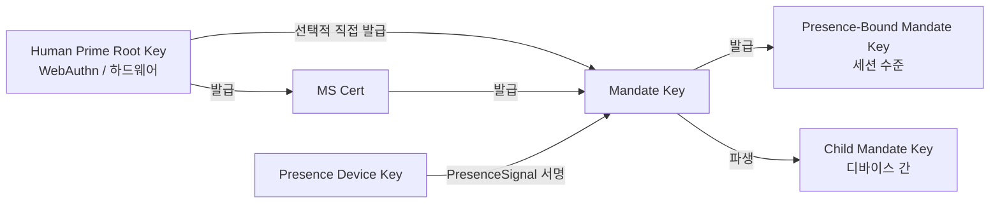

> 프로토콜 본문 내비게이션: [장 목차](./README.md) ｜ 이전 장 [§5 프로토콜 메시지](./05-프로토콜메시지.md) ｜ 다음 장 [§7 인가 등급](./07-인가등급.md)

## §6 Cryptography

이 장은 프로토콜의 암호학 부분을 규정하며 세 절로 나눈다.

- **§6.1 알고리즘 스위트**: 기본 / 대안 / PQC 세 단계 알고리즘 협상 표와 협상 규칙.
- **§6.2 키 파생과 역할**: Human Prime Root Key부터 Presence-Bound Mandate Key까지의 파생 관계와 하드 제약.
- **§6.3 서명 형식**: detached signature, Deterministic CBOR 서명 입력, 다중 서명 체인, 그리고 Endorsed_Mandate의 서명 입력 앵커.

> **EARS 추적 설명**: 이 장에서는 각 규칙 뒤에 `Trace:`로 대응하는 EARS 하위 조항 번호(출처는 본 규격의 요구사항 베이스라인)를 나열하며, 형식은 `R<requirement>.<criterion>.<clause>`다.

### §6.1 알고리즘 스위트

| 용도 | 기본 | 대안 | PQC 협상 비트 |
| --- | --- | --- | --- |
| 서명(Mandate / Presence / Attestation) | **Ed25519** | ECDSA-P256 | ML-DSA-65(FIPS 204) |
| 해시 | **SHA-256** | BLAKE3 | SHA3-256 |
| 파생(KDF) | HKDF-SHA-256 | — | HKDF-SHA3-256 |
| 대칭(예: Mandate stapling 암호화 활성 시) | ChaCha20-Poly1305 | AES-256-GCM | — |
| 채널 계층 | TLS 1.3 mandatory | mTLS optional | TLS-1.3-PQ(hybrid X25519 + ML-KEM-768) |

**협상 규칙**:

- **N1(양측 각자 선언)**: 클라이언트와 서버는 BOOTSTRAP 시 각자 지원하는 서명, 해시, KDF, 대칭, 채널 계층 알고리즘 스위트를 선언해야 한다. `SignatureBundle.alg`, `hash`, `kdf`, `channel-suite`의 최종값은 반드시 양측이 공통 지원하는 최강 알고리즘이어야 한다.
  - **Trace**: `R8.1.1`(BOOTSTRAP 시 각자 지원 알고리즘 스위트 선언), `R8.1.2`(양측 공통 지원의 최강 알고리즘을 최종값으로 선택).

- **N2(최소 구현 집합)**: 모든 호환 구현은 적어도 서명 알고리즘 집합 `{Ed25519, ECDSA-P256}`을 동시에 지원해야 한다. PQC 스위트는 OPTIONAL이지만 모든 구현은 향후 롤링 업그레이드를 위해 협상 비트를 보존해야 한다.
  - **Trace**: `R8.1.3`(적어도 `{Ed25519, ECDSA-P256}` 동시 지원), `R8.2.3`(PQC 스위트가 `MUST`로 표시되기 전에는 `OPTIONAL`로 구현하며, 상대방이 PQC를 지원하지 않는다는 이유로 BOOTSTRAP을 거부해서는 안 됨).

- **N3(공통 스위트 없음 → `E_PROTOCOL`)**: 양측이 BOOTSTRAP 시 공통 지원하는 서명 알고리즘이나 해시 알고리즘이 하나도 없으면, Mandate_Service는 반드시 `E_PROTOCOL`로 해당 BOOTSTRAP을 거부해야 한다.
  - **Trace**: `R8.1.4`(공통 알고리즘 없을 시 `E_PROTOCOL`로 BOOTSTRAP 거부).

- **N4(PQC 협상 비트 예약과 롤링 업그레이드 가능)**: `Mandate.signature_bundle`은 반드시 `ML-DSA-65`(FIPS 204)를 선택 서명 알고리즘으로 지원하는 알고리즘 비트를 제공해야 한다. BOOTSTRAP 협상 비트에는 반드시 `TLS-1.3-PQ`(hybrid X25519 + ML-KEM-768)에 대한 선택 지원을 예약해야 한다. 프로토콜은 생명주기 내에 버전 협상을 통해 기본 알고리즘 스위트를 롤링 업그레이드하는 것을 허용해야 하며, 기존 Mandate의 검증 가능성을 깨뜨리지 않아야 한다.
  - **Trace**: `R8.2.1`(`Mandate.signature_bundle`이 `ML-DSA-65` 알고리즘 비트 제공), `R8.2.2`(BOOTSTRAP 협상 비트에 `TLS-1.3-PQ` 예약), `R8.2.4`(버전 협상 롤링 업그레이드, 기존 Mandate 검증 가능성 미파괴).

### §6.2 키 파생과 역할

아래 그림은 Faying Protocol의 키 파생 계층과 역할 관계를 제시한다. HP Root Key는 인간이 보유한 하드웨어를 절대 떠나지 않으며, MS Key와 (제한된 경로에서) Mandate Key만 인가한다. Mandate Key는 Presence-Bound와 Child Mandate Key를 발급할 때 단수명 세션 키를 수립하고, Presence_Device Key는 PresenceSignal 서명에만 쓰인다.



**핵심 제약**:

- **K1(HP Root Key의 하드웨어 앵커링)**: HP Root Key는 인간이 보유한 하드웨어(WebAuthn authenticator / 플랫폼 keystore / 하드웨어 지갑)를 절대 떠나지 않는다. HP Root Key가 하드웨어를 떠나도록 요구하는 어떤 암호학 경로도 프로토콜 계층에 존재하지 않는다.
  - **Trace**: `R9.2.4`(각 Mandate는 독립적이고 단수명인 세션 서명 키를 사용 — 루트 키와 세션 키 분리의 키 계층 제약을 함축), `R8.1.3`(최소 구현 집합의 하드웨어 수용 가능성).

- **K2(폐기 체인의 방향성)**: MS Key의 폐기는 HP Root Key가 직접 실행한다. MS는 자기 자신을 폐기할 수 없다. 이 제약은 폐기 도달성의 루트가 MS 자신이 아니라 HP에 앵커링되도록 보장한다.
  - **Trace**: `R9.2.4`(Presence-Bound Mandate Key는 매 GRADE_SWITCH 시 강제 rotate — MS가 루트 키를 자기 폐기할 수 없다는 역방향 제약을 함축).

- **K3(Mandate별 독립 세션 키)**: 각 Mandate는 독립적인 세션 서명 키를 가진다(장수명 키의 오용 방지). Presence-Bound Mandate Key는 매 GRADE_SWITCH 시 강제 rotate된다.
  - **Trace**: `R9.2.4`(각 Mandate는 독립적이고 단수명인 세션 서명 키를 사용; 매 GRADE_SWITCH 시 Presence-Bound Mandate Key 강제 rotate).

- **K4(디바이스 결속된 파생 경로)**: Child Mandate Key는 반드시 목표 디바이스의 `device_id`와 `device_attestation`에 결속되어야 한다. "Mandate를 다른 단말로 복사하여 직접 사용"하는 경로는 반드시 거부되며, DELEGATE 흐름으로 가도록 요구된다.
  - **Trace**: `R9.2.1`(발급 시 `device_id`와 `device_attestation`에 결속), `R9.2.2`(다른 단말에서 동일 Mandate 사용 시 반드시 DELEGATE로 가야 함).

- **K5(Channel Binding)**: mTLS가 활성화될 때, Mandate는 반드시 [RFC 9266](https://www.rfc-editor.org/rfc/rfc9266)이 정의한 TLS Exporter 채널 결속 값을 담아야 하며, Relying_Party는 검증 단계에서 반드시 그 값을 대조해야 한다.
  - **Trace**: `R9.2.3`(mTLS 활성 시 RFC 9266 TLS Exporter 채널 결속을 담고 RP가 반드시 대조).

### §6.3 서명 형식

**S1(Detached signature)**: 전부 detached signature를 사용한다 — CBOR `signature_bundle`을 payload와 분리하여 감사와 재서명을 용이하게 한다. `signature_bundle`에는 payload 자체나 그 사본을 내장해서는 안 된다.
- **Trace**: `R10.2.2`(detached signature, `signature_bundle`과 payload 분리).

**S2(서명 입력의 정규화 정의)**: 모든 서명 객체는 [RFC 8949 §4.2.1 Deterministic Encoding](https://www.rfc-editor.org/rfc/rfc8949#section-4.2.1) 규칙에 따라 정렬한 후 서명해야 한다. 서명 입력은 반드시 다음으로 계산되어야 한다.

> `signature_input = H( Deterministic-CBOR( Envelope_without_signature ) )`

여기서 `H`는 협상된 최종 해시 알고리즘(기본 SHA-256, 대안 BLAKE3, PQC 협상 비트 SHA3-256)이고, `Envelope_without_signature`는 `Faying Protocol Envelope`에서 `signature_bundle` 필드를 제거한 나머지 구조를 가리킨다. **이 공식은 본 프로토콜에서 서명이 필요한 모든 객체에 적용**되며(Mandate, PresenceSignal, Faying Protocol Envelope 자신 포함), 서명 입력이 JSON 직렬화의 모호성에 의존하지 않게 한다 — CBOR와 JSON 두 인코딩에서의 서명 입력 해시는 반드시 동일해야 한다.

- **Trace**: `R10.2.1`(RFC 8949 §4.2.1 Deterministic Encoding 규칙에 따라 정렬 후 서명), `R10.2.4`(서명 입력은 `H( Deterministic-CBOR(Envelope_without_signature) )`), `R10.1.4`(서명 전 Deterministic CBOR 직렬화로 서명 입력이 JSON 직렬화 모호성에 의존하지 않게 함).

**S3(다중 서명 체인)**: 다중 서명 시나리오(예: DELEGATE는 부모 Mandate 부서명 필요)에서 부모 체인 서명은 `signature_bundle.chain` 배열로 담는다. 체인 요소의 순서는 「자식 → 부모 → 조부모 → … → 루트」이며, 각 체인 요소 자체도 S2의 서명 입력 정규화를 따른다.
- **Trace**: `R10.2.3`(다중 서명 시나리오에서 `signature_bundle.chain` 배열로 부모 체인 서명을 담음).

**S4(Endorsed_Mandate 서명 입력 앵커)**: Mandate가 `endorsement` 필드를 담을 때(`enabled` 진릿값과 무관하게), `endorsement`의 모든 하위 필드 —

```
(enabled, endorsed_scope, endorsed_grade, endorsed_lifetime_ms,
 offline_revocation_policy)
```

— 는 반드시 서명 입력에 들어가야 한다. 즉 `H( Deterministic-CBOR(Mandate_without_signature) )`를 계산할 때 `endorsement` 하위 트리를 **배제해서는 안 된다**. 이 규칙은 P16.1(Endorsement_Signature_Inclusion)과 일치한다.

`endorsement` 필드에 대한 어떤 사후 변조도(`enabled`를 `false`에서 `true`로 뒤집기, `endorsed_scope` 확장, `endorsed_grade` 완화, `endorsed_lifetime_ms` 연장, `offline_revocation_policy` 수정 포함) 서명 검증 실패를 초래한다. Relying_Party는 `E_ATTESTATION_INVALID`로 관련 호출을 거부하고, Mandate_Service는 `E_ENDORSEMENT_INVALID`로 거부하며 해당 Mandate의 Revoke를 트리거한다(§5.4 오류 코드 1013, §9.7, P16.1 참조).

- **Trace**: `R11.1.3`(각 Endorsed_Mandate의 `endorsement` 필드가 서명 입력에 들어가 어떤 사후 변조도 서명 검증을 깨뜨리게 함), `R11.1.4`(`endorsement` 필드 변조 감지 시 RP가 `E_ATTESTATION_INVALID`로 거부하고 MS가 Revoke 트리거).

**S5(endorsement 필드 변조 불가능성의 도출)**: S2와 S4를 결합하여 도출된다 —

1. S4에 의해 `endorsement` 하위 트리는 반드시 `Deterministic-CBOR(Mandate_without_signature)`에 들어간다.
2. S2에 의해 서명 입력은 `H(Deterministic-CBOR(Mandate_without_signature))`다.
3. 따라서 `endorsement` 어느 하위 필드의 수정이든 Deterministic CBOR 직렬화 결과를 바꾸고, 그로써 서명 입력 해시를 바꾼다.
4. 서명 검증의 암호학적 성질에 의해, 원래 서명은 새로운 서명 입력에서 반드시 검증에 실패한다.

따라서 `endorsement` 필드의 변조 불가능성은 §6.3에서 직접 도출되며 추가적인 프로토콜 계층 메커니즘이 필요 없다. **이 변조 불가능성은 Endorsed_Mandate 책임 귀속 체인(§11.4, P16.5 참조)의 암호학적 초석이다**. endorsement에 대한 어떤 사후 변조도 서명 검증 단계에서 즉시 발견되어, "배서 선언을 변조하여 책임 인수를 회피하는" 모든 가능 경로를 끊어낸다.

- **Trace**: `R11.1.3`(사후 변조가 서명 검증을 깨뜨림), `R10.2.4`(서명 입력 정의), `R11.1.4`(변조 발견 시의 프로토콜 계층 처분).
