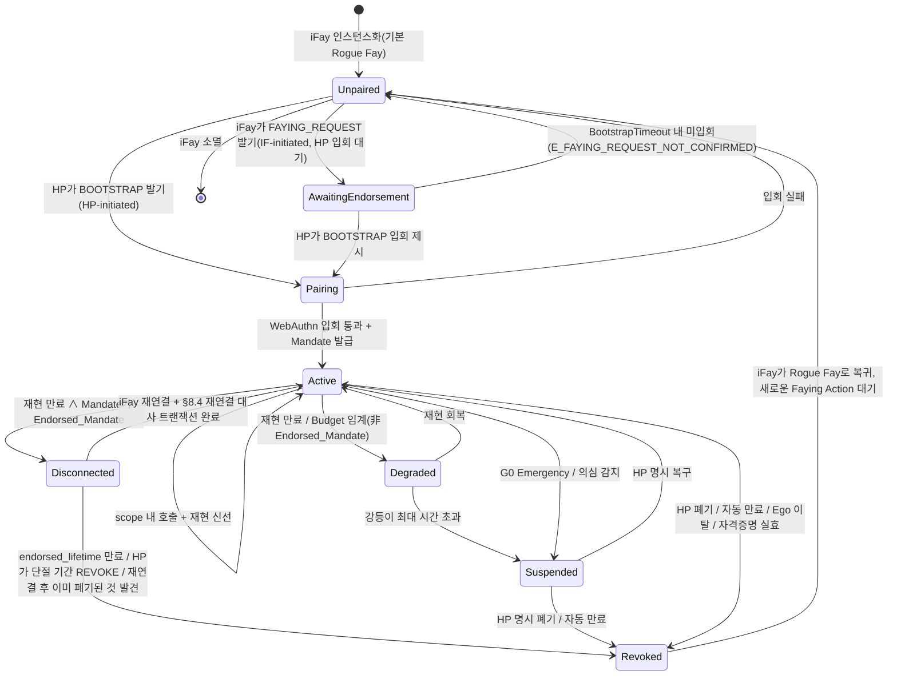
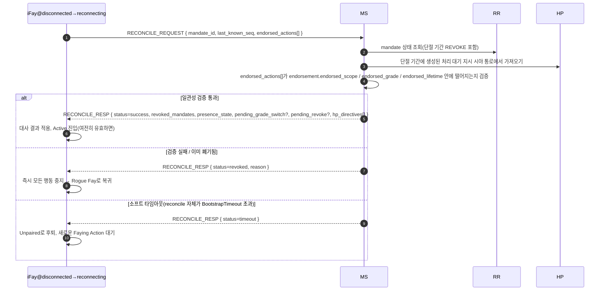

> 프로토콜 본문 내비게이션: [장 목차](./README.md) ｜ 이전 장 [§7 인가 등급](./07-인가등급.md) ｜ 다음 장 [§9 보안 고려사항](./09-보안고려사항.md)

## §8 Lifecycle

이 장은 iFay의 완전한 생명주기를 다룬다. 인스턴스화, Faying Action 발기, Faying State 유지부터 강등, 실연, 일시 정지, 폐기, 그리고 마지막에 Rogue Fay로 복귀하기까지다. 이 상태 기계는 프로토콜 계층의 핵심 불변식을 담는다 — 대외 행동이 합법인지, 책임 주체가 유일한지, 실연 기간에 어디까지 자치할 수 있는지가 모두 이 장에서 정의된다.

### §8.1 완전한 생명주기 상태 기계

아래 그림은 프로토콜 계층의 7개 상태 폐포(**Unpaired / Pairing / Active / Degraded / Disconnected / Suspended / Revoked**)와 그들 사이의 모든 합법 전이를 커버한다. `AwaitingEndorsement`는 IF-initiated 양방향 Faying 경로 위의 중간 임시 상태(§2.4 / §5.3.6 참조)로 "행동 실행 가능"한 안정 폐포를 구성하지 않지만, 전이 그래프의 완비성을 보장하기 위해 상태도에 등장한다.

> §4.3 Mandate 상태 기계와의 관계: §4.3은 *Mandate 객체*의 상태(Pending / Active / Degraded / Disconnected / Suspended / Revoked / Rejected)를 기술하고, 이 절은 *iFay 엔티티*의 생명주기 상태를 기술한다. 둘은 "Active/Degraded/Disconnected Mandate ⇔ Faying State / endorsed-only Faying State" 매핑으로 연결된다. §4.3 말미의 "Mandate 상태 ↔ Fay 행위 상태 매핑" 표를 참조하라.

### §8.2 단계 의미론

아래 표는 7개 상태 폐포의 의미론을 제시한다. 각 상태의 "대외 행동(D 차원)" 열의 값이 곧 프로토콜 계층의 D 차원 허입 결정이다.

- **Unpaired**: 청사진 Rogue Fay와 등가. A1–A4(자기 감지), B1–B3(대내 표현), C1–C2(대인 단방향 소통, FAYING_REQUEST 발기 포함) 차원 행위만 허용. D 차원은 일률 금지.

> **Rogue Fay의 정확한 판정(중요)**: 연결 단절 자체는 Rogue Fay와 **같지 않다**. 한 iFay가 Rogue Fay로 인정되는 것은 다음 두 정황 중 하나를 만족할 때에 한한다: (1) **연결이 끊겼고 어떤 명확한 인가도 존재하지 않음** — 즉 그 당장의 행위를 커버하는 `Active / Degraded / Disconnected` 상태의 Mandate가 하나도 없음(Faying을 수립한 적이 없거나, Mandate가 폐기 / 만료 / 정지된 경우 포함); (2) **실연이 입증됨** — §9.9에 따라 Perceived-Disconnected(감지된 실연)로 판정되고 현재 Mandate가 유효한 Endorsed_Mandate가 아님(또는 `endorsement`이 만료 / `enabled=false`).
>
> 반대로 말하면: 물리적 연결은 끊겼으나 **유효한 Endorsed_Mandate**를 보유하고 여전히 `endorsed_scope / endorsed_grade / endorsed_lifetime` 안에 있는 iFay는 `Disconnected` 상태에 있으며 **Faying State(endorsed-only)이지 Rogue Fay가 아니다** — 그 단절 기간의 D 차원 행위는 `Mandate.issuer`(HP)가 BOOTSTRAP 단계에서 오프라인 사전 인가로 인수한다(§4.3 / §7.5 / §8.3 / §8.4 참조). 오직 배서 수명이 만료되거나, 폐기되거나, 대사에 실패할 때에만 그 iFay가 Revoked → Unpaired로 전이하여 Rogue Fay로 복귀한다.
- **AwaitingEndorsement**: iFay가 발기한 FAYING_REQUEST가 이미 HP 시야 통로로 전달되어, HP가 `BootstrapTimeout`(기본 60s) 내에 BOOTSTRAP을 통해 승인 확인을 내놓기를 기다린다. 이 상태는 어떤 Mandate도 생성하지 않으며 대외 행동은 일률 금지된다. 타임아웃 시 Unpaired로 후퇴하고 Attestation Chain에 기록한다(오류 코드 1014 `E_FAYING_REQUEST_NOT_CONFIRMED`).
- **Pairing**: Faying Action 진행 중인 임시 상태. 반드시 `BootstrapTimeout` 내에 WebAuthn 입회 + Mandate 발급을 완료해야 한다. 실패 시 Unpaired로 후퇴하며 잔류 상태가 없다.
- **Active**: Faying State 정상 운행. 그것에 대응하는 유일한 Active 상태의 Mandate가 존재한다. 모든 D 차원 호출은 `Mandate.scope`와 `Mandate.grade`에 따라 허입된다.
- **Degraded**: Faying State는 여전히 성립하지만 등급이 조여짐(재현 신호 만료가 트리거). **비 Endorsed_Mandate**에만 적용. 지속 시간은 `MaxDegradedDuration`(기본은 grade별 설정, 부록 B 참조)을 초과할 수 없으며 초과 시 Suspended로 전이.
- **Disconnected**: Faying State는 `endorsement.endorsed_scope`와 `endorsement.endorsed_lifetime` 안에서만 유효. Endorsed_Mandate가 물리적 실연 기간에 갖는 "endorsed-only" 행위 창에 적용. 구체적 허입과 실연 의미론은 §4.3 / §7.5 / §8.4 참조.
- **Suspended**: Faying State 임시 정지. 대외 행동은 일률 금지되지만 HP의 명시 복구나 감사를 위해 Mandate 메타데이터는 보존된다. 자동 만료 지점을 넘으면 Revoked로 전이.
- **Revoked**: Mandate 종료. iFay는 Rogue Fay로 복귀. 이후의 어떤 D 차원 호출도 새로운 한 차례의 완전한 Faying Action(새 `mandate_id`)을 거쳐야 한다. Revoked는 Mandate의 흡수 상태다(P10 참조).

### §8.3 책임 귀속 시퀀스

> **어느 시점이든 IF의 대외 행동 → 반드시 유일한 Active, Degraded 또는 Disconnected 상태의 Mandate가 존재해야 함 → 그 Mandate의 `issuer`가 곧 책임 주체.**

본 항은 프로토콜 계층 "책임 주체 유일성"의 형식화 시퀀스 조항이며, 제3의 정황은 존재하지 않는다.

1. **합규 Mandate 부재**: Active / Degraded / Disconnected 상태의 Mandate가 하나도 없음 ⟹ 대외 행동 불허(D 차원 금지), RP는 반드시 `E_NO_MANDATE`(1001) 또는 `E_PRESENCE_STALE`(1005)를 반환.
2. **다중 합규 Mandate 공존**: 프로토콜 계층은 "가장 구체적인 작용역"의 하나를 강제 선택하며, 그것은 반드시 동일 `issuer`(HP)를 공유해야 한다. 서로 다른 issuer의 다중 합규 Mandate가 존재하면 프로토콜 오류로 간주하여 반드시 `E_PROTOCOL`(1099)을 반환.
3. **Disconnected 기간의 대외 행동**: 마찬가지로 `Mandate.issuer`(HP)에게 귀속된다. `endorsement`은 행동 실행 가능한 `endorsed_scope` / `endorsed_grade` / `endorsed_lifetime`만 제약할 뿐 책임 주체를 바꾸지 않는다. "endorsement이 책임을 iFay 자신 / MS / Supervisory Agent로 이전"하는 합법 경로는 없다(P16.5 참조).

본 항으로부터 곧바로 도출된다:

- 받아들여진 임의의 호출 `c`에서, 그 감사 5요소 `(mandate_id, endorsement_id?, action, ts, signature_chain)` 중 `signature_chain`의 루트 노드는 반드시 그리고 오직 `Mandate.issuer`다.
- iFay에게는 "자기 귀책"의 합법 경로가 없고, MS / Supervisory Agent도 대리 입회로 HP의 `issuer` 신원을 대체할 수 없다.
- 책임 주체는 Mandate 생명주기 내에 변경할 수 없다. 변경이 필요하면 반드시 폐기 + 새 BOOTSTRAP(새 `mandate_id`, 새 `issuer`)을 거쳐야 한다.

### §8.4 재연결 대사(Reconciliation)

> **목적**: iFay가 Disconnected 기간에 한 "endorsed 자치"와 프로토콜 중심 뷰(MS / RR / HP 시야 통로)의 상태 변화를 일치하도록 수렴시키고, "재연결하면 곧장 행동 계속"을 안티패턴으로 명시 금지한다.

#### §8.4.1 흐름

#### §8.4.2 대사 트랜잭션 반환 내용

트랜잭션 성공(`status = success`) 시 `RECONCILE_RESP`는 반드시 다음 필드를 반환해야 한다(Requirement 12.4와 일대일 대응).

1. **`revoked_mandates`**: 단절 기간에 폐기된 Mandate 목록(연쇄 자식 Mandate 포함).
2. **`presence_state`**: 현재 PresenceState(D 차원 계속 가능 여부 결정에 사용).
3. **`pending_grade_switch`**: 미완료 GRADE_SWITCH 이벤트(있을 경우).
4. **`pending_revoke`**: 미완료 REVOKE 이벤트(있을 경우).
5. **`hp_directives`**: 단절 기간에 HP 시야 통로에서 생성된 처리 대기 지시(예: G0 Emergency Override, 명시 REVOKE, 강제 강등 등).

#### §8.4.3 트랜잭션 결말 열거

대사 트랜잭션의 결말은 다음 셋 중 하나이며 오직 그것뿐이다. P17.4 `reconcile_result(M) ∈ {success, revoked, timeout}` 형식화 정의와 일치한다.

| 결말 | 트리거 조건 | 후속 상태 | 감사 요구 |
| --- | --- | --- | --- |
| `success` | 일관성 검증 통과 ∧ Mandate 여전히 유효 ∧ BootstrapTimeout 내 완료 | Disconnected → Active | Attestation Chain에 기입, endorsed_actions 완전 감사 포함 |
| `revoked` | endorsed_lifetime 이미 만료 ∨ HP가 단절 기간 REVOKE 발기 ∨ 재연결 후 이미 폐기된 것 발견 ∨ endorsed_actions 범위 초과 | Disconnected → Revoked → Unpaired | Attestation Chain에 기입, `endorsement.offline_revocation_policy`에 따라 단절 기간 감사 처리 |
| `timeout` | 대사 트랜잭션 자체가 `BootstrapTimeout` 초과해도 success / revoked 미달성 | Disconnected → Unpaired | Attestation Chain에 기입, `reason=reconcile-timeout` 표기 |

#### §8.4.4 프로토콜 계층 하드 제약

- **D 차원 금지령**: 대사 트랜잭션 완료 전 iFay는 어떤 D 차원 행동도 금지된다. 그 창 안에서 RP에 도달하는 어떤 호출도 반드시 `E_PRESENCE_STALE`(1005) 또는 `E_REVOKED`(1006)로 거부되어야 한다. 이 금지령은 `[t_reconnect, t_reconnect + reconcile_complete_ms]` 구간 안에서 성립한다(P17.4와 일치).
- **타임아웃 시 Rogue Fay로 후퇴**: 대사 트랜잭션은 반드시 `BootstrapTimeout` 내에 완료해야 한다. 타임아웃 시 iFay는 Unpaired로 후퇴하여 새로운 Faying Action을 기다린다(BOOTSTRAP 자동 재시도 불허).
- **세 결말 모두 AC 필수 기입**: 대사 트랜잭션 자체의 `success` / `revoked` / `timeout` 세 결말은 모두 반드시 Attestation Chain에 기입되어야 하며, `endorsement.offline_revocation_policy`에 따라 단절 기간의 행동 감사를 처리한다.
  - `stop-and-audit`(기본): 즉시 중지 + 완전한 endorsed_actions 감사 제출 + Rogue Fay로 후퇴.
  - `stop-only`: 즉시 중지 + 감사 강제 안 함(비가역 / 긴급 시나리오에만 적용, 프로토콜 위원회 결의 필요).
  - `graceful-stop`: 제한적 마무리(쓰기 닫기 / 상태 저장) 후 중지 허용, 마무리 동작도 여전히 endorsement 제약을 받음.
- **실패 후퇴 후 자가 재시도 금지**: 대사 트랜잭션 결말이 `revoked` 또는 `timeout`이어서 Rogue Fay로 후퇴할 때, iFay는 스스로 BOOTSTRAP을 재시도해서는 안 되며, HP가 다시 발기(HP-initiated)하거나 HP가 명시 승인한 새 FAYING_REQUEST(IF-initiated)를 기다려야 한다.
- **조용한 이어 보내기 금지**: "재연결하면 곧장 계속"하는 어떤 구현 경로도 금지된다. §8.4 대사 트랜잭션을 우회하여 Disconnected를 직접 Active로 전이하는 어떤 구현도 비합규 구현으로 간주되며, 상호운용 컴플라이언스 테스트 스위트는 반드시 그것을 fail로 판정해야 한다.
