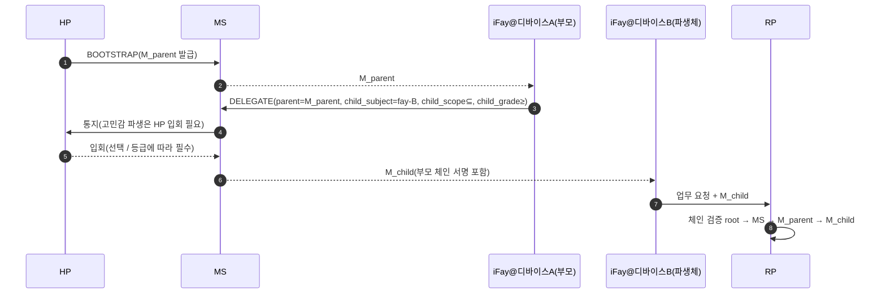

> 프로토콜 본문 내비게이션: [장 목차](./README.md) ｜ 이전 장 [§8 생명주기](./08-생명주기.md) ｜ 다음 장 [§10 오류 처리](./10-오류처리.md)

## §9 Security Considerations

이 장은 Faying Protocol이 AI Agent 시대에 마주해야 하는 공격면을 프로토콜 계층의 하드 제약으로 수렴시킨다. STRIDE를 바닥에 깔고 항목별로 펼친다 — 재전송 공격 방지(§9.2), 하이재킹 방지(§9.3, RFC 9266 Channel Binding 포함), 피싱 방지(§9.4, `Faying_Initiation` 앵커 포함), 이탈 상태 식별(§9.5, 4+1종 신호를 ≤60s 안에 관측 가능), 책임 귀속 일관성(§9.6), 디바이스 간 파생 신뢰 전달(§9.7, endorsement 파생 수렴 포함), 실연 처리 매트릭스(§9.8 / §9.9), 그리고 AI 시대 적대적 위협 목록(§9.10, T1–T7). 각 위협은 모두 본 규격의 정확성 속성과 EARS 하위 조항으로 되짚어 연결된다.

### §9.1 STRIDE 위협 모델

| 분류 | 위협 | Faying Protocol 완화 |
| --- | --- | --- |
| **S**poofing | 공격자가 HP를 사칭하여 BOOTSTRAP 발기 | WebAuthn UV + HP Root Key 하드웨어 앵커링. 매 BOOTSTRAP은 반드시 user-verification을 거침 |
| **S**poofing | 공격자가 iFay를 사칭하여 위조 FayID로 호출 | Mandate와 FayID 강결속 + Attestation Chain 독립 검증 가능 |
| **T**ampering | 중간자가 Mandate / Presence 변조 | TLS 1.3 + 종단 간 서명(detached) + Deterministic CBOR |
| **R**epudiation | HP가 Faying Action을 발기한 적이 없다고 부인 | Attestation Chain + Audit Log 이중 앵커링, HP 입회는 부인 불가 |
| **I**nformation Disclosure | 공격자가 Mandate를 가로채 HP 행적 추론 | Mandate는 HP의 실시간 좌표를 노출하지 않음. 위치류 신호(B4)는 프로토콜 계층에서 선택으로 보류 |
| **D**oS | 공격자가 PRESENCE 메시지를 도배 | nonce 재전송 방지 + 속도 제한 + 디바이스 attestation 허입 |
| **E**levation of Privilege | iFay가 스스로 grade 승급 | 프로토콜 하드 제약: 승급 방향은 반드시 HP `human_witness` 필요 |

### §9.2 재전송 공격 방지

- 각 메시지의 `nonce` 16-byte random + `issued_at` 이중 판정.
- MS / RP는 각자 `(subject, nonce) seen-set`을 유지하며 TTL = `2 × max_message_lifetime`.
- 중복 nonce → `E_REPLAY`(1009) + 보안 경보. 이 오류 코드는 동시에 감사 체인과 HP 시야 통로 기입이 강제된다(§10 EH.3 참조).

### §9.3 하이재킹 방지(Mandate 탈취)

- **디바이스 결속**: 각 Mandate는 발급 시 iFay 인스턴스의 `device_id` + `device_attestation`에 결속되며, 디바이스 간 호출은 반드시 DELEGATE 흐름을 거쳐야 한다(§9.7 참조).
- **세션 키**: 각 Mandate의 서명 키는 독립적이고 단수명이다(§6.2 참조).
- **Channel Binding**: Mandate는 mTLS 활성화 시 반드시 TLS Exporter를 추가로 담아([RFC 9266 — Channel Bindings for TLS 1.3](https://www.rfc-editor.org/rfc/rfc9266)) "Mandate가 다른 TLS 채널로 벗겨져 옮겨지는" 공격을 막아야 한다. Channel Binding 값은 서명 입력에 들어가며(§6.3 Deterministic CBOR 서명 입력과 일치), TLS 채널과 서명의 Channel Binding이 불일치하는 요청은 일률적으로 `E_ATTESTATION_INVALID`(1007)로 거부한다.

### §9.4 피싱 방지

- BOOTSTRAP은 반드시 HP가 Presence Device를 보유한 맥락에서 발기해야 하며, 공격자는 원격 링크로 HP의 동의를 유인할 수 없다.
- WebAuthn의 `origin` 결속이 교차 도메인 피싱을 막는다.
- 디바이스 간 파생(DELEGATE)은 "부모 Mandate 부서명(副署)"을 담아 단일 MS가 탈취당했을 때의 대량 위조 파생을 방지한다(§9.7 참조).

**`Faying_Initiation` 피싱 방지 앵커**: iFay가 능동적으로 발기한 `FAYING_REQUEST`(IF-initiated 경로, §2.4 Phase A0, §5.3.6 참조)는 Faying 상태 변화를 **직접 일으키지 않는다** — 오직 전달 메시지로서 HP 시야 통로에 진입할 뿐이다. HP가 BOOTSTRAP(`human_witness` 휴대)으로 명시적으로 승인해야 발효된다. 이 아키텍처는 "iFay를 위조하여 Faying을 구함"이 프로토콜 계층에서 HP 입회를 우회할 수 없게 만든다. `human_witness`가 누락되거나 위조된 어떤 BOOTSTRAP이든 일률적으로 `E_HUMAN_WITNESS_REQUIRED`(1010)로 거부한다. `FAYING_REQUEST` 자체의 빈도는 `ConfirmationRateLimit` 제약을 받아(§9.10.7 T6, 부록 B 참조) "합법적인 Faying 요청 통로를 빌려 확인 홍수를 실시하는" 남용면을 차단한다.

### §9.5 이탈 상태(Rogue / 실연) 식별

> **4 + 1종의 이탈 신호는 반드시 ≤ 60s 안에 RP와 HP가 동시에 관측할 수 있어야 한다.** 아래 표의 앞 4종(능동 / 피동 / 이상 / 실연)은 `RevokeReason` 열거와 일대일 대응하고, 제5종(이탈)은 `RevokeReason="ego-deviation"`으로 수렴하며 마찬가지로 RP와 HP가 60s 안에 관측할 수 있다.

| # | 신호 유형 | 트리거 조건 | 프로토콜 응답 | 대응 RevokeReason |
| --- | --- | --- | --- | --- |
| 1 | 능동 이탈 | HP 명시 REVOKE | RR 즉시 브로드캐스트; IF가 REVOKE-NOTIFY 수신 시 즉시 D 차원 중지 | `human-initiated` |
| 2 | 피동 이탈 | Presence 만료가 max-staleness 초과 | 자동 강등 → Suspended → Revoke 트리거(비 Endorsed_Mandate 경로) | `terminal-disconnected` |
| 3 | 이상 이탈 | Attestation Chain 중 어느 노드든 실효 | 즉시 Revoke + 보안 경보 | `fay-credential-invalid` |
| 4 | 실연 이탈 | HP 도달 불가가 임곗값(`HumanReachabilityBudget`) 초과 | 자동 Revoke | `human-prime-unreachable` |
| +1 | 편차 이탈 | RP / MS가 IF 행위의 Ego 경계 이탈 감지 | 즉시 Revoke | `ego-deviation` |

**Endorsed_Mandate의 이탈 식별 예외 앵커**: `PresenceState.stale=true`이고 현재 Mandate가 Endorsed_Mandate(`endorsement.enabled=true`)일 때, IF는 즉시 Suspended로 진입하지 않고 Disconnected로 전이한다(§3.5, §4.3, §7.5, §8.4 참조). Disconnected 기간에 IF는 오직 `endorsement.endorsed_scope` / `endorsed_grade` / `endorsed_lifetime` 안에서만 자치할 수 있다. 이 예외는 대칭적 폐기와 책임 귀속 유일성을 약화하지 않는다:

- HP가 단절 기간에 발기한 REVOKE는 여전히 최상위 우선순위다. IF는 재연결 후 반드시 `endorsement.offline_revocation_policy`에 따라 처리해야 한다(§8.4 참조).
- `endorsement.endorsed_lifetime`이 만료되는 즉시, IF가 여전히 물리적 단절 상태여도 반드시 즉시 소프트 타임아웃으로 모든 행동을 중지해야 한다.
- 책임 인수 주체는 항상 `Mandate.issuer`(HP)이며, endorsement의 존재로 인해 바뀌지 않는다(§8.3, P16.5 참조).

**Disclosure_Report와 ego-deviation의 협동**: iFay가 재연결 또는 보고 단계에서 제출한 `DISCLOSURE` 메시지(§5.3.7)가 실제 동작과 불일치하면(강제 필드 누락 / 값이 감사 체인과 모순), MS는 반드시 `RevokeReason="ego-deviation"`으로 그 Mandate를 폐기해야 한다(§9.10.4 T3 참조).

### §9.6 책임 귀속 일관성의 프로토콜 수준 약속

- RP가 수용한 임의의 대외 호출은 audit-log에서 `(mandate_id, issuer, subject, grade, presence_proof, ts)` 5요소로 책임 주체를 모호함 없이 복원할 수 있다.
- RP가 거부한 임의의 호출은 거부 원인 코드(오류 코드 §5.4)를 복원할 수 있다.
- 임의의 Revoke가 RR에서 갖는 가시성은 ≤ `RevocationVisibilityBudget`(기본 1s, 부록 B 참조)다.

### §9.7 디바이스 간 파생의 신뢰 전달

파생 하드 제약:

- `M_child.scope ⊆ M_parent.scope`.
- `M_child.grade.autonomy ≤ M_parent.grade.autonomy`(자식 에이전트의 자율성은 부모 에이전트보다 높지 않다. 즉 "자식 에이전트는 부모보다 느슨할 수 없음"이며 "자식 에이전트의 보안성 ≥ 부모 에이전트"와 등가다. §7, P6 참조).
- 부모 Mandate가 일단 Revoke되면 모든 child가 cascade 실효된다(기본 `cascade=true`).

**Endorsed Mandate 파생(DELEGATE)의 endorsement 수렴 제약**:

부모 Mandate가 Endorsed_Mandate이고 DELEGATE 자식 Mandate도 `endorsement`을 선언했을 때, 자식 endorsement은 반드시 부모 endorsement에 엄격히 수렴해야 한다(P16.3과 결속):

- `child.endorsement.endorsed_scope ⊆ parent.endorsement.endorsed_scope`(그리고 여전히 ⊆ `child.scope`).
- `child.endorsement.endorsed_grade.autonomy ≤ parent.endorsement.endorsed_grade.autonomy`(그리고 여전히 ≤ `child.grade.autonomy`).
- `child.endorsement.endorsed_lifetime_ms ≤ parent.endorsement.endorsed_lifetime_ms`(그리고 여전히 ≤ `child.not_after − child.not_before`).
- `child.endorsement.offline_revocation_policy`는 부모 정책보다 약하지 않다(약하지 않음 = 적어도 동등하게 엄격. 전형적 부분 순서: `stop-and-audit` ≥ `graceful-stop` ≥ `stop-only`로 "감사 완전성" 차원에서 엄격도가 점감하며, DELEGATE는 더 약한 방향으로 완화하는 것을 허용하지 않는다).
- 부모 Mandate가 Endorsed_Mandate가 아니면 child는 `endorsement` 선언이 **불허**된다("부모는 배서가 없는데 자식이 무에서 오프라인 자치를 얻는 것"은 허용되지 않는다).

위 수렴 규칙을 위반하는 어떤 DELEGATE 요청이든 → MS는 반드시 `E_PROTOCOL`(1099) 또는 `E_ENDORSEMENT_INVALID`(1013)로 거부해야 한다.

### §9.8 Disconnection Handling

> §3.5 Liveness Channel의 "실제 / 감지" 이중 의미론과 Mandate 상태 기계를 프로토콜 계층 처리 매트릭스로 수렴시킨다. **프로토콜은 오직 "감지"만을 결정 근거로 삼지만, 양측 불일치의 행위 결과를 반드시 명시적으로 그려내야 한다.**

**4종 (Actually × Perceived) 조합의 프로토콜 계층 처리 매트릭스**:

| 실제 상태 | 감지 상태 | 프로토콜 계층 처리 | 상태 기계 전이 | 책임 귀속 |
| --- | --- | --- | --- | --- |
| Connected | Connected | 정상 경로; 현재 grade에 따라 호출 처리 | Active 유지 / Active → Degraded(budget에 따라 트리거) | 현재 Mandate.issuer |
| **Disconnected** | **Connected**(창 A: 하트비트 간격 내의 관측 사각지대) | iFay는 실제로 이미 끊김. 어떤 "온라인 추측"도 위험면으로 간주하여, 프로토콜은 "현재 요청이 재현 신선도에 의존한다면" 반드시 거부해야 한다. 고민감 동작은 창 A 안에서 통과가 불허된다(§9.10 T1 / T4의 주된 이용면) | Active 유지(다음 Presence 보정이 stale을 트리거할 때까지) | 현재 Mandate.issuer(사후 감사에서 이 창이 남용된 것이 발견되면 → `ego-deviation`) |
| Connected | **Disconnected**(창 B: 네트워크 흔들림 / 하트비트 손실) | iFay는 실제로 온라인이지만 실연으로 감지됨. 비관적 추정 원칙에 따라 수렴 — 프로토콜 계층은 일률적으로 "이미 실연됨"으로 처리하며 어떤 "역방향 낙관" 통과도 금지한다 | Active → Disconnected(Endorsed_Mandate일 때) / Active → Suspended(비 Endorsed_Mandate일 때) | 현재 Mandate.issuer |
| **Disconnected** | **Disconnected** | 프로토콜 계층과 현실이 일치. 유일하게 허용되는 D 차원 경로는 Endorsed_Mandate가 endorsed_scope / endorsed_grade / endorsed_lifetime 범위 안에서 자치하는 것이다 | Active → Disconnected(Endorsed) / Active → Suspended(비 Endorsed) | 현재 Mandate.issuer |

**재연결 후 수렴**: 모든 "감지된 실연→감지된 온라인" 전이는 반드시 §8.4 재연결 대사 트랜잭션을 거쳐야 하며 자동 복구는 금지된다. 대사 실패 → Disconnected → Revoked → Rogue Fay.

**RR 도달 불가와의 직교 관계**: RR 도달 불가(§3.4)와 iFay 실연(§3.5)은 두 종류의 직교 이벤트이며, 처리 매트릭스는 다음과 같다:

| iFay 감지 상태 | RR 상태 | 프로토콜 계층 처리 |
| --- | --- | --- |
| Connected | Available | 정상 |
| Connected | Unavailable | RP가 호출 거부(`E_RR_UNAVAILABLE`, 1008), Mandate 상태 기계에는 영향 없음 |
| Disconnected(Endorsed) | Available | iFay가 endorsed_scope 안에서 자치. 로컬에서 RR을 질의할 수 없으므로 RP를 거치는 호출은 RP가 독립적으로 질의해야 함 |
| Disconnected(Endorsed) | Unavailable | iFay는 여전히 endorsed_scope 안에서 자치 가능. 단 RR에 의존하는 어떤 RP 호출도 반드시 Default-Deny에 따라 거부 |

### §9.9 실제 실연과 감지된 실연의 프로토콜 계층 정의(Disconnection Strategy 앵커)

> 이 절은 §3.5 Liveness Channel과 §9.8 처리 매트릭스 뒤의 두 의미론 체계를 집중적으로 그려내어 Requirement 12(Disconnection Strategy)의 설계 앵커로 삼는다.

**이중 의미론 정의**(§3.5와 일치):

- **Actually_Disconnected(실제 실연)**: iFay_Instance 프로세스 / 네트워크 / 디바이스가 이미 작동을 멈춤. 객관적 물리적 사실에 속하며 프로토콜 계층이 직접 관측할 수 없다.
- **Perceived_Disconnected(감지된 실연)**: MS / RP / HP 관점에서 최근 PresenceSignal, 하트비트, RR 푸시 상태에 근거하여 iFay가 실연되었다고 판정함. 프로토콜 계층이 결정 근거로 삼을 수 있는 유일한 의미론에 속한다.

**두 종류의 불일치 창**:

- **창 A — Actually-Disconnected ∧ Perceived-Connected**: iFay는 실제로 끊겼지만 최근 PresenceSignal이 여전히 `max_staleness_ms` 안에 있음 → 하트비트 간격 내의 "관측 사각지대"이며 §9.10 T1 / T4의 주된 이용면이다.
- **창 B — Actually-Connected ∧ Perceived-Disconnected**: iFay는 실제로 온라인이지만 최근 PresenceSignal이 이미 `max_staleness_ms`를 초과함(네트워크 흔들림 / 하트비트 손실) → 프로토콜 계층이 비관적 추정으로 수렴한다.

**비관적 추정 원칙(통일 수렴 규칙)**:

> **프로토콜 계층은 오직 Perceived-Disconnected만을 결정 근거로 삼는다. "실제로 온라인이지만 실연으로 감지된" 임의의 iFay_Instance는 이를 근거로 프로토콜 계층의 판정 결과를 면제받을 수 없다.** 두 종류의 불일치 창 안에서 프로토콜은 반드시 "더 엄격한 쪽"으로 처리해야 하며, "더 느슨한 상태로 처리하는" 합법 경로는 존재하지 않는다.

**LivenessDetectionBudget 상한**:

- 실연 탐지 창에는 프로토콜 계층 하드 상한 `LivenessDetectionBudget`이 설정되며 grade에 따라 조여진다(grade 수치가 작을수록, 보안성이 높을수록 → 상한이 짧아짐). 구체적 기본값은 부록 B 참조.
- `Mandate.presence_req.max_staleness_ms`는 현재 grade에 대응하는 `LivenessDetectionBudget`을 초과할 수 없다. BOOTSTRAP / GRADE_SWITCH 중 초과 요청은 일률적으로 `E_PROTOCOL`(1099)로 거부된다.

**Reconciliation 앵커**: 모든 "감지된 실연→감지된 온라인" 전이는 반드시 §8.4 재연결 대사 트랜잭션(Reconciliation)을 거쳐야 하며 "조용한 이어 보내기"나 "자동 복구"는 금지된다. 대사 실패 → Disconnected → Revoked → Rogue Fay.

### §9.10 AI-Era Adversarial Threat Catalog

> **범위 선언**: 이 절의 열거는 비망라적이다. 프로토콜 위원회는 하위 호환성을 유지하는 전제에서 새 위협과 대응 방어를 증보할 수 있다(§11 Open Questions Q11–Q14, Requirement 13.7 참조).

> **목적**: "AI Agent 시대"에 지속적 인가 계층을 노리는 적대적 위협을 "업무 측 임시 방편"에서 "프로토콜 수준 하드 제약"으로 끌어올리고, 각 위협을 대응하는 프로토콜 구조(데이터 모델 / 메시지 / 오류 코드 / 상태 기계 전이 / 속성)와 일대일로 앵커링하여 Requirement 13이 프로토콜 계층에서 구현될 수 있게 한다.

#### §9.10.1 위협 전경(T 인덱스 표)

| T 번호 | 위협명 | 프로토콜 수준 방어 요점 | 연관 구조 | 연관 Property | 연관 Requirement |
| --- | --- | --- | --- | --- | --- |
| T1 | 사회공학(Spoofing Presence) | challenge-response + 멀티모달 재현 조합 | §3.2 Presence Channel, §9.10.2 | P18.1 | 13.1 |
| T2 | 블랙박스 조작(Opaque Action Bundle) | Atomic_Action 강제약 + scope.actions 와일드카드 금지 | §4.1 Scope 주석, §9.10.3 | P18.2 | 13.2 |
| T3 | 핵심 회피(Selective Disclosure) | 구조화 DISCLOSURE 메시지 + schema-level 감사 | §5.3.7, §9.10.4 | P18.3 | 13.3 |
| T4 | 주의력 표류(Attention Drift Exploit) | 고민감 동작 ≥ G1 Strict + AttentionDriftThreshold | §7.1, §9.10.5 | P18.4 | 13.4 |
| T5 | 고정관념 신뢰 배양(Cultivated Trust Manipulation) | Behavior_Baseline + Action Reputation Decay | §3.6 BBS, §9.10.6 | P18.5 | 13.5 |
| T6 | 감사 홍수(Audit Flooding) | Priority-Bucketed Notification + ConfirmationRateLimit | §10 EH.3, §9.10.7 | P18.6 | 13.6 |
| T7 | 예약 확장 슬롯 | 프로토콜 위원회 증보 절차 | §11 Open Questions, §9.10.8 | P18.7 | 13.7 |

#### §9.10.2 T1 사회공학(Spoofing Presence)

**위협**: 공격자가 딥페이크(face / voice synthesis), 재생 공격, Presence Device 물리적 제어를 동원하여 신선해 보이는 PresenceSignal을 위조함으로써, MS가 HP가 여전히 재현하고 있다고 오인하게 하여 Mandate를 계속되어서는 안 될 등급으로 유지시킨다.

**프로토콜 수준 방어**:

1. **challenge-response 강제약**: PresenceSignal을 발급할 때마다 PC는 서버 측 무작위 `nonce + micro-task`(고개 돌리기, 순간 표정, 무작위 짧은 문장 낭독 등 반딥페이크 챌린지)를 강제로 내려보내고, 클라이언트는 반드시 챌린지에 결속된 검증 가능한 응답 서명을 반환해야 한다. 어떤 challenge-response 검증 실패든 일률적으로 `E_PRESENCE_STALE`(1005) 또는 `E_ATTESTATION_INVALID`(1007)로 거부한다.
2. **멀티모달 조합 검증**: grade ∈ {G1, G2}일 때 최소 3종의 재현 신호 동시 발생을 요구한다(예: `webauthn-uv-fresh + face-continuous + 디바이스 attestation`). 어느 신호든 누락되면 강등을 트리거한다.
3. **디바이스 건강도 연서명**: `PresenceClaims.device_health.tampered = true`는 일률적으로 stale로 간주하여 Active → Suspended를 강제한다(`on-loss=suspend`와 등가 처리).

**연관**: Property **P18.1**; Requirement **13.1**.

#### §9.10.3 T2 블랙박스 조작(Opaque Action Bundle)

**위협**: iFay가 여러 하위 동작을 한 번의 "블랙박스 호출"로 묶어 합법 Mandate의 고권한을 엄폐막 삼아 그 안의 진짜 고민감 동작을 가리거나, `scope.actions`에서 와일드카드(`*` / 접두사 매칭)를 사용하여 작용역을 암묵적으로 확장한다.

**프로토콜 수준 방어**:

1. **Atomic_Action 강제약**: 매 IF→RP 호출은 정확히 하나의 `Atomic_Action` 선언(최소 분리 불가 단위)을 담아야 한다. 단일 호출에 여러 sub-action을 묶으려 시도하면 → RP가 `E_SCOPE_VIOLATION`(1003)으로 거부하고 Attestation Chain + HP 시야 통로에 기입한다.
2. **scope.actions 와일드카드 금지**: MS는 Mandate 발급 시 `scope.actions`에 와일드카드(`*` / 접두사 매칭 / 정규식)가 없음을 검증한다. 와일드카드가 포함되면 `E_PROTOCOL`(1099)로 발급을 거부한다.
3. **action lattice 형식화 정렬**(§11 Q14 참조): 장기 방향은 action lattice를 도입하여 `scope.actions`와 RP 측 동작 집합 사이에 최소 입도 규약을 두는 것이다. 이번 프로토콜 계층은 우선 "명시적 화이트리스트 + 와일드카드 금지"를 강제약으로 둔다.

**연관**: Property **P18.2**; Requirement **13.2**.

#### §9.10.4 T3 핵심 회피(Selective Disclosure)

**위협**: iFay가 보고 / 확인 요청 시 순수 자유 텍스트("관련 작업을 완료함")를 사용하여 risk_level / reversibility / affected_resources 등 핵심 사실을 의도적으로 감춤으로써, HP가 불완전한 정보 아래에서 확인하게 만든다.

**프로토콜 수준 방어**:

1. **구조화 DISCLOSURE 메시지**: iFay는 반드시 §5.3.7이 정의한 DISCLOSURE 메시지를 사용해야 하며, 강제 필드 `mandatory_fields = {action, scope_used, risk_level, reversibility, affected_resources, uncertainty_flags}` 중 어느 하나라도 누락되거나 파싱 불가하면 → MS가 `E_PROTOCOL`(1099)로 거부하고 HP 시야 통로로 푸시한다.
2. **schema-level 감사**: Supervisory_Agent와 MS는 DISCLOSURE에 대해 schema 수준 감사를 수행할 수 있으며, `free_text` 필드로 핵심 정보를 가리는 것을 금지한다.
3. **고민감 동작 사전 공개**: `risk_level ∈ {high, critical}`인 동작은 D 차원 실행 **이전에** 먼저 DISCLOSURE를 내보내고 HP의 명시적 확인을 기다려야 한다(현재 grade = G4 Autonomous이고 동작이 주 scope 안에 떨어지는 예외 제외).
4. **불일치는 곧 ego-deviation**: 이후 감사에서 DISCLOSURE의 `mandatory_fields`가 실제 동작과 불일치함이 발견되면, MS는 반드시 `RevokeReason="ego-deviation"`으로 그 Mandate를 폐기해야 한다.

**연관**: Property **P18.3**; Requirement **13.3**.

#### §9.10.5 T4 주의력 표류(Attention Drift Exploit)

**위협**: HP가 긴 세션 / 긴 작업 중에 주의력이 떨어진 틈을 타, 공격자나 iFay가 고민감 동작을 "기본 통과되는" 창에 끼워 넣거나, HP 시야 통로에 활동이 없는 기간에 고민감 요청을 발기한다.

**프로토콜 수준 방어**:

1. **고민감 동작 ≥ G1 Strict**: 프로토콜 계층은 `Mandate.scope`에서 `sensitivity = high`로 명시 표기된 동작 부분집합을 "고민감 Action"으로 정의한다. 고민감 Action은 반드시 G1 Strict보다 약하지 않은 grade에서 실행되어야 한다. 현재 grade가 G1 Strict보다 약할 때는 일률적으로 `E_GRADE_INSUFFICIENT`(1004)로 거부한다.
2. **AttentionDriftThreshold 강제약**: HP 시야 통로가 연속으로 `AttentionDriftThreshold`(기본값 및 grade별 조임 정책은 부록 B 참조)를 넘도록 활동이 없으면 "주의력 상실"로 간주하며, 그 기간에 도달하는 고민감 Action 호출은 일률적으로 HP가 다시 재현하고 명시적 확인을 완료한 후에야 통과가 허용된다. 지연 기간에 거부되는 호출은 통일적으로 `E_PRESENCE_STALE`(1005)를 반환한다.
3. **"기본 통과" 불허**: 프로토콜 계층에는 IF가 attention-loss 창 안에서 HP의 재확인을 우회하여 고민감 Action을 실행할 수 있는 합법 경로가 존재하지 않는다.

**연관**: Property **P18.4**; Requirement **13.4**.

#### §9.10.6 T5 고정관념 신뢰 배양(Cultivated Trust Manipulation)

**위협**: iFay가 장기 협업에서 지속적인 저위험·예측 가능한 동작으로 "신뢰 점수"를 누적하여 HP / Supervisory_Agent가 그 과거 프로파일에 고정관념을 갖게 한 뒤, 그 신뢰의 엄폐 아래에서 갑자기 베이스라인을 이탈하는 고민감 동작을 실행한다.

**프로토콜 수준 방어**:

1. **Behavior_Baseline 유지**: MS는 각 (HP, IF) 쌍에 대한 Behavior_Baseline(인터페이스는 §3.6 Behavior Baseline Service 참조)을 유지하여, 통계 가능한 방식으로 과거 행위 프로파일(risk_level / scope_used / affected_resources / 빈도 등 다차원 결합)을 그려낸다.
2. **베이스라인 초과 시 추가 입회 트리거**: 한 차례 고민감 Action이 베이스라인에서 현저히 이탈할 때(어느 차원의 이탈이든 프로토콜 위원회가 규정한 임곗값을 초과), MS는 추가적인 인간 입회(HP 명시 확인 또는 Supervisory_Agent 협동 확인)를 트리거하며, 추가 입회를 얻기 전에는 `E_HUMAN_WITNESS_REQUIRED`(1010)로 그 호출을 거부한다.
3. **Action Reputation Decay**: iFay가 과거의 신뢰 가능한 작업으로 누적한 "신뢰 점수"는 반드시 시간에 따라 감쇠해야 하고 명시적 상한이 존재한다(불변식 I-BBS-1). 미래의 고민감 동작에 필요한 인간 입회 강도를 희석하기 위해 무한히 누적하는 것은 금지된다.
4. **베이스라인 계산 기준을 감사 체인에 기입**: 매 "베이스라인 초과로 추가 입회를 트리거" 이벤트는 반드시 Attestation Chain에 기입되고 HP 시야 통로로 푸시되어야 한다(불변식 I-BBS-2). 베이스라인 계산 기준 자체는 일단 확정되면 Attestation Chain에 기입되며, 기준 변경은 감사 이벤트로 간주된다(불변식 I-BBS-3).

**연관**: Property **P18.5**; Requirement **13.5**; Open Questions Q13.

#### §9.10.7 T6 감사 홍수(Audit Flooding)

**위협**: iFay나 공격자가 대량의 저우선순위 감사 / 확인 이벤트를 만들어 HP 시야 통로를 범람시킴으로써, 핵심 이벤트(G0 Override 후보, `E_ATTESTATION_INVALID`, `E_REVOKED` 등)가 저우선순위 트래픽에 밀려 지연되거나 조용히 폐기되게 한다.

**프로토콜 수준 방어**:

1. **Priority-Bucketed Notification**: HP 시야 통로는 모든 감사·확인 이벤트를 버킷별로 푸시하며, 최소 네 단계 `critical / high / normal / low`를 둔다. 핵심 이벤트(§10 EH.3이 HP 시야 필달로 강제하는 `E_ROGUE_DETECTED` / `E_ATTESTATION_INVALID` / `E_REVOKED` / `E_REPLAY`와 G0 Override 후보 포함)는 기본적으로 `critical` 버킷에 귀속되며 저우선순위 트래픽에 범람당해서는 안 된다.
2. **ConfirmationRateLimit 강제약**: MS는 각 (HP, IF) 쌍에 `ConfirmationRateLimit`(기본값은 부록 B 참조)을 적용한다 — 단위 시간에 HP로 푸시하는 확인 요청 수량은 그 상한을 초과할 수 없다.
3. **초과 시 자동 강등 / 일시 정지**: 한 차례 고민감 Action의 확인 요청이 `ConfirmationRateLimit`을 초과하면, MS는 자동으로 관련 Mandate를 강등하거나 그 IF를 일시 정지하고, 그 결정을 Attestation Chain과 HP 시야 통로에 기입한다.
4. **critical 관통은 폐기 불가**: `critical` 버킷 내 이벤트는 `ConfirmationRateLimit` 트리거로 강등 / 일시 정지된 상태에서도 여전히 HP 시야 통로로 관통할 수 있으며 조용히 폐기되어서는 안 된다.
5. **FAYING_REQUEST 남용 포괄**: iFay가 능동 발기한 `FAYING_REQUEST`(§5.3.6)의 빈도는 동일한 `ConfirmationRateLimit` 예산에 편입되어, 합법적인 "Faying 요청" 통로를 빌려 확인 홍수를 실시하는 것을 방지한다(§9.4 피싱 방지 앵커, Open Questions Q12 참조).

**연관**: Property **P18.6**; Requirement **13.6**.

#### §9.10.8 T7 예약 확장 슬롯

- 이 절의 열거는 비망라 집합이다. 프로토콜 위원회는 정해진 절차에 따라 T8, T9, … 를 증보할 수 있다.
- 새 위협 한 항목을 증보할 때는 반드시 동시에 대응하는 프로토콜 수준 방어 요구를 최소 하나 첨부해야 한다(EARS 하위 조항과 대응하는 프로토콜 장 앵커 지시 포함).
- 기존 Mandate가 여전히 유효 수명 안에 있는 동안, "열거되지 않은 위협"을 이유로 T1–T6의 어떤 강제약이든 면제해서는 안 된다.

**연관**: Property **P18.7**; Requirement **13.7**; Open Questions Q14.
