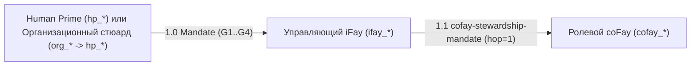

## §1 Обзор и область применения

Настоящая спецификация определяет **Faying Protocol/1.1 (`coFay` Delegated Stewardship Profile)**. Профиль строго следует правилам обратно совместимого расширения `MINOR` из `Faying Protocol/1.0` §1.7.2: все сообщения, конечные автоматы и коды ошибок `Faying Protocol/1.0` (`2025-10-25` Final и `schemas/fap-1.0.cddl`) остаются полностью неизменными. Узлы, поддерживающие только `1.0`, согласуют `Faying Protocol/1.0` по §1.7.3 либо безопасно игнорируют неизвестные необязательные расширения.

В экосистеме iFay (`Fay = iFay + coFay`) сущность `iFay` закреплена за единственным Human Prime, тогда как `coFay` представляет собой ролевую кремниевую цифровую сущность под управлением Role Charter без персонального слепка личности. Чтобы соблюсти базовый этический принцип — **каждое внешнее действие любой кремниевой сущности должно однозначно возлагаться на конкретного Human Prime** — данный профиль дополняет цепочку `Human Prime ↔ iFay` криптографически проверяемым мандатом `iFay Manager → coFay` и атомарной авторизацией передачи управления с двойной подписью.

### §1.1 Нормативные ключевые слова (RFC 2119 и RFC 8174)

Ключевые слова `MUST`, `MUST NOT`, `REQUIRED`, `SHALL`, `SHALL NOT`, `SHOULD`, `SHOULD NOT`, `RECOMMENDED`, `NOT RECOMMENDED`, `MAY` и `OPTIONAL` в настоящем документе толкуются в соответствии с [BCP 14](https://www.rfc-editor.org/info/bcp14) ([RFC 2119](https://www.rfc-editor.org/rfc/rfc2119) и [RFC 8174](https://www.rfc-editor.org/rfc/rfc8174)) только при написании заглавными буквами. При расхождениях между переводами приоритет имеют оригинал на упрощённом китайском языке (`zh-CN`) и `schemas/fap-1.1-cofay.cddl`.

---

## §2 Трёхуровневая цепочка ответственности

Сущность `coFay` `MUST NOT` самостоятельно выпускать корневой мандат и `MUST NOT` действовать от имени анонимного субъекта без привязки к Human Prime. Каждый действительный `cofay-stewardship-mandate` `MUST` образовывать трёхуровневую цепочку:

1. **Уровень конечной ответственности (`steward_entity` + `accountable_human_prime`)**: при личном управлении (`hp_*`) обязан совпадать с `accountable_human_prime`; при организационном управлении (`org_*`) `MUST` явно указывать ответственного `accountable_human_prime` (`hp_*`), иначе запрос отклоняется с кодом `1010 E_HUMAN_WITNESS_REQUIRED`.
2. **Уровень управляющего агента (`manager_fay_id`)**: `MUST` быть сущностью `ifay_*` с действующим мандатом `Faying Protocol/1.0`; `cofay_*` `MUST NOT` выступать эмитентом.
3. **Уровень исполняющего субъекта (`subject_cofay_id`)**: `MUST` быть сущностью `cofay_*`, ограниченной `charter_id`, чья проверка соответствия выполняется по `coFACTS` (отдельно от `iFACTS` для `iFay`).

---

## §3 Четыре инварианта безопасности без усиления полномочий (Normative)

Проверяющий модуль для `cofay-stewardship-mandate` `MUST` последовательно обеспечивать четыре инварианта:

1. **Каскадная аварийная остановка при `G0` или отзыве (`safe-state-halt`)**: если вышестоящий Human Prime или управляющий `iFay` находится в состоянии `G0` (`EmergencyOverride`) либо `Revoked`, `coFay` `MUST` немедленно перейти в `safe-state-halt` с кодом `1024 E_UPSTREAM_EMERGENCY_HALT` и `MUST NOT` обращаться к терминалам Host или внешним навыкам по кэшированному состоянию.
2. **Ограничение в один переход**: `hop_count == 1` и `max_stewardship_hops == 1` обязательны (`MUST`); передоверие отклоняется с кодом `1023 E_STEWARDSHIP_HOP_LIMIT`.
3. **Монотонное неусиление уровня**: условие `grade <= manager_grade` (`0..4`) обязательно (`MUST`); превышение отклоняется с кодом `1021 E_GRADE_AMPLIFICATION`.
4. **Двойное сужение области и временного окна**: `scope` (`domains`, `actions`, необязательные `terminals` и лимиты `budget`) `MUST` одновременно быть подмножеством `charter_scope` и `manager_scope`, а интервал `[not_before, not_after]` `MUST` лежать внутри `[manager_not_before, manager_not_after]` (иначе `1022 E_SCOPE_ESCAPE`).

---

## §4 Атомарная передача управления с двойной подписью (`cofay-transfer`)

При ротации ролей или реорганизации передача управления `MUST` выполняться атомарно через `cofay-transfer-authorization`:

- **Каноническая строка подписи с разделением доменов**: и `from_steward`, и `to_steward` `MUST` подписать байтовую строку `"ifay.faying.cofay-transfer.v1:"`, конкатенированную с канонизацией RFC 8785 JCS объекта без полей подписи.
- **Критерии атомарного принятия**: передача самому себе (`from_steward == to_steward`), истёкшее окно или неверные идентификаторы отклоняются с кодом `1026 E_TRANSFER_WINDOW_OR_PARTY_INVALID`; при отсутствии или недействительности любой из двух подписей операция откатывается с кодом `1025 E_TRANSFER_DUAL_SIG_REQUIRED`. История исполнения в GMChain остаётся непрерывно проверяемой, а MeriToken (`μ`) строго сохраняет статус немонетарной единицы репутации.

---

## §5 Нормативные схемы, коды ошибок и тестовые векторы

| Код | Имя ошибки | Условие срабатывания | Действие в рантайме |
| --- | --- | --- | --- |
| `1010` | `E_HUMAN_WITNESS_REQUIRED` | Отсутствует действительный `accountable_human_prime` | Отклонить мандат |
| `1021` | `E_GRADE_AMPLIFICATION` | `grade > manager_grade` или выход за пределы `0..4` | Отклонить мандат |
| `1022` | `E_SCOPE_ESCAPE` | Выход `scope` или окна за `charter_scope ∩ manager_scope` | Отклонить мандат |
| `1023` | `E_STEWARDSHIP_HOP_LIMIT` | `hop_count != 1` или передоверие не от `ifay_*` | Отклонить мандат |
| `1024` | `E_UPSTREAM_EMERGENCY_HALT` | Вышестоящее состояние `G0` или `Revoked` | Перейти в `safe-state-halt` |
| `1025` | `E_TRANSFER_DUAL_SIG_REQUIRED` | Отсутствует или неверна подпись одной из сторон | Откатить передачу |
| `1026` | `E_TRANSFER_WINDOW_OR_PARTY_INVALID` | Самопередача, истечение окна или неверный ID стороны | Отклонить передачу |

- **Авторитетная схема CDDL**: `schemas/fap-1.1-cofay.cddl`
- **Представление JSON Schema**: `schemas/fap-1.1-cofay.json`
- **Межъязыковые тестовые векторы**: `vectors/cofay-stewardship-v1.1.json` (`V01`–`V10`, проверены эталонными реализациями на TypeScript и Rust).
