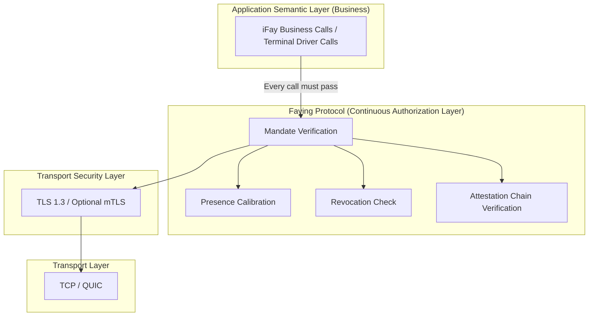
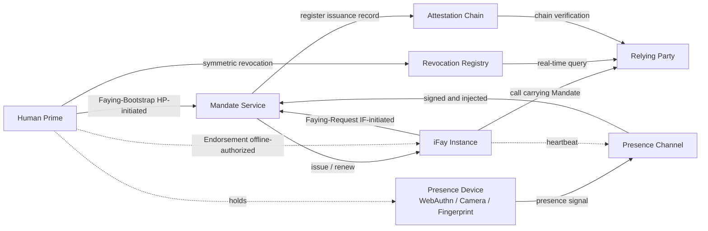
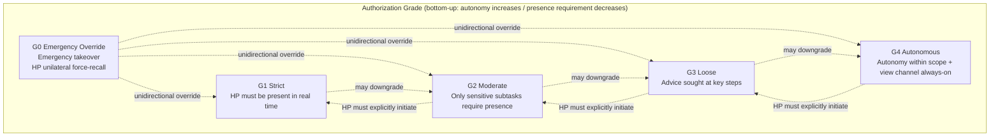
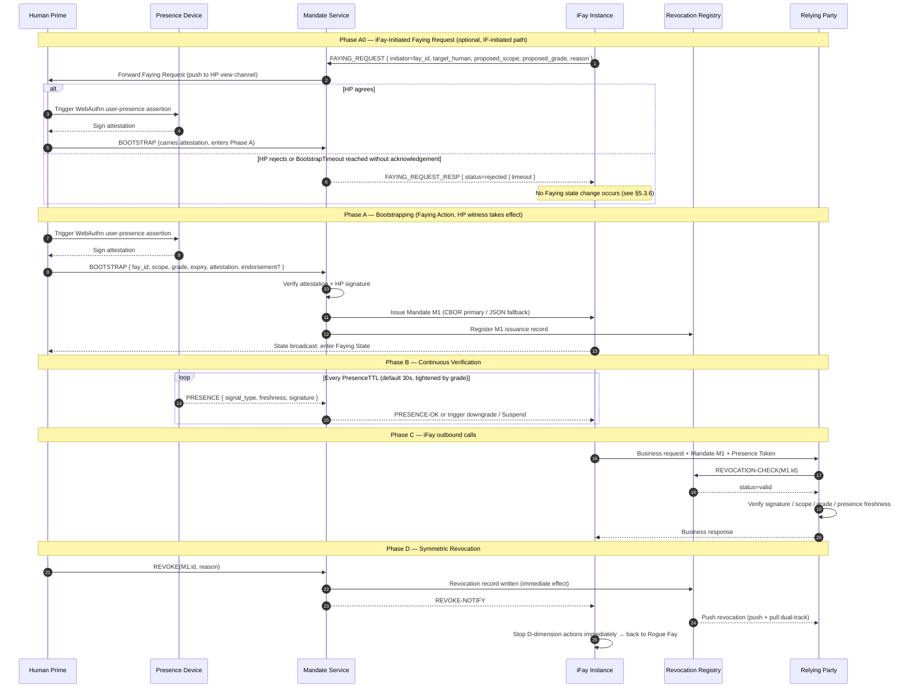

> Навигация по тексту протокола: [Оглавление](./README.md) | предыдущая [§1 Обзор](./01-Obzor.md) | следующая [§3 Компоненты и интерфейсы](./03-Komponenty-i-Interfeysy.md)

## §2 Архитектура

Эта глава даёт общий архитектурный взгляд на Faying Protocol на уровне протокола:

- **§2.1 Положение в стеке протоколов**: характеризует положение Faying Protocol по слою выше TLS 1.3 и ниже бизнес-семантики, делая явным жёсткое ограничение «каждое исходящее действие iFay должно проходить через шлюз проверки Mandate»;
- **§2.2 Отношения сущностей**: перечисляет 7 классов сущностей, которые задействует протокол, и их границы ответственности, а также даёт двунаправленные рёбра Faying (инициировано HP / инициировано IF) вместе с ребром офлайн-эндорсемента (Endorsed Mandate);
- **§2.3 Иерархия уровней авторизации**: представляет спектр уровней и направления переключения для пяти уровней G0–G4 по двум измерениям автономности / требования присутствия;
- **§2.4 Базовая последовательность взаимодействия**: сшивает BOOTSTRAP (включая путь Фазы A0, инициированный IF) + непрерывную проверку + действие + симметричный отзыв в единую сквозную последовательность, служащую визуальным якорем для последующих глав (§5 Сообщения / §7 Уровни / §8 Жизненный цикл / §10 Обработка ошибок);
- **§2.5 Принципы проектирования**: формулирует 6 принципов проектирования, которым уровень протокола обязан всегда следовать (Default-Deny / Least-Privilege / Continuous-Verification / Auditable-by-Construction / Human-Override / Graceful-Degradation).

> **Примечание о трассируемости EARS**: за каждым жёстким ограничением архитектурного уровня в этой главе следует строка `Trace:`, перечисляющая соответствующие идентификаторы подпунктов EARS (из базы требований) в форме `R<requirement>.<criterion>.<clause>`.
>
> **Выравнивание терминологии**: имена сущностей, встречающиеся в этой главе (Human Prime / iFay Instance / Presence Device / Mandate Service / Presence Channel / Attestation Chain / Revocation Registry / Relying Party и т. д.), полностью согласованы с кратким справочником выравнивания терминологии в Приложении A; всякий раз, когда эта глава и Приложение A выглядят неоднозначными в терминологии, **преимущественную силу имеет Приложение A**.

### §2.1 Положение в стеке протоколов

**Проектная позиция**: Faying Protocol не заменяет TLS и не переизобретает OAuth; он располагается выше TLS и ниже бизнес-семантики, вынуждая **каждое исходящее действие iFay** проходить через шлюз проверки Mandate. Любой исходящий вызов, обходящий шлюз Faying Protocol, рассматривается как Rogue Action и должен отклоняться промежуточным слоем, расположенным выше транспортного уровня и ниже бизнес-уровня.

**Жёсткие ограничения на уровне протокола**:

- **A-Stack-1 (каждый вызов должен пройти проверку четырёх элементов)**: прежде чем принять любой единичный исходящий вызов от iFay Instance, Relying Party должна по порядку завершить проверку Mandate / калибровку присутствия / проверку отзыва / проверку цепочки attestation — все четыре; отсутствие любой из них рассматривается как обходящее шлюз Rogue Action и отклоняется по Default-Deny.
  - **Trace**: `R2.1.1` (нет Mandate → отказ по умолчанию), `R2.1.2` (проверка scope), `R2.1.3` (отсутствующее поле → отклонить), `R2.1.4` (RR недостижим → отклонение по Default-Deny).
- **A-Stack-2 (разделение обязанностей между уровнем канала и уровнем авторизации)**: конфиденциальность канала и идентичность пира несутся TLS 1.3 / опциональным mTLS, и Faying Protocol не делает этого повторно; Faying Protocol отвечает только за семантику «непрерывной авторизации» и не вводит обязанностей по рукопожатию или согласованию ключей на уровне протокола, пересекающихся с TLS.

### §2.2 Отношения сущностей

**Примечания к двунаправленному ребру Faying**:

- `HP --> MS (Faying-Bootstrap, HP-initiated)`: Human Prime проактивно инициирует Faying (установление или корректировку) через канал BOOTSTRAP (см. §5.3.1).
- `IF --> MS (Faying-Request, IF-initiated)`: iFay Instance проактивно запрашивает Faying у Human Prime; запрос проходит сначала через Mandate Service, затем Human Prime подтверждает через BOOTSTRAP, чтобы он вступил в силу (см. §2.4 Фаза A0, §5.3.6 FAYING_REQUEST).
- `HP -. Endorsement (offline-authorized) .-> IF`: утверждение эндорсемента Endorsed Mandate несёт семантику офлайн-предавторизации — на момент BOOTSTRAP HP упаковывает `endorsed_scope` / `endorsed_grade` / `endorsed_lifetime` в Mandate за один раз, позволяя iFay автономно действовать в ограниченных рамках во время физического обрыва связи; это ребро — не «коммуникация во время выполнения», а «предварительно понесённая семантика, переносимая в полях Mandate» (см. §4.1 поле `endorsement`, §7.5 Endorsement Grades).

**Обязанности сущностей**:

| Сущность | Обязанности на уровне протокола | Граница ответственности / полномочий |
| --- | --- | --- |
| **Human Prime (HP)** | Единственная сущность, которая может инициировать Faying Action; единственная сущность, обладающая полномочием отзыва; единственная конечная точка несения ответственности | В любой момент исходящее действие iFay может быть однозначно отнесено к единственному HP; любое изменение состояния Faying должно получить явное, необманутое, проверяемое подтверждение от HP |
| **iFay Instance (IF)** | Уполномоченная агентская сущность, однозначно идентифицируемая FayID; должна предъявлять действующий Mandate при каждом исходящем вызове; может проактивно запрашивать Faying у HP (FAYING_REQUEST) или запрашивать разрыв Faying | Не обладает полномочием отозвать собственный Mandate; нет легитимного пути для самоинициированных повышений уровня; FAYING_REQUEST вступает в силу только при явном подтверждении HP |
| **Presence Device (PD)** | Аппаратура, несущая учётные данные WebAuthn / FIDO2 и биометрические возможности; физический источник сигналов присутствия | Каждый Presence Signal должен быть подписан PD и нести `nonce + produced_at + device_attestation`; окно свежести не переносится сигналом, а задаётся `presence_req.max_staleness_ms` соответствующего Mandate |
| **Mandate Service (MS)** | Логический сервис, который выпускает / продлевает / понижает / отзывает Mandate от имени HP | Нет легитимного пути для «MS самостоятельно решает bootstrap» или «MS заменяет HP в завершении подтверждения Faying»; когда MS недостижим, сходиться к Default-Deny |
| **Presence Channel (PC)** | Низколатентный, защищённый от replay поток присутствия от PD к MS; также несёт базовый источник сигнала для §3.5 Liveness Channel | nonce одноразовый; сигнал за пределами `presence_req.max_staleness_ms` соответствующего Mandate рассматривается как устаревший; один и тот же nonce может быть принят не более одного раза в пределах `2 × max_message_lifetime` |
| **Attestation Chain (AC)** | Обратно прослеживаемая цепочка подписей, образованная всеми действиями выпуска HP → MS → IF → производная IF | Каждый узел цепочки должен быть подписан своим родителем и иметь временную метку в пределах окна валидности родителя; любой отсутствующий узел или узел с неверной подписью делает всю цепочку недоверенной |
| **Revocation Registry (RR)** | Сервис статуса отзыва в реальном времени (OCSP-подобный короткий опрос + активный push + консервативный откат) | Задержка видимости отзыва ≤ `RevocationVisibilityBudget`; когда RR недостижим ≥ `StaleBudget`, RP должна отклонять (никакого «оптимистичного пропуска») |
| **Relying Party (RP)** | Терминал, приложение или сервис, вызываемый iFay | При каждом вызове обязательно проверяет кортеж из четырёх элементов (Mandate / Presence / Attestation / Revocation); провал любого → отклонить |

**Жёсткие ограничения на уровне протокола**:

- **A-Ent-1 (единственная конечная точка несения ответственности)**: для любого исходящего вызова, принятого RP, корневой узел Attestation Chain его Mandate соответствует ровно одному Human Prime; когда сосуществуют несколько издателей, отклонить с `E_PROTOCOL`.
  - **Trace**: `R1.1.1` (корень AC соответствует ровно одному HP), `R1.1.2` (когда несколько Mandate одновременно Active, выбранный Mandate и сосуществующие Mandate должны иметь одного и того же издателя HP), `R1.1.3` (несовпадение издателя → отклонить с `E_PROTOCOL`, записать в AC + протолкнуть в канал представления HP).
- **A-Ent-2 (нет Faying = Rogue Fay)**: поведенческое состояние iFay Instance в любой момент принадлежит бинарному множеству `{Faying State, Rogue Fay}`; третьего состояния не существует, как и какой-либо серой зоны «ни Faying, ни Rogue».
  - **Trace**: `R1.1.4` (пятёрка журнала аудита восстанавливает конечную точку несения ответственности, что влечёт наблюдаемость бинарного состояния — этот подпункт попадает в множество Requirements, объявленных данной задачей).

### §2.3 Иерархия уровней авторизации

**Основные правила**:

- **Понижения** (G_ST → G_MO → G_LO → G_AU) могут автоматически запускаться протоколом по правилам, встроенным в Mandate (например, сигнал присутствия потерян → автоматическое понижение к более строгому уровню; примечание: потеря присутствия → «строже» означает G_AU → G_LO и подобное «обратное направление»; см. §7).
- **Повышения** (в сторону большей автономности) должны явно инициироваться HP через свежий Faying Action; никакое автономное повышение со стороны iFay или MS не допускается.
- **G0 Emergency Override** может всегда инициироваться HP в одностороннем порядке, переопределяя любой текущий уровень, немедленно переводя iFay в Suspended в ожидании человеческого обзора.

**Жёсткие ограничения на уровне протокола**:

- **A-Grade-1 (повышения должны нести свидетельство HP)**: когда у GRADE_SWITCH `target_grade.autonomy > current_grade.autonomy`, запрос должен нести проверяемый `human_witness` (форма по умолчанию: утверждение присутствия пользователя WebAuthn); отсутствие или неверная подпись → отклонить с `E_HUMAN_WITNESS_REQUIRED`.
  - **Trace**: `R6.1.1` (повышения должны нести свидетельство HP), `R6.1.2` (отсутствие или неверная подпись → `E_HUMAN_WITNESS_REQUIRED`).
- **A-Grade-2 (направление потери присутствия монотонно ужесточается)**: при потере сигналов присутствия следующий переход состояния мигрирует в `Degraded(grade')` или `Suspended`, где `grade'.autonomy < current.autonomy`; оставаться на исходном уровне запрещено, переключаться в сторону большей автономности запрещено.
  - **Trace**: `R5.2.1` (мигрировать в более строгий grade'), `R5.2.2` (без сохранения / без обратного оптимизма).
- **A-Grade-3 (G0 имеет наивысший приоритет и доступен только HP)**: G0 Emergency Override обрабатывается с наивысшим приоритетом над любым текущим уровнем и любой текущей очередью событий; только HP может явно инициировать G0; G0, самоинициированный IF / MS / SA, единообразно отклоняется с `E_PROTOCOL`.
  - **Trace**: `R6.2.1` (G0 наивысший приоритет), `R6.2.4` (только HP может инициировать G0).

### §2.4 Базовая последовательность взаимодействия (Bootstrap + Heartbeat + Action)

**Ключевые ограничения Фазы A0**:

- Инициированный IF FAYING_REQUEST не порождает Mandate напрямую; MS выступает лишь как пересыльщик, проталкивая запрос в канал представления HP.
- Подтверждение HP должно принимать форму сообщения BOOTSTRAP + проверяемая attestation; нет легитимного пути для «MS по умолчанию соглашается от имени HP».
- Если HP не даёт явного подтверждения в течение `BootstrapTimeout` (по умолчанию 60 с, см. Приложение B), MS должен вернуть `FAYING_REQUEST_RESP { status=timeout }` и записать событие в Attestation Chain; при этом FAYING_REQUEST должен быть зафиксирован с `E_FAYING_REQUEST_NOT_CONFIRMED` (код ошибки 1014).
- См. определения сообщений FAYING_REQUEST / FAYING_REQUEST_RESP в §5.3.6 и код ошибки 1014 в §5.4.

**Жёсткие ограничения на уровне протокола**:

- **A-Seq-1 (свидетельство HP незаменимо)**: BOOTSTRAP в Фазе A0 / Фазе A должен нести проверяемый `human_witness`; нет легитимного пути для IF / MS / SA заменить HP в завершении подтверждения Faying.
  - **Trace**: `R1.3.1` (инициированный HP должен предъявить проверяемое явное подтверждение), `R1.3.2` (инициированный IF путь вступает в силу только после явного подтверждения HP), `R1.3.5` (не предоставляется легитимного пути для IF / MS / SA заменить HP в завершении подтверждения).
- **A-Seq-2 (тайм-аут инициированного IF не производит изменения состояния)**: инициированный IF FAYING_REQUEST, не получивший явного подтверждения HP в течение `BootstrapTimeout`, истекает или отклоняется и не производит изменения состояния Faying; событие записывается в Attestation Chain независимо от вступления в силу.
  - **Trace**: `R1.3.3` (отклонение без изменения состояния при истечении `BootstrapTimeout` без подтверждения), `R1.3.4` (событие записывается в AC независимо от вступления в силу).
- **A-Seq-3 (симметричный отзыв Фазы D)**: как только инициированный HP REVOKE публикуется через MS, все последующие запросы RP должны возвращать `revoked` в течение `RevocationVisibilityBudget` (по умолчанию 1 с); MS одновременно проталкивает уведомления REVOKE подписанным RP.
  - **Trace**: `R4.1.1` (каждой записи BOOTSTRAP соответствует хотя бы одна столь же достижимая запись REVOKE), `R4.1.2` (глубина пути REVOKE ≤ глубины пути BOOTSTRAP), `R4.1.3` (строгость аутентификации записи REVOKE не строже, чем у BOOTSTRAP).
- **A-Seq-4 (канал представления HP обязан достигнуть)**: пересылка Фазы A0, широковещание состояния Фазы A и уведомления REVOKE Фазы D должны публиковаться через канал представления HP; любой переход состояния должен становиться видимым HP после завершения.
  - **Trace**: `R3.3.1` (переходы состояния Mandate публикуются в канал представления HP после завершения).

### §2.5 Принципы проектирования

В таблице ниже даны 6 принципов проектирования, которым Faying Protocol обязан всегда следовать на уровне протокола. Каждый принцип имеет два столбца: **приземление на уровне протокола** и **соответствующие подпункты EARS**, гарантируя, что принципы не остаются на уровне лозунгов.

| Принцип | Приземление на уровне протокола | Соответствующие подпункты EARS |
| --- | --- | --- |
| **Default-Deny** | Нет Mandate → отклонить; отсутствие любого из scope / grade / временного окна Mandate → отклонить; когда RR недостижим ≥ `StaleBudget` → отклонить по Default-Deny | `R2.1.1`, `R2.1.2`, `R2.1.3`, `R2.1.4` |
| **Least-Privilege** | Mandate должен явно объявить `scope`; «делегирование всех полномочий» запрещено; подстановочные знаки / префиксное сопоставление в `scope.actions` запрещены на уровне протокола; при выводе `child.scope ⊆ parent.scope` строго сходится | `R2.1.2`, `R2.1.3` |
| **Continuous-Verification** | Каждый вызов проходит проверки и Presence, и Revocation; кэширование доверия запрещено; `PresenceState.last_freshness ≥ now − max_staleness_ms` — предусловие принятия вызова; основанием для пропуска вызова является свежесть, а не период опроса heartbeat | `R5.1.1`, `R5.1.2`, `R5.1.3`, `R5.1.4` |
| **Auditable-by-Construction** | Все Faying Action / Revoke / Grade-Switch / Delegate должны попадать в Attestation Chain; любое событие аудита не в цепочке рассматривается как недоверенное; канал представления HP обязан достигнуть | `R3.3.1` (канал представления HP обязан достигнуть) |
| **Human-Override** | G0 Emergency Override всегда имеет наивысший приоритет; только HP может явно инициировать G0; G0, самоинициированный IF / MS / SA, единообразно `E_PROTOCOL`; после обработки G0 целевой Mandate должен быть Suspended | `R6.2.1`, `R6.2.2`, `R6.2.3`, `R6.2.4` |
| **Graceful-Degradation** | Сигнал присутствия потерян → автоматическое понижение к более строгому уровню; «обратный оптимизм» запрещён; heartbeat G4 потерян → напрямую Suspended; `Degraded`, превысивший `MaxDegradedDuration`, должен → Suspended | `R5.2.1`, `R5.2.2`, `R5.2.3`, `R5.2.4` |

**Межпринципные отношения**:

- **Default-Deny ∧ Least-Privilege** совместно сходят «множество пропуска»: Default-Deny сводит состояние по умолчанию к «отказать», а Least-Privilege сводит множество разрешённого к минимальной тройке «явный scope ∩ явный grade ∩ явный presence_req»; вместе они составляют «базовую линию безопасности» Faying Protocol.
- **Continuous-Verification ∧ Graceful-Degradation** совместно поддерживают «монотонность спектра уровней во время выполнения»: первый ставит каждый вызов на факт «всё ещё свежо сейчас», второй гарантирует, что в направлении потери присутствия уровень всегда ужесточается в сторону более строгого, никогда наоборот.
- **Auditable-by-Construction ∧ Human-Override** совместно обеспечивают «восстановимость постфактум + отзыв в реальном времени»: первый позволяет независимой третьей стороне восстановить любое единичное Faying Action / Revoke / Grade-Switch, второй позволяет HP в любой момент вернуть контроль в форме G0.

> **Принципы не должны ослабляться**: 6 указанных выше принципов проектирования — это **обязательства уровня нормы** текста протокола; никакая референсная реализация / SDK / набор тестов соответствия совместимости не может ослабить ни один из них под предлогом «инженерного удобства»; если в будущей версии требуется корректировка, она должна быть одобрена через процесс разрешения, описанный в §11 Открытые вопросы, со стороны Protocol Committee и выпущена под новым номером версии (более не Faying Protocol/1.0).

---
