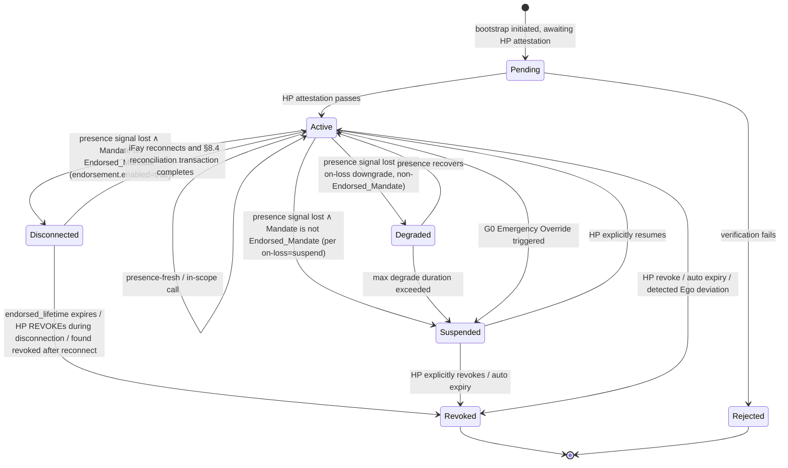

> Навигация по тексту протокола: [Оглавление](./README.md) | предыдущая [§3 Компоненты и интерфейсы](./03-Komponenty-i-Interfeysy.md) | следующая [§5 Сообщения протокола](./05-Soobshcheniya-Protokola.md)

## §4 Модели данных

Эта глава даёт основные модели данных Faying Protocol, в трёх разделах:

- **§4.1 Человекочитаемое представление на TypeScript (Ненормативно)** — человекочитаемый скелет, ориентированный на Protocol Committee, реализаторов SDK и рецензентов;
- **§4.2 Авторитетное определение CDDL (Нормативно)** — авторитетная схема для основного формата CBOR; все байты в проводе управляются этим разделом;
- **§4.3 Конечный автомат Mandate** — включая состояние `Disconnected`, матрицу условий-триггеров переходов и таблицу сопоставления «состояние Mandate ↔ поведенческое состояние Fay».

> **Авторитетное заявление**: когда представление TypeScript из §4.1 и CDDL из §4.2 в чём-либо несогласованы, **преимущественную силу имеет CDDL из §4.2**. §4.1 предназначено только для чтения человеком и не входит в проводной вход подписи; Deterministic CBOR-кодирование из §4.2 — единственный источник входа подписи (см. §6 Криптография).
>
> **Неподделываемость поля Endorsement**: подструктура `endorsement` входит во вход подписи как поле `mandate`; любая постфактумная подделка любого из её подполей (`enabled` / `endorsed-scope` / `endorsed-grade` / `endorsed-lifetime-ms` / `offline-revocation-policy`) ломает проверку подписи Mandate (согласовано с пунктом 3 Requirement 11.1 и §6.3).

### §4.1 Основные типы (представление TypeScript, Ненормативно)

Блок TypeScript ниже даёт в человекочитаемой форме основные типы FayID / Grade / Scope / Mandate / Endorsement / PresenceRequirement / PresenceSignal / Attestation; авторитетные определения находятся в §4.2.

```typescript
type FayID = string          // ULID-подобный, например "fay:01HX...Z"
type HumanPrimeID = string   // например "hp:..." (можно заякорить на WebAuthn credentialId)
type MandateID = string      // ULID
type Nonce = Uint8Array      // 16 случайных байт

/** Уровень авторизации */
enum Grade {
  EmergencyOverride = 0,  // G0
  Strict            = 1,  // G1
  Moderate          = 2,  // G2
  Loose             = 3,  // G3
  Autonomous        = 4   // G4
}

/** Объём авторизации (минимальные привилегии) */
interface Scope {
  domains:    string[]    // разрешённые домены ресурсов (паттерн URL / SPIFFE-ID-подобный)
  actions:    string[]    // разрешённые действия (read / write / control:drone:takeoff …)
  terminals?: string[]    // разрешённые терминалы (используется при выводе в фазе 2)
  budget?:   ResourceBudget
}

interface ResourceBudget {
  time_window:    [IsoTime, IsoTime]
  max_invocations?: number
  max_cost_units?:  number  // абстрактные единицы ресурсов (деньги / квота инференса / трафик и т. д.)
}

/** Mandate (заменяет токен) */
interface Mandate {
  version:       "Faying Protocol/1.0"
  id:            MandateID
  issued_at:     IsoTime
  not_before:    IsoTime
  not_after:     IsoTime          // должен быть конечным: бессрочный Faying — это антипаттерн
  issuer:        HumanPrimeID     // HP (или MS, авторизованный HP)
  ms_id:         string           // MS, который фактически выпустил
  subject:       FayID            // авторизуемая iFay
  scope:         Scope
  grade:         Grade
  presence_req:  PresenceRequirement
  parent?:       MandateID        // указывает на родительский Mandate при выводе
  endorsement?:  Endorsement      // опционально: эндорсированная авторизация (Endorsed Mandate)
  attestation:   Attestation
  signature:     SignatureBundle  // см. §6
}

/** Endorsed Mandate — предварительно понесённая семантика для офлайн-автономности
 *
 * Тогда и только тогда, когда `enabled = true`, iFay может действовать автономно
 * во время физического обрыва состояния Faying в пределах
 * endorsed_scope ⊆ scope и endorsed_grade.autonomy ≤ grade.autonomy;
 * endorsed_lifetime должен быть конечным. Конечная точка несения ответственности всегда остаётся издателем (Human Prime).
 */
interface Endorsement {
  enabled:                    boolean
  endorsed_scope:             Scope        // ⊆ Mandate.scope
  endorsed_grade:             Grade        // .autonomy ≤ Mandate.grade.autonomy
  endorsed_lifetime_ms:       number       // ≤ (not_after - not_before)
  offline_revocation_policy:  "stop-and-audit" | "stop-only" | "graceful-stop"
}

/** Примечание о Scope.actions: подстановочные знаки / префиксное сопоставление запрещены на уровне протокола (см. жёсткое ограничение Atomic_Action из §9 T2). */

/** Требование присутствия (привязано к уровню) */
interface PresenceRequirement {
  signal_types:   PresenceSignalType[]
  max_staleness_ms: number     // превышение этого запускает понижение
  on_loss:        OnLossPolicy // "downgrade-to:G2" | "suspend" | "emergency-override"
}

/** Сигнал присутствия */
interface PresenceSignal {
  mandate_id:     MandateID
  signal_type:    PresenceSignalType
  produced_at:    IsoTime
  nonce:          Nonce
  device_id:      string
  device_attestation: Attestation
  signature:      SignatureBundle
}

/** Attestation (унифицированный носитель проверяемого утверждения) */
interface Attestation {
  format:        "webauthn" | "tpm-quote" | "platform-keystore" | "self-signed"
  payload:       Uint8Array       // самоописательный в зависимости от format
  signer:        string           // идентификатор открытого ключа
  signature:     SignatureBundle
}
```

### §4.2 CDDL (основной формат CBOR, авторитетное определение)

Блок CDDL ниже — **авторитетная схема** для проводного формата Faying Protocol/1.0. И официальные тестовые векторы этой спецификации (`vectors/`), и набор тестов соответствия совместимости (`conformance/`) управляются этим разделом; результат декодирования байтов CBOR любой реализации должен быть в точности согласован с этим разделом.

```cddl
; Faying Protocol/1.0 — CBOR Data Definition Language
; Normative; this is the authoritative schema for Faying Protocol/1.0 wire format.
faying-grade = 0..4    ; 0=EmergencyOverride, 1=Strict, 2=Moderate, 3=Loose, 4=Autonomous

scope = {
  domains:    [* tstr],
  actions:    [* tstr],
  ? terminals: [* tstr],
  ? budget:   resource-budget
}

resource-budget = {
  time-window:        [iso-time, iso-time],
  ? max-invocations:  uint,
  ? max-cost-units:   uint
}

iso-time = #6.0(tstr)   ; CBOR tag 0 (RFC 3339 string)

presence-signal-type =
  "webauthn-uv-fresh" /
  "face-continuous"   /
  "fingerprint-tap"   /
  "presence-heartbeat-only" /
  "intent-ticket"

presence-requirement = {
  signal-types:        [+ presence-signal-type],
  max-staleness-ms:    uint,
  on-loss:             tstr            ; "downgrade-to:Gx" | "suspend" | "emergency-override"
}

attestation = {
  format:    "webauthn" / "tpm-quote" / "platform-keystore" / "self-signed",
  payload:   bstr,
  signer:    tstr,
  signature: signature-bundle
}

signature-bundle = {
  alg:       "Ed25519" / "ES256" / "ML-DSA-65",   ; PQC negotiation slot
  pubkey:    bstr,
  sig:       bstr,
  ? chain:   [* bstr]                              ; optional certificate chain
}

mandate = {
  version:        "Faying Protocol/1.0",
  id:             tstr,
  issued-at:      iso-time,
  not-before:     iso-time,
  not-after:      iso-time,
  issuer:         tstr,        ; Human Prime ID
  ms-id:          tstr,
  subject:        tstr,        ; FayID
  scope:          scope,
  grade:          faying-grade,
  presence-req:   presence-requirement,
  ? parent:       tstr,
  ? endorsement:  endorsement,
  attestation:    attestation,
  signature:      signature-bundle
}

endorsement = {
  enabled:                       bool,
  endorsed-scope:                scope,         ; must ⊆ main Mandate.scope
  endorsed-grade:                faying-grade,  ; must ≤ main Mandate.grade (autonomy weaker or equal, security higher)
  endorsed-lifetime-ms:          uint,          ; must ≤ (mandate.not-after - mandate.not-before)
  offline-revocation-policy:     "stop-and-audit" / "stop-only" / "graceful-stop"
}

presence-signal = {
  mandate-id:           tstr,
  signal-type:          presence-signal-type,
  produced-at:          iso-time,
  nonce:                bstr .size 16,
  device-id:            tstr,
  device-attestation:   attestation,
  signature:            signature-bundle
}
```

> **Сопоставление именования полей**: CDDL использует `kebab-case` (соглашение проводного формата); представление TypeScript использует `snake_case` (соглашение для чтения человеком). Поля соответствуют одно одному: `presence-req` ↔ `presence_req`, `endorsed-scope` ↔ `endorsed_scope`, `endorsed-lifetime-ms` ↔ `endorsed_lifetime_ms` и т. д.

### §4.3 Конечный автомат Mandate



**Семантика состояния `Disconnected`**: применимо только к Endorsed_Mandate (то есть `endorsement.enabled = true`). Пока в этом состоянии:

- iFay_Instance разрешено выполнять действия измерения D только в пределах `endorsement.endorsed_scope`, ограниченные `endorsement.endorsed_grade`;
- превышение `endorsement.endorsed_lifetime` немедленно вызывает мягкий тайм-аут → миграция в Revoked, даже пока iFay всё ещё физически отключена;
- REVOKE, выпущенный HP во время обрыва связи, обрабатывается немедленно по переподключении iFay согласно `endorsement.offline_revocation_policy` (по умолчанию `stop-and-audit`);
- переподключение должно проходить через транзакцию сверки §8.4; «тихое возобновление» запрещено.

**Матрица условий-триггеров переходов** (сцеплена с §3.5 Liveness Channel и Requirement 11 / 12):

| Переход | Условие триггера |
| --- | --- |
| Active → Degraded | `PresenceState.stale=true` ∧ Mandate не является Endorsed_Mandate ∧ `on-loss = "downgrade-to:Gx"` |
| Active → Disconnected | `PresenceState.stale=true` ∧ Mandate является Endorsed_Mandate (`endorsement.enabled=true`) |
| Active → Suspended | `PresenceState.stale=true` ∧ Mandate не является Endorsed_Mandate ∧ `on-loss = "suspend"` |
| Disconnected → Active | iFay переподключается и транзакция сверки §8.4 завершается (включая выравнивание восстановления Presence / отложенного REVOKE / GRADE_SWITCH) |
| Disconnected → Revoked | `endorsed_lifetime` истекает ∨ HP выполняет REVOKE во время обрыва ∨ обнаружен отзыв после переподключения |

**Сопоставление «состояние Mandate ↔ поведенческое состояние Fay»** (выровнено с измерениями A/B/C/D из главы 13):

| Состояние Mandate | Эквивалентное поведенческое состояние Fay | Измерение D (исходящее действие) |
| --- | --- | --- |
| Pending | Rogue Fay | Запрещено |
| Active | Faying State | Разрешено (в пределах scope) |
| Degraded | Faying State (ограниченное) | Разрешено только в пределах scope текущего пониженного уровня |
| Disconnected | Faying State (только эндорсированное) | Разрешено только в пределах `endorsement.endorsed_scope`, ограничено `endorsement.endorsed_grade` (см. §7.5 / §8.4) |
| Suspended | Faying State приостановлено | Запрещено, но Mandate остаётся восстановимым |
| Revoked | Rogue Fay | Запрещено |
| Rejected | Rogue Fay | Запрещено |

---
