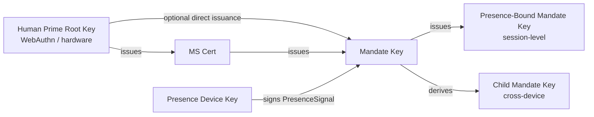

> Навигация по тексту протокола: [Оглавление](./README.md) | предыдущая [§5 Сообщения протокола](./05-Soobshcheniya-Protokola.md) | следующая [§7 Уровни авторизации](./07-Urovni-Avtorizacii.md)

## §6 Криптография

Эта глава даёт криптографическую спецификацию на уровне Faying Protocol, в трёх разделах:

- **§6.1 Наборы алгоритмов**: таблица согласования и правила для трёх ярусов default / alternative / PQC;
- **§6.2 Вывод ключей и роли**: иерархия вывода и жёсткие ограничения от Human Prime Root Key вниз до Presence-Bound Mandate Key;
- **§6.3 Формат подписи**: отсоединённые подписи, вход подписи Deterministic CBOR, цепочки множественных подписей и якорь входа подписи для Endorsed_Mandate.

> **Примечание о трассируемости EARS**: за каждым правилом этой главы следует строка `Trace:`, перечисляющая соответствующие идентификаторы подпунктов EARS (из базы требований) в форме `R<requirement>.<criterion>.<clause>`.

### §6.1 Наборы алгоритмов

| Назначение | По умолчанию | Альтернатива | Слот согласования PQC |
| --- | --- | --- | --- |
| Подпись (Mandate / Presence / Attestation) | **Ed25519** | ECDSA-P256 | ML-DSA-65 (FIPS 204) |
| Хеширование | **SHA-256** | BLAKE3 | SHA3-256 |
| Вывод (KDF) | HKDF-SHA-256 | — | HKDF-SHA3-256 |
| Симметричное (например, при включённом шифровании stapling Mandate) | ChaCha20-Poly1305 | AES-256-GCM | — |
| Уровень канала | TLS 1.3 обязателен | mTLS опционален | TLS-1.3-PQ (гибрид X25519 + ML-KEM-768) |

**Правила согласования**:

- **N1 (каждая сторона объявляет)**: клиент и сервер должны каждый объявить на момент BOOTSTRAP наборы подписи, хеша, KDF, симметричного и канального уровня, которые они поддерживают; итоговые значения для `SignatureBundle.alg`, `hash`, `kdf`, `channel-suite` должны быть наиболее сильными алгоритмами, поддерживаемыми совместно.
  - **Trace**: `R8.1.1` (каждая сторона объявляет поддерживаемые наборы на момент BOOTSTRAP), `R8.1.2` (наиболее сильный совместно поддерживаемый алгоритм выбирается как итоговое значение).

- **N2 (минимальный набор реализации)**: каждая совместимая реализация должна поддерживать как минимум набор алгоритмов подписи `{Ed25519, ECDSA-P256}` одновременно; наборы PQC являются OPTIONAL, но каждая реализация должна резервировать слоты согласования для будущих накатываемых обновлений.
  - **Trace**: `R8.1.3` (должна поддерживать `{Ed25519, ECDSA-P256}` одновременно), `R8.2.3` (наборы PQC являются `OPTIONAL` до пометки `MUST`, и BOOTSTRAP не должен отклоняться из-за того, что пир не поддерживает PQC).

- **N3 (нет общего набора → `E_PROTOCOL`)**: если на момент BOOTSTRAP не существует совместно поддерживаемого алгоритма подписи или хеша, Mandate_Service должен отклонить BOOTSTRAP с `E_PROTOCOL`.
  - **Trace**: `R8.1.4` (отклонить BOOTSTRAP с `E_PROTOCOL`, когда нет общего алгоритма).

- **N4 (зарезервирован слот согласования PQC + накатываемое обновление)**: `Mandate.signature_bundle` должен предоставлять слот алгоритма для поддержки `ML-DSA-65` (FIPS 204) как опционального алгоритма подписи; слот согласования BOOTSTRAP должен резервировать опциональную поддержку `TLS-1.3-PQ` (гибрид X25519 + ML-KEM-768); протокол должен позволять накатывать набор по умолчанию вперёд через согласование версий в пределах жизненного цикла, не нарушая проверяемости существующих Mandate.
  - **Trace**: `R8.2.1` (`Mandate.signature_bundle` предоставляет слот алгоритма `ML-DSA-65`), `R8.2.2` (слот согласования BOOTSTRAP резервирует `TLS-1.3-PQ`), `R8.2.4` (накатываемое обновление через согласование версий сохраняет проверяемость существующих Mandate).

### §6.2 Вывод ключей и роли

Диаграмма ниже показывает иерархию вывода ключей Faying Protocol и отношения ролей: HP Root Key никогда не покидает аппаратуру, удерживаемую человеком, и авторизует только MS Key и (по ограниченным путям) Mandate Key; Mandate Key устанавливает короткоживущие сессионные ключи при выпуске Presence-Bound и Child Mandate Key; Presence_Device Key используется исключительно для подписи PresenceSignal.



**Ключевые ограничения**:

- **K1 (аппаратное заякоривание HP Root Key)**: HP Root Key никогда не покидает аппаратуру, удерживаемую человеком (WebAuthn authenticator / platform keystore / hardware wallet); на уровне протокола не существует криптографического пути, требующего, чтобы HP Root Key покинул аппаратуру.
  - **Trace**: `R9.2.4` (каждый Mandate использует независимый короткоживущий сессионный ключ подписи — влечёт ограничение иерархии ключей о разделении корневого ключа и сессионного ключа), `R8.1.3` (свойство переносимости минимального набора реализации на аппаратуре).

- **K2 (направленность цепочки отзыва)**: отзыв MS Key выполняется напрямую HP Root Key; MS не может отозвать себя сам. Это ограничение гарантирует, что достижимость отзыва коренится в HP, а не в самом MS.
  - **Trace**: `R9.2.4` (Presence-Bound Mandate Key принудительно ротируется при каждом GRADE_SWITCH — влечёт обратное ограничение, что MS не может самостоятельно отозвать корневой ключ).

- **K3 (независимый сессионный ключ на Mandate)**: каждый Mandate имеет независимый сессионный ключ подписи (избегая злоупотребления долгоживущими ключами); Presence-Bound Mandate Key принудительно ротируется при каждом GRADE_SWITCH.
  - **Trace**: `R9.2.4` (каждый Mandate использует независимый короткоживущий сессионный ключ подписи; каждый GRADE_SWITCH принудительно ротирует Presence-Bound Mandate Key).

- **K4 (путь вывода с привязкой к устройству)**: Child Mandate Key должен быть привязан к `device_id` и `device_attestation` целевого устройства; любой путь «скопировать Mandate на другой терминал и использовать его напрямую» должен отклоняться и требовать прохождения через DELEGATE.
  - **Trace**: `R9.2.1` (привязывает `device_id` и `device_attestation` на момент выпуска), `R9.2.2` (использование того же Mandate на другом терминале должно проходить через DELEGATE).

- **K5 (Channel Binding)**: при включённом mTLS Mandate должен нести значение привязки канала TLS Exporter, определённое в [RFC 9266](https://www.rfc-editor.org/rfc/rfc9266), и Relying_Party должна сравнивать это значение на момент проверки.
  - **Trace**: `R9.2.3` (с включённым mTLS нести привязку канала TLS Exporter из RFC 9266, и RP должна сравнивать).

### §6.3 Формат подписи

**S1 (Отсоединённая подпись)**: все подписи отсоединены — CBOR `signature_bundle` отделён от полезной нагрузки, что облегчает аудит и повторную подпись. `signature_bundle` не должна встраивать саму полезную нагрузку или её копию.
- **Trace**: `R10.2.2` (отсоединённая подпись, `signature_bundle` отделена от полезной нагрузки).

**S2 (каноническое определение входа подписи)**: каждый подписываемый объект должен быть отсортирован по [RFC 8949 §4.2.1 Deterministic Encoding](https://www.rfc-editor.org/rfc/rfc8949#section-4.2.1) перед подписью; вход подписи должен вычисляться как:

> `signature_input = H( Deterministic-CBOR( Envelope_without_signature ) )`

где `H` — итоговый согласованный алгоритм хеширования (по умолчанию SHA-256, альтернатива BLAKE3, слот согласования PQC SHA3-256), а `Envelope_without_signature` обозначает остаточную структуру `Faying Protocol Envelope` после удаления поля `signature_bundle`. **Эта формула применима к каждому объекту этого протокола, требующему подписи** (включая Mandate, PresenceSignal, сам Faying Protocol Envelope), делая вход подписи независимым от неоднозначности JSON-сериализации — хеш входа подписи должен быть идентичен при обоих кодированиях CBOR и JSON.

- **Trace**: `R10.2.1` (отсортировано по RFC 8949 §4.2.1 Deterministic Encoding перед подписью), `R10.2.4` (вход подписи — это `H( Deterministic-CBOR(Envelope_without_signature) )`), `R10.1.4` (сериализация Deterministic CBOR перед подписью делает вход подписи независимым от неоднозначности JSON-сериализации).

**S3 (цепочка множественных подписей)**: в сценариях множественной подписи (например, DELEGATE требует контрподписи родительского Mandate) подписи родительской цепочки переносятся через массив `signature_bundle.chain`; порядок элементов цепочки — «дочерний → родитель → родитель родителя → … → корень», и каждый элемент цепочки сам следует канонизации из S2.
- **Trace**: `R10.2.3` (подписи родительской цепочки переносятся через массив `signature_bundle.chain` в сценариях множественной подписи).

**S4 (якорь входа подписи Endorsed_Mandate)**: когда Mandate несёт поле `endorsement` (независимо от истинности `enabled`), все подполя `endorsement` —

```
(enabled, endorsed_scope, endorsed_grade, endorsed_lifetime_ms,
 offline_revocation_policy)
```

— должны входить во вход подписи. То есть при вычислении `H( Deterministic-CBOR(Mandate_without_signature) )` поддерево `endorsement` **не должно исключаться**. Это правило согласовано с P16.1 (Endorsement_Signature_Inclusion).

Любая постфактумная подделка поля `endorsement` (включая переключение `enabled` с `false` на `true`, расширение `endorsed_scope`, расслабление `endorsed_grade`, продление `endorsed_lifetime_ms`, изменение `offline_revocation_policy`) приведёт к провалу проверки подписи: Relying_Party отклоняет связанный вызов с `E_ATTESTATION_INVALID`, а Mandate_Service отклоняет с `E_ENDORSEMENT_INVALID` и запускает Revoke этого Mandate (см. §5.4 код ошибки 1013, §9.7, P16.1).

- **Trace**: `R11.1.3` (поле `endorsement` каждого Endorsed_Mandate входит во вход подписи, делая любую постфактумную подделку ломающей проверку подписи), `R11.1.4` (при обнаружении подделки поля `endorsement` RP отклоняет с `E_ATTESTATION_INVALID`, а MS запускает Revoke).

**S5 (вывод неподделываемости поля endorsement)**: совместно выводится из S2 и S4 —

1. По S4 поддерево `endorsement` должно входить в `Deterministic-CBOR(Mandate_without_signature)`;
2. По S2 вход подписи — это `H(Deterministic-CBOR(Mandate_without_signature))`;
3. Следовательно, любое изменение любого подполя `endorsement` изменит результат сериализации Deterministic CBOR, тем самым изменив хеш входа подписи;
4. По криптографическому свойству проверки подписи оригинальная подпись обязана не пройти проверку на новом входе подписи.

Поэтому неподделываемость поля `endorsement` напрямую выводится из §6.3 и не требует дополнительного механизма уровня протокола. **Эта неподделываемость — криптографический краеугольный камень цепочки подотчётности Endorsed_Mandate** (см. §11.4 и P16.5): любая постфактумная подделка endorsement немедленно обнаруживается на этапе проверки подписи, отсекая всякий возможный путь «уклонения от несения ответственности через подделку утверждений endorsement».

- **Trace**: `R11.1.3` (постфактумная подделка ломает проверку подписи), `R10.2.4` (определение входа подписи), `R11.1.4` (диспозиция уровня протокола при обнаружении подделки).

---
