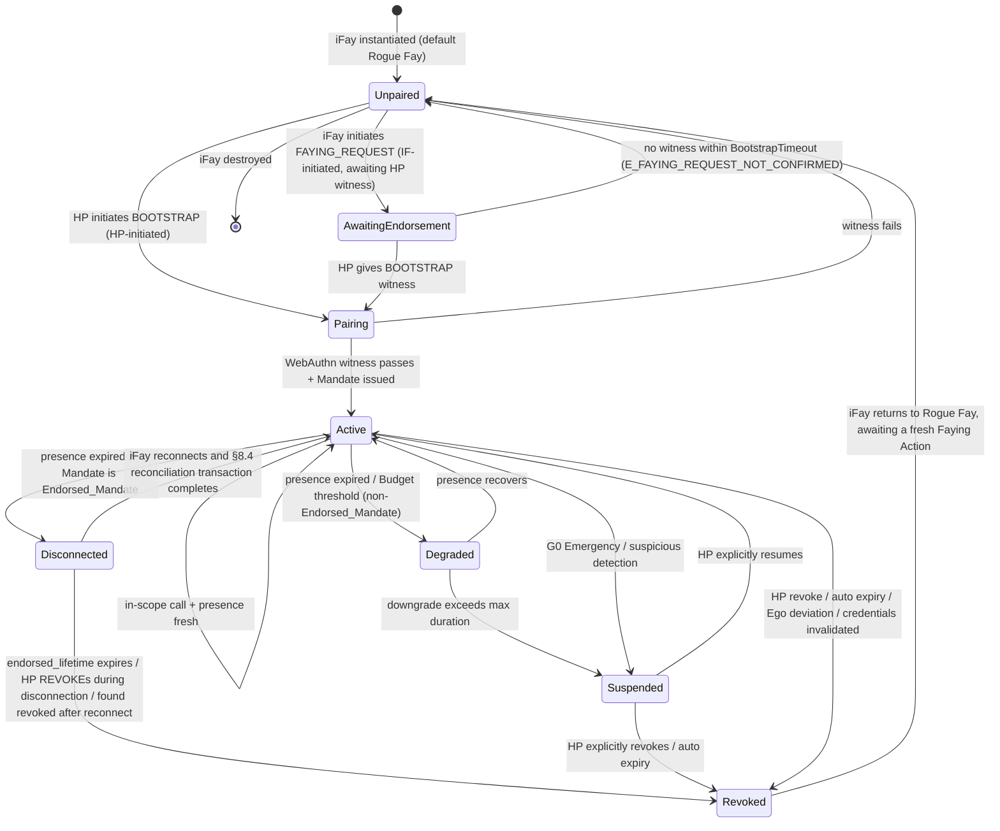
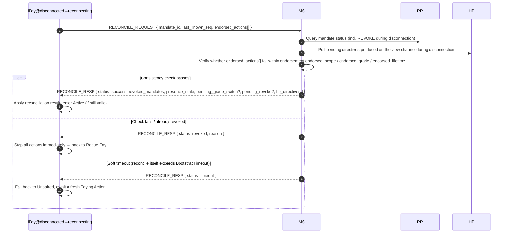

> Навигация по тексту протокола: [Оглавление](./README.md) | предыдущая [§7 Уровни авторизации](./07-Urovni-Avtorizacii.md) | следующая [§9 Вопросы безопасности](./09-Voprosy-Bezopasnosti.md)

## §8 Жизненный цикл

Эта глава даёт сквозной жизненный цикл Faying Protocol: от инстанцирования iFay, инициирования Faying Action, поддержания Faying State, через понижение / обрыв связи / приостановку / отзыв, вплоть до возврата к Rogue Fay — полное замыкание состояний. Конечный автомат, специфицируемый этой главой, — носитель инвариантов уровня протокола: легитимность всех действий измерения D (исходящих), уникальность конечной точки несения ответственности и граница «эндорсированной автономности» во время обрыва связи — всё определено в этой главе.

### §8.1 Полный конечный автомат жизненного цикла

Диаграмма ниже покрывает 7 замыканий состояний уровня протокола (**Unpaired / Pairing / Active / Degraded / Disconnected / Suspended / Revoked**) и все легитимные переходы между ними. `AwaitingEndorsement` — промежуточное транзитное состояние на пути двунаправленного Faying, инициированного IF (см. §2.4 / §5.3.6); оно не составляет стабильного замыкания, где «действия исполнимы», но всё же показано на диаграмме состояний, чтобы сохранить граф переходов полным.

> Отношение к конечному автомату Mandate из §4.3: §4.3 описывает состояние *объекта Mandate* (Pending / Active / Degraded / Disconnected / Suspended / Revoked / Rejected); этот раздел описывает состояние жизненного цикла *сущности iFay*. Они связаны мостом через сопоставление «Active/Degraded/Disconnected Mandate ⇔ Faying State / только эндорсированное Faying State»; см. таблицу «сопоставление состояния Mandate ↔ поведенческое состояние Fay» в конце §4.3.

### §8.2 Семантика фаз

Таблица ниже даёт семантику 7 замыканий состояний. Значение каждого состояния в столбце «исходящее действие (измерение D)» — решение о допуске измерения D на уровне протокола.

- **Unpaired**: эквивалентно Rogue Fay в концепции. Разрешены только действия A1–A4 (самовосприятие), B1–B3 (внутреннее выражение), C1–C2 (односторонняя человеческая коммуникация, включая инициирование FAYING_REQUEST). Действия измерения D единообразно запрещены.

> **Точное определение Rogue Fay (важно)**: разрыв связи сам по себе **не** равен Rogue Fay. iFay определяется как Rogue Fay тогда и только тогда, когда выполняется один из следующих двух случаев: (1) **отключена И не существует явной авторизации** — то есть ни один Mandate в `Active / Degraded / Disconnected` не покрывает её текущее поведение (включая случай, когда Faying никогда не устанавливался, или Mandate был отозван / истёк / приостановлен); (2) **доказанно отключена** — вынесен вердикт Perceived-Disconnected по §9.9, И текущий Mandate не является действующим Endorsed_Mandate (или `endorsement` истёк / `enabled=false`).
>
> И наоборот: iFay, у которой физическая связь разорвана, но которая удерживает **действующий Endorsed_Mandate** и всё ещё в пределах `endorsed_scope / endorsed_grade / endorsed_lifetime`, находится в состоянии `Disconnected` и в **Faying State (только эндорсированное), а не Rogue Fay** — её действия измерения D во время обрыва связи несутся `Mandate.issuer` (HP) через офлайн-предавторизацию, установленную на момент BOOTSTRAP (см. §4.3 / §7.5 / §8.3 / §8.4). Только когда срок жизни endorsement истекает, она отзывается или сверка проваливается, эта iFay мигрирует в Revoked → Unpaired и возвращается к Rogue Fay.
- **AwaitingEndorsement**: инициированный iFay FAYING_REQUEST переслан в канал представления HP, в ожидании подтверждения HP через BOOTSTRAP в течение `BootstrapTimeout` (по умолчанию 60 с); это состояние не порождает Mandate; исходящие действия единообразно запрещены; по тайм-ауту откатывается к Unpaired и записывается в Attestation Chain (код ошибки 1014 `E_FAYING_REQUEST_NOT_CONFIRMED`).
- **Pairing**: выполняющийся Faying Action, транзитное. Должно завершить свидетельство WebAuthn + выпуск Mandate в течение `BootstrapTimeout`; провал → откат к Unpaired без остаточного состояния.
- **Active**: Faying State работает нормально. Существует ровно один Mandate в состоянии Active, соответствующий ей; все вызовы измерения D допускаются согласно `Mandate.scope` и `Mandate.grade`.
- **Degraded**: Faying State всё ещё держится, но уровень ужесточён (запущено истечением сигнала присутствия). Применимо только к **не-Endorsed_Mandate**. Длительность не должна превышать `MaxDegradedDuration` (по умолчанию настраивается по уровню, см. Приложение B); превышение → миграция в Suspended.
- **Disconnected**: Faying State действителен только в пределах `endorsement.endorsed_scope` и `endorsement.endorsed_lifetime`; применимо к окну «только эндорсированных» действий Endorsed_Mandate во время физического обрыва связи. Конкретную семантику допуска и обрыва см. §4.3 / §7.5 / §8.4.
- **Suspended**: Faying State временно приостановлено. Исходящие действия единообразно запрещены, но метаданные Mandate сохраняются для явного восстановления HP или аудита; превышение точки автоистечения → миграция в Revoked.
- **Revoked**: Mandate прекращён. iFay возвращается к Rogue Fay; любой последующий вызов измерения D должен пройти свежий полный Faying Action (новый `mandate_id`). Revoked — поглощающее состояние Mandate (см. P10).

### §8.3 Последовательность атрибуции ответственности

> **В любой момент исходящее действие IF → должен существовать ровно один Mandate в Active, Degraded или Disconnected → `issuer` этого Mandate является конечной точкой несения ответственности.**

Этот пункт — формализованный временной пункт «уникальности конечной точки несения ответственности» на уровне протокола; третьего случая не существует:

1. **Нет соответствующего Mandate**: не существует Mandate в Active / Degraded / Disconnected ⟹ исходящее действие не разрешено (измерение D запрещено); RP должна вернуть `E_NO_MANDATE` (1001) или `E_PRESENCE_STALE` (1005).
2. **Сосуществуют несколько соответствующих Mandate**: уровень протокола обязательно выбирает тот, что с «наиболее специфичным scope», и они должны иметь один и тот же `issuer` (HP); если существует несколько соответствующих Mandate с разными издателями, это рассматривается как ошибка протокола и должно вернуть `E_PROTOCOL` (1099).
3. **Исходящее действие во время Disconnected**: всё ещё относится к `Mandate.issuer` (HP). `endorsement` лишь ограничивает исполнимые `endorsed_scope` / `endorsed_grade` / `endorsed_lifetime` действия и не меняет конечную точку несения ответственности; нет легитимного пути для «endorsement передать ответственность самой iFay / MS / Supervisory Agent» (см. P16.5).

Из этого пункта немедленно выводимо следующее:

- Для любого принятого вызова `c` пятёрка аудита `(mandate_id, endorsement_id?, action, ts, signature_chain)` имеет корневой узел `signature_chain`, необходимо и исключительно являющийся `Mandate.issuer`;
- iFay не имеет легитимного пути «самоатрибуции»; MS / Supervisory Agent не должны подменять идентичность `issuer` HP собственным агентским свидетельством;
- Конечная точка несения ответственности не может меняться в течение жизненного цикла Mandate; любое изменение должно проходить через отзыв + новый BOOTSTRAP (новый `mandate_id`, новый `issuer`).

### §8.4 Сверка при переподключении

> **Назначение**: свести «эндорсированную автономность» iFay во время Disconnected с изменениями состояния центрального представления протокола (MS / RR / канал представления HP) к согласованному состоянию и явно запретить «переподключение = возобновление действия» как антипаттерн.

#### §8.4.1 Поток

#### §8.4.2 Содержание возврата транзакции сверки

При успехе транзакции (`status = success`) `RECONCILE_RESP` должен вернуть следующие поля (в соответствии один к одному с Requirement 12.4):

1. **`revoked_mandates`**: список Mandate, отозванных во время обрыва связи (включая каскадные дочерние Mandate);
2. **`presence_state`**: текущий PresenceState (используется для решения, может ли измерение D продолжаться);
3. **`pending_grade_switch`**: незавершённые события GRADE_SWITCH (если есть);
4. **`pending_revoke`**: незавершённые события REVOKE (если есть);
5. **`hp_directives`**: отложенные директивы, порождённые в канале представления HP во время обрыва связи (например, G0 Emergency Override, явный REVOKE, принудительное понижение и т. д.).

#### §8.4.3 Перечисление исходов транзакции

Исход транзакции сверки — ровно один из следующих трёх, согласован с формализацией P17.4 `reconcile_result(M) ∈ {success, revoked, timeout}`:

| Исход | Условие триггера | Пост-состояние | Требование аудита |
| --- | --- | --- | --- |
| `success` | Проверка согласованности проходит ∧ Mandate всё ещё действителен ∧ завершено в течение BootstrapTimeout | Disconnected → Active | Записано в Attestation Chain, включая полный аудит endorsed_actions |
| `revoked` | endorsed_lifetime истёк ∨ HP выпустил REVOKE во время обрыва ∨ обнаружен отзыв после переподключения ∨ endorsed_actions вне границ | Disconnected → Revoked → Unpaired | Записано в Attestation Chain; обработать аудит периода обрыва по `endorsement.offline_revocation_policy` |
| `timeout` | Сама транзакция сверки превышает `BootstrapTimeout` без достижения success / revoked | Disconnected → Unpaired | Записано в Attestation Chain, помечено `reason=reconcile-timeout` |

#### §8.4.4 Жёсткие ограничения на уровне протокола

- **Запрет измерения D**: до завершения транзакции сверки iFay не должна выполнять никаких действий измерения D; любой вызов, прибывающий в RP в пределах этого окна, должен отклоняться с `E_PRESENCE_STALE` (1005) или `E_REVOKED` (1006). Этот запрет держится в пределах `[t_reconnect, t_reconnect + reconcile_complete_ms]` (согласовано с P17.4).
- **Тайм-аут = откат к Rogue Fay**: транзакция сверки должна завершиться в течение `BootstrapTimeout`; по тайм-ауту iFay откатывается к Unpaired, в ожидании свежего Faying Action (автоповтор BOOTSTRAP запрещён).
- **Все три исхода должны войти в AC**: три исхода `success` / `revoked` / `timeout` самой транзакции сверки должны все записываться в Attestation Chain; обработать аудит действий периода обрыва по `endorsement.offline_revocation_policy`:
  - `stop-and-audit` (по умолчанию): немедленно остановиться + представить полный аудит endorsed_actions + откатиться к Rogue Fay;
  - `stop-only`: немедленно остановиться + аудит не принуждается (применимо только к необратимым / аварийным сценариям; требует разрешения Protocol Committee);
  - `graceful-stop`: разрешить ограниченное завершение (write-close / сохранение состояния) перед остановкой; действия завершения остаются ограниченными endorsement.
- **Нет самоповтора после отката**: когда исход транзакции сверки — `revoked` или `timeout`, и iFay откатывается к Rogue Fay, iFay не должна повторять BOOTSTRAP сама; она должна дождаться повторного инициирования HP (HP-initiated) или нового FAYING_REQUEST, явно подтверждённого HP (IF-initiated).
- **Тихое возобновление запрещено**: не допускается путь реализации «переподключение = возобновление». Любая реализация, обходящая транзакцию сверки §8.4 и мигрирующая Disconnected напрямую в Active, рассматривается как несоответствующая; набор тестов соответствия совместимости должен пометить её как fail.

---
