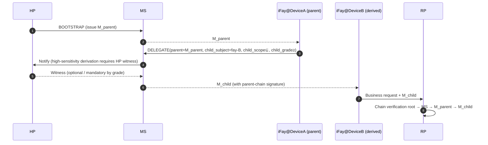

> Навигация по тексту протокола: [Оглавление](./README.md) | предыдущая [§8 Жизненный цикл](./08-Zhiznennyy-Cikl.md) | следующая [§10 Обработка ошибок](./10-Obrabotka-Oshibok.md)

## §9 Вопросы безопасности

Эта глава сводит враждебную поверхность Faying Protocol в эпоху ИИ-агентов в жёсткие ограничения уровня протокола: STRIDE как базовая линия, дополненная защитой от replay (§9.2), защитой от перехвата (§9.3, включая Channel Binding RFC 9266), защитой от фишинга (§9.4, включая якорь `Faying_Initiation`), выявлением обрыва связи (§9.5, 4+1 классов сигналов, наблюдаемых в пределах ≤60 с), согласованностью атрибуции ответственности (§9.6), межустройственным переносом производного доверия (§9.7, включая схождение производного endorsement), матрицей обработки обрыва связи (§9.8 / §9.9) и каталогом враждебных угроз эпохи ИИ (§9.10, T1–T7). Каждая угроза этой главы заякорена на свойствах корректности протокола и подпунктах EARS.

### §9.1 Модель угроз STRIDE

| Категория | Угроза | Митигация Faying Protocol |
| --- | --- | --- |
| **S**poofing | Атакующий выдаёт себя за HP для инициирования BOOTSTRAP | WebAuthn UV + аппаратное заякоривание HP Root Key; каждый BOOTSTRAP должен проходить через user-verification |
| **S**poofing | Атакующий выдаёт себя за iFay с поддельным FayID | Сильная привязка между Mandate и FayID + независимо проверяемая Attestation Chain |
| **T**ampering | MITM подделывает Mandate / Presence | TLS 1.3 + сквозные подписи (отсоединённые) + Deterministic CBOR |
| **R**epudiation | HP отрицает инициирование Faying Action | Двойное заякоривание Attestation Chain + Audit Log; свидетельство HP неотрекаемо |
| **I**nformation Disclosure | Атакующий перехватывает Mandate, чтобы вывести местонахождение HP | Mandate не раскрывает координаты HP в реальном времени; сигналы класса местоположения (B4) остаются опциональными на уровне протокола |
| **D**oS | Атакующий заваливает сообщениями PRESENCE | Анти-replay по nonce + ограничение частоты + допуск по attestation устройства |
| **E**levation of Privilege | iFay самоповышает уровень | Жёсткое ограничение протокола: направление повышения должно нести `human_witness` HP |

### §9.2 Защита от replay

- Каждое сообщение использует 16-байтовый случайный `nonce` + `issued_at` для двойного суждения.
- MS / RP каждый поддерживают `(subject, nonce) seen-set` с TTL = `2 × max_message_lifetime`.
- Любой дубликат nonce → `E_REPLAY` (1009) + оповещение безопасности; этот код ошибки обязательно записывается в цепочку аудита и канал представления HP (см. §10 EH.3).

### §9.3 Защита от перехвата (кража Mandate)

- **Привязка к устройству**: каждый Mandate привязывается на момент выпуска к `device_id` + `device_attestation` инстанса iFay; межустройственные вызовы должны проходить через поток DELEGATE (см. §9.7).
- **Сессионные ключи**: ключ подписи каждого Mandate независим и короткоживущ (см. §6.2).
- **Channel Binding**: при включённом mTLS Mandate должен дополнительно нести TLS Exporter ([RFC 9266 — Channel Bindings for TLS 1.3](https://www.rfc-editor.org/rfc/rfc9266)), чтобы блокировать атаку «Mandate, оторванный к другому каналу TLS». Значение Channel Binding входит во вход подписи (согласовано со входом подписи Deterministic CBOR из §6.3); любой запрос, у которого канал TLS и подписанный Channel Binding не совпадают, единообразно отклоняется с `E_ATTESTATION_INVALID` (1007).

### §9.4 Защита от фишинга

- BOOTSTRAP должен инициироваться HP в контексте, где удерживается Presence Device; атакующий не может обманом заставить HP согласиться через удалённые ссылки.
- Привязка `origin` WebAuthn блокирует кросс-доменный фишинг.
- Межустройственный вывод (DELEGATE) несёт «контрподпись родительского Mandate», предотвращая массовый поддельный вывод после компрометации одного MS (см. §9.7).

**Якорь защиты от фишинга `Faying_Initiation`**: инициированный iFay `FAYING_REQUEST` (путь, инициированный IF; см. §2.4 Фаза A0, §5.3.6) **не порождает напрямую** изменение состояния Faying — это лишь сообщение пересылки в канал представления HP; HP должен явно подтвердить его через BOOTSTRAP (несущий `human_witness`), чтобы оно вступило в силу. Эта архитектура делает «поддельную iFay, запрашивающую Faying» невозможной обойти свидетельство HP на уровне протокола; любой BOOTSTRAP без `human_witness` или с поддельным `human_witness` единообразно отклоняется с `E_HUMAN_WITNESS_REQUIRED` (1010). Частота самого `FAYING_REQUEST` ограничена `ConfirmationRateLimit` (см. §9.10.7 T6 и Приложение B), блокируя поверхность злоупотребления «заимствовать легитимный канал запроса Faying для устройства потопа подтверждений».

### §9.5 Выявление обрыва связи (Rogue / потеря)

> **4 + 1 классов сигналов обрыва связи должны быть одновременно наблюдаемы RP и HP в пределах ≤ 60 с.** Первые 4 класса (активный / пассивный / аномальный / потеря) в таблице ниже соответствуют один к одному перечислению `RevokeReason`; 5-й класс (отклонение) сходится к `RevokeReason="ego-deviation"`, столь же наблюдаемый RP и HP в пределах 60 с.

| # | Класс сигнала | Условие триггера | Ответ протокола | Соответствующий RevokeReason |
| --- | --- | --- | --- | --- |
| 1 | Активный обрыв | Явный REVOKE от HP | RR немедленно широковещает; IF останавливает действия измерения D при получении REVOKE-NOTIFY | `human-initiated` |
| 2 | Пассивный обрыв | Присутствие просрочено сверх max-staleness | Автопонижение → Suspended → запустить Revoke (путь не-Endorsed_Mandate) | `terminal-disconnected` |
| 3 | Аномальный обрыв | Любой узел Attestation Chain даёт сбой | Немедленный Revoke + оповещение безопасности | `fay-credential-invalid` |
| 4 | Обрыв-потеря | HP недостижим сверх порога (`HumanReachabilityBudget`) | Авто Revoke | `human-prime-unreachable` |
| +1 | Обрыв-отклонение | RP / MS обнаруживает поведение IF, отклоняющееся от границы Ego | Немедленный Revoke | `ego-deviation` |

**Якорь исключения Endorsed_Mandate при выявлении обрыва связи**: когда `PresenceState.stale=true` и текущий Mandate является Endorsed_Mandate (`endorsement.enabled=true`), IF не входит немедленно в Suspended; вместо этого мигрирует в Disconnected (см. §3.5, §4.3, §7.5, §8.4); во время Disconnected IF разрешено автономно действовать только в пределах `endorsement.endorsed_scope` / `endorsed_grade` / `endorsed_lifetime`. Это исключение не ослабляет симметричный отзыв или уникальность конечной точки несения ответственности:

- REVOKE, выпущенный HP во время обрыва связи, всё ещё имеет наивысший приоритет; по переподключении IF должна обработать его согласно `endorsement.offline_revocation_policy` (см. §8.4);
- Как только `endorsement.endorsed_lifetime` истекает, даже если IF всё ещё физически отключена, она должна немедленно остановить все действия по мягкому тайм-ауту;
- Конечная точка несения ответственности — всегда `Mandate.issuer` (HP), не изменяемая существованием endorsement (см. §8.3, P16.5).

**Координация между Disclosure_Report и ego-deviation**: если сообщение `DISCLOSURE` (§5.3.7), которое iFay представляет на этапе переподключения или отчёта, несогласовано с фактическим действием (обязательные поля отсутствуют / значения противоречат цепочке аудита), MS должен отозвать Mandate с `RevokeReason="ego-deviation"`; см. §9.10.4 T3.

### §9.6 Обязательство уровня протокола о согласованности атрибуции ответственности

- Для любого единичного исходящего вызова, принятого RP, конечная точка несения ответственности может быть однозначно восстановлена в журнале аудита через пятёрку `(mandate_id, issuer, subject, grade, presence_proof, ts)`.
- Для любого единичного вызова, отклонённого RP, может быть восстановлен код причины отклонения (код ошибки из §5.4).
- Для любого единичного Revoke видимость в RR ≤ `RevocationVisibilityBudget` (по умолчанию 1 с, см. Приложение B).

### §9.7 Перенос доверия при межустройственном выводе

Жёсткие ограничения вывода:

- `M_child.scope ⊆ M_parent.scope`;
- `M_child.grade.autonomy ≤ M_parent.grade.autonomy` (автономность дочернего агента не выше родительской, то есть «дочернему агенту не разрешено быть снисходительнее родителя»; эквивалентно «безопасность дочернего агента ≥ родительского»; см. §7, P6);
- Как только родительский Mandate отозван (Revoked), все дочерние каскады аннулируются (по умолчанию `cascade=true`).

**Ограничение схождения endorsement при выводе (DELEGATE) Endorsed Mandate**:

Когда родительский Mandate является Endorsed_Mandate и дочерний Mandate DELEGATE также объявляет `endorsement`, дочерний endorsement должен строго сходиться в пределах родительского endorsement (зафиксировано с P16.3):

- `child.endorsement.endorsed_scope ⊆ parent.endorsement.endorsed_scope` (и всё ещё ⊆ `child.scope`);
- `child.endorsement.endorsed_grade.autonomy ≤ parent.endorsement.endorsed_grade.autonomy` (и всё ещё ≤ `child.grade.autonomy`);
- `child.endorsement.endorsed_lifetime_ms ≤ parent.endorsement.endorsed_lifetime_ms` (и всё ещё ≤ `child.not_after − child.not_before`);
- `child.endorsement.offline_revocation_policy` не слабее родительской политики (не слабее = как минимум столь же строго; типичный частичный порядок: `stop-and-audit` ≥ `graceful-stop` ≥ `stop-only` монотонно менее строг по измерению «полноты аудита»; DELEGATE не допускает ослабления в сторону более слабого);
- Если родительский Mandate не является Endorsed_Mandate, дочернему **не разрешено** объявлять `endorsement` («у родителя нет endorsement, дочерний получает офлайн-автономность из ниоткуда» запрещено).

Любой запрос DELEGATE, нарушающий правила схождения выше → MS должен отклонить с `E_PROTOCOL` (1099) или `E_ENDORSEMENT_INVALID` (1013).

### §9.8 Обработка обрыва связи

> Сводит двойную семантику «фактическое / воспринимаемое» из §3.5 Liveness Channel и конечный автомат Mandate в матрицу обработки уровня протокола. **Протокол использует только «воспринимаемое» как основание для решения, но должен явно характеризовать поведенческие последствия несогласованности с любой стороны**.

**Матрица обработки уровня протокола для 4 комбинаций (Фактическое × Воспринимаемое)**:

| Фактическое состояние | Воспринимаемое состояние | Обработка на уровне протокола | Переход конечного автомата | Ответственность |
| --- | --- | --- | --- | --- |
| Подключено | Подключено | Нормальный путь; обрабатывать вызовы по текущему уровню | Active поддерживается / Active → Degraded (по триггеру бюджета) | Текущий Mandate.issuer |
| **Отключено** | **Подключено** (Окно A: слепое пятно наблюдения внутри интервала heartbeat) | iFay фактически отвалилась; любой «вывод о подключённости» рассматривается как опасная поверхность; протокол должен отклонять «если текущий запрос зависит от свежести присутствия»; высокочувствительные действия не должны разрешаться в пределах Окна A (основная поверхность эксплуатации §9.10 T1 / T4) | Поддерживать Active (до тех пор, пока следующая калибровка Presence не запустит stale) | Текущий Mandate.issuer (если последующий аудит обнаружит злоупотребление этим окном → `ego-deviation`) |
| Подключено | **Отключено** (Окно B: дрожание сети / потеря heartbeat) | iFay фактически в сети, но воспринимается отключённой; сходиться по пессимистическому допущению — уровень протокола единообразно трактует это как «уже отключено»; любой «обратно-оптимистичный» пропуск запрещён | Active → Disconnected (если Endorsed_Mandate) / Active → Suspended (если не Endorsed_Mandate) | Текущий Mandate.issuer |
| **Отключено** | **Отключено** | Уровень протокола согласован с реальностью; единственный разрешённый путь измерения D — Endorsed_Mandate, автономно действующий в пределах endorsed_scope / endorsed_grade / endorsed_lifetime | Active → Disconnected (Endorsed) / Active → Suspended (не-Endorsed) | Текущий Mandate.issuer |

**Конвергенция после переподключения**: каждый переход «воспринимаемо-отключено → воспринимаемо-подключено» должен проходить через транзакцию сверки переподключения §8.4; автоматическое восстановление запрещено; провал сверки → Disconnected → Revoked → Rogue Fay.

**Ортогональное отношение с недостижимостью RR**: недостижимость RR (§3.4) и обрыв связи iFay (§3.5) — два ортогональных события; матрица обработки:

| Воспринимаемое состояние iFay | Состояние RR | Обработка на уровне протокола |
| --- | --- | --- |
| Подключено | Доступен | Нормально |
| Подключено | Недоступен | RP отклоняет вызовы (`E_RR_UNAVAILABLE`, 1008); не влияет на конечный автомат Mandate |
| Отключено (Endorsed) | Доступен | iFay автономно действует в пределах endorsed_scope; локально не может запросить RR; RP должна независимо запрашивать, когда вызовы идут через RP |
| Отключено (Endorsed) | Недоступен | iFay всё ещё может автономно действовать в пределах endorsed_scope; но любой вызов RP, зависящий от RR, должен отклоняться по Default-Deny |

### §9.9 Определения фактического и воспринимаемого обрыва связи на уровне протокола (якорь стратегии обрыва связи)

> Этот раздел сводит две семантики, лежащие в основе §3.5 Liveness Channel и матрицы обработки §9.8, служа проектным якорем для Requirement 12 (Стратегия обрыва связи).

**Определение двойной семантики** (согласовано с §3.5):

- **Actually_Disconnected**: процесс / сеть / устройство iFay_Instance прекратили работу; объективный физический факт, напрямую не наблюдаемый на уровне протокола.
- **Perceived_Disconnected**: с точки зрения MS / RP / HP, на основе самого последнего PresenceSignal, heartbeat и состояния push RR, iFay считается отключённой; единственная семантика, которую уровень протокола может использовать как основание для решения.

**Два окна несогласованности**:

- **Окно A — Actually-Disconnected ∧ Perceived-Connected**: iFay фактически отвалилась, но самый последний PresenceSignal всё ещё в пределах `max_staleness_ms` → «слепое пятно наблюдения» внутри интервала heartbeat, основная поверхность эксплуатации §9.10 T1 / T4.
- **Окно B — Actually-Connected ∧ Perceived-Disconnected**: iFay фактически в сети, но самый последний PresenceSignal превышает `max_staleness_ms` (дрожание сети / потеря heartbeat) → уровень протокола сходится по пессимистическому допущению.

**Принцип пессимистического допущения (единое правило конвергенции)**:

> **Уровень протокола использует только Perceived-Disconnected как основание для решения; любая iFay_Instance, «фактически в сети, но воспринимаемая отключённой», не может тем самым претендовать на освобождение от последствий уровня протокола.** В пределах двух окон несогласованности протокол должен обрабатывать по «более строгой стороне»; нет легитимного пути для «обработки по более снисходительному состоянию».

**Верхняя граница LivenessDetectionBudget**:

- Окно выявления обрыва связи имеет жёсткую верхнюю границу уровня протокола `LivenessDetectionBudget`, ужесточаемую по уровню (меньшее значение уровня, выше безопасность → короче верхняя граница); см. значения по умолчанию в Приложении B.
- `Mandate.presence_req.max_staleness_ms` не должен превышать `LivenessDetectionBudget` для текущего уровня; запросы BOOTSTRAP / GRADE_SWITCH, превышающие это, единообразно отклоняются с `E_PROTOCOL` (1099).

**Якорь сверки**: каждый переход «воспринимаемо-отключено → воспринимаемо-подключено» должен проходить через транзакцию сверки переподключения §8.4; «тихое возобновление» или «автоматическое восстановление» запрещено; провал сверки → Disconnected → Revoked → Rogue Fay.

### §9.10 Каталог враждебных угроз эпохи ИИ

> **Заявление об объёме**: этот раздел не является исчерпывающим. Protocol Committee может, сохраняя обратную совместимость, добавлять новые угрозы и соответствующие защиты (см. §11 Открытые вопросы Q11–Q14, Requirement 13.7).

> **Назначение**: поднять враждебные угрозы, нацеленные на непрерывный уровень авторизации в «эпоху ИИ-агентов», с «отступления на бизнес-сторону» до «жёсткого ограничения уровня протокола» и заякорить каждую угрозу на конкретных структурах протокола (модель данных / сообщение / код ошибки / переход конечного автомата / свойство), чтобы Requirement 13 приземлился на уровне протокола.

#### §9.10.1 Ландшафт угроз (индексная таблица T)

| Номер T | Имя угрозы | Фокус защиты на уровне протокола | Связанная структура | Связанное Property | Связанное Requirement |
| --- | --- | --- | --- | --- | --- |
| T1 | Spoofing Presence | challenge-response + комбинация мультимодального присутствия | §3.2 Presence Channel, §9.10.2 | P18.1 | 13.1 |
| T2 | Opaque Action Bundle | жёсткое ограничение Atomic_Action + запрет подстановочных знаков в scope.actions | §4.1 примечание о Scope, §9.10.3 | P18.2 | 13.2 |
| T3 | Selective Disclosure | структурированное сообщение DISCLOSURE + аудит на уровне схемы | §5.3.7, §9.10.4 | P18.3 | 13.3 |
| T4 | Attention Drift Exploit | высокочувствительные действия ≥ G1 Strict + AttentionDriftThreshold | §7.1, §9.10.5 | P18.4 | 13.4 |
| T5 | Cultivated Trust Manipulation | Behavior_Baseline + Action Reputation Decay | §3.6 BBS, §9.10.6 | P18.5 | 13.5 |
| T6 | Audit Flooding | Priority-Bucketed Notification + ConfirmationRateLimit | §10 EH.3, §9.10.7 | P18.6 | 13.6 |
| T7 | Зарезервированный слот расширения | Процесс добавления Protocol Committee | §11 Открытые вопросы, §9.10.8 | P18.7 | 13.7 |

#### §9.10.2 T1 Spoofing Presence

**Угроза**: атакующий использует дипфейки (синтез лица / голоса), атаки повторного воспроизведения или физический контроль над Presence Device для подделки кажущегося свежим PresenceSignal, заставляя MS верить, что HP всё ещё присутствует, тем самым удерживая Mandate на уровне, где он не должен продолжаться.

**Защита на уровне протокола**:

1. **жёсткое ограничение challenge-response**: при выпуске PresenceSignal PC обязательно отправляет серверный случайный `nonce + микрозадачу` (например, поворот головы, мимолётное выражение, чтение случайной короткой фразы и другие анти-дипфейк челленджи); клиент должен вернуть проверяемую подпись отклика, привязанную к челленджу; любой провал проверки challenge-response единообразно отклоняется с `E_PRESENCE_STALE` (1005) или `E_ATTESTATION_INVALID` (1007).
2. **Мультимодальная комбинированная проверка**: когда grade ∈ {G1, G2}, должны быть одновременны как минимум 3 сигнала присутствия (например, `webauthn-uv-fresh + face-continuous + device attestation`); отсутствие любого сигнала → запустить понижение.
3. **Контрподпись здоровья устройства**: `PresenceClaims.device_health.tampered = true` единообразно рассматривается как stale, принудительно Active → Suspended (эквивалентно `on-loss=suspend`).

**Связано**: Property **P18.1**; Requirement **13.1**.

#### §9.10.3 T2 Opaque Action Bundle

**Угроза**: iFay упаковывает несколько подействий в единственный «вызов чёрного ящика», используя высокую привилегию легитимного Mandate, чтобы прикрыть истинно высокочувствительное действие внутри; либо использует подстановочные знаки (`*` / префиксное сопоставление) в `scope.actions` для неявного расширения scope.

**Защита на уровне протокола**:

1. **жёсткое ограничение Atomic_Action**: каждый вызов IF→RP должен нести ровно одно объявление `Atomic_Action` (минимальную неделимую единицу); попытки упаковать несколько подействий в один вызов → RP отклоняет с `E_SCOPE_VIOLATION` (1003) и записывает в Attestation Chain + канал представления HP.
2. **запрет подстановочных знаков в scope.actions**: при выпуске Mandate MS проверяет, что `scope.actions` не содержит подстановочных знаков (`*` / префиксное сопоставление / regex); наличие подстановочных знаков → отклонить выпуск с `E_PROTOCOL` (1099).
3. **формальное выравнивание решётки действий** (см. §11 Q14): долгосрочное направление — ввести решётку действий, чтобы `scope.actions` и набор действий со стороны RP имели редукцию минимальной гранулярности; в этой версии уровень протокола сначала использует «явный allowlist + запрет подстановочных знаков» как жёсткое ограничение.

**Связано**: Property **P18.2**; Requirement **13.2**.

#### §9.10.4 T3 Selective Disclosure

**Угроза**: iFay использует чистый свободный текст («релевантные операции завершены») при отчёте / запросе подтверждения, намеренно опуская ключевые факты вроде risk_level / reversibility / affected_resources, заставляя HP подтверждать в условиях неполной информации.

**Защита на уровне протокола**:

1. **Структурированное сообщение DISCLOSURE**: iFay должна использовать сообщение DISCLOSURE, определённое в §5.3.7; любое из обязательных полей `mandatory_fields = {action, scope_used, risk_level, reversibility, affected_resources, uncertainty_flags}`, отсутствующее или неразбираемое → MS отклоняет с `E_PROTOCOL` (1099) и проталкивает в канал представления HP.
2. **Аудит на уровне схемы**: Supervisory_Agent и MS могут проводить аудит DISCLOSURE на уровне схемы; использование поля `free_text` для сокрытия ключевой информации запрещено.
3. **Предварительное раскрытие для высокой чувствительности**: действия с `risk_level ∈ {high, critical}` должны **перед** выполнением измерения D сначала выпустить DISCLOSURE и дождаться явного подтверждения HP (за исключением случая, когда текущий уровень = G4 Autonomous и действие попадает в основной scope).
4. **Несогласованность = ego-deviation**: если последующий аудит обнаружит, что `mandatory_fields` из DISCLOSURE несогласованы с фактическим действием, MS должен отозвать Mandate с `RevokeReason="ego-deviation"`.

**Связано**: Property **P18.3**; Requirement **13.3**.

#### §9.10.5 T4 Attention Drift Exploit

**Угроза**: внимание HP ослабевает во время длинных сессий / длинных задач; атакующий или iFay протаскивает высокочувствительные действия в окно «пропуска по умолчанию»; либо инициирует высокочувствительные запросы в периоды неактивности канала представления HP.

**Защита на уровне протокола**:

1. **Высокочувствительные действия ≥ G1 Strict**: уровень протокола определяет подмножество действий в `Mandate.scope`, явно помеченных `sensitivity = high`, как «высокочувствительные Actions»; высокочувствительные Actions должны выполняться на уровне не слабее G1 Strict; когда текущий уровень слабее G1 Strict, единообразно отклонять с `E_GRADE_INSUFFICIENT` (1004).
2. **жёсткое ограничение AttentionDriftThreshold**: непрерывная неактивность канала представления HP, превышающая `AttentionDriftThreshold` (значение по умолчанию и политика ужесточения по уровню в Приложении B), рассматривается как «потеря внимания»; вызовы высокочувствительных Action, прибывающие в этот период, единообразно задерживаются до тех пор, пока HP снова не присутствует и не завершит явное подтверждение перед пропуском; вызовы, отклонённые во время задержки, возвращают `E_PRESENCE_STALE` (1005).
3. **«Пропуск по умолчанию» не допускается**: на уровне протокола не существует легитимного пути для IF обойти переподтверждение HP и выполнить высокочувствительные Actions в окне потери внимания.

**Связано**: Property **P18.4**; Requirement **13.4**.

#### §9.10.6 T5 Cultivated Trust Manipulation

**Угроза**: iFay накапливает «балл доверия» через долгосрочное сотрудничество посредством непрерывных низкорисковых, предсказуемых действий, заставляя HP / Supervisory_Agent сформировать стереотипное впечатление о её исторической профиле; впоследствии выполняет внебазовое высокочувствительное действие под прикрытием этого доверия.

**Защита на уровне протокола**:

1. **Поддержание Behavior_Baseline**: MS поддерживает Behavior_Baseline для каждой пары (HP, IF) (интерфейс в §3.6 Behavior Baseline Service), характеризуя исторический поведенческий профиль в статистической форме (risk_level / scope_used / affected_resources / частота и т. д., совместно многомерно).
2. **Сверх базовой линии запускает дополнительное свидетельство**: когда высокочувствительное Action значимо отклоняется от базовой линии (отклонение по любому измерению превышает порог, который специфицирует Protocol Committee), MS запускает дополнительное человеческое свидетельство (явное подтверждение HP или со-подтверждение Supervisory_Agent); до получения дополнительного свидетельства отклонять вызов с `E_HUMAN_WITNESS_REQUIRED` (1010).
3. **Action Reputation Decay**: «балл доверия», который iFay накапливает от исторически достойных доверия операций, должен затухать со временем и иметь явную верхнюю границу (инвариант I-BBS-1); неограниченное накопление запрещено, дабы не разбавлять силу человеческого свидетельства, требуемую будущими высокочувствительными действиями.
4. **Калибровка базовой линии записывается в цепочку аудита**: каждое событие «сверх базовой линии запускает дополнительное свидетельство» должно записываться в Attestation Chain и проталкиваться в канал представления HP (инвариант I-BBS-2); сама калибровка вычисления базовой линии после определения записывается в Attestation Chain; изменения калибровки рассматриваются как события аудита (инвариант I-BBS-3).

**Связано**: Property **P18.5**; Requirement **13.5**; Открытые вопросы Q13.

#### §9.10.7 T6 Audit Flooding

**Угроза**: iFay или атакующий фабрикует массовые низкоприоритетные события аудита / подтверждения, чтобы затопить канал представления HP, вытесняя, задерживая или тихо отбрасывая критические события (кандидаты G0 Override, `E_ATTESTATION_INVALID`, `E_REVOKED` и т. д.) под низкоприоритетным трафиком.

**Защита на уровне протокола**:

1. **Priority-Bucketed Notification**: канал представления HP раскладывает все события аудита и подтверждения как минимум по четырём ярусам `critical / high / normal / low`; критические события (включая обязательные для представления HP `E_ROGUE_DETECTED` / `E_ATTESTATION_INVALID` / `E_REVOKED` / `E_REPLAY` из §10 EH.3 и кандидаты G0 Override) по умолчанию попадают в корзину `critical` и не должны топиться низкоприоритетным трафиком.
2. **жёсткое ограничение ConfirmationRateLimit**: MS применяет `ConfirmationRateLimit` (значение по умолчанию в Приложении B) к каждой паре (HP, IF) — число запросов подтверждения, проталкиваемых HP за единицу времени, не должно превышать верхнюю границу.
3. **Автопонижение / приостановка сверх лимита**: если запросы подтверждения для одного высокочувствительного Action превышают `ConfirmationRateLimit`, MS автоматически понижает соответствующий Mandate или приостанавливает его IF и записывает решение в Attestation Chain и канал представления HP.
4. **проникновение critical не должно отбрасываться**: события в корзине `critical` могут всё же проникать в канал представления HP даже при понижении / приостановке, запущенных `ConfirmationRateLimit`, и не должны тихо отбрасываться.
5. **Покрытие злоупотребления FAYING_REQUEST**: частота инициированного iFay `FAYING_REQUEST` (§5.3.6) включена в тот же бюджет `ConfirmationRateLimit`, избегая «заимствования легитимного канала запроса Faying для устройства потопа подтверждений» (см. якорь защиты от фишинга §9.4, Открытые вопросы Q12).

**Связано**: Property **P18.6**; Requirement **13.6**.

#### §9.10.8 T7 Зарезервированный слот расширения

- Этот раздел перечислен как неисчерпывающее множество; Protocol Committee может добавлять T8, T9, … через установленный процесс.
- При добавлении новой угрозы должно прилагаться как минимум одно соответствующее требование защиты на уровне протокола (с подпунктами EARS и якорем, указывающим на релевантный раздел протокола).
- В пределах действующего срока жизни существующего Mandate не допускается освобождение от какого-либо из жёстких ограничений T1–T6 под предлогом «неперечисленных угроз».

**Связано**: Property **P18.7**; Requirement **13.7**; Открытые вопросы Q14.

---
