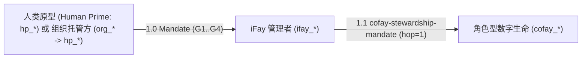

## §1 概述与定位

本规范定义 **Faying Protocol/1.1（coFay Delegated Stewardship Profile，coFay 委派托管扩展配置）**。本规范严格遵循 `Faying Protocol/1.0` 第 §1.7.2 节之 `MINOR` 向后兼容增补规则：`Faying Protocol/1.0`（`2025-10-25` 定稿与 `schemas/fap-1.0.cddl`）的所有报文、状态机与错误码保持完全不变；仅支持 `1.0` 的对端在协商阶段按 §1.7.3 回退至 `Faying Protocol/1.0`，或安全忽略不识别的可选扩展。

在 iFay 体系（`Fay = iFay + coFay`）中，`iFay` 拥有唯一固定的人类原型（Human Prime），而 `coFay` 是围绕专业角色章程（Role Charter）持续运行的硅基数字生命，不绑定单一自然人人格包。为坚守体系第一性伦理底线——**任意硅基实体的每一次对外行动都必须唯一归责到具体人类原型（Human Prime）**——本规范在 `Human Prime ↔ iFay` 授权链末端增补受密码学约束的 `iFay Manager → coFay` 委派托管与双签移交契约。

### §1.1 规范性关键词声明（RFC 2119 & RFC 8174）

本文档中的英文大写关键词 `MUST`、`MUST NOT`、`REQUIRED`、`SHALL`、`SHALL NOT`、`SHOULD`、`SHOULD NOT`、`RECOMMENDED`、`NOT RECOMMENDED`、`MAY` 与 `OPTIONAL` 按照 [BCP 14](https://www.rfc-editor.org/info/bcp14)（[RFC 2119](https://www.rfc-editor.org/rfc/rfc2119) 与 [RFC 8174](https://www.rfc-editor.org/rfc/rfc8174)）解释，当且仅当以全大写形式出现或对应下表中的中文规范性动词时具备规范性约束力：

| 中文规范性表述 | RFC 2119 / RFC 8174 对应语义 |
| --- | --- |
| **必须** / **须** | `MUST` / `REQUIRED` / `SHALL` |
| **不得** / **严禁** | `MUST NOT` / `SHALL NOT` |
| **应当** / **建议** | `SHOULD` / `RECOMMENDED` |
| **不建议** | `SHOULD NOT` / `NOT RECOMMENDED` |
| **可以** / **可选** | `MAY` / `OPTIONAL` |

多语种版本出现歧义时，以简体中文（`zh-CN`）正文与 `schemas/fap-1.1-cofay.cddl` 为权威基准。

---

## §2 三层责任穿透架构

`coFay` **不得**自行签发根授权，也**不得**绑定脱离人类原型问责的匿名主体。每一份合法的 `cofay-stewardship-mandate` **必须**构成如下三层可验证责任穿透链：

1. **终极问责层（`steward_entity` + `accountable_human_prime`）**：
   - 个人托管时，`steward_entity` 为 `hp_*`，且**必须**与 `accountable_human_prime` 完全一致；
   - 组织托管时，`steward_entity` 为 `org_*`，且**必须**显式指定承担终极法律与伦理问责的 `accountable_human_prime`（`hp_*`）。缺失或格式非法的报文**必须**以错误码 `1010 E_HUMAN_WITNESS_REQUIRED` 拒绝。
2. **管理代理层（`manager_fay_id`）**：
   - **必须**是持有有效 `Faying Protocol/1.0` Mandate 的 `ifay_*` 实体；任何 `cofay_*` 实体**不得**充当上游签发者。
3. **执行主体层（`subject_cofay_id`）**：
   - **必须**是符合角色章程（`charter_id`）约束的 `cofay_*` 实体，其一致性测试由 `coFACTS` 承担（与面向 `iFay` 的 `iFACTS` 严格分轨）。

---

## §3 四项非放大安全不变式（Normative）

校验器在评估 `cofay-stewardship-mandate` 时**必须**按顺序强制执行以下四条不变式：

1. **上游 `G0` 与吊销级联停机（Cascading Safe-State Halt）**：
   - 当上游人类原型或 `iFay` 管理者的运行态处于 `G0`（`EmergencyOverride`）或 `Revoked` 时，`coFay` **必须**立即转入 `safe-state-halt` 安全停机态，并返回 `1024 E_UPSTREAM_EMERGENCY_HALT`，**不得**凭本地缓存继续对外调用终端（Host）或外部技能。
2. **单跳托管上限（Single-Hop Ceiling）**：
   - `hop_count` **必须**恒等于 `1`，`max_stewardship_hops` **必须**恒等于 `1`。若 `hop_count != 1` 或签发者不是 `ifay_*`，校验器**必须**返回 `1023 E_STEWARDSHIP_HOP_LIMIT`。`coFay` **严禁**向下游再次转授托管权。
3. **授权等级单调不放大（Grade Non-Amplification）**：
   - 托管 `grade`（`0..4`）**必须**满足 `grade <= manager_grade`。任何试图赋予 `coFay` 高于其 `iFay` 管理者自主等级的报文**必须**以 `1021 E_GRADE_AMPLIFICATION` 拒绝。
4. **范围与时间窗双重收敛（Dual Scope Convergence）**：
   - 托管 `scope` 的 `domains`、`actions`、可选 `terminals` 与预算上限（`max_invocations`、`max_cost_units`）**必须**同时是 `charter_scope`（角色章程边界）与 `manager_scope`（管理者授权边界）的子集；
   - 有效期 `[not_before, not_after]` **必须**完整落在 `[manager_not_before, manager_not_after]` 之内且覆盖当前评估时刻。违反任一条件**必须**返回 `1022 E_SCOPE_ESCAPE`。

---

## §4 原子化双签托管权移交（`cofay-transfer`）

由于 `coFay` 不绑定单一自然人终身身份，当岗位轮换或组织重组引发托管主体变更时，移交过程**必须**通过 `cofay-transfer-authorization` 原子完成，以杜绝单方强夺或责任真空：

- **双签域分离规范化输入**：移出方（`from_steward`）与接收方（`to_steward`）**必须**对去除签名字段后的载荷执行 RFC 8785 JCS 规范化序列化，并在字节前缀拼接 `"ifay.faying.cofay-transfer.v1:"` 后分别生成有效密码学签名（`Ed25519`、`ES256` 或 `ML-DSA-65` 协商位）。
- **原子生效判据**：
  1. `from_steward` 与 `to_steward` **不得**为同一主体（禁止无意义自移交）；
  2. 双方均**必须**绑定合法的 `from_human_prime` 与 `to_human_prime`（`hp_*`），并指明接收后的新任 `next_manager_fay_id`（`ifay_*`）；
  3. 评估时刻**必须**处于 `[issued_at, expires_at]` 窗口内，且 `nonce` 长度不少于 8 字符；违反窗口或主体约束返回 `1026 E_TRANSFER_WINDOW_OR_PARTY_INVALID`；
  4. 任一方签名缺失或验签失败时，移交整体回滚并返回 `1025 E_TRANSFER_DUAL_SIG_REQUIRED`。移交成功后，`coFay` 在公誉链（GMChain）上的历史履职记录依公誉链继承规则保持连续可追溯，且美誉值（MeriToken，`μ`）严格维持非货币化声誉计量属性。

---

## §5 权威 Schema、错误码表与一致性向量

### §5.1 新增错误码（1021–1026）

| 错误码 | 错误名称 | 触发条件 | 运行时动作 |
| --- | --- | --- | --- |
| `1010` | `E_HUMAN_WITNESS_REQUIRED` | 复用 1.0：缺少合法 `accountable_human_prime` 问责锚点 | 拒绝托管 |
| `1021` | `E_GRADE_AMPLIFICATION` | `grade > manager_grade` 或等级越界 | 拒绝托管 |
| `1022` | `E_SCOPE_ESCAPE` | `scope` 或时间窗越出 `charter_scope ∩ manager_scope` | 拒绝托管 |
| `1023` | `E_STEWARDSHIP_HOP_LIMIT` | `hop_count != 1` 或非 `ifay_*` 签发者转授 | 拒绝托管 |
| `1024` | `E_UPSTREAM_EMERGENCY_HALT` | 上游处于 `G0` 或 `Revoked` | 立即进入 `safe-state-halt` |
| `1025` | `E_TRANSFER_DUAL_SIG_REQUIRED` | 托管移交缺少移出方或接收方有效签名 | 回滚移交 |
| `1026` | `E_TRANSFER_WINDOW_OR_PARTY_INVALID` | 自移交、移交窗口过期或主体标识非法 | 拒绝移交 |

### §5.2 互操作三件套锚点

- **CDDL 权威定义**：`schemas/fap-1.1-cofay.cddl`
- **JSON Schema 视图**：`schemas/fap-1.1-cofay.json`
- **跨语言测试向量**：`vectors/cofay-stewardship-v1.1.json`（含 `V01`–`V10` 共 10 组确定性向量，已由 TypeScript 与 Rust 参考实现双向验证通过）。
