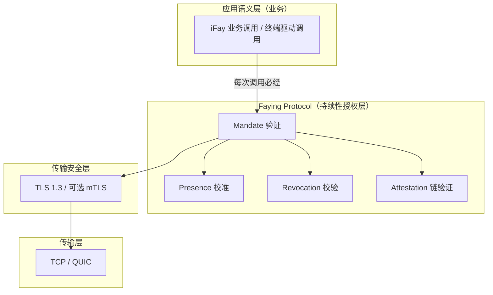
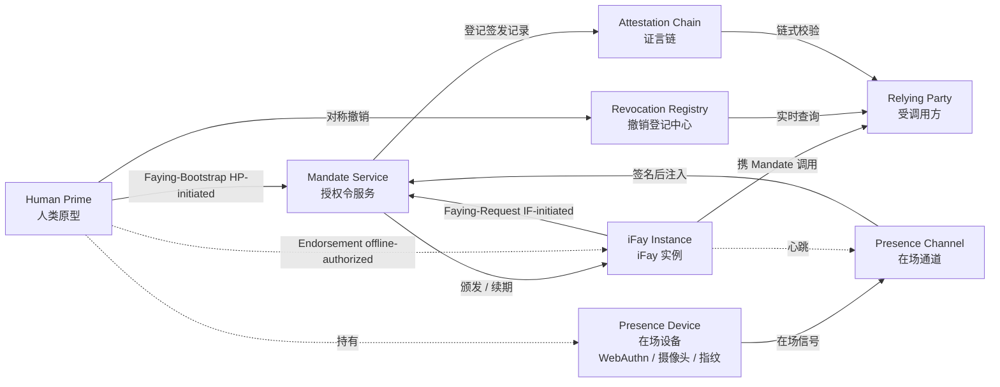
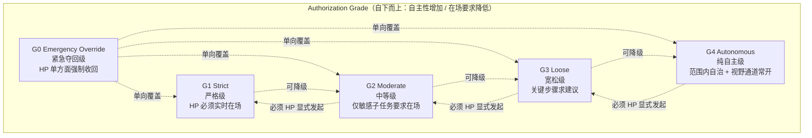
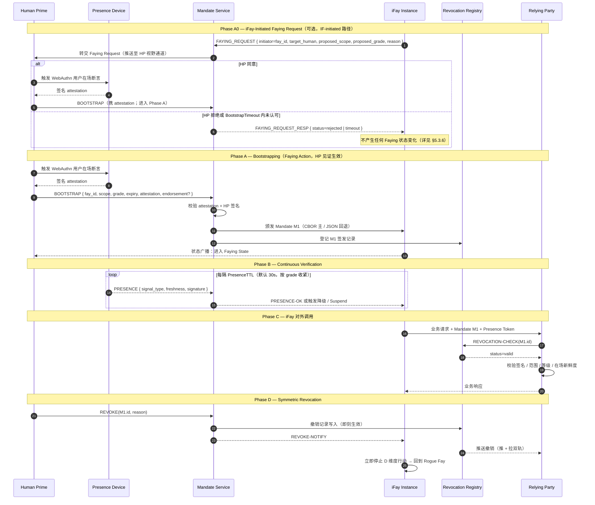

> 协议正文导航：[章节目录](./README.md) ｜ 上一章 [§1 概述](./01-概述.md) ｜ 下一章 [§3 组件与接口](./03-组件与接口.md)

## §2 Architecture

本章从架构视角说明 Faying Protocol 长什么样：

- **§2.1 协议栈定位**：刻画 Faying Protocol 在 TLS 1.3 之上、业务语义之下的层次位置，明确"每一次 iFay 对外行为必经 Mandate 校验闸门"这一硬约束；
- **§2.2 实体关系**：列出协议涉及的 7 类实体及其职责边界，并给出双向 Faying 边（HP-initiated / IF-initiated）与离线背书边（Endorsed Mandate）；
- **§2.3 授权等级层次**：以 G0–G4 五档等级在自主性 / 在场要求两个维度上的相对位置呈现等级谱与切换方向；
- **§2.4 核心交互时序**：把 BOOTSTRAP（含 Phase A0 IF-initiated 路径）+ Continuous Verification + Action + Symmetric Revocation 串为一条端到端时序，作为后续章节（§5 报文 / §7 等级 / §8 生命周期 / §10 错误处理）的视觉锚点；
- **§2.5 设计原则**：陈述协议层必须始终遵循的 6 项设计原则（Default-Deny / Least-Privilege / Continuous-Verification / Auditable-by-Construction / Human-Override / Graceful-Degradation）。

> **EARS 追溯说明**：本章每条架构级硬约束后以 `Trace:` 列出其对应的 EARS 子条款编号（出处见本规范需求基线），形式为 `R<requirement>.<criterion>.<clause>`。
>
> **术语对齐**：本章出现的实体名（Human Prime / iFay Instance / Presence Device / Mandate Service / Presence Channel / Attestation Chain / Revocation Registry / Relying Party 等）与附录 A 术语对齐速查表完全一致；当本章与附录 A 在术语上出现任何歧义时，以**附录 A 为准**。

### §2.1 协议栈定位

**设计立场**：Faying Protocol 不取代 TLS，亦不重新发明 OAuth；它在 TLS 之上、业务语义之下，强制把**每一次 iFay 对外行为**经过 Mandate 校验闸门。任何绕开 Faying Protocol 闸门的对外调用即视为 Rogue Action，必须在传输层之上、业务层之下的中间件被拒绝。

**协议层硬约束**：

- **A-Stack-1（每次调用必经四元校验）**：Relying Party 在接受任意一次来自 iFay Instance 的对外调用前，必须依次完成 Mandate 验证 / Presence 校准 / Revocation 校验 / Attestation 链验证四项校验；任一缺失即视为绕开闸门的 Rogue Action 并按 Default-Deny 拒绝。
  - **Trace**：`R2.1.1`（无 Mandate 默认拒绝）、`R2.1.2`（scope 校验）、`R2.1.3`（字段缺失即拒绝）、`R2.1.4`（RR 不可达即按 Default-Deny 拒绝）。
- **A-Stack-2（信道与授权层职责分离）**：信道机密性与对端身份由 TLS 1.3 / 可选 mTLS 承担，Faying Protocol 不重做；Faying Protocol 仅负责"持续性授权"语义，不在协议层引入与 TLS 重合的握手或密钥协商职责。

### §2.2 实体关系

**双向 Faying 边说明**：

- `HP --> MS（Faying-Bootstrap, HP-initiated）`：Human Prime 主动发起 Faying（建立或调整），走 BOOTSTRAP 通道（详见 §5.3.1）。
- `IF --> MS（Faying-Request, IF-initiated）`：iFay Instance 主动向 Human Prime 寻求 Faying，先经 Mandate Service 转交，再由 Human Prime 通过 BOOTSTRAP 响应认可生效（详见 §2.4 Phase A0、§5.3.6 FAYING_REQUEST）。
- `HP -. Endorsement (offline-authorized) .-> IF`：Endorsed Mandate 的背书声明属于离线预授权语义——HP 在 BOOTSTRAP 阶段一次性把 `endorsed_scope` / `endorsed_grade` / `endorsed_lifetime` 显式打包进 Mandate，使 iFay 在物理失联期间仍能在限定范围内自治；该边并非"运行期通信"，而是"Mandate 字段携带的预先承担"（详见 §4.1 `endorsement` 字段、§7.5 Endorsement Grades）。

**实体职责**：

| 实体 | 协议层职责 | 责任 / 权力边界 |
| --- | --- | --- |
| **Human Prime（HP）** | 唯一可发起 Faying Action 的实体；唯一持有撤销权的实体；唯一最终责任承接端 | 任意时刻 iFay 的对外行为可被无歧义归责到一位 HP；任何 Faying 状态变化必须经 HP 给出明确的、不被欺骗的、可验证的认可确认 |
| **iFay Instance（IF）** | 被监护的代理实体，由 FayID 唯一标识；每次对外调用必须出示有效 Mandate；可主动向 HP 寻求 Faying（FAYING_REQUEST）或请求断开 Faying | 不拥有撤销自身 Mandate 的权力；不存在自主发起 grade 升级的合法路径；FAYING_REQUEST 的生效以 HP 明确认可确认为前提 |
| **Presence Device（PD）** | 承载 WebAuthn / FIDO2 凭据、生物识别能力的硬件；在场信号的物理源头 | 每条 Presence Signal 必须由 PD 签名，并携带 `nonce + produced_at + device_attestation`；新鲜度窗口由对应 Mandate 的 `presence_req.max_staleness_ms` 给定，不由信号自带 |
| **Mandate Service（MS）** | 代表 HP 颁发 / 续期 / 降级 / 撤销 Mandate 的逻辑服务 | 不存在"MS 自我决定 bootstrap"或"MS 替 HP 完成 Faying 认可确认"的合法路径；MS 不可达时按 Default-Deny 收敛 |
| **Presence Channel（PC）** | 从 PD 到 MS 的低延迟、抗重放在场流；同时承担 §3.5 Liveness Channel 的底层信号源 | nonce 单次消费；超出对应 Mandate 的 `presence_req.max_staleness_ms` 即视为 stale；同 nonce 在 `2 × max_message_lifetime` 内至多被接受一次 |
| **Attestation Chain（AC）** | HP → MS → IF → 派生 IF 的全部签发动作形成的可逆向追溯签名链 | 链上每节点必须由父节点签名且时间戳 ∈ 父节点 validity window；任一节点缺失或签名无效即视为整链不可信 |
| **Revocation Registry（RR）** | 实时撤销状态服务（OCSP-like 短轮询 + 主动推送 + 保守 fallback） | 撤销可见延迟 ≤ `RevocationVisibilityBudget`；RR 不可达且 ≥ `StaleBudget` 时 RP 必拒绝（不允许"乐观放行"） |
| **Relying Party（RP）** | 受 iFay 调用的终端、应用或服务 | 在每次调用时强制校验四元（Mandate / Presence / Attestation / Revocation），任一不通过即拒绝 |

**协议层硬约束**：

- **A-Ent-1（责任承接端唯一）**：任意一次被 RP 接受的对外调用，其 Mandate 的 Attestation Chain 根节点恰好对应一个 Human Prime；多 issuer 并存时按 `E_PROTOCOL` 拒绝。
  - **Trace**：`R1.1.1`（AC 根节点恰好对应一个 HP）、`R1.1.2`（多 Mandate 同时 Active 时被选中的 Mandate 与并存 Mandate 的 issuer 必须为同一 HP）、`R1.1.3`（issuer 不一致即 `E_PROTOCOL` 拒绝并写入 AC + 推送 HP 视野）。
- **A-Ent-2（无 Faying 即 Rogue Fay）**：iFay Instance 在任意时刻的行为状态属于二元集合 `{Faying State, Rogue Fay}`；不存在第三种状态，亦不存在"既非 Faying 又非 Rogue"的灰区。
  - **Trace**：`R1.1.4`（audit-log 五元组还原责任承接端，蕴含状态二元性的可观测性；该子条款属于本任务声明的 Requirement 集合内）。

### §2.3 授权等级层次

**核心规则**：

- **降级**（G_ST → G_MO → G_LO → G_AU）允许在 Mandate 内置规则下由协议自动触发（如在场信号丢失 → 自动降级为更严格的等级；注意：丢失在场 → "更严格"意味着 G_AU → G_LO 等"反方向"，详见 §7）。
- **升级**（自主性更高方向）必须由 HP 显式发起新一轮 Faying Action，不允许 iFay 或 MS 自主升级。
- **G0 Emergency Override** 永远可由 HP 单方面发起，覆盖任何当前等级，立即将 iFay 推入 Suspended，等待人工核查。

**协议层硬约束**：

- **A-Grade-1（升级方向必带 HP 见证）**：当 GRADE_SWITCH 的 `target_grade.autonomy > current_grade.autonomy` 时，请求中必须携带可验证的 `human_witness`（默认形态为 WebAuthn 用户在场断言）；缺失或验签失败一律 `E_HUMAN_WITNESS_REQUIRED`。
  - **Trace**：`R6.1.1`（升级方向必带 HP 见证）、`R6.1.2`（缺失或验签失败 → `E_HUMAN_WITNESS_REQUIRED`）。
- **A-Grade-2（在场丢失方向单调收紧）**：在场信号丢失时下一次状态转换迁移到 `Degraded(grade')` 或 `Suspended`，且 `grade'.autonomy < current.autonomy`；禁止维持原 grade，禁止切换到自主性更高的方向。
  - **Trace**：`R5.2.1`（迁移到更严的 grade'）、`R5.2.2`（不维持 / 不反向乐观）。
- **A-Grade-3（G0 优先级最高且仅 HP 可发起）**：G0 Emergency Override 在任意当前 grade 与任意当前事件队列上以最高优先级处理；仅 HP 可显式发起，IF / MS / SA 自发起的 G0 一律 `E_PROTOCOL`。
  - **Trace**：`R6.2.1`（G0 最高优先级）、`R6.2.4`（仅 HP 可发起 G0）。

### §2.4 核心交互时序（Bootstrap + Heartbeat + Action）

**Phase A0 关键约束**：

- iFay 主动发起的 FAYING_REQUEST 不直接产生 Mandate；MS 仅作为转交方，将请求推送至 HP 视野通道。
- HP 的认可必须以 BOOTSTRAP 报文 + 可验证 attestation 形态出现；不存在"MS 替 HP 默认同意"的合法路径。
- 若 HP 在 `BootstrapTimeout`（默认 60s，详见附录 B）内未给出明确认可确认，MS 必须以 `FAYING_REQUEST_RESP { status=timeout }` 返回，并将事件写入 Attestation Chain；同时该 FAYING_REQUEST 必须以 `E_FAYING_REQUEST_NOT_CONFIRMED`（错误码 1014）的形式被记录。
- 详见 §5.3.6 FAYING_REQUEST / FAYING_REQUEST_RESP 报文定义与 §5.4 错误码 1014。

**协议层硬约束**：

- **A-Seq-1（HP 见证不可替代）**：Phase A0 / Phase A 中的 BOOTSTRAP 必须携带可验证的 `human_witness`；不存在任何由 IF / MS / SA 替代 HP 完成 Faying 认可确认的合法路径。
  - **Trace**：`R1.3.1`（HP 主动发起须出示可验证的明确认可确认）、`R1.3.2`（IF-initiated 路径仅在 HP 明确认可后生效）、`R1.3.5`（不提供任何由 IF / MS / SA 替代 HP 完成认可确认的合法路径）。
- **A-Seq-2（IF-initiated 超时不产生状态变化）**：iFay 主动发起的 FAYING_REQUEST 若未在 `BootstrapTimeout` 内获 HP 明确认可即过期或被拒，不产生任何 Faying 状态变化；事件无论生效与否均写入 Attestation Chain。
  - **Trace**：`R1.3.3`（`BootstrapTimeout` 内未认可即拒绝且无状态变化）、`R1.3.4`（无论生效与否均写入 AC）。
- **A-Seq-3（Phase D 对称撤销）**：HP 通过 MS 发起的 REVOKE 一旦 publish，对所有后续 RP 的 query 在不超过 `RevocationVisibilityBudget`（默认 1s）内必须返回 `revoked`；MS 同步向已订阅的 RP 推送 REVOKE 通知。
  - **Trace**：`R4.1.1`（每条 BOOTSTRAP 入口对应至少一条同等可达的 REVOKE 入口）、`R4.1.2`（REVOKE 路径深度 ≤ BOOTSTRAP 路径深度）、`R4.1.3`（REVOKE 入口认证强度不严于 BOOTSTRAP）。
- **A-Seq-4（HP 视野通道必达）**：Phase A0 转交、Phase A 状态广播、Phase D REVOKE 通知必须经由 HP 视野通道发布；任何状态迁移在迁移完成后必须对 HP 可见。
  - **Trace**：`R3.3.1`（Mandate 状态迁移在迁移完成后向 HP 视野通道发布）。

### §2.5 设计原则

下表给出 Faying Protocol 在协议层必须始终遵循的 6 项设计原则。每项原则给出**协议层落地形态**与**对应 EARS 子条款**两栏，确保原则不停留在标语层面。

| 原则 | 协议层落地 | 对应 EARS 子条款 |
| --- | --- | --- |
| **Default-Deny** | 无 Mandate 一律拒绝；Mandate 范围 / 等级 / 时间窗任一缺失即拒绝；RR 不可达且 ≥ `StaleBudget` 时按 Default-Deny 拒绝 | `R2.1.1`、`R2.1.2`、`R2.1.3`、`R2.1.4` |
| **Least-Privilege** | Mandate 必须显式声明 `scope`，禁止"全权委托"；`scope.actions` 协议层禁止使用通配符 / 前缀匹配；派生时 `child.scope ⊆ parent.scope` 严格收敛 | `R2.1.2`、`R2.1.3` |
| **Continuous-Verification** | 每次调用必走 Presence + Revocation 双校验，不缓存信任；`PresenceState.last_freshness ≥ now − max_staleness_ms` 是接受调用的前置条件；以新鲜度而非心跳轮询周期作为放行依据 | `R5.1.1`、`R5.1.2`、`R5.1.3`、`R5.1.4` |
| **Auditable-by-Construction** | 所有 Faying Action / Revoke / Grade-Switch / Delegate 必须落入 Attestation Chain；任一审计事件未入链即视为不可信；HP 视野通道必达 | `R3.3.1`（HP 视野通道必达） |
| **Human-Override** | G0 Emergency Override 永远具有最高优先级；仅 HP 可显式发起 G0；IF / MS / SA 自发起的 G0 一律 `E_PROTOCOL`；G0 处理后目标 Mandate 必为 Suspended | `R6.2.1`、`R6.2.2`、`R6.2.3`、`R6.2.4` |
| **Graceful-Degradation** | 在场信号丢失 → 自动降级为更严格等级，禁止"反向乐观"；G4 心跳丢失直接 → Suspended；`Degraded` 超过 `MaxDegradedDuration` 必 → Suspended | `R5.2.1`、`R5.2.2`、`R5.2.3`、`R5.2.4` |

**原则间相互关系**：

- **Default-Deny ∧ Least-Privilege** 共同收敛"放行集合"：Default-Deny 把缺省状态收敛为"拒绝"，Least-Privilege 把允许集合收敛为"显式 scope ∩ 显式 grade ∩ 显式 presence_req"的最小三元组；两者构成 Faying Protocol 的"安全基线"。
- **Continuous-Verification ∧ Graceful-Degradation** 共同维持"运行期等级谱单调性"：前者使每次调用都基于"当下仍新鲜"的事实，后者保证在场丢失方向上 grade 永远向更严的方向收紧而非反向。
- **Auditable-by-Construction ∧ Human-Override** 共同保障"事后可还原 + 实时可夺回"：前者使任意一次 Faying Action / Revoke / Grade-Switch 可被独立第三方还原，后者使 HP 在任意时刻都能以 G0 形态把控制权收回。

> **原则不可被弱化**：上述 6 项设计原则是协议正文的**规范级承诺**，任何参考实现 / SDK / 互操作合规测试套件都不得以"工程便利"为由弱化其中任一原则；如需在未来版本调整，必须经协议委员会按 §11 Open Questions 所述的决议流程审批，并以新版本号（不再是 Faying Protocol/1.0）发布。

