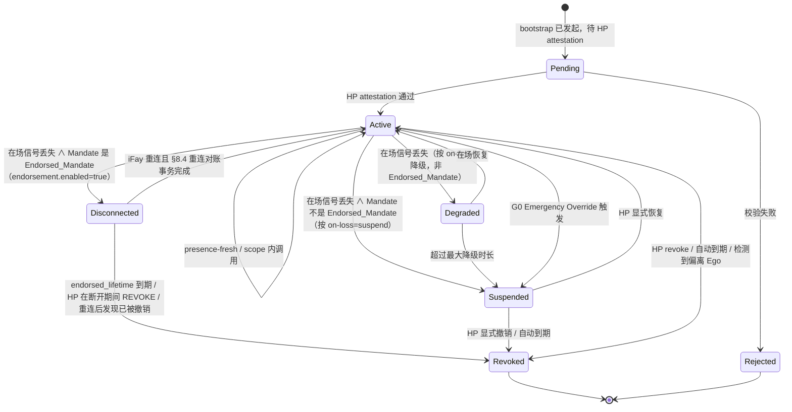

> 协议正文导航：[章节目录](./README.md) ｜ 上一章 [§3 组件与接口](./03-组件与接口.md) ｜ 下一章 [§5 协议报文](./05-协议报文.md)

## §4 Data Models

本章定义协议的核心数据模型，分三节：

- **§4.1 TypeScript 人读视图（Non-normative）**——面向协议委员会、SDK 实现者与审阅者的人读骨架；
- **§4.2 CDDL 权威定义（Normative）**——CBOR 主格式的权威 schema，所有线上字节均以本节为准；
- **§4.3 Mandate 状态机**——含 `Disconnected` 状态、迁移触发条件矩阵与「Mandate 状态 ↔ Fay 行为状态」映射表。

> **权威性声明**：当 §4.1 的 TypeScript 视图与 §4.2 的 CDDL 出现任何不一致，**以 §4.2 CDDL 为准**。§4.1 仅用于人读，不进入线上签名输入；§4.2 的 Deterministic CBOR 编码是签名输入的唯一来源（详见 §6 Cryptography）。
>
> **Endorsement 字段不可篡改性**：`endorsement` 子结构作为 `mandate` 的字段进入签名输入，对其任一子字段（`enabled` / `endorsed-scope` / `endorsed-grade` / `endorsed-lifetime-ms` / `offline-revocation-policy`）的事后篡改都会破坏 Mandate 签名校验（与 Requirement 11.1 第 3 条、§6.3 一致）。

### §4.1 核心类型（TypeScript 视图，Non-normative）

下方 TypeScript 块以人读形式给出 FayID / Grade / Scope / Mandate / Endorsement / PresenceRequirement / PresenceSignal / Attestation 等核心类型；权威定义见 §4.2。

```typescript
type FayID = string          // 形如 "fay:01HX...Z" 的 ULID-like
type HumanPrimeID = string   // 形如 "hp:..."（可锚定到 WebAuthn credentialId）
type MandateID = string      // ULID
type Nonce = Uint8Array      // 16 bytes random

/** 授权等级 */
enum Grade {
  EmergencyOverride = 0,  // G0
  Strict            = 1,  // G1
  Moderate          = 2,  // G2
  Loose             = 3,  // G3
  Autonomous        = 4   // G4
}

/** 授权范围（least-privilege） */
interface Scope {
  domains:    string[]    // 允许访问的资源域（URL pattern / SPIFFE-ID-like）
  actions:    string[]    // 允许的动作（read / write / control:drone:takeoff …）
  terminals?: string[]    // 允许的终端集合（Phase 2 派生用）
  budget?:   ResourceBudget
}

interface ResourceBudget {
  time_window:    [IsoTime, IsoTime]
  max_invocations?: number
  max_cost_units?:  number  // 抽象资源单元（金额 / 推理量 / 流量等）
}

/** Mandate（替代 token） */
interface Mandate {
  version:       "Faying Protocol/1.0"
  id:            MandateID
  issued_at:     IsoTime
  not_before:    IsoTime
  not_after:     IsoTime          // 必须有限：无限期 Faying 是反模式
  issuer:        HumanPrimeID     // HP（也可以是其授权的 MS）
  ms_id:         string           // 实际签发的 MS
  subject:       FayID            // 被授权的 iFay
  scope:         Scope
  grade:         Grade
  presence_req:  PresenceRequirement
  parent?:       MandateID        // 派生时指向父 Mandate
  endorsement?:  Endorsement      // 可选：背书式授权（Endorsed Mandate）
  attestation:   Attestation
  signature:     SignatureBundle  // 见 §6
}

/** 背书式授权（Endorsed Mandate）—— 离线自治的预先承担
 *
 * 当且仅当 `enabled = true` 时，iFay 在物理 Faying 状态断开期间
 * 仍可在 endorsed_scope ⊆ scope、endorsed_grade.autonomy ≤ grade.autonomy
 * 范围内自治；endorsed_lifetime 必须有限。责任承接端始终为 issuer（Human Prime）。
 */
interface Endorsement {
  enabled:                    boolean
  endorsed_scope:             Scope        // ⊆ Mandate.scope
  endorsed_grade:             Grade        // .autonomy ≤ Mandate.grade.autonomy
  endorsed_lifetime_ms:       number       // ≤ (not_after - not_before)
  offline_revocation_policy:  "stop-and-audit" | "stop-only" | "graceful-stop"
}

/** Scope.actions 注释：协议层禁止使用通配符 / 前缀匹配（参见 §9 T2 Atomic_Action 强约束）。 */

/** 在场要求（绑定到 grade） */
interface PresenceRequirement {
  signal_types:   PresenceSignalType[]
  max_staleness_ms: number     // 超过即触发降级
  on_loss:        OnLossPolicy // "downgrade-to:G2" | "suspend" | "emergency-override"
}

/** 在场信号 */
interface PresenceSignal {
  mandate_id:     MandateID
  signal_type:    PresenceSignalType
  produced_at:    IsoTime
  nonce:          Nonce
  device_id:      string
  device_attestation: Attestation
  signature:      SignatureBundle
}

/** 证言（统一的可验证断言载体） */
interface Attestation {
  format:        "webauthn" | "tpm-quote" | "platform-keystore" | "self-signed"
  payload:       Uint8Array       // 各 format 自描述
  signer:        string           // public key id
  signature:     SignatureBundle
}
```

### §4.2 CDDL（CBOR 主格式，权威定义）

下方 CDDL 块为 Faying Protocol/1.0 线上格式的**权威 schema**。本协议规范的官方测试向量（`vectors/`）与互操作合规测试套件（`conformance/`）均以本节为准；任何实现的 CBOR 字节解码结果必须与本节定义完全一致。

```cddl
; Faying Protocol/1.0 — CBOR Data Definition Language
; Normative; this is the authoritative schema for Faying Protocol/1.0 wire format.
faying-grade = 0..4    ; 0=EmergencyOverride, 1=Strict, 2=Moderate, 3=Loose, 4=Autonomous

scope = {
  domains:    [* tstr],
  actions:    [* tstr],
  ? terminals: [* tstr],
  ? budget:   resource-budget
}

resource-budget = {
  time-window:        [iso-time, iso-time],
  ? max-invocations:  uint,
  ? max-cost-units:   uint
}

iso-time = #6.0(tstr)   ; CBOR tag 0 (RFC 3339 string)

presence-signal-type =
  "webauthn-uv-fresh" /
  "face-continuous"   /
  "fingerprint-tap"   /
  "presence-heartbeat-only" /
  "intent-ticket"

presence-requirement = {
  signal-types:        [+ presence-signal-type],
  max-staleness-ms:    uint,
  on-loss:             tstr            ; "downgrade-to:Gx" | "suspend" | "emergency-override"
}

attestation = {
  format:    "webauthn" / "tpm-quote" / "platform-keystore" / "self-signed",
  payload:   bstr,
  signer:    tstr,
  signature: signature-bundle
}

signature-bundle = {
  alg:       "Ed25519" / "ES256" / "ML-DSA-65",   ; PQC 协商位
  pubkey:    bstr,
  sig:       bstr,
  ? chain:   [* bstr]                              ; 可选证书链
}

mandate = {
  version:        "Faying Protocol/1.0",
  id:             tstr,
  issued-at:      iso-time,
  not-before:     iso-time,
  not-after:      iso-time,
  issuer:         tstr,        ; Human Prime ID
  ms-id:          tstr,
  subject:        tstr,        ; FayID
  scope:          scope,
  grade:          faying-grade,
  presence-req:   presence-requirement,
  ? parent:       tstr,
  ? endorsement:  endorsement,
  attestation:    attestation,
  signature:      signature-bundle
}

endorsement = {
  enabled:                       bool,
  endorsed-scope:                scope,         ; 必须 ⊆ 主 Mandate.scope
  endorsed-grade:                faying-grade,  ; 必须 ≤ 主 Mandate.grade（自主性更弱或相等，安全性更高）
  endorsed-lifetime-ms:          uint,          ; 必须 ≤ (mandate.not-after - mandate.not-before)
  offline-revocation-policy:     "stop-and-audit" / "stop-only" / "graceful-stop"
}

presence-signal = {
  mandate-id:           tstr,
  signal-type:          presence-signal-type,
  produced-at:          iso-time,
  nonce:                bstr .size 16,
  device-id:            tstr,
  device-attestation:   attestation,
  signature:            signature-bundle
}
```

> **字段命名映射**：CDDL 使用 `kebab-case`（线上格式约定），TypeScript 视图使用 `snake_case`（人读约定）。两者字段一一对应：`presence-req` ↔ `presence_req`、`endorsed-scope` ↔ `endorsed_scope`、`endorsed-lifetime-ms` ↔ `endorsed_lifetime_ms` 等。

### §4.3 Mandate 状态机



**`Disconnected` 状态语义**：仅适用于 Endorsed_Mandate（即 `endorsement.enabled = true`）。处于该状态时：

- iFay_Instance 仅允许在 `endorsement.endorsed_scope` 内、按 `endorsement.endorsed_grade` 约束执行 D 维度行为；
- 超出 `endorsement.endorsed_lifetime` 立即软超时 → 迁移到 Revoked，即使 iFay 仍处于物理断开；
- HP 在断开期间发起的 REVOKE 在 iFay 重连后立即按 `endorsement.offline_revocation_policy` 处理（默认 `stop-and-audit`）；
- 重连必须经 §8.4 对账事务，禁止「静默续传」。

**迁移触发条件矩阵**（与 §3.5 Liveness Channel、Requirement 11 / 12 联动）：

| 迁移 | 触发条件 |
| --- | --- |
| Active → Degraded | `PresenceState.stale=true` ∧ Mandate 不是 Endorsed_Mandate ∧ `on-loss = "downgrade-to:Gx"` |
| Active → Disconnected | `PresenceState.stale=true` ∧ Mandate 是 Endorsed_Mandate（`endorsement.enabled=true`） |
| Active → Suspended | `PresenceState.stale=true` ∧ Mandate 不是 Endorsed_Mandate ∧ `on-loss = "suspend"` |
| Disconnected → Active | iFay 重连且 §8.4 重连对账事务完成（含 Presence 恢复 / 待处理 REVOKE / GRADE_SWITCH 全部对齐） |
| Disconnected → Revoked | `endorsed_lifetime` 到期 ∨ HP 在断开期间 REVOKE ∨ 重连发现已被撤销 |

**Mandate 状态 ↔ Fay 行为状态映射**（与第 13 章 A/B/C/D 维度对齐）：

| Mandate 状态 | 等价的 Fay 行为状态 | D 维度（对外行动） |
| --- | --- | --- |
| Pending | Rogue Fay | 禁止 |
| Active | Faying State | 允许（在 scope 内） |
| Degraded | Faying State（受限） | 仅允许当前降级等级 scope 内 |
| Disconnected | Faying State（endorsed-only） | 仅允许 `endorsement.endorsed_scope` 内、按 `endorsement.endorsed_grade` 约束（详见 §7.5 / §8.4） |
| Suspended | Faying State 暂停 | 禁止，但保持 Mandate 可恢复 |
| Revoked | Rogue Fay | 禁止 |
| Rejected | Rogue Fay | 禁止 |

