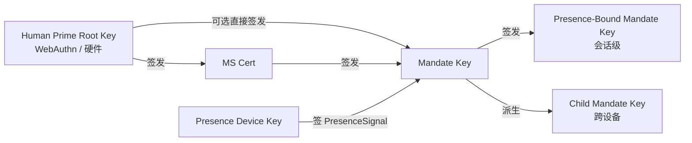

> 协议正文导航：[章节目录](./README.md) ｜ 上一章 [§5 协议报文](./05-协议报文.md) ｜ 下一章 [§7 授权等级](./07-授权等级.md)

## §6 Cryptography

本章规定协议的密码学部分，分三节：

- **§6.1 算法套件**：默认 / 备选 / PQC 三档算法协商表与协商规则；
- **§6.2 密钥派生与角色**：从 Human Prime Root Key 到 Presence-Bound Mandate Key 的派生关系与硬约束；
- **§6.3 签名格式**：detached signature、Deterministic CBOR 签名输入、多签链以及 Endorsed_Mandate 的签名输入锚点。

> **EARS 追溯说明**：本章每条规则后以 `Trace:` 列出其对应的 EARS 子条款编号（出处见本规范需求基线），形式为 `R<requirement>.<criterion>.<clause>`。

### §6.1 算法套件

| 用途 | 默认 | 备选 | PQC 协商位 |
| --- | --- | --- | --- |
| 签名（Mandate / Presence / Attestation） | **Ed25519** | ECDSA-P256 | ML-DSA-65（FIPS 204） |
| 哈希 | **SHA-256** | BLAKE3 | SHA3-256 |
| 派生（KDF） | HKDF-SHA-256 | — | HKDF-SHA3-256 |
| 对称（如启用 Mandate stapling 加密） | ChaCha20-Poly1305 | AES-256-GCM | — |
| 信道层 | TLS 1.3 mandatory | mTLS optional | TLS-1.3-PQ（hybrid X25519 + ML-KEM-768） |

**协商规则**：

- **N1（双方各自声明）**：客户端与服务端必须在 BOOTSTRAP 时各自声明其所支持的签名、哈希、KDF、对称、信道层算法套件；`SignatureBundle.alg`、`hash`、`kdf`、`channel-suite` 的最终值必须是双方共同支持的最强算法。
  - **Trace**：`R8.1.1`（BOOTSTRAP 时各自声明所支持算法套件）、`R8.1.2`（选择双方共同支持的最强算法作为最终值）。

- **N2（最低实现集合）**：所有兼容实现必须至少同时支持签名算法集合 `{Ed25519, ECDSA-P256}`；PQC 套件作为 OPTIONAL 但所有实现必须保留协商位以便未来滚动升级。
  - **Trace**：`R8.1.3`（至少同时支持 `{Ed25519, ECDSA-P256}`）、`R8.2.3`（PQC 套件被标记为 `MUST` 之前实现为 `OPTIONAL`，且不得因对端不支持 PQC 而拒绝 BOOTSTRAP）。

- **N3（无共同套件 → `E_PROTOCOL`）**：若双方在 BOOTSTRAP 时不存在任一共同支持的签名算法或哈希算法，Mandate_Service 必须以 `E_PROTOCOL` 拒绝该次 BOOTSTRAP。
  - **Trace**：`R8.1.4`（无共同算法时以 `E_PROTOCOL` 拒绝 BOOTSTRAP）。

- **N4（PQC 协商位预留与可滚动升级）**：`Mandate.signature_bundle` 必须提供算法位以支持 `ML-DSA-65`（FIPS 204）作为可选签名算法；BOOTSTRAP 协商位中必须预留对 `TLS-1.3-PQ`（hybrid X25519 + ML-KEM-768）的可选支持；协议必须允许在生命周期内通过版本协商将默认算法套件滚动升级，且不破坏既有 Mandate 的可校验性。
  - **Trace**：`R8.2.1`（`Mandate.signature_bundle` 提供 `ML-DSA-65` 算法位）、`R8.2.2`（BOOTSTRAP 协商位预留 `TLS-1.3-PQ`）、`R8.2.4`（版本协商滚动升级且不破坏既有 Mandate 可校验性）。

### §6.2 密钥派生与角色

下图给出 Faying Protocol 的密钥派生层次与角色关系：HP Root Key 永远不离开人类持有的硬件，仅授权 MS Key 与（在受限路径下）Mandate Key；Mandate Key 在签发 Presence-Bound 与 Child Mandate Key 时建立短寿命会话密钥，Presence_Device Key 仅用于签 PresenceSignal。



**关键约束**：

- **K1（HP Root Key 的硬件锚定）**：HP Root Key 永远不离开人类持有的硬件（WebAuthn authenticator / 平台 keystore / 硬件钱包）；任何要求 HP Root Key 离开硬件的密码学路径在协议层不存在。
  - **Trace**：`R9.2.4`（每个 Mandate 使用独立的、短寿命的会话签名密钥——蕴含根密钥与会话密钥分离的密钥层次约束）、`R8.1.3`（最低实现集合的硬件可承载性）。

- **K2（撤销链的方向性）**：MS Key 的撤销由 HP Root Key 直接执行；MS 自己不能撤销自己。该约束保证撤销可达性的根锚定在 HP，而非 MS 自身。
  - **Trace**：`R9.2.4`（Presence-Bound Mandate Key 在每次 GRADE_SWITCH 时强制 rotate——蕴含 MS 不可自我撤销根密钥的反向约束）。

- **K3（每 Mandate 独立会话密钥）**：每个 Mandate 拥有独立的会话签名密钥（避免长寿命密钥被滥用）；Presence-Bound Mandate Key 在每次 GRADE_SWITCH 时强制 rotate。
  - **Trace**：`R9.2.4`（每个 Mandate 使用独立的、短寿命的会话签名密钥；每次 GRADE_SWITCH 强制 rotate Presence-Bound Mandate Key）。

- **K4（设备绑定的派生路径）**：Child Mandate Key 必须绑定到目标设备的 `device_id` 与 `device_attestation`；任何"复制 Mandate 到另一终端直接使用"的路径必须被拒，要求其改走 DELEGATE 流程。
  - **Trace**：`R9.2.1`（颁发时绑定 `device_id` 与 `device_attestation`）、`R9.2.2`（在另一终端上使用同一 Mandate 必须改走 DELEGATE）。

- **K5（Channel Binding）**：当 mTLS 被启用时，Mandate 必须携带由 [RFC 9266](https://www.rfc-editor.org/rfc/rfc9266) 定义的 TLS Exporter 通道绑定值，且 Relying_Party 必须在校验阶段比对该值。
  - **Trace**：`R9.2.3`（mTLS 启用时携带 RFC 9266 TLS Exporter 通道绑定，且 RP 必须比对）。

### §6.3 签名格式

**S1（Detached signature）**：全部使用 detached signature——CBOR `signature_bundle` 与 payload 分离，便于审计与重签。`signature_bundle` 不得内嵌 payload 自身或其副本。
- **Trace**：`R10.2.2`（detached signature，`signature_bundle` 与 payload 分离）。

**S2（签名输入的规范化定义）**：所有签名对象必须按 [RFC 8949 §4.2.1 Deterministic Encoding](https://www.rfc-editor.org/rfc/rfc8949#section-4.2.1) 规则排序后再签名；签名输入必须计算为：

> `signature_input = H( Deterministic-CBOR( Envelope_without_signature ) )`

其中 `H` 即协商最终的哈希算法（默认 SHA-256，备选 BLAKE3，PQC 协商位 SHA3-256），`Envelope_without_signature` 表示从 `Faying Protocol Envelope` 中剔除 `signature_bundle` 字段后的剩余结构。**该公式适用于本协议中所有需要签名的对象**（含 Mandate、PresenceSignal、Faying Protocol Envelope 自身），并使签名输入不依赖 JSON 序列化的歧义——CBOR 与 JSON 两种编码下的签名输入哈希必须相同。

- **Trace**：`R10.2.1`（按 RFC 8949 §4.2.1 Deterministic Encoding 规则排序后再签名）、`R10.2.4`（签名输入为 `H( Deterministic-CBOR(Envelope_without_signature) )`）、`R10.1.4`（签名前先做 Deterministic CBOR 序列化使签名输入不依赖 JSON 序列化的歧义）。

**S3（多签链）**：在多签场景下（如 DELEGATE 需父 Mandate 副签），父链签名通过 `signature_bundle.chain` 数组承载；链元素的顺序为「子 → 父 → 父之父 → … → 根」，且每个链元素自身亦遵循 S2 的签名输入规范化。
- **Trace**：`R10.2.3`（多签场景下通过 `signature_bundle.chain` 数组承载父链签名）。

**S4（Endorsed_Mandate 签名输入锚点）**：当 Mandate 携带 `endorsement` 字段（无论 `enabled` 真值），`endorsement` 的全部子字段——

```
(enabled, endorsed_scope, endorsed_grade, endorsed_lifetime_ms,
 offline_revocation_policy)
```

——必须进入签名输入。即 `H( Deterministic-CBOR(Mandate_without_signature) )` 计算时**不得排除** `endorsement` 子树。该规则与 P16.1（Endorsement_Signature_Inclusion）一致。

任何对 `endorsement` 字段的事后篡改（含将 `enabled` 由 `false` 翻转为 `true`、扩张 `endorsed_scope`、放松 `endorsed_grade`、延长 `endorsed_lifetime_ms`、修改 `offline_revocation_policy`）都将导致签名校验失败：Relying_Party 以 `E_ATTESTATION_INVALID` 拒绝相关调用，Mandate_Service 以 `E_ENDORSEMENT_INVALID` 拒绝并触发该 Mandate 的 Revoke（详见 §5.4 错误码 1013、§9.7、P16.1）。

- **Trace**：`R11.1.3`（每份 Endorsed_Mandate 的 `endorsement` 字段进入签名输入，使任何事后篡改都会破坏签名校验）、`R11.1.4`（`endorsement` 字段被检测篡改时 RP 以 `E_ATTESTATION_INVALID` 拒绝并由 MS 触发 Revoke）。

**S5（endorsement 字段不可篡改性的推导）**：由 S2 与 S4 联合得出——

1. 由 S4，`endorsement` 子树必须进入 `Deterministic-CBOR(Mandate_without_signature)`；
2. 由 S2，签名输入为 `H(Deterministic-CBOR(Mandate_without_signature))`；
3. 因此对 `endorsement` 任一子字段的修改都将改变 Deterministic CBOR 序列化结果，从而改变签名输入哈希；
4. 由签名验签的密码学性质，原签名在新的签名输入上必校验失败。

故 `endorsement` 字段的不可篡改性由 §6.3 直接推导得出，无需额外协议层机制。**该不可篡改性是 Endorsed_Mandate 责任归属链（详见 §11.4 与 P16.5）的密码学基石**：任何对 endorsement 的事后篡改都将在签名校验阶段被立即发现，从而切断"通过篡改背书声明逃避责任承接"的所有可能路径。

- **Trace**：`R11.1.3`（事后篡改破坏签名校验）、`R10.2.4`（签名输入定义）、`R11.1.4`（篡改被发现时的协议层处置）。

