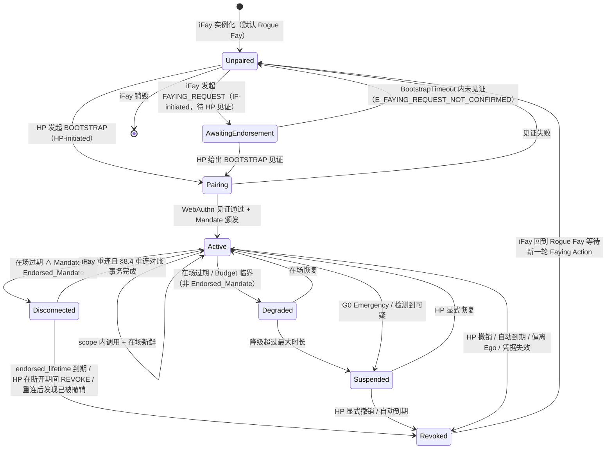
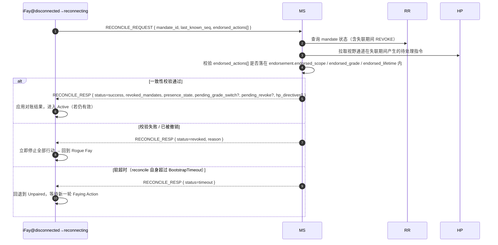

> 协议正文导航：[章节目录](./README.md) ｜ 上一章 [§7 授权等级](./07-授权等级.md) ｜ 下一章 [§9 安全考量](./09-安全考量.md)

## §8 Lifecycle

本章讲 iFay 的完整生命周期：从实例化、发起 Faying Action、维持 Faying State，到降级、失联、暂停、撤销，最后回到 Rogue Fay。这套状态机承载了协议层的核心不变式——对外行动是否合法、责任端是否唯一、失联期间能自治到什么边界，都由本章定义。

### §8.1 完整生命周期状态机

下图覆盖协议层 7 个状态闭包（**Unpaired / Pairing / Active / Degraded / Disconnected / Suspended / Revoked**）以及它们之间的全部合法迁移。`AwaitingEndorsement` 是 IF-initiated 双向 Faying 路径上的中间临时态（详见 §2.4 / §5.3.6），不构成"行动可执行"的稳定闭包，但仍出现在状态图中以保证迁移图完备。

> 与 §4.3 Mandate 状态机的关系：§4.3 描述 *Mandate 对象* 的状态（Pending / Active / Degraded / Disconnected / Suspended / Revoked / Rejected），本节描述 *iFay 实体* 的生命周期状态。两者通过"Active/Degraded/Disconnected Mandate ⇔ Faying State / endorsed-only Faying State"映射衔接；详见 §4.3 末尾的"Mandate 状态 ↔ Fay 行为状态映射"表。

### §8.2 阶段语义

下表给出 7 个状态闭包的语义。每个状态在"对外行动（D 维度）"列上的取值即为协议层的 D 维度准入决策。

- **Unpaired**：与蓝图 Rogue Fay 等价。仅允许 A1–A4（自我感知）、B1–B3（对内表达）、C1–C2（对人单向沟通，含 FAYING_REQUEST 发起）维度行为。D 维度一律禁止。

> **Rogue Fay 的精确判定（重要）**：连接断开本身**不等于** Rogue Fay。一个 iFay 被认定为 Rogue Fay，当且仅当满足下列两类情形之一：（1）**断开连接且不存在任何明确授权**——即没有任何处于 `Active / Degraded / Disconnected` 的 Mandate 覆盖其当下行为（含从未建立 Faying、Mandate 已撤销 / 过期 / 被暂停）；（2）**已被证明失联**——按 §9.9 被判定为 Perceived-Disconnected（感知失联），且当前 Mandate 不是有效 Endorsed_Mandate（或 `endorsement` 已到期 / `enabled=false`）。
>
> 反过来说：物理连接虽断、但持有**有效 Endorsed_Mandate** 且仍在 `endorsed_scope / endorsed_grade / endorsed_lifetime` 内的 iFay，处于 `Disconnected` 状态，属于 **Faying State（endorsed-only）而非 Rogue Fay**——其断开期间的 D 维度行为由 `Mandate.issuer`（HP）在 BOOTSTRAP 阶段的离线预授权承接（详见 §4.3 / §7.5 / §8.3 / §8.4）。仅当背书寿命到期、被撤销、或对账失败时，该 iFay 才迁移到 Revoked → Unpaired，回到 Rogue Fay。
- **AwaitingEndorsement**：iFay 发起的 FAYING_REQUEST 已转交 HP 视野通道，等待 HP 在 `BootstrapTimeout`（默认 60s）内通过 BOOTSTRAP 给出认可确认；该状态不产生任何 Mandate，对外行动一律禁止；超时即回退到 Unpaired 并写入 Attestation Chain（错误码 1014 `E_FAYING_REQUEST_NOT_CONFIRMED`）。
- **Pairing**：Faying Action 进行中，临时态。必须在 `BootstrapTimeout` 内完成 WebAuthn 见证 + Mandate 签发；失败即回退到 Unpaired，无残留状态。
- **Active**：Faying State 正常运行。存在唯一一个 Active 状态的 Mandate 与之对应；所有 D 维度调用按 `Mandate.scope` 与 `Mandate.grade` 准入。
- **Degraded**：Faying State 仍成立但等级被收紧（在场信号过期触发）。仅适用于**非 Endorsed_Mandate**。持续时长不可超过 `MaxDegradedDuration`（默认按 grade 配置，见附录 B）；超过即迁移到 Suspended。
- **Disconnected**：Faying State 仅在 `endorsement.endorsed_scope` 与 `endorsement.endorsed_lifetime` 内有效；适用于 Endorsed_Mandate 在物理失联期间的"endorsed-only"行为窗口。具体准入与失联语义详见 §4.3 / §7.5 / §8.4。
- **Suspended**：Faying State 临时挂起。对外行动一律禁止，但 Mandate 元数据保留以便 HP 显式恢复或审计；超过自动到期点即迁移到 Revoked。
- **Revoked**：Mandate 终止。iFay 回到 Rogue Fay；任何后续 D 维度调用必须经过新一轮完整 Faying Action（新 `mandate_id`）。Revoked 是 Mandate 的吸收态（详见 P10）。

### §8.3 责任归属时序

> **任意时刻 IF 的对外行动 → 必须存在唯一一个 Active、Degraded 或 Disconnected 的 Mandate → 该 Mandate 的 `issuer` 即责任承接端。**

本款是协议层"责任承接端唯一性"的形式化时序条款，不存在第三种情形：

1. **不存在合规 Mandate**：没有任何处于 Active / Degraded / Disconnected 的 Mandate ⟹ 不允许对外行动（D 维度被禁），RP 必须返 `E_NO_MANDATE`（1001）或 `E_PRESENCE_STALE`（1005）。
2. **多个合规 Mandate 并存**：协议层强制选择"最具体作用域"的一个，且必须共享同一 `issuer`（HP）；若存在不同 issuer 的多个合规 Mandate，视为协议错误，必须返 `E_PROTOCOL`（1099）。
3. **Disconnected 期间的对外行动**：同样归责于 `Mandate.issuer`（HP）。`endorsement` 仅约束行动可执行的 `endorsed_scope` / `endorsed_grade` / `endorsed_lifetime`，不改变责任承接端；不存在"由 endorsement 把责任转移到 iFay 自己 / MS / Supervisory Agent"的合法路径（详见 P16.5）。

由本款立刻可推得：

- 任何被接受的调用 `c`，其审计五元组 `(mandate_id, endorsement_id?, action, ts, signature_chain)` 中 `signature_chain` 的根节点必为且仅为 `Mandate.issuer`；
- iFay 不存在"自我归责"的合法路径，MS / Supervisory Agent 亦不得以代理见证替代 HP 的 `issuer` 身份；
- 责任承接端在 Mandate 生命周期内不可变更；如需变更必须经撤销 + 新 BOOTSTRAP（新 `mandate_id`、新 `issuer`）。

### §8.4 重连对账（Reconciliation）

> **目的**：把 iFay 在 Disconnected 期间的"endorsed 自治"与协议中心视图（MS / RR / HP 视野通道）的状态变化收敛到一致，并把"重连即可继续行动"作为反模式显式禁止。

#### §8.4.1 流程

#### §8.4.2 对账事务返回内容

事务成功（`status = success`）时，`RECONCILE_RESP` 必须返回以下字段（与 Requirement 12.4 一一对应）：

1. **`revoked_mandates`**：失联期间被撤销的 Mandate 列表（含级联子 Mandate）；
2. **`presence_state`**：当前 PresenceState（用于决定是否可继续 D 维度）；
3. **`pending_grade_switch`**：未完成的 GRADE_SWITCH 事件（如有）；
4. **`pending_revoke`**：未完成的 REVOKE 事件（如有）；
5. **`hp_directives`**：HP 视野通道在失联期间产生的待处理指令（如 G0 Emergency Override、显式 REVOKE、强制降级等）。

#### §8.4.3 事务结局枚举

对账事务的结局为且仅为下列三种之一，与 P17.4 `reconcile_result(M) ∈ {success, revoked, timeout}` 形式化定义一致：

| 结局 | 触发条件 | 后置状态 | 审计要求 |
| --- | --- | --- | --- |
| `success` | 一致性校验通过 ∧ Mandate 仍有效 ∧ 在 BootstrapTimeout 内完成 | Disconnected → Active | 写入 Attestation Chain，含 endorsed_actions 完整审计 |
| `revoked` | endorsed_lifetime 已到期 ∨ HP 在断开期间发起 REVOKE ∨ 重连后发现已被撤销 ∨ endorsed_actions 越界 | Disconnected → Revoked → Unpaired | 写入 Attestation Chain，按 `endorsement.offline_revocation_policy` 处理失联期间审计 |
| `timeout` | 对账事务自身超过 `BootstrapTimeout` 仍未达成 success / revoked | Disconnected → Unpaired | 写入 Attestation Chain，标记 `reason=reconcile-timeout` |

#### §8.4.4 协议层硬约束

- **D 维度禁令**：对账事务未完成前，iFay 禁止任何 D 维度行动；任何在该窗口内到达 RP 的调用必须以 `E_PRESENCE_STALE`（1005）或 `E_REVOKED`（1006）拒绝。该禁令在 `[t_reconnect, t_reconnect + reconcile_complete_ms]` 区间内成立（与 P17.4 一致）。
- **超时即退回 Rogue Fay**：对账事务必须在 `BootstrapTimeout` 内完成；超时即 iFay 退回 Unpaired，等待新一轮 Faying Action（不允许自动重试 BOOTSTRAP）。
- **三种结局必入 AC**：对账事务自身的 `success` / `revoked` / `timeout` 三种结局都必须写入 Attestation Chain，并按 `endorsement.offline_revocation_policy` 处理失联期间的行动审计：
  - `stop-and-audit`（默认）：立即停止 + 提交完整 endorsed_actions 审计 + 退回 Rogue Fay；
  - `stop-only`：立即停止 + 不强制审计（仅适用于不可逆 / 紧急场景，需协议委员会决议）；
  - `graceful-stop`：允许有限收尾（写关闭 / 状态保存）后停止，收尾动作仍受 endorsement 约束。
- **失败回退后不得自重试**：对账事务结局为 `revoked` 或 `timeout` 而回退到 Rogue Fay 时，iFay 不得自行重试 BOOTSTRAP，必须等待 HP 重新发起（HP-initiated）或经 HP 显式认可的新 FAYING_REQUEST（IF-initiated）。
- **静默续传禁止**：禁止任何"重连即继续"的实现路径。任何绕过 §8.4 对账事务直接把 Disconnected 迁移到 Active 的实现，均视为不合规实现，互操作合规测试套件必须将其判定为 fail。

